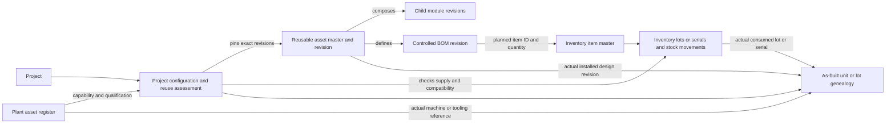

# SSM One Electronics Project Lifecycle and APQP Roadmap

**Document type:** Electronics-specific product-process and requirements reference  
**Version:** 0.5 — Owner review draft  
**Prepared:** 19 October 2026  
**Status:** Supporting domain-specific reference; the active cross-platform authority is [SSM_ONE_MASTER_PLAN.md](../SSM_ONE_MASTER_PLAN.md). The generic SSM One software/product implementation phases are in the [Product Build Roadmap](Feature%20Roadmap/Product%20Build%20Roadmap.md). This file describes the electronics product process and detailed requirements; it does not override the master or claim that planned capabilities are deployed or certified.

## 1. Purpose and reading guide

SSM One is intended to connect customer intake, engineering, procurement, manufacturing, quality, finance, service, people operations, controlled documents, and project lifecycle evidence in one system. This reference preserves the electronics product's operational lifecycle and related rebuild requirements so a team can recreate that domain from an agreed baseline even if the current prototype or implementation is lost.

The plan distinguishes **Confirmed** decisions from **Planned** capabilities, **Proposed** mappings, **Open** owner decisions, and **Historical** implementation evidence. An idea found in an older source is not automatically a current requirement. No sample project value, technical limit, customer signature, test result, certificate, approval, or actual deployment status is created by this plan.

This Markdown file is a supporting detail document. Original planning sources remain in their existing workspace locations; no original source folders were moved. Archived copies have been removed from this curated library to reduce duplication. The review DOCX was deleted by the owner and is not required.

## 2. Authority and configuration control

The hierarchy is:

1. The project-root `SSM_ONE_MASTER_PLAN.md` controls cross-platform product scope, common vocabulary, approved organization model, lifecycle intent, and acceptance criteria.
2. The web/backend and Android implementation plans control platform-specific technical work and must conform to this master.
3. Document standardization, document-control contracts, and the catalogue control type-specific document requirements and known backend boundaries. Their details are incorporated here by reference and summarized below.
4. The [Product Build Roadmap](Feature%20Roadmap/Product%20Build%20Roadmap.md) sequences generic SSM One software/product delivery phases. Those phases are not the electronics product's operational lifecycle stages.
5. Handoffs, review reports, test output, and Antigravity sync ledgers are dated evidence. They do not amend requirements by themselves.
6. Older DOCX and copied plans are source material. Their valid unique requirements are mapped into this reference; conflicts remain listed until resolved.

Every decision or requirement change needs an ID, owner, status, source, rationale, affected lifecycle stage/departments/platforms, effective version, and acceptance evidence. A change to a live project or released document requires impact analysis, authorized review, audit history, and preserved prior revisions. This plan does not replace formal approval or customer-specific requirements.

## 3. Product scope and guiding rules

SSM One covers web portal and backend, Android client, shared operational records and APIs, controlled document workflows, and selected company-wide operations. The system must support project-based and department-based work without duplicating the source of truth.

The verified backend is authoritative for identity, organization membership, project links, permissions, tasks, approvals, official document numbers, revision history, audit events, and private files. A URL role, mock login, local fixture, visible screen, or successful build is not evidence of authentication or an operational business transaction. Web and Android must use the same server-owned contracts and access decisions.

A project master specification is the reviewed, versioned baseline for project scope and technical/commercial requirements. Drafts retain source references and verification state. Missing or conflicting information is shown for resolution; it is never filled from a demo, guessed from a filename, or copied from a different project. Planned work, actual results, approved evidence, and released records are distinct states.

## 4. Company structure, roles, and future growth

### 4.1 Current department registry

The current baseline organization has 12 departments: **SAL** Sales & Business Development; **EHW** Embedded Hardware Engineering; **FW** Firmware Engineering; **SW** Cloud & Application Software; **MECH** Mechanical Engineering; **PUR** Purchasing & Supply Chain; **QA** Quality Assurance; **EMF** Electronics Manufacturing; **MMF** Mechanical Manufacturing; **FIN** Finance; **SIT** Service & IT; and **HR/OPS** Human Resources & Operations.

The 12 departments describe today's structure, not a permanent product limit. Use stable department IDs, display names, aliases, active state, effective dates, lead/owner assignments, capabilities, and scope. New departments can be configured later without rebuilding lifecycle stages or hard-coded platform enums. Renames preserve identity; splits, mergers, and retirement require a governed mapping of records and responsibilities. Historical identifiers remain readable and are not silently reassigned.

Use **FW** and **SW** for active labels and new identifiers. EFW and CSW are transitional legacy aliases; ESW is legacy merged data only. Do not create new active labels or prefixes from these old codes. Ambiguous legacy ownership is quarantined for an authorized decision.

### 4.2 Production boundaries

Production has two manufacturing departments: **EMF** and **MMF**. **MECH** remains mechanical design; MMF is mechanical production. The former **TST/EOL** department is not a separate active department. Production performs assigned test execution; QA controls test criteria, independent quality disposition, nonconformance, and release authority. Preserve old TST records and roster until ownership is explicitly resolved.

For the current scope, PCB assembly/SMT is outsourced; in-house bare-board fabrication, placement, reflow, SPI, and AOI are not planned. PUR coordinates supplier, sourcing, and purchase records; QA defines supplier-quality acceptance and disposition; EHW owns the released design/specification package. EMF receives and traces accepted PCB assemblies, integrates the board into enclosure/box build, installs harnesses/accessories, loads controlled firmware, performs assigned in-line/final checks, packages, and records travelers. MMF performs mechanical fabrication or controlled supplier receipt, finishing, subassembly, and fit/dimensional inspection. EMF/MMF hand off using explicit product and lot references. Any future in-house PCB assembly is a scope change, not an implied feature.

### 4.3 Stage-specific roles and shared services

Keep lifecycle stages independent from departments. A versioned responsibility matrix maps stage, project/product/process applicability, department, role/capability, RACI, and required signer authority. Each project pins the approved matrix version. Later updates apply to new projects by default; an active project changes only through authorized, audited impact review. Historical tasks, evidence, decisions, signers, and project baselines remain unchanged.

Normally each decision/work package has one Accountable owner; multiple Responsible and Consulted roles may participate. Every mandatory gate has an accountable owner and authorized signer, or a documented not-applicable rationale. HR/OPS, FIN, SIT, QA, and future shared teams can contribute horizontally where relevant. HR/OPS examples include workforce capacity, onboarding, competency/training, and safety readiness. Sensitive employee information remains restricted to authorized HR users.

RACI, assignment, and notification never grant read or signing access. Access is separately checked against authenticated membership, project/record scope, and capability. “Informed” permits notification only when the underlying record is already accessible. New departments receive no inherited project, document, team, or approval access by default.

## 5. Project lifecycle and APQP activity crosswalk

### 5.1 Nine-stage project lifecycle

The portal's nine stages are the user-facing project journey. Stage templates are versioned and may support parallel tasks, applicability rules, documented skips, and rework loops. Stage identity and gate intent are stable within a template version; changing stages requires governed versioning and migration review.

| Stage | Name and intent | Example controlled outputs / gate evidence |
|---|---|---|
| 1 | Sales intake and client portal | Enquiry, customer SOR, mNDA, project identity and initial source records |
| 2 | Cross-department feasibility | Contract review, risk/assumption/action register, relevant department feasibility responses, capacity and sourcing review |
| 3 | Requirement freeze and commercial confirmation | Approved project master specification baseline, requirements traceability, quotation/PO or explicit commercial gate decision |
| 4 | Design and development / PoC | Architecture, schematics, firmware/software prototypes, mechanical design, review results and design risks |
| 5 | Pilot build and manufacturing readiness | Outsourced PCBA receipt baseline, EMF/MMF travelers, process flow, PFMEA, control plan, work instructions, tooling and pilot records |
| 6 | Client validation and pre-compliance | Approved DVP&R, planned vs actual testing, sample/configuration, measured results, defect/rework and customer feedback |
| 7 | Production release and PPAP | Released design/BOM, production controls, run-at-rate/capability, PPAP package, customer disposition and production-readiness decision |
| 8 | Type approval and supply readiness / mass-run authorization | Authentic authority certificate where applicable, supplier capacity/PPAP, long-range supply plan, authorized production ramp decision |
| 9 | SOP, production inspection, delivery and feedback | Work orders, traceable lots/serials, final inspection and QA disposition, dispatch, invoicing, warranty/field issues, lessons and change loop |

These labels consolidate the current 9-stage portal flow and source DOCX flow. Exact gate ownership, deliverable applicability, and terminology must be confirmed by accountable process owners. Project examples and demo figures in the source documents are not production facts.

### 5.2 Preserve the complete 37-activity APQP framework

The QMS DOCX's 37 activities are retained as detailed sub-stage/work-package definitions, not deleted or forced to become 37 top-level portal screens. The crosswalk below is a proposed mapping to review and version. APQP phase gates 1–5 remain identifiable; their mapping can span adjacent portal stages where the real process requires it.

| APQP ID | Activity | Proposed portal stage |
|---|---|---|
| HW_01 | Market requirement and RFQ intake | 1 |
| HW_02 | Customer technical requirement review/freeze | 2–3 (split review from approved freeze) |
| HW_03 | Business case and sourcing feasibility | 2 |
| HW_04 | High-level system and hardware architecture | 2–4 (feasibility concept to design baseline) |
| HW_05 | Initial safety and cybersecurity hazard analysis | 2–4, applicability-based |
| HW_06 | Preliminary BOM and sourcing strategy | 2–4 |
| HW_07 | APQP Phase Gate 1 and program approval | 2 |
| HW_08 | Detailed hardware schematic capture | 4 |
| HW_09 | Hardware DFMEA | 4 |
| HW_10 | High-speed PCB layout and routing | 4 |
| HW_11 | Mechanical enclosure and thermal CAD design | 4 |
| HW_12 | DFM/DFA review | 4–5 |
| HW_13 | Prototype hardware component procurement | 4–5 |
| HW_14 | A-sample board assembly and bench bring-up | 4; assembly route requires owner decision and may be outsourced |
| HW_15 | Hardware DVP creation | 4–6 (plan created before test execution) |
| HW_16 | APQP Phase Gate 2 and design freeze | 4 |
| HW_17 | Manufacturing process flow and layout | 5 |
| HW_18 | PFMEA | 5 |
| HW_19 | Pre-launch control plan and work instructions | 5 |
| HW_20 | Production tooling, jigs, fixtures and stencils | 5 |
| HW_21 | MSA plan and execution | 5–7 as applicable |
| HW_22 | B-sample pilot build | 5 |
| HW_23 | B-sample DVP&R functional/environmental tests | 6 |
| HW_24 | APQP Phase Gate 3 and process freeze | 5–6 (gate dependency to confirm) |
| HW_25 | Pilot production / run-at-rate, C-sample | 7 |
| HW_26 | SPC capability evaluation | 7 |
| HW_27 | Environmental/EMC product homologation | 6–8 by test vs authority-approval activity |
| HW_28 | PPAP package assembly | 7 |
| HW_29 | Production control plan and final-line handover | 7 |
| HW_30 | Customer PPAP approval and PSW sign-off | 7–8 depending on customer gate sequence |
| HW_31 | APQP Phase Gate 4 and production readiness | 7 |
| HW_32 | Mass-production SOP and ramp-up | 8–9 |
| HW_33 | Early production containment / safe launch | 9 |
| HW_34 | Post-launch lessons learned and knowledge management | 9 |
| HW_35 | Warranty and field-return 8D | 9 |
| HW_36 | Continuous improvement / VAVE | 9 and continuous |
| HW_37 | Engineering change management (ECN/ECO) | all stages through a controlled change loop |

This mapping is not yet a released process crosswalk. Approve stage-level criteria, deliverables, applicable standards/CSR, evidence, owner and route before implementation. Retain all source activity IDs for traceability even if labels or mappings change.

## 6. Cross-functional business capabilities

The unified system should support these capabilities through shared projects, tasks, documents, and audit identity:

- **Sales and client:** lead/enquiry intake, customer register, RFQ/SOR, NDA/agreement routing, clarification requests, contract review, proposal/quotation, customer PO/LOI, scoped client portal, accepted milestone and validation feedback.
- **Engineering:** EHW/FW/SW/MECH requirement sheets; system architecture and interfaces; BOM and approved alternates; design risk/DFMEA; native design releases; firmware/software builds and test evidence; mechanical CAD/drawings/tooling; controlled engineering changes.
- **Sourcing and inventory:** dual-track prototype and production sourcing where configured; supplier evaluation, ASL/AVL, RFQ comparison, PO revision, supplier acknowledgement/ASN, supplier PPAP, receiving/GRN, IQC hold/release, lot/serial traceability, issue/return and stock reconciliation. A document must never post inventory by itself.
- **Manufacturing:** EMF and MMF process flow, PFMEA, control plans, work instructions, travelers, tools, fixtures, outsourced-PCBA receipt, box-build, mechanical manufacturing, in-line/final checks and cross-team handoff.
- **Quality and compliance:** DVP&R, calibration-aware test plans, measured results, NCR/deviation/concession, 8D/CAPA and effectiveness, PPAP index, release checklists, authentic third-party certificates, audits, management review, corrective action and lessons learned.
- **Finance, delivery and service:** approved budgets/cost models, quotations and invoice calculations, payment/receivables reconciliation, packing/dispatch/delivery evidence, customer installation and commissioning, service tickets, warranty/field returns and feedback into ECN/ECO.
- **HR/OPS and corporate services:** restricted skill matrix, training needs/effectiveness, onboarding and statutory calendar, staffing/capacity, QMS procedures, legal templates, company identity/letterhead, facilities, EHS, risk and improvement registers.
- **Assets and facilities:** asset/tooling register, customer-owned tooling custody and insurance, TPM/maintenance plans, MTBF/MTTR, calibration/IMTE, MSA/Gage R&R, utility contingency drills, calibration due dates, out-of-tolerance impact and safety records.

Operational KPI/SLA definitions must have owner, formula, unit, source, cadence, target rationale and exception behavior. Example KPIs in source documents are candidates only; do not seed fabricated measured values or targets.

### 6.1 Reusable modular assets and project configuration

Maintain reusable engineering and production assets as controlled, revisioned master records (for example PCB assemblies, harnesses, firmware/software components, mechanical parts/tooling, test fixtures, and approved process modules). A project reuses an exact asset revision through a project-specific configuration record; it does not copy the master into an unrelated document or treat a catalogue match as evidence of compatibility.

For each reuse decision, record the project/product variant, selected asset ID and revision, owner/status, intended configuration and interfaces, linked customer/project requirements, compatibility and fit-gap assessment, deviations or adaptations, affected risk and verification items, qualification/certification scope and validity where applicable, evidence sources, decision owner/approval, and any schedule/cost estimate with its basis. Changed or derived variants get their own revisioned identity and change/effectivity history; preserve the source-to-variant relationship. The project baseline pins the exact selected revisions, while as-built unit/lot records capture the revisions and serial/lot identities actually used.

Certification/qualification evidence is scoped explicitly at two linked levels: the individual reusable component or asset revision (for example a PCB/assembly, enclosure material/design, or harness), and the finished project/product configuration that combines those items. A component certificate can support a project assessment but does not certify the assembled product. Record issuer, applicable standard/edition, certificate/report ID, covered product/asset revision and configuration, tested sample/conditions, limitations, validity, and source file. The project conformity/type-approval record separately identifies the exact combined configuration and its own required test results, approvals, and authentic authority/lab evidence. Do not inherit or imply certification across revisions, configurations, customers, or product variants without an authorized applicability decision.

Reuse can reduce duplicated design effort, but it does not by itself waive a lifecycle gate, customer approval, test, regulatory approval, or recertification. Any skip or tailored verification requires an authorized, evidence-backed applicability and impact assessment, an explicit decision by the configured authority, and retained rationale; unknown or changed configurations keep the relevant checks open. See the [Document Catalogue — Auto-Drafting, Audit, and Native Upload Rules](SSM%20One%20Document%20Catalogue%20-%20Auto-Drafting%20Audit%20and%20Native%20Upload%20Rules.md) for the controlled asset, configuration, and reuse-assessment records.

### 6.2 Inventory, reusable design assets, and plant assets

Keep three related but distinct records: **stock items** (raw materials, purchased components, subassemblies, packaging, and consumables); **reusable engineering/product assets** (revisioned designs and approved configurations such as PCBs, enclosures, harnesses, firmware/software components, and process modules); and **physical plant/operational assets** (production machinery, test equipment, fixtures, tooling, calibration instruments, and facility equipment). A reusable design or fixed asset is not itself on-hand stock. An asset may reference stock parts and manufacturing resources without owning or moving their inventory.

#### Inventory and reusable-asset domain map

Treat `Asset` as an umbrella concept in navigation only; the data model keeps three typed domains separate. A **stock item** is an orderable/stockable identity; **lot/serial positions and movements** hold the actual quantities and statuses. A **reusable asset revision** is a controlled design or module, which can contain child module revisions and a BOM. A **project configuration** pins the exact reusable asset revisions selected for that project. A **plant asset** is a serialized machine/tool/resource with custody, maintenance/calibration, and capability data. The project **as-built genealogy** records the exact design revisions, inventory lots/serials, and plant resources used.

| Record layer | Owns | Links to | Does not mean |
|---|---|---|---|
| Inventory item master | Part/material identity, item class, UOM, manufacturer/supplier IDs, approved alternates | Lots/serials, storage locations, suppliers, reusable-asset BOM lines | On-hand quantity by itself |
| Inventory lot/serial and transactions | Receipt/inspection, location, released/held/rejected/allocated state, issue/return/transfer/adjustment and movement history | Inventory item, supplier/PO, authorized project/work order | A reusable design or plant asset |
| Reusable asset/module revision | Controlled design/configuration, interfaces, revision/effectivity, verification and qualification scope | Child modules, BOM lines, native files, requirements and evidence | Stock balance, reservation, or permission to build |
| Project configuration | Project-pinned asset/module revisions, fit-gap/reuse decision, adaptations and required verification | Project baseline, exact asset revisions, selected BOM revisions | A copy of the master asset or a stock transaction |
| Plant asset | Serialized machinery, fixture, tooling, test/calibration equipment, custody and capability | Site/plant, maintenance/calibration records, compatible process/product | Consumable stock or a reusable product design |
| As-built genealogy | Actual product/unit/lot configuration and consumed/installed material | Project configuration, actual inventory lot/serial, installed asset revisions, plant/tool IDs and evidence | The planned BOM or a claim that planned parts were actually used |

The relationships should be visible as a domain flow:

The BOM and project configuration describe planned selection only. Availability checks read current authorized stock; only a separate approved procurement, reservation, issue, return, transfer, or adjustment transaction changes stock. Digital assets such as FW/SW remain revisioned reusable assets without fictitious stock balances; a physical programmed product or module can separately have a stock item and lot/serial identity when it is actually manufactured or received.

The inventory model must support electronics and mechanical manufacturing needs, with configurable item classes, units of measure, supplier/manufacturer part identities, approved alternates, locations/bins, lot/batch/serial/date-code traceability as applicable, on-hand/allocated/released/held/rejected states, receipt and inspection evidence, issue/return/adjustment transactions, and append-only movement history. Consumables and raw materials use quantity/lot controls appropriate to their risk and process; serialized machinery/equipment use a fixed-asset record with owner, site/plant, department custody, location, operational status, maintenance/calibration/qualification history, and compatibility with processes or products. Plant/site and department views may organize these records but must not create duplicate stock balances or bypass authorization.

Each reusable asset's controlled BOM/configuration links to the exact inventory item IDs, approved alternates, quantity/UOM, sourcing and supplier/lot requirements, and applicable plant/process capability. A project-level feasibility and build check compares the pinned asset revision with available released inventory, approved supply, and compatible plant/equipment. Reuse or selecting a BOM does not reserve, issue, procure, or adjust stock; those remain explicit authorized inventory transactions. The as-built record captures actual substituted parts, lots/serials, tooling/machine references, and asset revisions used. See the Web and Android plans for inventory implementation and the Document Catalogue for linked evidence/record types.

## 7. Controlled documents and project data

### 7.1 Document identity and lifecycle

Maintain distinct identities for template, document instance, project, and revision. Project output numbering follows the verified server contract and current approved pattern `HLPL-[PROJ_ID]-[DEPT]-[DOC_TYPE]-[REV]`; controlled form IDs such as `HLPL/F/MKT/01` and `HLPL/F/HR/03` remain stable. Preserve legacy IDs and links; alias only through approved reference-safe mappings. Official numbering is server-assigned.

A controlled record includes company identity from approved configuration, title, document ID, template ID/version, project ID, department, revision, issue/effective date, classification, lifecycle state, owner, preparer/reviewer/approver attribution, change reason, linked baseline/source revisions, evidence/attachments, revision history and page numbering. Project-independent forms explicitly show project not applicable. Missing owners, approvals, evidence or source revision are shown as gaps, not interpreted as compliance failure or silently filled.

Supported workflow states and transitions come from the verified backend contract. The current read contract describes DRAFT, IN_REVIEW, APPROVED, and OBSOLETE; review/release mutation is reported web-only, and mobile may read only within backend policy. Private files stay private. Do not claim Android release actions or generalized signed downloads without an approved contract and authenticated tests.

### 7.2 Source provenance and outputs

Document generation uses the selected authorized project's approved PMSS/SOR, linked commercial records, released BOM/design revision, inspection/test records and approved files. Every populated value records source record/file ID, source revision, field path/page, retrieval time and verification state. States include verified, unverified, demo, missing, conflict and not applicable. Conflict requires owner resolution. An upload does not itself become an approved baseline.

Each document family has its own fields and output format as defined by the [Document Catalogue — Auto-Drafting, Audit, and Native Upload Rules](SSM%20One%20Document%20Catalogue%20-%20Auto-Drafting%20Audit%20and%20Native%20Upload%20Rules.md). Authorized users edit structured portal entries, preview the populated template, and download DOCX/PDF renditions where configured; a full rich-text or in-app DOCX editor is not required. Preview and downloaded renditions use the same data snapshot. A downloaded copy is not itself a released source of truth; changes that need to become authoritative return through controlled revision and review. Released revisions are immutable through ordinary editing; source changes flag impacted drafts for review rather than silently rewriting releases. Auto-generation is limited to portal-owned structured drafts and renditions. The portal may create a tentative BOM from the controlled parts/inventory catalogue; creating or exporting it does not reserve or move stock. It must not generate native schematics/PCB/Gerber files, firmware/software source or build/release artifacts, CAD/STEP/drawings, actual lab/test/certification reports, or certificates. Those are authored or issued by approved specialist tools/providers and uploaded or linked as controlled evidence. The portal may generate their metadata index, cover, or checklist, but not the source artifacts.

### 7.3 Inventory and catalogue control

The source plan lists document families for sales, requirements, design, materials, firmware, software, mechanical, sourcing, supplier quality, stores, EMF, validation, QMS, release, production test, finance, dispatch, service, assets, HR/OPS and governance. The active catalogue baseline is 38 logical families, 89 unique source blocks, and 90 family-to-source links because B0545 maps to two families; D02 and D04 are clarification-only. These are coverage counts, not required files. Distinguish a family, a template, an issued instance, a source block, and a family-to-source link; count each separately.

### 7.4 Department document organization and audit access

Every department workspace uses the same four document contexts: **Common & Standards**, **Internal Projects**, **Client Projects**, and **Department Operations & References**. Departments may receive tasks and document records through explicit assignment; the record is filed under its business context, so project work stays with the internal or client project even when another department owns a task or review. Common & Standards contains approved company/department standards and controlled templates, plus the shared department-organized audit/QMS index and non-project audit evidence. Audit views link to canonical project evidence rather than creating uncontrolled duplicate files. Department Operations & References holds non-project registers, recurring operational records, miscellaneous reference material, and the approved knowledge base. A configured standards owner manages common standards; this does not create a new department by implication. Folder placement and task assignment never grant access: the backend enforces ownership, explicit authorization, classification, and client/internal boundaries.

## 8. Roles, navigation, boards, and notifications

Every department has a consistent task board: Today/In Progress on the left, Review as its own lane, To Do on the right, and Completed collapsed by default. Each task appears once. One project-aware workspace uses a project selector to scope tasks, project progress, linked documents/references, approvals, and recorded owners; clearly separate unlinked department work.

Lists default to department-relevant and explicitly assigned records. Cross-department collaboration appears when authorized and linked. Filters never expand permissions. My Tasks and approvals must navigate to the real queue and detail. Badges derive from authorized pending records, never hard-coded counts. References must point to verified labels/destinations. Team views use the approved department roster with explicit authorized company-wide directory access where intended.

Handoff notifications are triggered by the pinned responsibility matrix. Responsible and Accountable participants receive actionable work; Informed participants receive notice only when the underlying record can be read by them. A notification does not change stage state or record approval. Approval actions check current state, signer capability, reason, stale/duplicate request protection and audit attribution server-side.

## 9. Architecture, security, and persistence

The web/backend is the source of truth. Establish authenticated identities and organization membership; server-enforced department/project policies; auditable mutations; private storage; reliable database migrations; document/source version links; notification jobs; idempotent transactions; backup/recovery and observability. RLS policy and service actions require independent review and negative tests. Never treat a browser role switcher as real authentication.

Android consumes verified backend contracts, preserves project/document identity across navigation and cache, and shows clear offline/denied/empty states. No client-only role authority, local duplicate department registry, unsafe document release write, or cross-project cache leakage. Offline drafts must be clearly labeled and reconciled through authorized server actions.

Separate local development, Lovable preview, backend test, published deployment and production. Record exact build, commit, migrations, environment and test identities for each. A successful screen load or simulated lifecycle is not end-to-end proof. No production data migration, publish, signing, or permission change is implied by this plan.

## 10. Relationship to the generic Product Build Roadmap

This document defines the electronics product's nine operational lifecycle stages and preserves the 37-activity APQP crosswalk as a proposed, owner-review mapping. The [Product Build Roadmap](Feature%20Roadmap/Product%20Build%20Roadmap.md) defines the generic phases for implementing SSM One itself. They are separate planning axes: the product lifecycle describes how a customer product moves from intake through engineering, manufacturing, release, delivery, and feedback; build phases describe how the portal and its backend/mobile capabilities are delivered. Do not force a one-to-one mapping between the two.

Use the Product Build Roadmap to select software scope and implementation order. Each selected phase must implement and verify the applicable electronics lifecycle requirements in this document and the cross-platform acceptance rules in the root master. A phase closes only with its scoped evidence, required automated and browser/device checks, persisted state after reload, negative access tests, and recorded status. Planned, prototype, locally verified, backend-verified, and production-released remain separate statuses.

## 11. Source decisions and unresolved items

**Confirmed in prior owner discussion and current root plan:** current department names include FW/SW and EMF/MMF; TST is not a separate current department; production PCBA assembly is outsourced/currently out of scope in-house; shared services and future departments must fit an extensible stage-responsibility model; project and department views must be correctly scoped; document content must use project evidence and standard type-specific formats.

**Open for accountable owner/process review:** final mapping of each HW_01–HW_37 activity and APQP gate to nine portal stages; prototype/A-sample PCBA assembly route; applicability of each QMS activity and external standard/edition per product/customer; MMF lead/owner; final company identity, legal text, tax data and authorized signers; owner validation of any ambiguous source-family mappings; which shared functions are in scope for each project/stage; which current back-end contract statements have been independently verified.

**Historical or unverified inputs:** source DOCX project names, volumes, prices, BOM values, test counts, sample approval dates/signatures, fixed specifications and advertised completed features remain examples unless tied to verified project records. Earlier sync entries are preserved with their dates and must be reconciled against the current code revision before implementation claims.

## Appendix A. Source-to-plan traceability

| Source | Treatment in this domain reference | Record retained |
|---|---|---|
| Historical lifecycle and QMS source material | Preserve HW_01–HW_37, five APQP gates, dependencies/loops, department QMS, KPIs, audits/risk/EHS, quality case; validate applicability against owner-approved processes | Original sources remain at their original workspace locations; see the separate lifecycle framework |
| Owner-confirmed product discussions and current root master | Carry forward nine-stage portal, PMSS, numbering/revision, role dashboards, RACI/alerts, repository, templates, procurement, asset maintenance, HR/OPS, legal and infrastructure capabilities; remove fabricated sample defaults | [SSM_ONE_MASTER_PLAN.md](../SSM_ONE_MASTER_PLAN.md) |
| Web and Android implementation plans | Keep implementation details subordinate to the root master; reconcile platform gaps against it | `Current Plans/` |
| Document standards and controlled-document read contract | Carry forward data provenance, type-specific formats, metadata, private storage, revisions, and known mobile limitations; keep the active Catalogue as the sole document-family reference | Planning-library root catalogue and `Android and Backend Contracts/` |
| Antigravity ledgers, completion handoffs, backend gap/review reports | Keep as dated evidence, never as policy; re-verify each claim against revision/environment | `Portal Progress and Handoffs/` and `Android and Backend Contracts/` |
| Active document catalogue | 38 logical families cover 89 unique source blocks and 90 family-source links (B0545 maps to two families); these are coverage counts, not required standalone files. Reusable-asset records are subrecords within existing families and do not change the family count. | [Document Catalogue — Auto-Drafting, Audit, and Native Upload Rules](SSM%20One%20Document%20Catalogue%20-%20Auto-Drafting%20Audit%20and%20Native%20Upload%20Rules.md) and its [JSON mapping](SSM%20One%20Document%20Catalogue%20-%20Auto-Drafting%20Audit%20and%20Native%20Upload%20Rules.json) |

## Appendix B. Change record for this consolidated draft

| Version | Date | Change | Status |
|---|---|---|---|
| 0.1 | 19 Oct 2026 | Consolidated current owner decisions, source-document requirements, cross-platform architecture, lifecycle and control rules; proposed 37-to-9 crosswalk; source copies were later removed from the curated library after original paths were verified | Draft for owner review |
| 0.2 | 19 Oct 2026 | Defined revisioned reusable-asset masters, project-pinned reuse/configuration assessments, change lineage and as-built genealogy; clarified that structured entries, preview and DOCX/PDF downloads do not require an in-app DOCX editor; confirmed catalogue counts remain unchanged | Draft for owner review |
| 0.3 | 19 Oct 2026 | Separated component/asset certificates from finished-project certification; clarified stock inventory, reusable design assets, and physical plant assets as distinct linked records with BOM, plant capability, and as-built lot/serial traceability | Draft for owner review |
| 0.4 | 19 Oct 2026 | Defined department document contexts for common standards/audit, internal projects, client projects, and department operations/references; kept audit links canonical and access permission-based | Draft for owner review |
| 0.5 | 19 Oct 2026 | Made the inventory domain visible: separated item masters and lot/serial transactions from reusable modular asset revisions, project-pinned configurations, plant assets, and actual as-built genealogy; clarified BOM-to-stock and build transaction boundaries | Draft for owner review |

## Appendix C. Rebuild checklist

Before rebuilding: identify original source files at their existing workspace paths and the current master version; approve open decisions; establish a clean repository/environment and verified backend target; implement department registry and stage/RACI versions; migrate only deterministic records with backup and recovery; implement document type registry and source provenance; configure roles and policy; run tests and browser/device acceptance; capture evidence; issue the next controlled master revision. No build or deployment is certified by this document alone.
