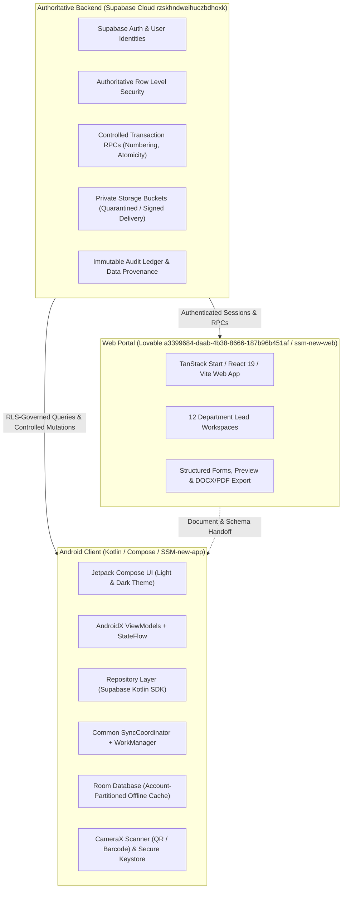
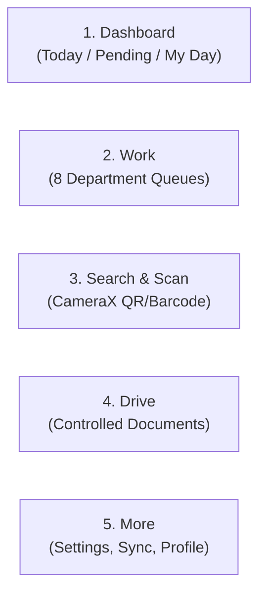
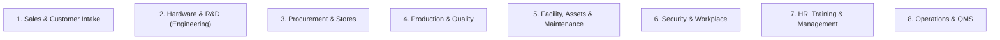
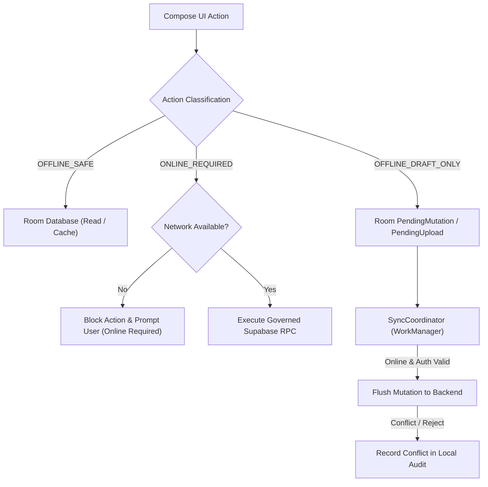
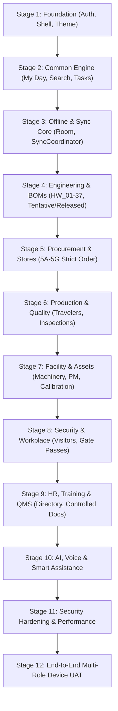
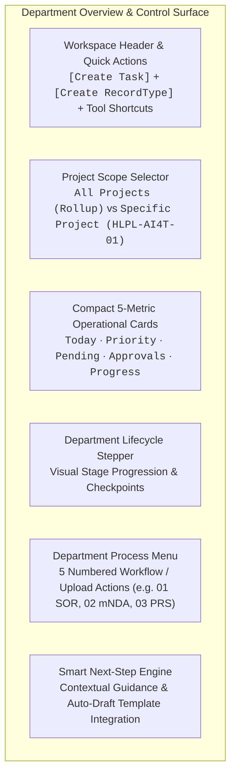
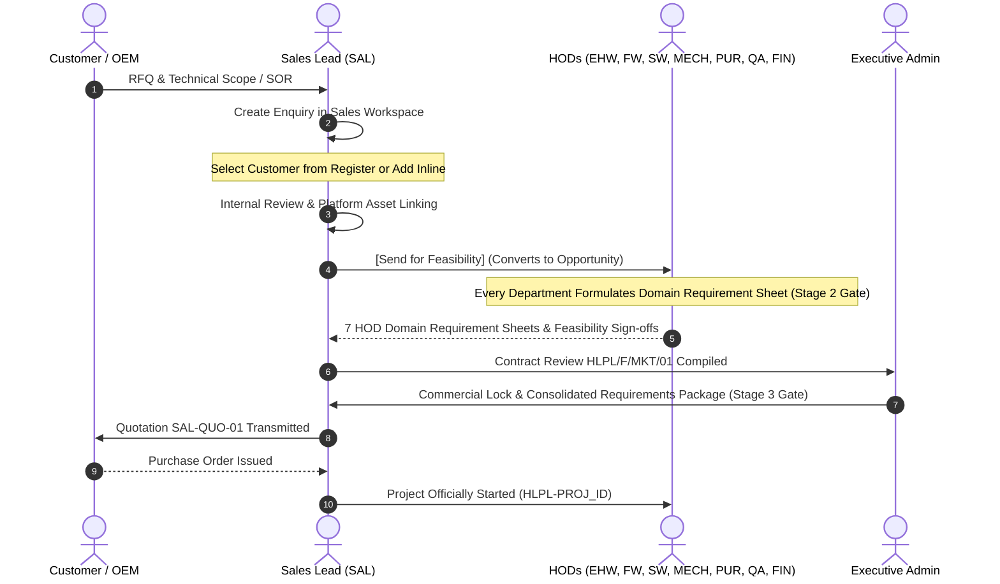

# SSM One Implementation Plan

Merged web/Android plans and active handoffs. The [master plan](SSM_ONE_MASTER_PLAN.md) governs scope and the [sample catalogue](Feature%20Roadmap/Sample%20Data%20and%20Test%20Plan.md) governs reusable fixtures. Preserve implemented features; inspect latest source before applying old requirements. Dated build/completion statements below are not fresh acceptance.


<a id="source-01"></a>
## Android Antigravity Handoff

**Source:** `Android and Backend Contracts/Android Antigravity Handoff.md`. **Treatment:** platform implementation reference; revalidate source/environment before execution. Latest decisions at the beginning of the master plan override conflicting older universal-stage, department or completion claims.

<a id="source-01-android-companion-handoff-for-antigravity"></a>
### Android Companion Handoff for Antigravity

<a id="source-01-shared-product-identity"></a>
#### Shared product identity

Use **SSM New** as the web portal display name and **SSM-new-app** as the Android launcher/project name. The web repository/package slug is `ssm-new`; the Android repository is `SSM-new-app`. Keep the existing Android `applicationId` and namespace stable; changing them would create a different installed Android app identity.

Read this file when working on the Android companion from the SSM-new Antigravity workspace. The portal's architecture and current integration status are in [Web Implementation Plan, §25](Implementation%20Plan.md#source-16-25-android-companion-handoff-contract-and-release-gates). The department-owned document and lifecycle audit design is in HLPL-AI4T-QA-DOCCTRL-00 (source reference: `../../SSM-new-app/docs/backend-handoff/HLPL-AI4T-QA-DOCCTRL-00.md`; not bundled).

<a id="source-01-android-project-location"></a>
#### Android project location

The Android Studio project currently resides at:

`C:\Users\Test\Documents\SSM-new\SSM-new-app`

It is maintained in its own Git repository at `https://github.com/narendok/SSM-new-app.git` on `main`. Android commits do not automatically land in the portal repository or Lovable sync. Work directly in the Android project; do not create a second Android source copy under SSM-new-web.

<a id="source-01-corrected-backend-configuration"></a>
#### Corrected backend configuration

- The SSM-new portal's configured Supabase authority is project `rzskhndweihuczbdhoxk` at `https://rzskhndweihuczbdhoxk.supabase.co`.
- Android Gradle now defaults to this endpoint, rejects a different `SUPABASE_URL`, and fails configuration if the publishable/anon key is empty.
- The Android project's ignored `local.properties` contains the same URL and the portal publishable key as `SUPABASE_ANON_KEY`. Keep the key out of tracked files, screenshots, logs, and handoff documents.
- Do not use the historical Android target `yyrvduosyyaluifqvwkr` as a current environment. No separate Dev/UAT backend is approved.

<a id="source-01-files-to-consult-in-the-android-project"></a>
#### Files to consult in the Android project

- `app/build.gradle.kts` — canonical URL guard and allowed client configuration.
- `docs/backend-handoff/ANDROID_BACKEND_HANDOFF.md` — mobile security and operation boundaries.
- `docs/backend-handoff/MOBILE_BACKEND_CONTRACT.md` and `mobile_backend_contract.json` — proposed read/RPC contract; confirm every object against the portal's actual schema before implementation.
- `docs/planning/SSM_ONE_ANDROID_BUILD_PLAN.md` — Android delivery plan.
- `app/src/main/java/com/example/myapplication/data/repository/SafeViewsRepository.kt` and `StockMutationRepository.kt` — currently fail-closed pending verified schema/RPC contracts.

<a id="source-01-remaining-release-gates"></a>
#### Remaining release gates

1. Reconcile Android models, views, RPC signatures, RLS, permission helpers, and private buckets against the portal's current generated Supabase types and deployed schema. Do not infer columns or enable writes from stale handoff documents.
2. Keep inventory mutations disabled until exact authenticated RPC contracts are verified. Never optimistically update local stock as though the server committed it.
3. Remove local role switching from operational builds. Keep local repository data clearly marked as prototype/demo; local inventory and shopfloor events do not sync to the portal or its audit trail.
4. Use only the authenticated Supabase Storage signed-URL path for approved private buckets. The local prototype signed-URL method now fails closed; do not replace it with a fabricated or public URL.
5. Verify sign-in, permission denial, field stripping, private-link expiry, and sync behavior before enabling shopfloor use. Do not create stock-affecting test records without approved fixtures.

<a id="source-01-build-verification"></a>
#### Build verification

From the Android project directory, run:

```powershell
$env:JAVA_HOME = 'C:\Program Files\Android\Android Studio\jbr'
.\gradlew.bat testDebugUnitTest assembleDebug
```

The latest verified run completed successfully with 26 unit tests passing. Re-run after Android source changes and report any compiler warnings separately from failures.

<a id="source-01-19-october-2026-planning-checkpoint"></a>
#### 19 October 2026 planning checkpoint

The current checkout is `C:/Users/Admin/AndroidStudioProjects/SSM-new/SSM-new-app`; the Test-user path above is historical. Use [Web Implementation Plan §28](Implementation%20Plan.md#source-16-28-cross-department-portal-correction-and-production-acceptance--19-october-2026) and [Android Build Plan §9](Implementation%20Plan.md#source-15-9-web-cross-department-audit-and-android-acceptance-dependencies--19-october-2026) for department scoping, task/approval round trips, client/document boundaries and current production blockers. Web browser-local fixes do not deploy a backend contract or change Android behavior. Authentication and organization provisioning, shared persistence, RLS/private storage verification and cross-client lifecycle acceptance remain pending. No Android source/build/device work was performed in this plan update.

<a id="source-07"></a>
## People and Client Web to Android Handoff - planned 2026-10-18

**Source:** `Android and Backend Contracts/People and Client Web to Android Handoff - planned 2026-10-18.md`. **Treatment:** platform implementation reference; revalidate source/environment before execution. Latest decisions at the beginning of the master plan override conflicting older universal-stage, department or completion claims.

<a id="source-07-people-and-client-workspace-web-to-android-handoff-specification"></a>
### People and client workspace: web-to-Android handoff specification

Status: PLANNED / CONTRACT ACCEPTANCE PENDING. This is a handoff checklist, not an exported live API contract. No endpoint, table, enum or permission is invented or certified by this document. Existing verified backend-handoff artifacts retain authority for their proven scope.

Shared source: SSMone-Web/docs/planning/SSM_ONE_WEB_PORTAL_MASTER_PLAN.md, sections People workspace and shared document intake; Training, recurring reviews, feedback forms and newsletter drafts; Default timing profile; Client journey; One-view client dashboard. Mobile delivery source: docs/planning/SSM_ONE_ANDROID_BUILD_PLAN.md. Update each plan in place; do not merge implementation queues.

<a id="source-07-ownership-and-screen-matrix"></a>
#### Ownership and screen matrix

| Feature | Web / managed backend owns | Android owns | Shared handoff proof required |
|---|---|---|---|
| Leave and travel policies | Authoring, rules, applicability, immutable revisions, review/publication | Read applicable published versions; supported acknowledgement | Exact caller/employee resolver, applicable version read, scoped attachment access, acknowledgement receipt/readback |
| Leave and calendar | Authoritative entitlement/date calculation, holiday/work calendar, request state and approval transactions | Own balances/list/calendar, draft/request/detail; authorized team action only if accepted | Supported dates/partial days/states, server duration, overlap/balance concurrency, replay, authorized decision/cancellation and readback |
| Training and monthly reviews | Template/version administration, assignment/reviewer scope, certification/review outcomes | Assigned inbox, materials, full draft payload, assessment/self-review, permitted feedback | Immutable template/assignment version, field/attachment schema, submission/review receipts, privacy boundaries, actual competency acceptance |
| Forms and reminders | Template designer and timing matrix; scheduler, dedup/outbox, quiet hours and escalation | Simple form fill, local drafts, minimal notifications, authorized deep links | Current assignment/access resolver, replay and event keys, expiry/revocation, delivery dedup and cancellation after completion |
| Shared smart import | Accepted extraction/mapping authority, controlled document templates, official numbering and business draft transactions | File/camera intake, source comparison, field correction and review using shared contracts | Supported formats, source preservation, party-role mapping, complete draft fields, affected-row/receipt/readback; no automatic posting |
| Client dashboard and inputs | Customer/account membership, published project-stage projection, scoped requirement submissions and commercial records | Same authorized summaries/cards/detail and allowed client actions | Company vs individual isolation, explicit membership/signatory scope, published revisions, orders/production/delivery/invoice semantics and denied cross-customer tests |
| Feedback and support | Verified event triggers, customer entitlement, distinct Service ticket and feedback routing | Immediate eligible feedback option, own/permitted tickets and supported evidence | Event-bound assignment dedup, support submit/readback, customer-visible messages only, attachment isolation, closure/reopen capabilities |
| Newsletter | Permitted source aggregation, traceable draft generation, manual-edit merge, human review, controlled artifact/publication | No authoring/publication assumed; permitted reading/review only after separate scope acceptance | Source/version/audience register, verified milestones, generated-vs-approved-vs-sent receipts, no automatic external send |

<a id="source-07-required-contract-packet-per-feature"></a>
#### Required contract packet per feature

Backend owner supplies: original target identity; reviewed source/migration version; actual installed object signatures and supported payloads; enums/field types/nullability; caller identity and employee/customer/membership resolution; authorization/RLS/grants; attachment/storage limits and access; request/replay/version pins; exact receipt and independent readback; conflict/validation/denied/unavailable behavior; pagination/freshness; date/timezone/currency semantics; notification/deep-link rules; and actual positive/negative test evidence. Do not ship privileged credentials, business rows or customer/employee personal data in this handoff.

Mark each feature separately: proposed, source-tested, specifically approved for managed installation, installation verified, ordinary caller accepted, Android implemented, device verified, cross-client accepted. These are evidence milestones, not prescribed database status values. The newest dated file does not automatically supersede an unrelated contract. No live execution is inferred from this planning specification.

<a id="source-07-mobile-integration-protocol"></a>
#### Mobile integration protocol

1. Inspect accepted contract and compare with existing repositories; flag only affected missing operations.
2. Reuse existing authentication, navigation and common Room/WorkManager/SyncCoordinator foundation. Identity and business authority remain backend-owned.
3. Classify every action: cached read with freshness, OFFLINE_DRAFT_ONLY, OFFLINE_SAFE only with verified support, or ONLINE_REQUIRED. Final approvals, authoritative balances, business posting and publication stay online-required unless explicitly superseded.
4. Preserve complete typed form drafts and attachment references. Do not turn permission/validation denials into promised queued submissions. Worker execution must exist and be verified before promising automatic sync.
5. Verify compile, focused tests and debug build, then actual device flows and shared web readback. A build is not backend/RLS acceptance.
6. Acceptance uses approved test identities/environment. Verify wrong employee/customer/reviewer, revoked membership, stale template/policy, replay, partial failure, reconnect and attachment denial. Never create production test identities implicitly.

<a id="source-07-current-acceptance-boundary"></a>
#### Current acceptance boundary

Existing source contains HR leave/policy and other partial features, but this packet has not verified the new full People/forms/client contracts. Existing backend exports are older than this planning expansion; do not treat them as coverage for every new operation. No feature enablement, grant, migration, scheduler activation, financial approval or publication occurs from this document.

<a id="source-07-approved-client-layout-and-additional-pending-contract-requirements"></a>
#### Approved client layout and additional pending contract requirements

Client design baseline: Home / Projects / central Scan-Verify / Orders / Support. Verification requires the actual scoped device/document reference resolver, current published revision/release state, denied/unknown privacy, pagination/rate limits where applicable and camera/manual fallback; a record match is not physical authenticity certification. New resolver/access remains pending, not authorized by UI approval.

Lead Process Flow editing must reuse the same accepted settings capabilities and protected configuration transaction as web settings. Required handoff includes node/edge schema, allowed editable properties, cycle/gate validation, draft/review/activation versions, impact on running instances, conflict/replay/readback and denied edit tests. Do not use diagram visibility to bypass approval or create a second mobile workflow authority.

Plans/handoff are prepared for later review against a new user-supplied repository/folder. No target transfer, new backend or installed-contract acceptance is inferred until that destination and its authority are inspected.

<a id="source-07-engineering-observations-to-report-draft-contract-packet--pending"></a>
#### Engineering observations to report-draft contract packet — pending

Before Android enablement, supply actual assigned visit/project/device/procedure/template resolvers; typed observation/criteria/unit/evidence schema; supported offline classification; upload limits and scoped storage; atomic observation save/replay/version pins; independent receipt/readback; report-generation status/event/idempotency; snapshot/template/output binding; manual-edit conflict preservation; and authorized review/release transitions. R&D assigned to Service work requires explicit work scope, not blanket department access. Verify wrong-assignee/project denial, stale revisions, interrupted complete drafts/uploads, duplicate generation and no automatic pass/sign-off.

<a id="source-07-confirmed-controlled-template-approval-and-mom-contract-additions"></a>
#### Confirmed controlled-template approval and MOM contract additions

Google API/editor feasibility is excluded from selected integration scope. Backend packet must distinguish scoped web template-maintainer capability from assigned instance-fill capability; immutable template/instance/source pins; authenticated Prepared by; exact lead review/edit/return receipts; applicable CPO/CTO/CEO management routing; delegated current authority; change invalidation; conflict/replay/readback; and separate client-visible publication/notification. Approval matrix settings and diagram editor must call the same protected configuration contract; no permissions inferred from a role title or flow visibility. Copy MOM email subject/body is local/manual-send convenience only, scoped to published permitted content; no mailbox-draft/send API or invitation issuance. No new live grants/contracts are installed by this specification.

<a id="source-15"></a>
## Android Build Plan

**Source:** `Current Plans/Android Build Plan.md`. **Treatment:** platform implementation reference; revalidate source/environment before execution. Latest decisions at the beginning of the master plan override conflicting older universal-stage, department or completion claims.

<a id="source-15-ssm-one--android-mobile-managing-portal-master-plan"></a>
### SSM One — Android Mobile Managing Portal Master Plan

**Document Version:** 2.1 (Cross-department acceptance checkpoint)

**Date:** 19 October 2026

**Target Repository:** `C:/Users/Admin/AndroidStudioProjects/SSM-new/SSM-new-app`

**Cross-platform Master Plan Reference:** [SSM-new root master plan](SSM_ONE_MASTER_PLAN.md#source-32). The [Electronics Project Lifecycle and APQP Roadmap](SSM_ONE_MASTER_PLAN.md#source-18) adds product-process requirements; the [Product Build Roadmap](SSM_ONE_MASTER_PLAN.md#source-19) sequences generic system delivery. The [detailed web implementation plan](Implementation%20Plan.md#source-16) is a subordinate web handoff; Android-local copies are historical references.
**Authoritative Backend Contracts:** [`docs/backend-handoff/mobile_backend_contract.json`](Mobile%20Backend%20Contract.json), [`docs/backend-handoff/MOBILE_BACKEND_CONTRACT.md`](Backend%20Contracts.md#source-04), [`docs/backend-handoff/ANDROID_BACKEND_HANDOFF.md`](Backend%20Contracts.md#source-02)

---

<a id="source-15-1-executive-purpose--architectural-authority"></a>
#### 1. Executive Purpose & Architectural Authority

The **SSM One Android Mobile Application** serves as the authoritative on-the-move managing and operational client for the SSM One enterprise platform. It enables engineers, storekeepers, technicians, quality inspectors, facility managers, security guards, and executives to monitor operations, scan hardware/assets/lots, execute verified draft workflows, inspect document revisions, and perform controlled transactions from Android handheld devices and tablets.

<a id="source-15-11-system-authority-split"></a>
##### 1.1 System Authority Split



<a id="source-15-12-non-negotiable-architecture-rules"></a>
##### 1.2 Non-Negotiable Architecture Rules

1. **Backend Owns Truth**: The Supabase backend owns users, profiles, employees, roles, permissions, projects, inventory stock, official numbering, and transaction atomicity. The Android client never creates local source-of-truth business tables (e.g. no `mobile_inventory`, no `mobile_purchase_orders`).
2. **Credential Boundary**: The APK receives strictly `SUPABASE_URL` and `SUPABASE_ANON_OR_PUBLISHABLE_KEY`. It never contains `service_role`, database passwords, JWT signing secrets, or private OAuth secrets.
3. **RLS Authorization**: Authorization is strictly enforced by backend Row-Level Security. Android never overrides or replaces backend RLS with client-side UI hiding or locally cached roles. An empty response from Supabase represents denied access.
4. **Controlled Mutation Atomicity**: Critical inventory, asset, and document state changes (Final GRN, Material Issue, Material Return, Stock Transfer, Stock Adjustment, Document Release) must invoke designated server RPCs with client-generated UUID `request_key` idempotency tokens. Critical mutations remain `ONLINE_REQUIRED`.
5. **Single Common Sync Engine**: All offline caching, mutation queues, and background synchronization must use the common `SyncCoordinator`, Room database, and WorkManager infrastructure. Feature-specific synchronization daemons (e.g., `GrnSyncWorker`, `InventorySyncWorker`) are strictly prohibited.
6. **Package Path Discipline**: Package paths must not use Kotlin reserved words (e.g. use `feature.stores.returns`, never `feature.stores.return`).

---

<a id="source-15-2-android-experience--ui-architecture"></a>
#### 2. Android Experience & UI Architecture

<a id="source-15-21-five-tab-navigation-framework"></a>
##### 2.1 Five-Tab Navigation Framework

The application implements a predictable, thumb-accessible five-tab bottom navigation structure supplemented by a dynamic top operational bar:



1. **Dashboard (My Day)**:
   - Role-aware daily cockpit showing *Today's Tasks*, *Pending Actions*, and *Overdue Items*.
   - Filtered by the active presentation department, with quick links to assigned project cards and task checklists.
   - Honest metric presentation: unavailable or restricted metrics are clearly badged as *Restricted* or *Unavailable* rather than rendering dummy zeroes.
2. **Work (Departmental Operational Queues)**:
   - Primary operational surface exposing the 12 enterprise department workflows based on user permissions.
   - Filterable by department, status, project, and priority.
3. **Search & Scan**:
   - High-performance barcode and QR scanner using CameraX and ML Kit / ZXing.
   - Instantly resolves physical items to authoritative records: components (MPN), reels, storage bins, lots, asset tags, employee badges, travelers, and purchase orders.
   - Deep-linking engine navigates directly to the resolved entity detail screen.
4. **Drive (Controlled Documents & BOMs)**:
   - Scoped departmental document roots mirroring the web portal Drive taxonomy.
   - Use the shared four contexts from the master and Document Catalogue: Common & Standards, Internal Projects, Client Projects, and Department Operations & References. Common includes department-organized audit/QMS indexes; audit views link to canonical project evidence. Assignment or folder placement never grants access.
   - Exposes controlled document registers, revision timelines, version tags, and project BOM linkages.
   - Native read-only previewers for PDF, images, and tabular XLSX/BOM data.
5. **More (Administration & Connectivity)**:
   - User profile, department switcher (presentation alias, without privilege elevation).
   - Sync Coordinator center: visual status of pending offline drafts, sync logs, cache size, network health.
   - App settings, theme toggle (Light / Dark / System default).

<a id="source-15-22-dark-mode--material-3-theming"></a>
##### 2.2 Dark Mode & Material 3 Theming

The application adheres to Material Design 3 with comprehensive Light and Dark theme implementations that visually align with the SSM One web portal:

- **Dynamic Theme Palette**:
  - Light Palette: High-contrast slate and industrial blue accents, clean white/gray surfaces (`#F8FAFC`, `#FFFFFF`), subtle borders (`#E2E8F0`).
  - Dark Palette: Deep charcoal surfaces (`#090D16`, `#111827`, `#1E293B`), subdued text tones (`#F1F5F9`, `#94A3B8`), and vibrant indicator accents for active, warning, and success states.
- **Theme State Management**: Integrated into `Theme.kt`, observing system theme changes and providing an explicit user override stored in encrypted preferences.

---

<a id="source-15-3-departmental-coverage-8-workspaces"></a>
#### 3. Departmental Coverage (8 Workspaces)

The Android app provides operational mobile clients for all 12 enterprise departments:



<a id="source-15-31-sales--customer-intake"></a>
##### 3.1 Sales & Customer Intake
- **Mobile Scope**: Read-only commercial pipeline, active customer directories, assigned enquiries, and feasibility review status.
- **Key Tables**: `customers`, `customer_contacts`, `customer_requirements`, `customer_requirement_revisions`, `customer_portal_shares`.
- **Boundaries**: Customer quotations, pricing models, and contract signing remain web-authoritative. Mobile displays operational project links without exposing confidential financial margins.

<a id="source-15-32-hardware--rd-engineering--bom-management"></a>
##### 3.2 Hardware & R&D (Engineering & BOM Management)
- **Mobile Scope**:
  - Project repository exploration (`projects`, `project_members`, `project_process_stage_records`).
  - Company Process Stage Tracking (Taxonomy HW_01 to HW_37) with predecessor lock indicators and evidence links.
  - **Tentative BOM vs. Released BOM Inspection**:
    * Full line-level stock match status (Exact Match, Substitute Available, Shortage, Unstocked).
    * Alternate component review rationale and datasheet links (`datasheet_cache`).
    * Revision comparison between Draft/Tentative engineering BOMs and Released production BOMs (`project_boms`).
  - Authorized read view of the selected project's exact reusable-asset revisions, reuse/fit-gap decision, component/asset certificate scope, separate project/product certification status, required delta verification, and as-built genealogy. Do not infer compatibility, certification, or stage waiver from a catalog match.
  - Keep the domain types separate as defined in [Electronics Project Lifecycle and APQP Roadmap §6.2](SSM_ONE_MASTER_PLAN.md#source-18-62-inventory-reusable-design-assets-and-plant-assets): stock item and lot/serial; reusable asset/module revision and its controlled BOM; project-pinned configuration; serialized plant asset; and actual as-built genealogy. Display the links from the server's authorized projections; never create client-side balances or infer actual use from a BOM.
  - Engineering Changes: Review active ECR/ECO records, linked tasks, and impacted parts.

<a id="source-15-33-procurement--stores-stage-5-detailed-delivery"></a>
##### 3.3 Procurement & Stores (Stage 5 Detailed Delivery)
Procurement and Stores follow the strict staged execution sequence (5A through 5G):

- Distinguish stock-controlled electronics components/outsourced PCB assemblies, mechanical raw materials and purchased parts, configured WIP/subassemblies, consumables/MRO, and packaging by item class/UOM and applicable lot/serial tracking. Stage 5 views the authorized stock ledger only; BOM/reuse selection is not a stock mutation.

- **5A — Procurement Read-Only**:
  - Safe operational projections: `operational_purchase_requests`, `operational_purchase_request_items`, `operational_rfqs`, `operational_po_shipments`, `operational_vendors`.
  - Excludes unit costs, margins, payment terms, and vendor bank accounts.
- **5B — Receiving Drafts**:
  - Scan PO barcode or ASN to load expected items via `operational_receiving_purchase_orders`.
  - Component verification: MPN scanning, lot number, batch code, date code, reel ID, packaging condition, MSL/ESD flags.
  - Photo evidence capture attached to local draft receiving vouchers.
  - Drafts saved locally in Room; strictly no offline Final GRN posting.
- **5C — Inventory Read-Only**:
  - Component search by MPN, manufacturer, description, category, or bin location (`components`, `inventory_lots`, `storage_locations`).
  - Stock visibility categorized as Available, Quality Hold / Quarantine, or Reserved.
  - Explicit *Cached / May-be-outdated* freshness timestamp on every stock screen.
- **5D — Material Issue & Return**:
  - Material Issue: Online posting via `post_material_issue` against valid project work orders.
  - Material Return: Online posting via `post_material_return` (package `feature.stores.returns`), preventing over-return atomically.
- **5E — Cycle Counts & Blind Picking**:
  - Assigned cycle count sheets with blind count support (system stock quantity hidden from count operator).
  - Pick list execution with barcode confirmation per line.
- **5F — Final GRN & Critical Stock Transactions**:
  - Online-only execution of `create_grn`, `post_stock_transfer`, and `post_stock_adjustment`.
  - Enforces client UUID idempotency tokens, server numbering, row-locking concurrency, and immutable audit logs.
- **Review-Based Import / Draft Handling**:
  - When PO or invoice data is scanned or imported from external supplier manifests, records are placed into a *Draft Review Queue*.
  - No inventory stock movement occurs until formally approved and received through the controlled receiving inspection gate.

<a id="source-15-34-production--quality"></a>
##### 3.4 Production & Quality
- **Mobile Scope**:
  - Traveler & Work Order Execution: `work_orders`, `production_routes`, `routing_steps`, `production_units`.
  - Step check-in/check-out with operator badge scan.
  - Quality Inspection: In-process and final inspection checklists (`inspection_records`, `ncr_records`).
  - Defect logging with camera photo evidence and quarantine tagging.
  - PPAP / First Article Inspection review summaries and dispatch packaging verification.

<a id="source-15-35-facility-assets--maintenance"></a>
##### 3.5 Facility, Assets & Maintenance
- **Mobile Scope**:
  - Asset Directory & Quick Scan: `assets`, `asset_categories`, `asset_assignments`.
  - Machinery Registers: Operating state, maintenance history, and assigned operators.
  - Preventive Maintenance (PM): Scheduled PM checklists with step-by-step sign-off and photo upload.
  - Breakdown Work Orders: Rapid breakdown ticket creation with priority rating, machine stoppage timer, and technician dispatch.
  - Calibration Logs: Measuring equipment calibration dates, certificate inspection, and out-of-calibration warnings (`calibration_records`).

<a id="source-15-36-security--workplace"></a>
##### 3.6 Security & Workplace
- **Mobile Scope**:
  - Gatehouse Cockpit: Visitor check-in/check-out with badge generation (`visitor_logs`).
  - Material Gate Pass Verification: Inward and outward pass scanning against approved store transfers (`gate_passes`).
  - Vehicle Logistics: Truck entry/exit logging, driver details, and loading bay assignment.
  - Workplace Incident Reports: Hazard identification, injury reporting, and facility security patrols.

<a id="source-15-37-hr-training--management"></a>
##### 3.7 HR, Training & Management
- **Mobile Scope**:
  - Organization Directory: Department employee list with contact shortcuts (`employees`, `departments`).
  - Training & Competency Matrix: Verification of operator certifications before authorizing specialized machinery operation.
  - Personal Workspace: Leave application status, assigned training modules, and policy acknowledgements.

<a id="source-15-38-operations--qms-quality-management-system"></a>
##### 3.8 Operations & QMS (Quality Management System)
- **Mobile Scope**:
  - Controlled Document Viewer: RLS-governed access to company SOPs, manuals, work instructions, and specifications (`document_control_registers`, `document_control_events`).
  - Audit Trail Timeline: Real-time inspection of document revisions and change histories.
  - Audit & CAPA Inspection: Internal audit checklists, corrective action tracking, and KPI dashboard monitoring.

---

<a id="source-15-4-offline-engine--sync-architecture"></a>
#### 4. Offline Engine & Sync Architecture



<a id="source-15-41-action-classification-rules"></a>
##### 4.1 Action Classification Rules

Every user action in the mobile app is strictly classified:

| Classification | Meaning | Examples |
|---|---|---|
| `OFFLINE_SAFE` | Read-only operations against cached Room tables. Stale indicators are displayed. | Browsing downloaded SOPs, reviewing cached component lists, viewing project directories. |
| `OFFLINE_DRAFT_ONLY` | Data entry that creates a local draft. Never changes server state until synced and verified online. | Receiving draft vouchers, cycle count observations, breakdown reports, visitor entries, inspection checklists. |
| `ONLINE_REQUIRED` | Cannot be performed offline. Must execute synchronously against Supabase with server-side validation and locking. | Final GRN creation, Material Issue, Material Return, Stock Transfers, Stock Adjustments, Document Release. |

<a id="source-15-42-room-partitioning--security"></a>
##### 4.2 Room Partitioning & Security

- Room database schemas are isolated per authenticated user account (`account_id` column on all cached tables).
- Logging out or switching accounts flushes uncommitted non-draft caches and resets repository state.
- Sensitive credentials, auth tokens, and session keys are kept exclusively in Android EncryptedSharedPreferences (backed by Android Keystore), never in plain Room tables.

---

<a id="source-15-5-technical-implementation-stack--directory-structure"></a>
#### 5. Technical Implementation Stack & Directory Structure

<a id="source-15-51-android-technology-stack"></a>
##### 5.1 Android Technology Stack

- **Language**: Kotlin 2.0+ (100% Kotlin, Coroutines, Flow).
- **UI Toolkit**: Jetpack Compose + Material 3, Navigation Compose.
- **Architecture**: Clean Architecture (Presentation → Domain → Data) + MVI / Unidirectional Data Flow.
- **Backend SDK**: Supabase Kotlin Client (`gotrue-kt`, `postgrest-kt`, `storage-kt`, `realtime-kt`).
- **Local Persistence**: Androidx Room with SQLite KSP compiler.
- **Background Work**: Androidx WorkManager with CoroutineWorker.
- **Hardware Integration**: CameraX (preview & image analysis), ML Kit Barcode Scanning / ZXing.
- **Dependency Injection / Factory**: Lightweight Repository & ViewModel providers adhering to Android lifecycle guidelines.

<a id="source-15-52-source-code-directory-layout"></a>
##### 5.2 Source Code Directory Layout

```text
app/src/main/java/com/example/ssmapplication3/
├── MainActivity.kt                      # App entry point, theme provider, root navigation
├── core/
│   ├── auth/                            # Session manager, secure token storage, Google OAuth
│   ├── network/                         # SupabaseClientProvider, error parsers, interceptors
│   ├── security/                        # Capabilities, permission checkers, device security
│   ├── sync/                            # SyncCoordinator, PendingMutation, WorkManager workers
│   ├── ui/                              # Common Compose components, status badges, dialogs
│   └── util/                            # Environment config, Flow helpers, date formatters
├── data/
│   ├── local/                           # Room database, DAOs, local entity models
│   └── repository/                      # Repository implementations connecting Supabase & Room
├── domain/
│   ├── model/                           # Pure Kotlin business models & domain entities
│   └── repository/                      # Domain repository interfaces
├── feature/
│   ├── auth/                            # Sign-in screen, SSO callback, session restore
│   ├── dashboard/                       # My Day cockpit, today/pending checklists
│   ├── documents/                       # Drive document browser, controlled register viewer
│   ├── engineering/                     # Projects, BOM dual-lifecycle, stage tracking HW_01-37
│   ├── facility/                        # Asset register, PM checklists, breakdown reporting
│   ├── inventory/                       # Component lookup, lot/reel details, stock freshness
│   ├── mywork/                          # Unified work queue across permitted departments
│   ├── notifications/                   # Notification center, alert routing
│   ├── procurement/                     # PR, RFQ, PO, shipment tracking (safe projections)
│   ├── production/                      # Travelers, work orders, routing inspection
│   ├── receiving/                       # Receiving draft vouchers, PO item matching
│   ├── scanner/                         # CameraX barcode/QR scanner, deep-link resolver
│   ├── security/                        # Visitor logging, gate passes, vehicle registers
│   └── stores/                          # Critical stock transactions
│       ├── adjustments/                 # Stock adjustments (ONLINE_REQUIRED)
│       ├── issues/                      # Material issue posting (ONLINE_REQUIRED)
│       ├── returns/                     # Material return posting (ONLINE_REQUIRED)
│       └── transfers/                   # Stock transfers (ONLINE_REQUIRED)
├── navigation/                          # AppNavigation, Screen routes, DeepLinkHandler
└── ui/theme/                            # Color, Theme (Dark/Light), Type, Shape
```

---

<a id="source-15-6-authoritative-handoff-contract-index"></a>
#### 6. Authoritative Handoff Contract Index

The Android client directly implements data structures and calls corresponding to the generated backend specifications:

| Backend Contract Artifact | Purpose & Android Mapping |
|---|---|
| [`mobile_backend_contract.json`](Mobile%20Backend%20Contract.json) | Complete machine-readable catalog of all 180+ tables, foreign keys, columns, RPC signatures, and bucket paths. |
| [`MOBILE_BACKEND_CONTRACT.md`](Backend%20Contracts.md#source-04) | Object classification matrix: `MOBILE_READ_SAFE`, `ONLINE_REQUIRED`, `WEB_ONLY`. |
| [`ANDROID_BACKEND_HANDOFF.md`](Backend%20Contracts.md#source-02) | Safe configuration boundaries, operational projection specifications, RLS rules. |
| [Android Lifecycle Read Contract - 2026-10-03](Backend%20Contracts.md#source-03) | Specification for displaying HW_01–HW_37 stages, department templates, and dependency chains. |
| [Verified Safe Procurement Contract - 2026-09-26](Backend%20Contracts.md#source-12) | Contract for `operational_*` safe views omitting financial/commercial data. |
| [Verified Material Issue Return Contract - 2026-09-27](Backend%20Contracts.md#source-11) | Signatures and idempotency rules for `post_material_issue` and `post_material_return`. |

---

<a id="source-15-7-stage-by-stage-implementation-roadmap"></a>
#### 7. Stage-by-Stage Implementation Roadmap

The mobile roadmap is organized into 12 controlled stages. Progress adheres to the strict engineering discipline: **INSPECT → IMPLEMENT → COMPILE → TEST → BUILD → DEVICE VERIFY → EVIDENCE → CONTINUE**.



<a id="source-15-stage-1-foundation-completed--verified"></a>
##### Stage 1: Foundation (COMPLETED / VERIFIED)
- Supabase auth integration (Email/Password, Google OAuth).
- Session manager with encrypted token storage.
- Navigation shell with 5-tab scaffold and top bar.
- Material 3 Theme foundation with Dark Mode and Light Mode support.

<a id="source-15-stage-2-common-engine-completed--verified"></a>
##### Stage 2: Common Engine (COMPLETED / VERIFIED)
- Role-aware Dashboard / My Day cockpits with Today and Pending tasks.
- Unified task repository querying `project_tasks` partitioned by department.
- Deep link resolution foundation and notification badges.

<a id="source-15-stage-3-offline--sync-core-completed--verified"></a>
##### Stage 3: Offline & Sync Core (COMPLETED / VERIFIED)
- Room database schema with account isolation.
- Common `SyncCoordinator` handling draft queues (`PendingMutation`, `PendingUpload`).
- Network connectivity monitor and conflict resolution handlers.

<a id="source-15-stage-4-engineering--rd-workspace-in-progress--active-refinement"></a>
##### Stage 4: Engineering & R&D Workspace (IN PROGRESS / ACTIVE REFINEMENT)
- Project directory and project team exploration.
- Hardware process stages (HW_01 to HW_37) with predecessor lock indicators.
- **Tentative BOM vs Released BOM Inspection**:
  * Line-by-line stock match visualization (Exact, Substitute, Shortage).
  * Mouser component enrichment view (MPN, package, datasheet link).
  * Revision comparison between draft/tentative engineering BOMs and approved released production BOMs.
- Authorized project view of linked reusable-asset master IDs/revisions, approved reuse assessment, verification gaps, and as-built identity; full source authoring stays in specialist tools.
- Engineering Change Requests (ECR) and ECO impact review.

<a id="source-15-stage-5-procurement-stores--receiving-strict-5a5g-sequence"></a>
##### Stage 5: Procurement, Stores & Receiving (STRICT 5A–5G SEQUENCE)
- **5A (Procurement Read-Only)**: PR, RFQ, PO, ASN, Vendor list using `operational_*` safe projections.
- **5B (Receiving Draft)**: PO/ASN selection, CameraX barcode scan matching, lot/batch/reel capture, draft voucher storage.
- **5C (Inventory Read-Only)**: MPN stock search, bin location lookup, stock freshness timestamps.
- **5D (Material Issue & Return)**: Online posting via `post_material_issue` and `post_material_return`.
- **5E (Cycle Counts & Picking)**: Blind count execution, pick lists with line-by-line verification.
- **5F (Final GRN & Critical Stock)**: `create_grn`, `post_stock_transfer`, `post_stock_adjustment` with UUID idempotency.
- **5G (Integration & Acceptance)**: End-to-end scanner, notifications, and regression test suite.

<a id="source-15-stage-6-production--quality-assurance"></a>
##### Stage 6: Production & Quality Assurance
- Route station tracking and electronic travelers.
- Component lot traceability during assembly.
- In-process inspection, NCR creation with photos, PPAP sign-offs.

<a id="source-15-stage-7-facility-assets-maintenance--calibration"></a>
##### Stage 7: Facility, Assets, Maintenance & Calibration
- Asset QR scanning and metadata cards (`assets`).
- Keep fixed production machinery, test fixtures/equipment, tooling, calibration instruments, and facility assets distinct from raw-material/consumable stock; show ownership, plant/site, custody, maintenance/calibration status, and product/process compatibility when authorized.
- Machinery operational state and breakdown ticketing.
- Preventive maintenance schedules with step checklists.
- Instrument calibration validity and certificate viewing (`calibration_records`).

<a id="source-15-stage-8-security-visitors--workplace-logistics"></a>
##### Stage 8: Security, Visitors & Workplace Logistics
- Gatehouse visitor check-in, pass generation, and host notifications.
- Material gate pass verification (inward / outward).
- Loading bay vehicle logs and incident report logging.

<a id="source-15-stage-9-hr-training--controlled-documents-qms"></a>
##### Stage 9: HR, Training & Controlled Documents (QMS)
- Department staff directory and contact integration.
- Operator skill matrix verification.
- Controlled Document Register: RLS-permitted viewing of SOPs, manuals, and revision timelines.

<a id="source-15-stage-10-ai-voice--mobile-automation"></a>
##### Stage 10: AI, Voice & Mobile Automation
- Voice-assisted inventory lookup and notes transcription.
- Intelligent scanner recognition for damaged packaging or illegible supplier labels.
- Scoped AI assistant answering procedural questions against cached SOPs.

<a id="source-15-stage-11-security-hardening-performance--recovery"></a>
##### Stage 11: Security Hardening, Performance & Recovery
- Memory optimization and list virtualization for large BOMs and component catalogs.
- Safe file handling, sandboxed PDF rendering, and zero-cache leakage on logout.
- ProGuard / R8 code shrinking and security audit.

<a id="source-15-stage-12-end-to-end-multi-role-acceptance-testing"></a>
##### Stage 12: End-to-End Multi-Role Acceptance Testing
- Live testing on physical Android devices across distinct test identities (Engineer, Storekeeper, Inspector, Manager).
- Verification of parity between web changes and mobile viewports.
- Full regression passing `:app:testDebugUnitTest` and clean `:app:assembleDebug` packaging.

---

<a id="source-15-8-verification--execution-gates"></a>
#### 8. Verification & Execution Gates

Every implementation increment must provide documented evidence meeting these gates before marking complete:

1. **Static & Syntax Gate**: `:app:compileDebugKotlin` exits with code `0`.
2. **Unit Test Gate**: `:app:testDebugUnitTest` passes all unit tests across data, domain, and ViewModels.
3. **Packaging Gate**: `:app:assembleDebug` successfully produces a valid debug APK.
4. **Device / Emulator Gate**: Verified on an Android emulator or physical device; screenshot or CLI log preserved in `docs/evidence/`.
5. **Contract Conformance Gate**: Network calls must conform strictly to `mobile_backend_contract.json` without inventing endpoints, columns, or tables.

Company-name anonymization: current repository display labels, planning/reference snapshots and synthetic examples use XYZ Pvt Ltd. Live business records, identities, backend configuration, official document codes and published Git history were not changed. Sanitized schema/reference text is not a claim of an altered installed database. Image/binary contents and historical commits require separate review; a source sync is not deployment.

<a id="source-15-9-web-cross-department-audit-and-android-acceptance-dependencies--19-october-2026"></a>
#### 9. Web Cross-Department Audit and Android Acceptance Dependencies — 19 October 2026

<a id="source-15-91-status-qualification"></a>
##### 9.1 Status qualification

This is a documentation/handoff update, not an Android implementation or device verification. Existing stage/build claims above describe historical checkpoints; they do not prove current live integration. No Kotlin, Gradle, APK or backend changes were made for this update, and Android tests/build were not rerun for documentation alone.

The [SSM-new root master plan](SSM_ONE_MASTER_PLAN.md#source-32) is the cross-platform authority. The detailed web checkpoint (source reference: `../../ssm-new-web/SSM_ONE_WEB_PORTAL_MASTER_PLAN.md#28-cross-department-portal-correction-and-production-acceptance--19-october-2026`; not bundled) records fixes to department scoping, navigation, document drafts, task field retention, serialized local edits, designated approvals and client routing. Fourteen web tests, TypeScript/build and a two-tab Hardware-to-Quality round trip passed locally. These results do not certify Android behavior or shared server persistence. [Web browser evidence](References/Historical%20Evidence.md#source-26).

Live Lovable inspection found no enabled sign-in method and no organization/users or operational rows in the inspected core tables. Real organization identity and first administrator work email are required for secure provisioning; no passwords belong in plans/chat. The user approved narendok/ssm-new-web main on 19 October; web fixes and the web plan were pushed through 3403586 and received by Lovable. Live-preview Service task navigation and Finance approval scoping passed. This resolves the earlier automatic-review push block. Production publishing and Android remote sync were not performed.

<a id="source-15-92-required-android-parity-checks-pending-not-implemented-by-this-plan"></a>
##### 9.2 Required Android parity checks (pending, not implemented by this plan)

| Area | Required mobile behavior | Dependency / acceptance evidence |
|---|---|---|
| Trusted identity and department | Resolve organization, department and capabilities from authenticated protected membership. Cover SAL, EHW, FW, SW, MECH, PUR, QA, EMF, MMF, FIN, SIT and HR/OPS. TST/EOL testing is a production function with QA oversight, not an active department. | Verified Auth/RLS contract; separate authorized identities. Preview roles are never operational authority. |
| My Day / Tasks / deep links | Open the actual assigned queue and task; preserve project, due date and source fields on reassignment/update. Empty and denied states are explicit. | Verified task projection/mutation; device navigation and reload tests. |
| Projects and team | Show authorized linked projects and relevant department roster. A general directory/filter must not widen access beyond server permissions. | Protected project/roster reads, cross-department denial and correct detail destinations. |
| Approval / rework / notifications | Only designated signers act; pending gates block completion. Server rechecks current state, records rationale/audit, rejects duplicate or stale decisions, and notifies the requester. | Verified online transaction; web-to-mobile and mobile-to-web round trips on independent sessions. |
| Documents and references | Use actual project sources, correct document type/revision/reference target, and explicit missing fields. Unissued local drafts remain drafts; client release needs recipient grant. | Verified controlled-document contract, private signed links, expiry and denial tests. No synthetic certification/signature accepted as evidence. |
| Client boundary | Deny internal index, financial/HR detail and unreleased files unless explicitly authorized by the canonical backend. Filename/type matching is not an access grant. | Server projection/field stripping and negative access tests. |
| Session/cache isolation | Sign-out removes session and account-scoped sensitive cache; never fall back to Admin. Another login must not inherit cached role data. | Logout, expiry, user-switch, offline-cache and deep-link tests. |
| Lifecycle / floor work | Display authoritative predecessor gates and actual inspection/BOM/build/test/dispatch/service evidence. Keep simulation isolated and labeled. | Verified lifecycle contracts; stock/release actions remain ONLINE_REQUIRED and fail closed. |

<a id="source-15-93-execution-order-and-release-gate"></a>
##### 9.3 Execution order and release gate

1. Web/backend owner confirms environment, organization/admin, authentication, canonical schema, RLS and private storage; supplies versioned verified contracts under docs/backend-handoff. Do not infer a migration was deployed from repository files.
2. Android owner maps existing repositories/models to those contracts, preserving Stage 5A–5G order and the common SyncCoordinator. Do not create a competing backend or enable transactions from browser-local web behavior.
3. Implement and test each affected operation only after its contract is verified. Keep unavailable operations disabled with a clear reason. Official numbering, stock, approvals and releases remain authoritative server operations.
4. Run compile, unit tests and debug packaging after source changes; verify on device/emulator. Capture per-role results and negative tests under docs/evidence. Historical test counts are not evidence of this new run.
5. Complete an authenticated web/mobile lifecycle round trip with actual persisted records and source-backed documents. Final acceptance remains pending until this evidence exists; neither a plan update nor a working web demo closes Android release gates.

<a id="source-15-94-standard-task-board-parity--19-october-2026"></a>
##### 9.4 Standard task board parity — 19 October 2026

Web now uses one shared task board for all twelve department roles in My Tasks and department workspaces: Today / In Progress left, Review middle, To Do right, Completed collapsed by default with an expand arrow/count. Mobile should adopt the same task grouping and action semantics when verified task contracts are available. A task must occupy only one lane; approved/released and review take precedence over due-today/progress. Preserve assignee, project and due-date fields on updates; retain guarded approval completion. Web browser-local workStatus is not a newly verified backend column or Android contract. No Android source/build/device work is included in this board update.

<a id="source-15-95-department-project-workspace-parity--19-october-2026"></a>
##### 9.5 Department project workspace parity — 19 October 2026

Web consolidates department home/summary and project navigation into one page controlled by an All projects / department-linked project dropdown. Android parity should apply one trusted project selection to task queue, project details/progress, document/reference links, approvals, department records and recorded owners. Use explicit project IDs/codes/source links, clear empty states and preserved selection when opening/returning from details. Unlinked documents must not be attributed by filename/title. This is a mobile planning requirement pending verified backend contracts and device tests, not a Kotlin/APK change.

<a id="source-15-96-antigravity-continuation-plan"></a>
##### 9.6 Antigravity continuation plan

Continue using the [detailed portal completion handoff](References/Historical%20Evidence.md#source-28), especially sections 6–8 for backend prerequisites and Android acceptance. Workspace browser verification of web `8fabb5f` has passed (evidenced in `ssm-new-web` commit `46b1ac3` / `docs/evidence/WORKSPACE_CONSOLIDATION_2026-10-19.md`). Android runtime/source/build work was not performed in this increment. Preserve existing planning/context edits and the separate Android execution queue.

<a id="source-15-96-canonical-firmware-and-software-department-naming--19-october-2026"></a>
##### 9.6 Canonical firmware and software department naming — 19 October 2026

Use **FW** for Firmware and **SW** for Cloud & Application Software in Android labels, role/deep-link identifiers, and new document IDs. EFW and CSW are retired transitional labels; ESW is a legacy merged-data alias only. Existing source document/entity IDs must remain intact until an explicit, reference-safe migration is approved. Legacy aliases may be normalized only through deterministic ownership mappings; ambiguous ESW records remain quarantined for owner review. Android must consume the canonical web/backend department contract and must not infer ownership from titles or filenames.

<a id="source-15-97-production-department-parity--19-october-2026"></a>
##### 9.7 Production department parity — 19 October 2026

The canonical production departments are EMF (Electronics Manufacturing) and MMF (Mechanical Manufacturing). The former TST/EOL Testing department is not a separate active department; test execution belongs to the relevant production process, while QA owns criteria and independent disposition. Preserve historical TST data and identifiers pending explicit ownership mapping. EMF receives accepted outsourced PCBA and performs in-house box-build, checks and packaging; in-house SMT/PCBA assembly is out of scope. MMF owns mechanical manufacturing and assembly. PUR/QA/EHW retain their distinct supplier, quality, and design responsibilities.

<a id="source-15-98-extensible-departments-and-lifecycle-responsibility-matrix--19-october-2026"></a>
##### 9.8 Extensible departments and lifecycle responsibility matrix — 19 October 2026

The current 12 departments are an initial registry, not a product limit. Android must consume a backend-owned, stable-ID department registry and versioned responsibility matrix; do not encode department membership or stage owners as a closed enum or local source of truth. Lifecycle stage IDs remain stable and independent from the department chart. The matrix assigns department, role/capability, RACI, applicability, and any required signer capability to a stage and project context.

Each project uses the responsibility-matrix version accepted at its baseline. Later changes apply to new projects by default; changing an active project requires an authorized, audited change with impact review. Preserve historical stage decisions, assignments, signatures, and IDs. Department additions, splits, merges, renames, and deactivation require explicit mapping and effective dates; adding a department grants no project, document, team, or approval access by default.

Shared functions such as HR/OPS, Finance, SIT, and QA can contribute horizontally when the project/stage applicability says so. HR/OPS may manage staffing, onboarding, competency/training, and safety readiness while confidential personnel information stays restricted. RACI and notification membership never grant record access; Android must rely on server-enforced organization membership, project/record scope, and capability checks. “Informed” is notification eligibility only. Verify both old-project stability and new department routing on the same backend contract before claiming parity. This is a planning requirement; it does not claim Android implementation is complete.

<a id="source-16"></a>
## Web Implementation Plan

**Source:** `Current Plans/Web Implementation Plan.md`. **Treatment:** platform implementation reference; revalidate source/environment before execution. Latest decisions at the beginning of the master plan override conflicting older universal-stage, department or completion claims.

<a id="source-16-ssm-one---web-portal-implementation-plan"></a>
### SSM One - Web Portal Implementation Plan

<a id="source-16-plan-boundary"></a>
#### Plan Boundary

This document is the detailed implementation subplan for the SSM One web portal and backend. The cross-platform authority is the [SSM-new root master plan](SSM_ONE_MASTER_PLAN.md#source-32); this web plan must follow its shared department names, platform contracts, delivery gates, and acceptance rules. It specifies the portal architecture, operational flows, data schemas, department ownership, document controls, and web delivery roadmap.

The target is the connected Lovable project `a3399684-daab-4b38-8666-187b96b451af`, managed Supabase PostgreSQL backend, and private Cloud Storage. Web/Supabase owns identities, role permissions, operational records, official document numbering (`HLPL-[PROJ_ID]-[DEPT]-[DOC_TYPE]-[REV]`), transactions, immutable audit logs, automation triggers, and private document storage.

Evidence generated or imported for web source belongs in `docs/evidence/`. Shared product decisions live in the project-root [SSM_ONE_MASTER_PLAN.md](SSM_ONE_MASTER_PLAN.md#source-32); electronics product-process requirements are in the [Electronics Project Lifecycle and APQP Roadmap](SSM_ONE_MASTER_PLAN.md#source-18). The [Product Build Roadmap](SSM_ONE_MASTER_PLAN.md#source-19) sequences generic system delivery. This file contains the detailed web implementation requirements.

---

<a id="source-16-1-authority-and-how-to-use-this-plan"></a>
#### 1. Authority and How to Use This Plan

1. **Plan hierarchy**: The project-root [SSM_ONE_MASTER_PLAN.md](SSM_ONE_MASTER_PLAN.md#source-32) is the shared cross-platform authority. The [Electronics Project Lifecycle and APQP Roadmap](SSM_ONE_MASTER_PLAN.md#source-18) defines product-process context; the [Product Build Roadmap](SSM_ONE_MASTER_PLAN.md#source-19) defines generic system-build phases. This document governs detailed web implementation only. Historical web plans and temporary notes are source material for reconciliation, not parallel active instructions.
2. **Automotive & Enterprise Standards**:
   - **IATF 16949:2016** & **ISO 9001:2015**: Quality management, customer-oriented processes (COP), contract review gates, design verification (DVP&R), PPAP Level 3, and full part traceability.
   - **AIS-140 / TAC**: Telematics and emergency system certification (ARAI/ICAT).
   - **AEC-Q100 / AEC-Q200**: Automotive grade qualification for ICs and passive components.
   - **ISO 7637-2**: Electrical transient conduction along supply lines.
   - **ISO 14001:2015** & **ISO 45001:2018**: Environmental and occupational health/safety.
   - **ISO/IEC 27001:2022**: Information security management and bilateral mutual NDA controls.
3. **Core Architectural Invariants**:
   - Canonical Document ID Formula: $\text{Document ID} = \mathbf{HLPL-[\text{PROJ\_ID}]-[\text{DEPT}]-[\text{DOC\_TYPE}]-[\text{REV}]}$.
   - Master Plan §5: Decoupled Project vs. PCB vs. Wiring Harness vs. Firmware vs. Enclosure architecture with automated development process skips.
   - Symmetrical 4-group departmental Drive (`01 Common & Standards`, `02 Internal Projects`, `03 Client Projects`, `04 Department Operations & References`), with audit/QMS indexing linked to canonical department/project evidence.
   - Human-in-the-loop governance: Protected quality releases and commercial commitments always require recorded human sign-off.

<a id="source-16-14-operational-enterprise-baseline--clean-ui-standard"></a>
##### 1.4 Operational Enterprise Baseline & Clean UI Standard
- **Elimination of Demo/Fictional Markers**: All `"DEMO DATA ONLY"`, `"fictional"`, and `"simulated"` markers are permanently retired. The portal operates exclusively on authentic automotive master records (`Tata Motors Limited · EV Fleet Division`, `Ashok Leyland Limited`, `Select Motors Limited`, `Mahindra Electric Mobility Limited`).
- **Compact Dashboard Typography**: Dashboards adhere to high information density without vertical clutter: compact single-line headers, standard responsive grid containers, and clear inter-section spacing with dual light/dark theme support.

---

<a id="source-16-2-one-portal-twelve-functional-departments"></a>
#### 2. One Portal, Twelve Functional Departments

The digital backbone integrates twelve canonical automotive departments. Every employee accesses permitted work, tasks, documents, and notifications through the same unified records, filtered by department ownership.

```mermaid
graph TD
    CC["Executive Command Center<br/>Admin & HOD Overview · Daily Checklist · RACI Matrix"]

    subgraph Commercial & Governance ["Commercial, Quality & Governance"]
        SAL["1. SAL: Sales & Business Development<br/>CRM · Enquiries · Feasibility · Quotations"]
        QA["7. QA: Quality Assurance & APQP<br/>IATF 16949 · DVP&R · PPAP L3 · TAC Cert"]
        FIN["10. FIN: Accounts & Finance<br/>Costing · Tax Invoices · Budgets · Ledger"]
        HROPS["12. HR/OPS: HR & Operations<br/>Skill Matrix · QMS · Corporate Legal & Letterheads"]
    end

    subgraph Engineering & Design ["Product Engineering & Design"]
        EHW["2. EHW: Embedded Hardware Engineering<br/>Schematics · PCB Layout · BOM · DFMEA"]
        FW["3. FW: Embedded Firmware Engineering<br/>RTOS Kernel · HAL Drivers · Bootloader · FOTA"]
        SW["4. SW: Cloud & Application Software<br/>Telematics Backend · Protocols · BLE · GUI Tools"]
        MECH["5. MECH: Mechanical Engineering<br/>IP67 Enclosures · Harness Drawings · Thermal CAD"]
    end

    subgraph Supply & Manufacturing ["Procurement, Manufacturing & Service"]
        PUR["6. PUR: Purchasing & Supply Chain<br/>Dual-Track Proto/Mass · AVL · POs · Stores"]
        EMF["8. EMF: Electronics Manufacturing<br/>Outsourced PCBA receipt · Box-build · Packaging"]
        MMF["9. MMF: Mechanical Manufacturing<br/>Mechanical fabrication · Finishing · Subassembly"]
        SIT["11. SIT: Service & IT Infrastructure<br/>Cloud Drive · Telematics Server · Field RMA"]
    end

    CC --> SAL & QA & FIN & HROPS
    CC --> EHW & FW & SW & MECH
    CC --> PUR & EMF & MMF & SIT
```



| Department Code | Full Department Title | Primary Record Type | Core Operational Ownership & Deliverables |
|---|---|---|---|
| **SAL** | Sales & Business Development | `Enquiry` | Customer Register.xlsx, RFQ intake, SOR analysis (`SAL-SOR-01`), bilateral mNDA (`SAL-mNDA-01`), contract reviews (`HLPL/F/MKT/01`), quotations (`SAL-QUO-01`), customer purchase orders (`SAL-PO-01`). |
| **EHW** | Embedded Hardware Engineering | `PRS` | System architecture, Hardware PRS (`EHW-PRS-01`), schematics (`EHW-SCH-01`), preliminary/frozen BOMs (`EHW-BOM-01`), hardware DFMEA (`EHW-DFMEA-01`), Gerber archives, AEC-Q100 compliance. |
| **FW** | Embedded Firmware Engineering | `Firmware release` | Low-level MCU firmware, Firmware Requirements (`FW-FRS-01`), Bootloader, RTOS kernel bring-up, HAL peripheral drivers, CAN/LIN protocol stack, secure dual-bank FOTA, cryptographic binary signing (`FW-BIN-01`). |
| **SW** | Cloud & Application Software | `Software package` | Telematics application software, Software Requirements (`SW-SRS-01`), AIS-140/MQTT/HTTP protocol engine, BLE 5.2 mobile companion app, cloud API contracts, desktop diagnostic & flashing GUI tools (`SW-TOOL-01`). |
| **MECH** | Mechanical Engineering | `Mechanical CAD` | Mechanical Requirements (`MECH-MRS-01`), 3D CAD modeling, IP67 enclosure tooling (`ENC-MECH-CAD-01`), wiring harness pinout drawings (`HARN-MECH-DWG-01`), thermal CFD simulation, vibration fixture design. |
| **PUR** | Purchasing & SCM | `Purchase order` | Sourcing Feasibility (`PUR-SRS-01`), Approved Vendor List (AVL), dual-track sourcing (Proto soft-tooling vs Mass production), PR/RFQ/PO issuance, supplier PPAP Level 3 review, stock allocation. |
| **QA** | Quality Assurance & APQP | `Quality inspection` | Quality & DVP&R Requirements (`QA-QRS-01`), APQP roadmap (`HLPL-APQP-001`), DVP&R matrix (`QA-DVP-01`, 18 electrical/environmental tests), ISO 7637-2 compliance, iCAT Type Approval TAC cert (`QA-TAC-01`), NCR/CAPA logs. |
| **EMF** | Electronics Manufacturing | `Production traveler` | Electronics manufacturing requirements (`EMF-MPR-01`), receipt/traceability of accepted outsourced PCBAs, enclosure integration and box-build, harness/accessory installation, controlled firmware loading, in-line/final checks, packaging and production traveler. In-house SMT/PCBA assembly is out of scope. |
| **MMF** | Mechanical Manufacturing | `Mechanical production traveler` | Mechanical manufacturing requirements (`MMF-MPR-01`), enclosure/part fabrication or controlled supplier receipt, finishing, mechanical subassembly, fit/dimensional checks, tooling and handoff to EMF for final electronics integration. |
| **FIN** | Accounts & Finance | `Commercial quotation` | Financial Feasibility & Cost Model (`FIN-CFS-01`), project budget tracking, commercial margin analysis, milestone billing, GST/HSN tax invoices (`FIN-INV-01`), payment reconciliation. |
| **SIT** | Service & IT Infrastructure | `Service ticket` | Infrastructure Requirements (`SIT-SRS-01`), enterprise Cloud Drive storage, telematics backend gateway, OTA server monitoring, role-based access control, field vehicle mounting checklist (`SIT-MNT-01`), RMA ticketing. |
| **HR/OPS** | HR & Operations | `Audit report` | Competency & Safety Requirements (`HROPS-CRS-01`), employee competence matrix (`HLPL/F/HR/03`), QMS internal audits, Six Sigma DMAIC registers, Signed-In Company Directory, Corporate Legal Documents & Letterheads. |

---

<a id="source-16-3-command-center-personas--role-switching-governance"></a>
#### 3. Command Center, Personas & Role-Switching Governance

<a id="source-16-31-role--persona-switcher"></a>
##### 3.1 Role & Persona Switcher
The portal incorporates an instant **Role & Persona Switcher** in the header allowing 1-click verification of department context, permission boundaries, and filtered queues:
1. **Executive Admin / MD**: Master authority, full cross-department rollup, system template configuration, and PMSS override.
2. **12 Department Roles**:
   - `SAL Lead`: Priya Sharma (Sales & BD)
   - `EHW Lead`: Avery Vale (Embedded Hardware Engineering)
   - `FW Lead`: Devon Lane (Embedded Firmware Engineering)
   - `SW Lead`: Maya Lin (Cloud & Application Software Engineering)
   - `MECH Lead`: Samira Holt (Mechanical Engineering)
   - `PUR Lead`: Morgan Reed (Purchasing & SCM)
   - `QA Lead`: Jordan Blake (Quality Assurance)
   - `EMF Lead`: Casey Rowan (Electronics Manufacturing)
   - `MMF Lead`: Owner TBD; do not reuse the former TST persona without owner approval
   - `FIN Lead`: Priya Voss (Finance & Accounts)
   - `SIT Lead`: Kai Morgan (Service & IT Infrastructure)
   - `HR Lead`: Taylor Quinn (HR & Operations)
3. **Client Portal Persona**: Rohan Verma (Tata Motors Fleet Manager) — restricted customer view displaying order tracking, published TAC certificates, and customer ticket status.

When switched, the portal displays a persistent active persona banner with a 1-click `[Switch Back to Admin]` button. Every persona change is audited in the immutable event log.

<a id="source-16-32-executive-command-center-overview"></a>
##### 3.2 Executive Command Center Overview
The **Home / Command Center** serves as the compact operational hub:
- **Header Action Bar**: Unified `[Create Task]`, `[Cross-Department Sync]`, `[Auto-Draft Templates]`, and `[Platform Asset Library]` actions.
- **Executive KPI Cards**: 6 responsive compact metrics tracking Active Project, Order Volume, Revenue, Stage, Audit Score, and System Sync.
- **Nine-Stage Project Stepper**: Real-time project milestone tracking with 1-click stage inspection.
- **Two-Column Daily Task Checklist**:
  - Left Lane: *Today's Action Items* with quick complete and status toggles.
  - Right Lane: *Pending & Overdue Tasks* with priority indicators (Critical, High, Normal, Low) and assignee badges.
- **Department Quick Management Grid**: Cards for all 12 departments showing active lead, open task count, pending approvals, and direct deep-link into the department workspace.

---

<a id="source-16-4-universal-departmental-overview--dynamic-record-creation"></a>
#### 4. Universal Departmental Overview & Dynamic Record Creation

The overview section is the operational heart of each workspace. It unites real-time department metrics, project scoping, lifecycle flow visualization, and direct dual-action record creation.



<a id="source-16-41-compact-metric-cards-design-system"></a>
##### 4.1 Compact Metric Cards Design System
Every department overview features five standardized, high-density KPI cards engineered for immediate situational awareness:
1. **Today**: Tasks due today or reviews scheduled for today (`fields["dueDate"] === today`).
2. **Priority**: High-risk items requiring urgent action (`priority === "High" || priority === "Critical"`).
3. **Pending**: Unreleased records (`status === "Draft" || status === "Open"`).
4. **Approvals**: Formal sign-offs awaiting human review (IATF 16949 / ISO 9001 governance).
5. **Progress**: Overall completion rate (% of department deliverables marked `Approved` or `Released`).

<a id="source-16-card-density--visual-rules"></a>
###### Card Density & Visual Rules
- **Padding**: Dense vertical padding (`p-2.5 sm:p-3`) to maximize vertical space on standard laptop screens (`1366x768` to `1920x1080`).
- **Typography Scale**: Compact numeric display (`text-xl font-bold sm:text-2xl`), single-line uppercase category eyebrow (`text-[10px] font-semibold uppercase tracking-[.1em] text-muted-foreground`), and concise status subtitle (`text-[11px] text-muted-foreground truncate mt-0.5`).
- **Status Indicator**: Minimal color-coded status dot (`size-2 rounded-full`) indicating operational health (`danger`, `steel`, `moss`, `warning`).
- **Grid Layout**: Responsive 5-column grid (`grid gap-2.5 sm:grid-cols-2 xl:grid-cols-5`) ensuring balanced horizontal layout without vertical stacking.

<a id="source-16-42-dual-action-record-creation-pattern"></a>
##### 4.2 Dual-Action Record Creation Pattern
The workspace header provides two complementary, instant creation mechanisms:
1. **Universal Tracked Task (`[Create Task]`)**:
   - Present across all 12 departments.
   - Auto-generates department-scoped task identifier: `TASK-[DEPT]-[NUM]` (e.g. `TASK-SAL-004`, `TASK-EHW-012`, `TASK-FW-008`, `TASK-SW-015`).
   - Automatically synchronizes with the Daily Checklist, Today lane, and Priority queues.
2. **Primary Domain Record (`[Create <RecordType>]`)**:
   - Primary accent button dynamically configured to the department's core deliverable:
     - Sales: `[Create Enquiry]`
     - Hardware: `[Create Hardware PRS]`
     - Firmware: `[Create Firmware FRS]`
     - Software: `[Create Software SRS]`
     - Mechanical: `[Create Mechanical MRS]`
     - Purchasing: `[Create Purchase order]`
     - Quality: `[Create Quality inspection]`
     - Manufacturing: `[Create Work instruction]`
     - Production testing / inspection: `[Create Production Test Record]`
     - Finance: `[Create Commercial quotation]`
     - Service & IT: `[Create Service ticket]`
     - HR & Ops: `[Create Audit report]`
   - Generates official document numbering: `HLPL-[PROJ_ID]-[DEPT]-[DOC_TYPE]-[REV]`.

<a id="source-16-43-department-process-menus-numbered-shortcuts--feasibility-requirement-discipline"></a>
##### 4.3 Department Process Menus (Numbered Shortcuts) & Feasibility Requirement Discipline
Directly beneath the lifecycle stepper, each department workspace embeds a **Department Process Menu** with five actions. An action may start a structured portal record/template or an upload/link workflow in the authorized project repository. It does not create the engineering source files themselves. Native CAD/ECAD, firmware/software source and build artifacts, actual test reports, and certificates remain authored or issued by approved specialist tools/providers and are uploaded or linked with revision and checksum metadata.

> [!IMPORTANT]
> **Universal Stage 2 Feasibility Requirement Discipline (Process 01)**:
> In strict compliance with IATF 16949 COP (Customer Oriented Processes), no department jumps directly into implementation tasks (e.g. Firmware does NOT jump directly to a board support package, nor Mechanical to 3D CAD modeling).
> **Process 01 for every department is their Domain Requirements Specification (PRS / FRS / SRS / MRS / etc.)**. During Stage 2 Feasibility, every department evaluates the customer SOR/Enquiry from their unique engineering or operational perspective and releases their formal requirement points into the **Multi-Department Feasibility Report (`HLPL/F/MKT/01`)**. Only after all HOD requirement sheets are approved and frozen at Stage 3 does downstream development proceed.

| Dept | Process 01 (Feasibility Requirement Sheet) | Process 02 | Process 03 | Process 04 | Process 05 | Cloud Drive Folder |
|---|---|---|---|---|---|---|
| **SAL** | Customer enquiry & lead intake (`SAL-ENQ-01`) | Customer SOR intake & analysis (`SAL-SOR-01`) | Mutual NDA generator (`SAL-mNDA-01`) | Commercial quotation builder (`SAL-QUO-01`) | Contract review record (`HLPL/F/MKT/01`) | `/01_Governance_and_QMS` |
| **EHW** | Hardware PRS & system architecture (`EHW-PRS-01`) | External schematic/design file upload and review (`EHW-SCH-01`) | Tentative BOM builder from controlled parts/inventory (`EHW-BOM-01`) | Hardware DFMEA record/review (`EHW-DFMEA-01`) | External Gerber/fabrication package upload/release (`EHW-GERBER-01`) | `/02_Hardware_Engineering` |
| **FW** | Embedded Firmware Requirements (`FW-FRS-01`) | BSP/HAL development work item and source link | CAN J1939 / LIN driver work item and source link | Secure dual-bank FOTA implementation work item | Externally built/signed firmware artifact upload/link (`FW-BIN-01`) | `/03_Firmware_Engineering` |
| **SW** | Software Requirements Specification (`SW-SRS-01`) | AIS-140 & IoT protocol implementation work item | Mobile App BLE interface work item | Telematics cloud & OTA gateway work item | Diagnostic/EOL tool release upload/link (`SW-TOOL-01`) | `/04_Software_Engineering` |
| **MECH** | Mechanical Requirements Sheet (`MECH-MRS-01`) | External enclosure CAD/STEP upload and review (`MECH-CAD-01`) | External harness drawing/pinout upload/link (`HARN-DWG-01`) | External thermal simulation report upload/link (`MECH-THM-01`) | External ingress/vibration fixture or tooling file upload/link (`MECH-TOOL-01`) | `/05_Mechanical_Engineering` |
| **PUR** | Sourcing & Component Feasibility (`PUR-SRS-01`) | Sourcing PR & RFQ issuance | Proto vs Mass vendor evaluation | Commercial purchase order (`PUR-PO-01`) | Approved Vendor List (AVL) update | `/06_Purchasing_and_SCM` |
| **QA** | Quality & DVP&R Requirements (`QA-QRS-01`) | APQP gate milestone review (`QA-APQP-01`) | DVP&R test plan matrix (`QA-DVP-01`) | Type Approval TAC coordination (`QA-TAC-01`) | Non-conformance & CAPA report (`QA-CAPA-01`) | `/07_Quality_Assurance` |
| **EMF** | Electronics Manufacturing Process Requirements (`EMF-MPR-01`) | Outsourced PCBA receipt & traceability | Enclosure integration / box-build | Approved firmware load and in-line checks | Final assembly, packaging & traveler (`EMF-WI-01`) | `/08_Electronics_Manufacturing` |
| **MMF** | Mechanical Manufacturing Process Requirements (`MMF-MPR-01`) | Enclosure fabrication/finishing | Mechanical subassembly and fit checks | Production tooling and work instructions | Handoff to EMF for box-build integration | `/09_Mechanical_Manufacturing` |
| **FIN** | Financial Feasibility & Cost Model (`FIN-CFS-01`) | Project NRE & BOM cost model | Customer advance deposit match | GST commercial tax invoice (`FIN-INV-01`) | Supplier PO payment release | `/10_Finance_and_Accounts` |
| **SIT** | Infrastructure Requirements (`SIT-SRS-01`) | Symmetrical Cloud Drive sync | Telematics server endpoint config | Private S3 signed storage token | Vehicle mounting & RMA ticket (`SIT-MNT-01`) | `/11_Service_and_IT` |
| **HR/OPS**| Competency & Safety Requirements (`HROPS-CRS-01`)| Employee skill matrix review (`HLPL/F/HR/03`) | IATF 16949 internal audit | Corporate legal agreement / mNDA | Six Sigma DMAIC improvement | `/12_HR_and_Operations` |

Process-menu names describe the department's workflow or responsibility. For schematic, Gerber, firmware/software source/build, CAD/STEP/drawing, simulation-report, and certificate actions, the portal creates a linked task/file record and upload or connector route; the external authoring tool/provider creates the native content. The tentative BOM is the exception: its structured lines are created within the portal from controlled parts/inventory records, with no stock movement.

<a id="source-16-44-project-scope-filtering"></a>
##### 4.4 Project Scope Filtering
Every department workspace includes an interactive **Project Scope Selector**:
- **All Projects (Department Rollup)**: Displays department-wide aggregated metrics, all open tasks across projects, team capacity, and overall workload.
- **Specific Project Scope** (e.g. `HLPL-AI4T-01 · Tata Ace EV` or `HLPL-SLCT-01 · AIS-140 Gateway`):
  - Filters the entire workspace to show only records, checklist tasks, deliverables, team members, and stage evidence linked to that selected project.

<a id="source-16-45-purchasing-context-pur-complete-purchasing-command-center--mutual-linkage"></a>
##### 4.5 Purchasing Context (PUR): Complete Purchasing Command Center & Mutual Linkage
The Purchasing workspace is implemented as a comprehensive four-module command center (`PurchasingCommandCenter.tsx`) that unifies commercial vendor pricing, purchase order volume commitments, governed inventory stores, and approved supplier governance:

1. **Tab 1: Recordage & Stores**:
   - Integrates the full `LiveInventoryWorkspace` with PUR column presets, Inward GRN receipt processing, IQC hold availability gating, lot tracking, stock movement history, and serialized asset compatibility.
   - Embeds Mouser Search API v1 Key configuration (`localStorage["scms_mouser_api_key"]`) allowing 1-click live REST API lookups or offline verified automotive master catalog lookups.
2. **Tab 2: Quotations & Vendor Pricing Breaks**:
   - Manages commercial vendor quotations with tiered volume price breaks (1,000 pcs proto baseline, 10,000 pcs ramp-up, and 50,000 pcs mass production).
   - Tracks quoted factory lead times, warranty standards (e.g. 24–36 months), and commercial validity expiry dates.
   - Provides 1-click `[Convert to PO]` which auto-locks the target part MPN, supplier, unit price, and inherited warranty terms into an official Purchase Order.
   - Embeds the `PurchasingBOMReviewTable` for direct engineering vs procurement line-by-line comparison and release to manufacturing.
3. **Tab 3: Purchase Orders (POs) Alignment with 50,000 Annual Sales Target**:
   - Tracks estimated component purchase quantities vs. the 50,000 annual vehicle sales target for project `HLPL-AI4T-01` (Tata Ace EV 4G Gateway) with visual progress coverage bars.
   - Tracks batch delivery schedules (e.g. Batch 1: 5,000 pcs, Batch 2: 10,000 pcs), unit costs in USD ($) and INR (₹), and committed total order values.
   - Inherits warranty coverage and accreditation validity directly from the approved vendor.
   - Features 1-click `[📦 Receive GRN]` on issued POs that routes directly into Recordage & Stores for official inward receipt and IQC inspection.
4. **Tab 4: Supplier Management (Approved Supplier List / ASL / ACML)**:
   - Tracks Tier-1 automotive franchise suppliers (Mouser, Arrow, Quectel, Texas Instruments, Molex) with full vendor profiles and contacts.
   - **Supplier Warranty Terms**: Explicit warranty period (months), RMA turnaround time (TAT SLA, e.g. 5–7 business days), and coverage scope (100% replacement for electrical parametric failure, reel defects, or moisture damage).
   - **Supplier Validity & Accreditations**: Tracks IATF 16949:2016 expiry dates, ISO 9001:2015 expiry dates, VDA 6.3 process audit scores (e.g. Grade A 96%), and upcoming on-site audit due dates.
   - **Supplier Documentation & Dossier**: Direct tracking of PPAP Level 3 dossiers, bilateral mutual NDAs, GST tax registrations, ISO/AS9120 certificates, and RoHS/REACH compliance declarations.
   - Includes interactive **Supplier Dossier Modals** with verified download badges and 1-click `[+ Raise PO]` generation.
5. **Department-Specific Sidebar Navigation**:
   - When the sidebar is expanded (`w-64`), the `PUR` navigation rail renders four dedicated 1-click sub-options (`Recordage`, `Quotations`, `Purchase Orders`, `Suppliers (ASL)`), providing instant department-level navigation with active state highlighting. Supported identically in both desktop sidebar and mobile menu.

<a id="source-16-46-quality-assurance-context-qa-hardware-dvpr-plan--lab-certification-matrix"></a>
##### 4.6 Quality Assurance Context (QA): Hardware DVP&R Plan & Lab Certification Matrix
The Quality Assurance workspace incorporates an interactive compliance verification matrix (`QualityAssuranceDVPReviewTable`) operating under IATF 16949 §8.3.4.4 and AIS-140 APQP:
- **10 Core Automotive Test Regimes**: Tracks electrical transients (ISO 7637-2), load dump clamping (ISO 16750-2 Pulse 5b), reverse polarity/jump-start, radiated/conducted emissions (CISPR 25 Class 3), electrostatic discharge (ISO 10605), thermal shock (ISO 16750-4), water/dust ingress (ISO 20653 IP67), road vibration (AIS-140 Annex 8), emergency packet protocol (AIS-140 Annex 3), and HTOL 500-hour endurance.
- **Dual Lab Facility Routing**:
  - **Internal Lab**: XYZ Pvt Ltd In-House Chambers & R&D Benches (transient pulse generator, ESD gun, dual-chamber thermal oven, burn-in rack).
  - **Outsourced Accredited Lab**: NABL / Type Approval facilities (ARAI Pune, ICAT Manesar, TUV Rheinland) for statutory AIS-140 TAC certifications.
- **Zero-Deviation Traceability**: Tracks Sample Size (DUT count), Target Completion Dates, Test Report Numbers (`HLPL-DVP-TR-01` to `10`), with actions to *Execute Internal Test*, *Attach Lab Certificate*, and *Issue Zero-Deviation Release*.

---

<a id="source-16-5-one-sales-flow-enquiries-opportunities--feasibility-gate"></a>
#### 5. One Sales Flow: Enquiries, Opportunities & Feasibility Gate

The commercial workflow follows a single, unified queue without competing entry points:



<a id="source-16-flow-steps--persisted-results"></a>
##### Flow Steps & Persisted Results
1. **New Enquiry**: Select existing customer or use inline *Add Customer* modal; capture requirement and technical scope. Generates server-numbered enquiry (`ENQ-2026-XXX`).
2. **Internal Review**: Assign Sales owner, set target closure date, and attach preliminary files.
3. **Platform Asset Linking & Feasibility Dispatch**:
   - Primary action: `[Send for Feasibility]`.
   - Embeds the **Platform Architecture Selector**: chooses Reusable Platform vs. Hybrid vs. Clean Sheet.
   - Links pre-qualified Motherboard, Secondary PCB, Harness, Firmware, and Enclosure assets.
   - Calculates development skips (weeks saved and NRE avoided).
   - Dispatches review tasks and requirement sheet authoring to the engineering & commercial HODs (EHW, FW, SW, MECH, PUR, QA, FIN).
4. **Multi-Department Feasibility Input & Requirement Sheets (Gate 2)**:
   - Each HOD evaluates the customer SOR from their domain perspective, formulates their formal Requirement Sheet / Process 01 points (Hardware PRS, Firmware FRS, Software SRS, Mechanical MRS, Sourcing Feasibility, Quality DVP&R Scope, Finance Cost Model), flags risks, confirms lead times, and records formal sign-off.
   - Locking all HOD sign-offs compiles the official **Contract Review Record (`HLPL/F/MKT/01`)**.
5. **Consolidated Requirement Freeze & Commercial Lock (Gate 3)**:
   - Formally generates and freezes the **Complete System Requirements Package** alongside the Commercial Quotation:
     - Hardware PRS (`HLPL-[PROJ_ID]-EHW-PRS-01`)
     - Firmware FRS (`HLPL-[PROJ_ID]-FW-FRS-01`)
     - Software SRS (`HLPL-[PROJ_ID]-SW-SRS-01`)
     - Mechanical MRS (`HLPL-[PROJ_ID]-MECH-MRS-01`)
     - Quality QRS (`HLPL-[PROJ_ID]-QA-QRS-01`)
     - Commercial Quotation (`HLPL-[PROJ_ID]-SAL-QUO-01`).
6. **Project Kick-off**: Formal conversion creates the project workspace, pins master references, and authorises downstream engineering development.

---

<a id="source-16-6-decoupled-architecture-project-vs-pcb-vs-harness-vs-firmware-vs-enclosure"></a>
#### 6. Decoupled Architecture: Project vs. PCB vs. Harness vs. Firmware vs. Enclosure

<a id="source-16-61-the-automotive-decoupling-principle"></a>
##### 6.1 The Automotive Decoupling Principle
A **Project is a Customer Commercial Commitment**, not a single physical hardware file. In automotive electronics:
- **A Project can incorporate multiple PCBs**: A telematics terminal frequently pairs a Core Motherboard (`HLPL-MOD-PCB-01`) with a Dual-CAN Daughterboard (`HLPL-MOD-PCB-02`) or a 9–100V EV SMPS Board (`HLPL-PWR-SMPS-01`).
- **Wiring Harnesses are Interchangeable**: The same physical PCB unit can connect to a commercial fleet via an OBD-II pass-through harness (`HLPL-HARN-OBD2-16P`), to an EV bus via a sealed Molex MX150 harness (`HLPL-HARN-MX150-14P`), or to an industrial tractor via a Deutsch DT04 connector (`HLPL-HARN-DT04-12P`).
- **Firmware & Enclosures are Reusable Modular Assets**: Released firmware/software components and mechanical designs may be reused across projects when exact revision, configuration, interfaces, customer requirements, and qualification/certification scope are reviewed. Reuse alone never removes required verification or re-certification.

```mermaid
graph TD
    subgraph Master Catalog ["Authoritative Master Asset Libraries (EHW / FW / SW / MECH)"]
        PCB1["Master Motherboard<br/><code>HLPL-MOD-PCB-01 Rev 03</code>"]
        PCB2["Master Dual-CAN Board<br/><code>HLPL-MOD-PCB-02 Rev 01</code>"]
        HARN1["Molex MX150 14-Pin<br/><code>HLPL-HARN-MX150-14P</code>"]
        HARN2["OBD-II Pass-through<br/><code>HLPL-HARN-OBD2-16P</code>"]
        HARN3["Deutsch DT04 12-Pin<br/><code>HLPL-HARN-DT04-12P</code>"]
        FW1["AIS-140 RTOS Stack<br/><code>HLPL-FW-AIS140-RTOS v2.4.1</code>"]
        ENC1["IP67 Polycarbonate Case<br/><code>HLPL-ENC-IP67-PC</code>"]
    end

    subgraph ClientA ["Project: Tata Ace EV (HLPL-AI4T-01)"]
        direction TB
        CA_PCB["Motherboard: PCB-01"]
        CA_HARN["Harness: Molex MX150 (Sealed)"]
        CA_FW["FW: AIS140 RTOS (AIS-140)"]
        CA_ENC["Case: IP67 PC"]
    end

    subgraph ClientB ["Project: Select Motors (HLPL-SLCT-01)"]
        direction TB
        CB_PCB["Same Motherboard: PCB-01"]
        CB_HARN["Different Harness: OBD-II Y-Cable"]
        CB_FW["Same FW: AIS140 RTOS"]
        CB_ENC["Same Case: IP67 PC"]
    end

    subgraph ClientC ["Project: Heavy CV Dual-CAN (HLPL-XLINK-03)"]
        direction TB
        CC_PCB1["Motherboard: PCB-01"]
        CC_PCB2["Daughterboard: PCB-02"]
        CC_HARN["Heavy Harness: Deutsch DT04"]
        CC_FW["FW: Dual-CAN RTOS"]
        CC_ENC["Case: Extruded Aluminum"]
    end

    PCB1 -.-> CA_PCB & CB_PCB & CC_PCB1
    PCB2 -.-> CC_PCB2
    HARN1 -.-> CA_HARN
    HARN2 -.-> CB_HARN
    HARN3 -.-> CC_HARN
    FW1 -.-> CA_FW & CB_FW
    ENC1 -.-> CA_ENC & CB_ENC
```



<a id="source-16-62-reference--re-branding-model"></a>
##### 6.2 Reference & Re-Branding Model
- **Master Files Remain Authoritative**: Master schematics, layouts, firmware repositories, and mold drawings remain stored and maintained under their master IDs (`HLPL-MOD-PCB-01`, `HLPL-HARN-MX150-14P`).
- **Project Deliverables Use Branded Identifiers**: Portal records and uploaded artifact records (PRS, BOM, schematic/GERBER package) receive unique project-branded identifiers; assigning an ID does not generate the underlying native engineering file:
  $$\text{Deliverable ID} = \mathbf{HLPL-[\text{PROJ\_ID}]-[\text{DEPT}]-[\text{DOC\_TYPE}]-[\text{REV}]}$$
  Example: a project BOM record references a controlled master design revision. Uploaded schematic/CAD/Gerber source files keep their original file identity and checksum under the portal's controlled artifact record. This avoids duplicate CAD drawings while preserving formal audit lineage.

<a id="source-16-63-reuse-assessment--potential-effort-avoidance"></a>
##### 6.3 Reuse Assessment & Potential Effort Avoidance
When a project links candidate platform assets at intake/feasibility, the system records an owner-reviewed reuse assessment. It may show project-specific schedule/cost estimates only when the owner records the source, assumptions, unit/currency, date, and approval. The following are candidate work areas for assessment, not automatic skips or savings:

| Candidate reusable module | Work potentially affected (subject to compatibility and gap review) |
|---|---|
| Core or secondary PCB assembly | Architecture, schematic/layout changes, prototype build, interface verification |
| Wiring harness | Connector/pinout adaptation, harness build, fit/sealing and electrical verification |
| Firmware/software component | Configuration/adaptation, integration, security and regression verification |
| Enclosure/tooling | Fit, thermal/environmental impact, DFM and production readiness |

<a id="source-16-64-stage-4-poc-tailoring-and-waiver-decision"></a>
##### 6.4 Stage 4 PoC tailoring and waiver decision
At the applicable feasibility/design gate, a project may propose tailoring or waiving a PoC activity only after linking the exact reused asset revisions and completing the documented project configuration/reuse assessment. The assessment must establish fit against requirements and interfaces, adaptations/deviations, change impact, verification delta, customer and regulatory applicability, qualification evidence and its validity. The configured accountable owner and required customer/quality authorities record the decision and rationale against the exact project baseline. A Boolean flag or generic “pre-certified” label is insufficient; any changed or unverified configuration keeps affected checks open. Outsourced-PCBA pilot or box-build still requires released design, supplier acceptance, incoming criteria, and EMF/MMF readiness. In-house SMT/PCBA assembly remains out of scope.

<a id="source-16-65-automated-stage-gate-dependency--manufacturing-interlock-rules"></a>
##### 6.5 Automated Stage Gate Dependency & Manufacturing Interlock Rules
To guarantee automotive product integrity under IATF 16949 §8.3 and prevent premature manufacturing investment:
- **Hardware Schematics Critical Path Interlock**:
  $$\text{Stage 5 (pilot assembly)} \lor \text{Stage 7 (Mass Production)} \implies \text{Status}(\text{EHW-SCH-01}) == \text{Released}$$
  - **Rule**: Neither in-house box-build nor pilot/mass production may proceed until **Stage 4 Hardware Schematics (`EHW-SCH-01`)** has been officially certified and released by Embedded Hardware.
  - **Enforcement Engine**: The system programmatically locks downstream stages, displaying an explicit interlock banner:
    > *"Interlock Enforced: Stage 4 Hardware Schematics (EHW-SCH-01) must be released and signed off by Embedded Hardware before outsourced PCBA procurement or pilot box-build can commence."*
- **Client-Facing Stage Dependency Matrix**: Surfaced in the Client Portal view (`?role=client`), showing Stage ID, Stage Name, Mandatory Prerequisites, Dependency Status, and Production Interlock state.

<a id="source-16-66-reusable-asset-records-and-project-traceability"></a>
##### 6.6 Reusable-asset records and project traceability
Use the record families in the [Document Catalogue — Auto-Drafting, Audit, and Native Upload Rules](SSM%20One%20Document%20Catalogue%20-%20Auto-Drafting%20Audit%20and%20Native%20Upload%20Rules.md#source-31): reusable asset master/release package, project configuration and asset-selection/reuse assessment, and as-built configuration/genealogy. The web workflow must link exact master IDs/revisions to project requirements, BOM and native files, record variant/change lineage, capture verification/qualification evidence, and preserve the revisions actually used in each build/serial/lot. Project-branded document IDs identify project records; they do not clone or rename the source CAD, code, or other native assets.

---

<a id="source-16-7-departmental-document-areas--work-registers"></a>
#### 7. Departmental Document Areas & Work Registers

Every department workspace features a symmetrical **4-group document architecture**. Departments may receive task/document records through explicit assignment; the record remains filed by its business context:

```text
[Department Workspace]
├── 01 Common & Standards                 (company/department standards, SOPs, controlled templates)
│   └── Department-organized audit/QMS index and non-project audit records
├── 02 Internal Projects                  (company initiatives and their tasks/records)
├── 03 Client Projects                    (customer project records under client access boundaries)
└── 04 Department Operations & References (non-project registers, reviews, tickets, knowledge base)
```

Audit/QMS views link to canonical evidence in the relevant department or project context; do not duplicate or move project evidence solely to make an audit view. A configured standards owner manages common standards; this label does not imply a new department. Filing, task assignment, or a folder name does not grant access. Enforce ownership, explicit authorization, classification, and client/internal boundaries at the API/backend layer. The Document Catalogue remains the authority for family, format, and generation/upload rules.

<a id="source-16-key-work-registers"></a>
##### Key Work Registers
1. **Customer Register.xlsx** (`01_Governance_and_QMS`):
   - Managed live spreadsheet in Sales workspace containing all customer accounts, GSTIN, SPOCs, active programs, and credit limits.
   - Synchronized with customer records without requiring external workbook uploads.
   - 1-click modal view and native `.xlsx` download.
2. **Project Master Spec Sheet (PMSS)**:
   - Central engineering register maintaining volume commitments, hardware configurations, BOM baselines, and firmware versions for all active projects.
3. **Signed-In Company Directory** (§11):
   - Real-time staff directory accessible from the header and PMSS with department filters, extensions, email, and skill matrix summaries.
4. **Official Project Decision Log** (§11):
   - Immutable audit register capturing technical/commercial decisions, author, rationale, alternatives considered, affected departments, and status (Proposed, Locked, Executed, Superseded).
5. **Operations Legal Documents & Corporate Letterhead Hub** (§11):
   - Houses formal bilateral mutual NDAs (`HLPL-AI4T-OPS-mNDA-01`), vendor agreements, and a corporate letterhead generator with customizable company addresses, logos, and IATF/ISO accreditations.

<a id="source-16-74-department-scoped-document-access-rbac--client-sanitization"></a>
##### 7.4 Department-Scoped Document Access (RBAC) & Client Sanitization
To preserve department accountability and intellectual property protection:
- **Prepared / Reviewed / Controlled By Rule**: Users logged into a department role only see documents that are:
  1. Authored/owned by their department (`doc.department === activeRole`).
  2. Routed to their department for review or approval.
  3. Controlled by corporate QMS (common policy SOPs).
- **Client Portal Sanitization Protocol**: When accessed via `?role=client`, internal design failure modes (DFMEA), confidential supplier margins, and non-client risk assessments are automatically redacted, presenting only client-authorized commercial deliverables (Customer SOR, Quotation, TAC Certificate, Tax Invoice, PDI release).

<a id="source-16-75-governed-inventory--asset-workspace-architecture"></a>
##### 7.5 Governed Inventory & Asset Workspace Architecture
Extends the governed inventory experience into an enterprise inventory-and-assets workspace while preserving stock, receiving, project-link, audit, and authorization controls.

<a id="source-16-canonical-inventory-and-modular-asset-relationships"></a>
###### Canonical inventory and modular-asset relationships

The web model must keep the following server-owned records distinct and show their links in the authorized project workspace:

| Entity | Purpose | Key relationship |
|---|---|---|
| Inventory item master | Stockable raw material, purchased part, PCBA, WIP/subassembly, consumable, or packaging identity | Links supplier/manufacturer identities, approved alternates, UOM, and lot/serial balances |
| Inventory lot/serial | Physical receipt, location, quality state, quantity, and movement history | Links an item master to PO/GRN, inspection, and authorized issue/return transactions |
| Reusable asset/module revision | Controlled PCB, enclosure, harness, FW/SW component, fixture design, or process-module revision | May compose child modules; its controlled BOM lines reference item IDs and quantities |
| Project configuration | Project-specific selection of exact reusable revisions with interface/fit-gap assessment and required verification | Pins asset and BOM revisions; reads current stock/capability without changing either |
| Plant asset | Serialized production/test machinery, fixture, tool, or calibration equipment | Links custody, site, maintenance/calibration, qualification, and compatible process/product capability |
| As-built genealogy | Actual unit/lot configuration after build | Links project-pinned revisions to actual consumed item lots/serials and used plant/tool IDs |

Model the `Asset` label as a view over these typed records, not a single table that mixes designs, stock, and machinery. The build flow is **reusable asset revision → modular child revisions and controlled BOM → inventory item masters → actual lots/serials → project-pinned configuration → authorized issue/build transactions → as-built genealogy**. Plant-asset capability is checked against the project configuration and actual build. A planned BOM or reuse selection never creates stock, reserves it, or proves actual consumption. Digital FW/SW revisions remain reusable assets without quantity balances; physical manufactured instances can separately be tracked as stock when received or built. This cross-reference follows the entity boundaries in [Electronics Project Lifecycle and APQP Roadmap §6.2](SSM_ONE_MASTER_PLAN.md#source-18-62-inventory-reusable-design-assets-and-plant-assets).

<a id="source-16-architectural-principles--boundaries"></a>
###### Architectural Principles & Boundaries
1. **Wire Harnesses as Assemblies**: Wire harnesses (`HLPL-HARN-...`) are modeled as project-linked connector-and-wire assemblies, not raw material hardness. They carry wire specifications (FLRY-B thin-wall ISO 6722, TXL cross-linked SAE J1128), connector pins, approved substitutes, and assembly crimp tooling links.
2. **Dual-Discovery Classification**: Harnesses possess one controlled primary category (`Wire Harnesses`) plus `Mechanical` and `Electrical` cross-tags for multi-department discovery.
3. **Asset Decoupling**: Supplier-owned PCBA equipment (if used by an approved supplier), mechanical equipment (`Komax Gamma 255 Wire Crimper`, `Branson 2000X Ultrasonic Welder`), company-owned test fixtures (if applicable), and compliance test rigs (`EM Test UCS 500N`) live in a dedicated serialized register with calibration intervals, custodians, and compatible-part links, completely separated from stock-part inventory.
4. **Server-Side Project Team Recipient Scope Validation**: A component or harness can be issued only to an active member of its linked project team (`projectTeamRoster[projectCode]`), rejecting cross-project, inactive, or department-ineligible personnel.
5. **Quality-Held Lot Stock Rule**: Any stock received under "Pending IQC" or placed in quarantine is placed in `held` stock and programmatically blocked from issuance:
   $$\text{Available Stock} = \max\left(0, (\text{Released} \text{ or } \text{OnHand}) - \text{Held} - \text{Allocated}\right)$$

<a id="source-16-the-six-governed-workspace-tabs"></a>
###### The Six Governed Workspace Tabs
- **Tab 1: Component & Parts Register**: Multi-level hierarchy (Electronics, Connectors, Wire and Cable, Wire Harnesses, Mechanical, Enclosures, Firmware Tools, Production Tools, Packaging & Consumables). Multi-dimensional filtering by category, cross-tags, location, and project link.
- **Tab 2: Wire Harness Assemblies**: Automotive connector-and-wire assemblies with terminal pinouts, wire gauges, pull-force ratings, approved alternates, and compatible fabrication assets.
- **Tab 3: Project Material Issuance & Returns**: Controlled issuance with project-team validation, request keys, and return dialog with Usable vs. Quarantine disposition.
- **Tab 4: Goods Received Notes (GRN) & IQC Traceability**: PO-led receiving with supplier, invoice, lot/batch/date code, location/bin, and accepted vs. quality-held split.
- **Tab 5: Governed Asset Register**: Serialized assets, custody tracking, calibration scheduling, and bidirectional machine-to-part compatibility relations.
- **Tab 6: Stock Movement & Audit Log**: Immutable audit trail with timestamps, actors, transaction keys, and movement reasons.

---

<a id="source-16-8-controlled-document-engine--native-printpdf-output"></a>
#### 8. Controlled Document Engine & Native Print/PDF Output

The [Document Catalogue — Auto-Drafting, Audit, and Native Upload Rules](SSM%20One%20Document%20Catalogue%20-%20Auto-Drafting%20Audit%20and%20Native%20Upload%20Rules.md#source-31) is the sole authority for document families, formats, and generation/upload boundaries. This section defines web implementation requirements; existing generic previews and sample release claims are not verification of completion.

<a id="source-16-81-portal-document-and-artifact-record-numbering"></a>
##### 8.1 Portal Document and Artifact Record Numbering
Portal-owned records and generated document instances follow the verified numbering contract:
$$\mathbf{HLPL-[\text{PROJ\_ID}]-[\text{DEPT}]-[\text{DOC\_TYPE}]-[\text{REV}]}$$
Forms use the canonical quality record standard: `HLPL/F/[DEPT]/[NUM]` (e.g. `HLPL/F/MKT/01`, `HLPL/F/HR/03`).

Uploaded or externally linked artifacts retain their native filenames and source identity. The portal assigns its own attachment/record ID and records the source file identity; project numbering does not rename or regenerate the file.

<a id="source-16-82-portal-generated-drafts-and-uploaded-engineering-files"></a>
##### 8.2 Portal-Generated Drafts and Uploaded Engineering Files
Auto Draft generates only approved, data-backed portal records and document renditions. Users edit structured portal entries, inspect a preview, and download DOCX/PDF renditions where configured; a full rich-text/in-app DOCX editor is not a baseline requirement. The source snapshot, revision, missing/conflicting fields, owner and review state remain visible. Approved project fields may populate a requirement sheet, feasibility response, checklist, review/index package, or other configured structured form. A tentative hardware BOM may be built in the portal from controlled part/inventory records; the generated XLSX/CSV is a rendition of that same tentative record and causes no reservation, stock movement, purchase or release. A DVP&R plan may be drafted from approved requirements and methods, but actual results are never fabricated.

The following content is created in its specialist authoring/issuing system and then uploaded or connected to the authorized private project repository: schematic and PCB design files, Gerber/fabrication packages, firmware source/build/binary/signing artifacts, software source/build/deployment artifacts, mechanical STEP/STP/CAD/drawing/tooling files, actual test logs and results, certification/type-approval reports, and authority/laboratory certificates. This list includes other native design files and independent evidence as the project requires. The portal may create the linked metadata record, checksum, cover/index or review checklist; it must not author, modify, sign, compile, simulate, certify or represent those files as authentic.

Uploads/connectors preserve the original file bytes and revision, and record project, document type, origin tool/provider, uploader/service identity, upload time, checksum, classification/access policy, source links and approval state. File preview or PDF conversion is secondary and never replaces the native file. An upload, generated cover sheet, data-filled draft, or review notification is not an approval or released baseline. No template inserts fixed product specifications, standards, company identity, signatures or pass/fail results unless each value comes from an applicable approved source and is reviewed under the configured control.

<a id="source-16-83-isolated-a4-iframe-print--pdf-export"></a>
##### 8.3 Isolated A4 Iframe Print & PDF Export
- Document printing uses an isolated DOM iframe passing pure document HTML and print styles.
- `@media print` rules enforce standard A4 dimensions (`210mm x 297mm`), `margin: 10mm`, and `print-color-adjust: exact`.
- Completely prevents dark-theme inversion, modal dialog overflow cutoffs, or trailing blank pages.

---

<a id="source-16-9-dynamic-raci-matrix--inter-department-stage-notifications"></a>
#### 9. Dynamic RACI Matrix & Inter-Department Stage Notifications

<a id="source-16-91-raci-configuration"></a>
##### 9.1 RACI Configuration
The target portal administration panel provides a **versioned RACI Responsibility Matrix** defining applicable department roles across lifecycle stages. Any existing prototype matrix or stage-owner table is illustrative until backed by the governed registry and persisted versioned configuration described in §28.11:
- **R (Responsible)**: Department executing the primary deliverable.
- **A (Accountable)**: Final gatekeeper and sign-off authority.
- **C (Consulted)**: Functional contributors providing feasibility and design input.
- **I (Informed)**: Downstream departments receiving automated handoff notifications.

<a id="source-16-92-automated-stage-handoff-routing"></a>
##### 9.2 Automated Stage Handoff Routing
When any department completes a gate or signs a deliverable:
1. The system evaluates the project's pinned matrix version and current stage applicability.
2. Creates scoped actionable alerts for assigned *Responsible* and *Accountable* owners; *Informed* parties receive notifications only when authorized for the linked record.
3. Notification bell updates with badge count; alert cards display 1-click `[Review Handoff]` actions linking directly to the pending document.

An RACI or task assignment does not grant access. The authenticated backend independently checks organization membership, project/record scope, capability, and signer authority before returning data or accepting a decision.

---

<a id="source-16-10-end-to-end-project-lifecycle-walkthrough-hlpl-ai4t-01"></a>
#### 10. End-to-End Project Lifecycle Walkthrough (`HLPL-AI4T-01`)

The portal incorporates a complete, interactive simulation of the **Tata Ace EV 4G AIS-140 Telematics Gateway** (50,000 units / ₹20.33 Cr) covering all 9 automotive stages:

| Stage | Name & Intent | Primary Controlled Deliverable | Owning Dept |
|---|---|---|---|
| **Stage 1** | Client & Sales Intake | Customer SOR (`HLPL-AI4T-SAL-SOR-01`) & mNDA (`SAL-mNDA-01`) | `SAL` |
| **Stage 2** | Multi-Dept Feasibility Gate | Contract Review Record (`HLPL/F/MKT/01`) with 7 HOD Requirement Sheets (`EHW`, `FW`, `SW`, `MECH`, `PUR`, `QA`, `FIN`) | `SAL` / All |
| **Stage 3** | Requirement Freeze & Commercial Lock | Consolidated Requirements Package (`EHW-PRS-01`, `FW-FRS-01`, `SW-SRS-01`, `MECH-MRS-01`, `QA-QRS-01`) & Quotation (`SAL-QUO-01`) | `EHW` / `FW` / `SW` / `SAL` |
| **Stage 4** | Design & Development (PoC) | Schematics (`EHW-SCH-01`), Preliminary BOM (`EHW-BOM-01`), PoC Firmware (`FW-BIN-01`), Telematics Application Stack (`SW-APP-01`) | `EHW` / `FW` / `SW` |
| **Stage 5** | Pilot Build & Manufacturing Readiness | Released PCBA supplier/lot record, EMF box-build traveler, MMF enclosure/fit checks, and controlled process instructions | `PUR` / `QA` / `EMF` / `MMF` |
| **Stage 6** | DVP&R Pre-Compliance | DVP&R Matrix (`QA-DVP-01`) with 18 electrical/environmental tests | `QA` |
| **Stage 7** | Production Release & PPAP L3 | Gerber Rev B, Hardware DFMEA (`EHW-DFMEA-01`), Supplier PPAP | `EHW` / `PUR` |
| **Stage 8** | TAC Type Approval & Mass Run | AIS-140 TAC Certificate (`QA-TAC-01`), PO Sync (`SAL-PO-01`) | `QA` / `SAL` |
| **Stage 9** | Production Inspection & Invoicing | EMF final assembly/test record, MMF mechanical inspection record, QA disposition, Commercial Invoice (`FIN-INV-01`) | `EMF` / `MMF` / `QA` / `FIN` |

<a id="source-16-master-document-dossier-binder"></a>
##### Master Document Dossier Binder
A unified modal tab allows viewing and downloading all 12 automotive deliverables in a single binder, complete with live stage progression percentage and audit history.

---

<a id="source-16-11-signed-in-company-directory-decision-log--corporate-legal-hub"></a>
#### 11. Signed-In Company Directory, Decision Log & Corporate Legal Hub

<a id="source-16-111-signed-in-company-directory-111"></a>
##### 11.1 Signed-In Company Directory (§11.1)
- Real-time directory modal accessible from the portal navigation.
- Department filter chips (`ALL`, `SAL`, `EHW`, `FW`, `SW`, `MECH`, `PUR`, `QA`, `EMF`, `MMF`, `FIN`, `SIT`, `HR/OPS`).
- Search by employee name, role title, or key technical competency.
- Individual staff cards show photo, official designation, direct phone extension, email, and competency skill tags derived from Skill Matrix `HLPL/F/HR/03`.

<a id="source-16-112-official-project-decision-log-112"></a>
##### 11.2 Official Project Decision Log (§11.2)
- Formal engineering and commercial governance register.
- Captures decision title, date/timestamp, authorizing stakeholder, detailed engineering rationale, alternatives evaluated, and list of affected departments.
- Status states: `Proposed`, `Locked`, `Executed`, `Superseded`.
- Directly linked to the Project Master Spec Sheet (PMSS).

<a id="source-16-113-operations-legal-documents--corporate-letterhead-hub-113"></a>
##### 11.3 Operations Legal Documents & Corporate Letterhead Hub (§11.3)
- Multi-tab legal portal managing:
  - Bilateral mutual NDAs (`HLPL-AI4T-OPS-mNDA-01`) with confidentiality terms and authorized signatures.
  - Corporate Letterhead Generator rendering official corporate communications with configurable company logos, registration numbers, ISO/IATF accreditation badges, and legal footers.

---

<a id="source-16-12-completed-milestones--remaining-delivery-roadmap"></a>
#### 12. Completed Milestones & Remaining Delivery Roadmap

<a id="source-16-completed-milestones"></a>
##### Completed Milestones
- [x] **12 Functional Departments**: Symmetrical hubs for SAL, EHW, FW, SW, MECH, PUR, QA, EMF, MMF, FIN, SIT, and HR/OPS.
- [x] **Universal Department Overview**: Compact 5-metric cards (`Today`, `Priority`, `Pending`, `Approvals`, `Progress`), dual creation action bar (`[Create Task]` + `[Create <RecordType>]`), project scope filter, and 5 numbered process menu shortcuts.
- [x] **Admin Persona & Role Switcher**: Instant switching between Executive Admin, 12 HODs, and Client Portal persona.
- [x] **AI4T 9-Stage Lifecycle Simulator**: Complete 9-stage progression with 12-document master dossier.
- [x] **Decoupled Architecture & PCB Reusability (Master Plan §5)**: Multi-PCB linking, modular harnesses, firmware stacks, and enclosures.
- [x] **Development Process Skip Engine**: Time/cost calculations with automated Stage 4 PoC waiver.
- [x] **Document Control Numbering**: Automated `HLPL-[PROJ_ID]-[DEPT]-[DOC_TYPE]-[REV]` formula.
- [x] **Full-Page Document Preview & PDF Engine**: Isolated A4 iframe print without overflow or dark mode artifacts.
- [x] **Configurable Corporate Template Settings**: Customizable company headers, footers, logos, and accreditations.
- [x] **Dynamic RACI Matrix & Stage Handoff Alerts**: Configurable RACI table with automated notification routing.
- [x] **Signed-In Company Directory (§11)**: Real-time staff contact directory with department filtering.
- [x] **Official Project Decision Log (§11)**: Immutable technical and commercial decision tracking.
- [x] **Operations Legal & Letterhead Hub (§11)**: Corporate mNDA and branded letterhead generation.
- [x] **Customer Register.xlsx**: Managed live customer sheet with native download.
- [x] **Dual Project Scope in Departments**: Filter views by All Projects (Rollup) vs. Specific Project.
- [x] **Phase 1: Symmetrical Cloud Drive & File Manager (§7)**:
  - 4-Group departmental document architecture (`01 Common & Standards`, `02 Internal Projects`, `03 Client Projects`, `04 Department Operations & References`), including linked audit/QMS views and canonical record placement.
  - Direct file upload dropzone supporting PDF, DOCX, XLSX, STEP, ZIP, HEX with progress bar and SHA-256 verification.
  - S3 / Lovable Cloud Storage private access indicator, download buttons, and revision tracking.
- [x] **Phase 2: Department-Wise Process Menus & Action Shortcuts (§4, §12)**:
  - Structured 5 numbered process shortcuts for all 12 departments (60 total processes) in `departmentProcesses`.
  - Clicking any process shortcut immediately opens `RecordForm` pre-filled with the exact canonical record type, specific title, pre-filled scope linking to the target Cloud Drive folder, project ID, location, and priority.
- [x] **Clean Compilation & Automated Tests**: 0 TypeScript errors (`npx tsc --noEmit`), production build passing, Playwright regression suite passing with 100% success across all phases.

- [ ] **Phase 3: Supabase Shared Persistence Migration (cloud acceptance pending)**:
  - Dual-track persistence architecture pairing high-speed offline browser-local storage with Lovable Cloud Supabase Postgres (`rzskhndweihuczbdhoxk.supabase.co`).
  - Interactive Cloud & Supabase Sync panel in Administration command center with real-time cluster health pinging, latency diagnostics, telemetry counters, offline JSON snapshot backups, and cloud synchronization controls.
  - A prior automated UI verification exists (`test_phase3_verification.js`), but it does not establish real Supabase Auth, production-safe RLS, or durable end-to-end persistence; complete §27 acceptance before marking this phase done.
- [x] **Purchasing Context (PUR) R&D BOM Review Table (§4.5)**: Interactive table reviewing tentative R&D parts, real-time variance costing, 10-week long-lead buffer PO alerts, and SCM CSV export (`PurchasingBOMReviewTable`).
- [x] **Quality Assurance (QA) DVP&R Certification Matrix (§4.6)**: 10 automotive tests with Internal Lab vs. Outsourced Accredited Lab (ARAI / ICAT) classification and zero-deviation release (`QualityAssuranceDVPReviewTable`).
- [x] **Automated Stage Gate & Manufacturing Interlock (§6.5)**: Hardware Schematics (`EHW-SCH-01`) critical gate enforcing locked states for Stage 5 pilot build and Stage 7 PPAP.
- [x] **Department-Scoped Document Vault & Client Sanitization (§7.4)**: Role-based document access (prepared/reviewed/controlled) with internal cost/DFMEA redaction for clients.
- [x] **Operational Enterprise Baseline & UI Standards (§1.4)**: Permanent retirement of demo/fictional markers, integration of real automotive OEM accounts, and compact dashboard typography.
- [x] **Governed Inventory & Asset Management Architecture (§14)**: 6-tab workspace for Component Register, Wire Harnesses with cross-tags, Project Material Issuance with server-scoped team validation, GRN & IQC hold vs released availability gate, Serialized Production Assets & Machinery, and immutable movement audit log.
- [x] **Mouser Electronics Component Intelligence & Auto-Fill Engine (§15)**: 1-click lookup from MPN (`src/lib/mouser-service.ts`) auto-populating electrical parameters, AEC-Q qualification, tentative unit costs ($ & ₹), volume price tiers, lead times, distributor stock, direct Mouser catalog buy links, and manufacturer PDF datasheets, with automatic controlled category/subcategory mapping.
- [x] **Department-Adaptive Multi-Column Inventory Presets & Deep Inspection (§16)**: Department view toolbar switching between EHW (Voltage, Current, AEC-Q, Datasheet), PUR (Cost, Price Breaks, Lead Time, 50k Volume Coverage %), MECH (Dimensions, Mass, IP67, Wire Gauge, Machinery), and Universal views. Includes 5-tab deep component inspection modal (`Overview`, `EHW Technical`, `PUR Commercial`, `MECH Physical`, `Traceability`).
- [x] **Direct Department Hub Integration**: Embedded `LiveInventoryWorkspace` in `PUR`, `EHW`, and `MECH` department views in `src/routes/index.tsx`.
- [x] **SCMS Portal Features Knowledge Base (§17)**: Comprehensive living reference with step-by-step verified screenshots (`docs/SCMS_PORTAL_FEATURES_KNOWLEDGE_BASE.md`) and mandatory engineering agent update protocols.
- [x] **Purchasing Command Center & Department-Specific Sidebar Navigation (§4.5, §18)**: Complete 4-module command center (`PurchasingCommandCenter.tsx`) integrating Recordage (stores & IQC), Quotations with volume pricing breaks (1k/10k/50k), Purchase Orders with 50,000 sales target alignment & 1-click GRN receiving, Approved Supplier List (ASL) with explicit warranty terms, validity (IATF 16949 & ISO 9001 expiry dates, VDA 6.3 score), verified documentation dossiers (PPAP L3, NDA, GST, RoHS), expanded sidebar department sub-navigation, and persistent Mouser Search API key configuration.
- [x] **Role-Aware Sidebar Navigation & Favorites Engine (§19)**: Adaptive sidebar with persistent Favorites at top, accordion work groups with chevron indicators, Admin Overview auto-expansion with rest collapsed, all-expanded default for department leads, compact rail mode with tooltips, and responsive mobile drawer.
- [x] **Dual-Lifecycle Smart BOM Architecture (§20)**: Explicit separation of exploratory Tentative BOMs (`v0.3-tentative` allowing provisional candidate MPNs and dynamic "What-If" stock simulations) from Governed Released Baselines (`Rev A ECO-2026-004` immutable, locked to PPAP L3). Dynamic shortage calculation, revision diff engine (+added, -removed, cost deltas), ECO promotion gate, and multi-format CSV exports (Indented, Flattened Production with ref des, Shortage Requisition).
- [x] **Adaptive PO & Invoice Ingestion Engine (§21)**: Arbitrary layout ingestion parsing distributor spreadsheets (Mouser, Digi-Key, Arrow, local fabricator) via multi-alias fuzzy dictionary matcher (120% confidence score) with interactive dropdown override controls.
- [x] **Governed Pre-Inventory Staging Gate (§22)**: 3-way reconciliation verifying Vendor ASL status, Component Catalog matching (`Exact`, `Substitute`, `Unmatched Candidate`), and PO line variance detection (ordered vs. billed quantity, unit price hikes).
- [x] **Controlled Receiving & Strict Quality Release Boundary (§22)**: ZERO automatic stock posting. Inward deliveries generate pending Inwarding (GRN) drafts on 100% IQC Quarantine Hold (`quantityAccepted = 0`, `quantityHeld = 100%`, bin `IQC-HOLD-STAGE-01`). Stock is incremented only upon recorded IQC disposition release (`QA-IR-2026-088`).
- [x] **Complete Asset Lifecycle & Machinery Fleet (§23)**: Bulk CSV asset register ingestion with serial number/tag deduplication, machine-to-component compatibility mappings (`compatiblePartNumbers`), full Asset Register export (.csv), and Calibration & Maintenance Due Schedule export (.csv).
- [ ] **Supabase-backed Sample User Authentication & Session Confinement (§24, §27)**: INCOMPLETE. The current gateway compares credentials against a client-side hard-coded roster and simulates authentication; it does not call Supabase Auth. The current roster also lacks SIT and HR/OPS lead accounts. Do not describe these credentials as real authentication until verified against provisioned Supabase Auth users and server-derived role assignments.

---

<a id="source-16-13-consolidation-record"></a>
#### 13. Consolidation Record

This consolidated master plan incorporates all requirements, specifications, and architecture decisions from:
1. `admin-personas-and-ai4t-lifecycle-workspace-2026-10-03.md` (Personas, AI4T 9-stage lifecycle hub, 12-document dossier).
2. `department-owned-audit-documents-and-command-center-2026-09-27.md` (Department-owned records, Command Center architecture, symmetrical Drive).
3. `roadmap.md` (Milestone progress and delivery phases).
4. `scms_master_plan_gap_analysis.md` (Company Directory §11, Decision Log §11, Legal Hub §11).
5. Master Plan §5 Decoupled Product Architecture & PCB Reusability (Multi-PCB, interchangeable harnesses, firmware stacks, automated skips, and Stage 4 PoC waiver).
6. Portal Overview Excellence: Compact 5-metric cards, dual-action record creation (`[Create Task]` + `[Create <RecordType>]`), 12 departmental process menus, and project scoping.
7. Governed Inventory & Asset Replica Plan: Server-side project-team recipient validation, GRN lot traceability, IQC hold availability gate, wire harness cross-tags, and separate serialized capital asset register (§14).
8. Mouser Electronics Component Intelligence Module: MPN auto-fetch, AEC-Q validation, dual-currency pricing, PDF datasheets, and category mapping (§15).
9. Department-Adaptive Inventory Views: EHW, PUR, MECH, and Universal column presets and 5-tab deep part inspection modal (§16).
10. SCMS Portal Features Knowledge Base: Living reference document with step-by-step verified screenshots and update protocols (§17).
11. Purchasing Command Center & Department-Specific Sidebar Navigation: 4 mutually-linked modules (Recordage, Quotations, Purchase Orders, Suppliers ASL), Supplier Warranty & Validity Dossiers, and Mouser API Key Integration (§18).

All redundant, conflicting, or fragmented planning documents in `.lovable/plan` are retired and consolidated into this document as the single authoritative source of truth.

---

<a id="source-16-14-governed-inventory--asset-management-architecture"></a>
#### 14. Governed Inventory & Asset Management Architecture

<a id="source-16-141-six-tab-unified-operational-surface"></a>
##### 14.1 Six-Tab Unified Operational Surface
The governed inventory engine (`LiveInventoryWorkspace.tsx`) operationalizes IATF 16949 §8.4 traceability and stores management without creating browser-local pseudo-records:
1. **Component & Parts Register (Tab 1)**: Authoritative part records with on-hand, released, held in IQC, allocated stock, storage location, and bin coordinates.
2. **Wire Harness Assemblies (Tab 2)**: Project-linked connector-and-wire assemblies classified under one controlled primary category (`Wire Harnesses`) with discovery cross-tags for `Mechanical` and `Electrical`.
3. **Project Material Issuance & Returns (Tab 3)**:
   - Server-side roster verification restricting recipients strictly to active project-team members (`Avery Vale`, `Samira Holt`, `Devon Lane`, etc.).
   - Prevents issuing to inactive, removed, cross-project, or department-ineligible personnel.
   - Zero-stock interlock automatically blocks allocation if available released quantity is zero.
   - Partial and full returns with usable/inspection/quarantine disposition.
4. **Goods Received Note (GRN) & IQC Hold (Tab 4)**:
   - Formal PO-led receipt records with supplier invoice data, lot numbers, and date codes.
   - Splits incoming shipments into accepted and held/quarantined quantities.
   - Hard availability gate: held or rejected lots are completely excluded from material issuance until formal quality release.
5. **Governed Asset Register (Tab 5)**:
   - Tracks company-owned production assets separately from consumables. Outsourced PCBA equipment remains supplier-owned and is governed through supplier qualification and audit records.
   - Captures facility location, department custody, maintenance logs, and calibration validity.
   - Maintains compatibility relationships linking machines to the components and harnesses they process.
6. **Stock Movement & Immutable Audit Trail (Tab 6)**:
   - Append-only event history capturing every stock delta with timestamp, actor, lot number, quantity, reason, and cryptographic request key.

<a id="source-16-142-inventory-item-classes-reusable-design-records-and-physical-assets"></a>
##### 14.2 Inventory item classes, reusable design records, and physical assets

Keep three linked object classes separate in storage, transactions, and UI:
- **Stock-controlled inventory**: electronics components and accepted outsourced PCB assemblies; mechanical raw materials and purchased parts; WIP/subassemblies where configured; consumables, MRO, fasteners, wire, labels and packaging. Each class has configured UOM, item identity, supplier/approved source, storage, stock states, and lot/batch/date-code/serial controls appropriate to its risk and process. Mechanical and electronics plants may use different views and validation fields over the same authorized stock ledger.
- **Reusable engineering/product assets**: controlled revisioned master designs/configurations such as PCBs, enclosures, harnesses, firmware/software components and process modules. These are not on-hand quantities. Their revision-specific BOMs link to stock item IDs, alternates and required supplier/lot controls; a project pins the exact asset/configuration revision.
- **Physical plant and operational assets**: company-owned production machinery, test fixtures/equipment, tooling, calibration instruments and facilities. Track fixed-asset identity, ownership/custody, site/plant, department/location, state, compatibility, maintenance/calibration and applicable qualification evidence. Supplier-owned outsourced PCBA machinery remains supplier capability evidence, not company stock or a company asset.

Plant/work-center context (electronics, mechanical, shared test/quality, facility) is configurable organizational metadata, not a second inventory ledger. Item classification and plant context must not override project ownership, access, or transaction authority. A reusable PCB/case/harness design does not guarantee inventory availability or manufacturability; feasibility/build readiness checks the linked BOM against released stock, approved sourcing, supplier capability and compatible plant/equipment. Creating/selecting the BOM does not reserve, receive, issue, purchase, or adjust stock. Those remain explicit authorized transactions and are traced through actual lots/serials to the as-built configuration.

<a id="source-16-143-componentasset-and-finished-project-certification-scope"></a>
##### 14.3 Component/asset and finished-project certification scope

Maintain component/asset certificates against the exact covered PCB/assembly, enclosure/material, harness, tool or other asset revision. Separately maintain finished-product/project certification for the exact integrated configuration and applicable customer/market/authority. The project certification record links contributing component evidence but has its own applicability, required tests, tested sample/configuration, conditions, gaps, final report/certificate and approval. Neither scope inherits the other by default. A changed material, asset revision, BOM/firmware variant or manufacturing site triggers documented impact/applicability review; do not display a project as certified from a component certificate alone.

---

<a id="source-16-15-mouser-electronics-component-intelligence--auto-fill-engine"></a>
#### 15. Mouser Electronics Component Intelligence & Auto-Fill Engine

<a id="source-16-151-architecture--lookup-pipeline"></a>
##### 15.1 Architecture & Lookup Pipeline
The Mouser intelligence module (`src/lib/mouser-service.ts`) enables 1-click automotive component ingestion inside the part registration dialog:
1. **MPN Search & Catalog Lookup**:
   - Matches against an authoritative automotive master catalog (e.g. `STM32G0B1VCT6`, `EG915N-EU`, `TCAN1042VDRQ1`, `LMR14050SDDAR`, `SM5S24A-E3/2D`, `MX150-33472-1601`) and provides dynamic synthetic fallback for novel automotive parts.
2. **Technical Parameter Extraction**:
   - Operating voltage limits, operating currents (active/standby), clock frequencies, and operating temperature ranges.
   - Automotive qualification detection: `AEC-Q100` (Grade 0/1/2/3 for ICs), `AEC-Q200` (Passives), and `AIS-140 / TAC`.
3. **Commercial Intelligence & Dual-Currency Costing**:
   - Tentative unit costs in both USD ($) and Indian Rupees (₹) calculated via live exchange factors.
   - Multi-tier volume price breaks (1, 100, 1k, 10k units).
   - Factory lead times and real-time distributor stock levels.
4. **Direct External Catalog & Datasheet Links**:
   - Direct Mouser catalog buy URL (`https://www.mouser.in/c/?q=[MPN]`) opening in a new tab (`target="_blank"`).
   - Official manufacturer PDF datasheet URL opening in a new tab (`target="_blank"`).
5. **Controlled Taxonomy Auto-Selection**:
   - Automatically maps the retrieved part into one of the 9 controlled IATF categories and selects the appropriate subcategory (`Microcontrollers & MCUs`, `Power Management`, `Wireless & RF`, etc.).

---

<a id="source-16-16-department-adaptive-multi-column-inventory-presets--deep-inspection"></a>
#### 16. Department-Adaptive Multi-Column Inventory Presets & Deep Inspection

<a id="source-16-161-department-view-switcher-toolbar"></a>
##### 16.1 Department View Switcher Toolbar
A prominent view switcher toolbar allows instant toggling between four department-tailored column presets:
- **Hardware Engineering (`EHW`)**: Prioritizes electrical operating limits: Operating Voltage, Operating Current, Automotive AEC-Q Standard, Package/Footprint, and direct Datasheet PDF ↗ button.
- **Purchasing & SCM (`PUR`)**: Prioritizes commercial metrics: Tentative Unit Cost ($ / ₹), Volume Tier Price Breaks (1k / 10k), Factory Lead Time, Distributor Stock, Reorder Buffer Alert, and Coverage % vs. the 50,000-unit annual sales target.
- **Mechanical Engineering (`MECH`)**: Prioritizes physical packaging: Physical Dimensions (L×W×H mm), Weight/Mass (g), Ingress Protection (`IP67 Rated`), Wire Gauge (`FLRY-B 0.50mm²`), Mating Retention Force, and Compatible Manufacturing Machinery.
- **Universal**: Standard warehouse view displaying locations, bin coordinates, released quantities, and IQC held stock.

<a id="source-16-162-multi-section-deep-part-inspection-modal"></a>
##### 16.2 Multi-Section Deep Part Inspection Modal
Clicking any part number row opens a structured 5-tab modal:
1. **Overview & Stock**: Warehouse on-hand, released vs. held, storage location, and bin coordinates.
2. **EHW Technical**: Operating voltage, active/standby current, clock frequency, operating temp, AEC-Q qualification, and RoHS compliance.
3. **PUR Commercial**: Mouser stock, lead time, volume price tier matrix, and 50k sales requirement coverage.
4. **MECH Physical**: Package dimensions, mass, IP rating, wire gauge, mating force, and compatible machines.
5. **Traceability**: Approved dual-source alternates, active project allocations, and lot tracking.

<a id="source-16-163-direct-department-integration"></a>
##### 16.3 Direct Department Integration
`LiveInventoryWorkspace` is directly embedded in:
- `http://localhost:8080/?role=pur` (defaults to Purchasing preset alongside `PurchasingBOMReviewTable`).
- `http://localhost:8080/?role=ehw` (defaults to Hardware preset).
- `http://localhost:8080/?role=mech` (defaults to Mechanical preset).

---

<a id="source-16-17-living-knowledge-base--portal-features-review-protocol"></a>
#### 17. Living Knowledge Base & Portal Features Review Protocol

<a id="source-16-171-purpose--location"></a>
##### 17.1 Purpose & Location
A comprehensive, illustrated portal features reference is maintained in:
- Repository: `SCMS Portal Features Knowledge Base` (source reference: `../../ssm-new-web/docs/SCMS_PORTAL_FEATURES_KNOWLEDGE_BASE.md`; not bundled)
- Verified Screenshots: `web docs/images` (source reference: `../../ssm-new-web/docs/images/`; not bundled)

<a id="source-16-172-mandatory-review--update-rules"></a>
##### 17.2 Mandatory Review & Update Rules
1. **Pre-Implementation Review**: Before modifying any portal feature, review the corresponding module in the Knowledge Base to understand existing data contracts, visual density rules, and test scripts.
2. **Automated Verification & Visual Capture**: After code modifications, run the browser controller / Playwright script to verify the workflow and capture fresh screenshots into `docs/images/`.
3. **Simultaneous Documentation Sync**: Update the Knowledge Base and this Master Plan in the same pull request / commit to ensure zero documentation drift.
4. **Lovable Git Integrity**: Always push to `origin/main` without rewriting published git history.

---

<a id="source-16-18-purchasing-command-center-architecture--department-navigation"></a>
#### 18. Purchasing Command Center Architecture & Department Navigation

<a id="source-16-181-department-navigation-rail-sub-options"></a>
##### 18.1 Department Navigation Rail Sub-Options
The portal sidebar (`src/routes/index.tsx`) incorporates department-level sub-navigation. When expanded (`w-64`), the `PUR` department button reveals four 1-click sub-options with active route styling:
- **Recordage**: Stores, lot tracking, GRN receiving, and IQC release.
- **Quotations**: Commercial vendor quotes, volume pricing breaks (1k/10k/50k), lead times, and 1-click PO conversion.
- **Purchase Orders**: Official PO register, 50,000 annual sales target coverage progress bar, batch delivery schedules, unit costs, inherited warranty, and 1-click `[Receive GRN]`.
- **Suppliers (ASL)**: Approved Vendor List, supplier warranty terms, accreditation validity (IATF 16949 / ISO 9001 expiry dates, VDA 6.3 scores), verified documentation badges, and full supplier dossiers.

<a id="source-16-182-mutual-linkage--enterprise-traceability"></a>
##### 18.2 Mutual Linkage & Enterprise Traceability
Every purchasing transaction is bidirectionally linked:
$$\text{Supplier ASL (Warranty + Validity)} \longleftrightarrow \text{Quotation (Tiers)} \xrightarrow{\text{1-Click}} \text{PO (50k Alignment)} \xrightarrow{\text{Receive}} \text{GRN (IQC Hold/Release)} \longleftrightarrow \text{Stores}$$

1. **Quotation to PO Conversion**: Converting a quotation automatically generates a draft PO with the quoted MPN, locked price break, lead time, and inherited warranty terms, updating quotation status to `"Converted to PO"`.
2. **PO to Inward GRN Execution**: Issuing a PO activates the `[📦 Receive GRN]` button which routes directly into Recordage & Stores for physical receipt and IQC inspection gating.
3. **Supplier Dossier Inspection**: Clicking any supplier opens the interactive dossier displaying warranty SLAs, accreditation validity schedules, and compliance documents (PPAP L3, NDA, GST, RoHS/REACH).
4. **Mouser Electronics Search API Key**: Live REST API integration with fallback to the verified automotive master catalog, configurable directly from the interface.

---

<a id="source-16-19-role-aware-sidebar-navigation-with-favorites--accordion-work-groups"></a>
#### 19. Role-Aware Sidebar Navigation with Favorites & Accordion Work Groups

<a id="source-16-191-architectural-overview--core-capabilities"></a>
##### 19.1 Architectural Overview & Core Capabilities
The XYZ Pvt Ltd SCMS sidebar navigation adapts intelligently to the signed-in persona (`admin`, department leads, `client`):
- **Favorites System at Top**:
  - Always appears first with pinned items.
  - Hovering any item in any work group reveals a pin/unpin star trigger (`★`).
  - Pinned items persist across browser sessions in `localStorage` under `scms_user_favorites_${persona.id}`.
  - Sensible role-focused defaults:
    - **Executive Admin**: Overview, Projects, Work queue, Inventory, Procurement, Quality, Documents, People.
    - **Department Leads**: My work, Department queue, Active projects, Department primary workspace (e.g. for PUR: Recordage, Quotations, Orders, Suppliers).
- **Expandable Accordion Work Groups with Dynamic Arrow Rules**:
  - **Administrator View**:
    - Favorites is open at the top.
    - **`Overview`** section is **expanded by default** (with arrow pointing down `ChevronDown`).
    - **All remaining work groups** (`Commercial & Projects`, `Engineering & Delivery`, `Inventory & Procurement`, `Quality & Compliance`, `Documents & Collaboration`, `People & Organization`, `Administration`) start **unexpanded (collapsed)** by default with arrow pointing right (`ChevronRight`).
    - Clicking any group header toggles expansion, and navigating to any page automatically auto-expands its containing group.
  - **Department Lead View**:
    - "For others all expanded": All department work groups (`My work`, `Projects`, `Department workspace`, `Reference`) start **expanded by default** with downward chevrons, giving immediate visibility into all permitted department tasks, workflows, and documents.
- **Dual Display Modes**:
  - **Expanded View (`w-64`)**: Full company branding (`SS` monogram badge + XYZ Pvt Ltd / XYZ Pvt Ltd title), group headers, badges, open task counters, pin stars, and bottom setup wizard status.
  - **Compact Rail View (`w-16`)**: Icon-only navigation with tooltips on hover, active indicator badges, and one-click expand toggle (supporting `[` keyboard shortcut).
  - **Accessible Mobile Drawer**: Complete responsive drawer matching the exact desktop role-aware group structure.

---

<a id="source-16-20-dual-lifecycle-smart-bom-architecture-tentative-vs-released-baseline"></a>
#### 20. Dual-Lifecycle Smart BOM Architecture (Tentative vs. Released Baseline)

<a id="source-16-201-dual-lifecycle-separation"></a>
##### 20.1 Dual-Lifecycle Separation
The Smart BOM engine (`DualLifecycleSmartBOMWorkspace.tsx`) enforces strict separation between early engineering experimentation and committed production releases:
1. **Tentative Engineering BOM (`v0.3-tentative`)**:
   - Intended for rapid product exploration, prototype design, and preliminary procurement feasibility.
   - Built inside the portal by selecting controlled part-catalogue/inventory records and entering project quantities, designators, and revision. Off-catalogue candidates may be recorded only as clearly marked proposals pending cataloguing and sourcing review.
   - Enables availability/shortage and cost checks without claiming physical stock locks. Creating or exporting a tentative BOM does not reserve, issue, purchase, or adjust stock.
   - Iterated freely across Hardware, Firmware, and SCM without triggering formal change controls.
2. **Governed Released Baseline (`Rev A ECO-2026-004`)**:
   - Formally locked revision tied to committed customer requirements (`Tata Motors HLPL-AI4T-01`), PPAP Level 3, and AIS-140 TAC type approval.
   - Strict validation: Every line item must map to an active, approved component in the component catalog with verified AEC-Q100/AEC-Q200 standards.
   - Immutable once released: Any engineering modification requires an authorized Engineering Change Order (ECO number and rationale).
   - Authoritative baseline for production kitting, formal Purchase Requisitions, and shop-floor box-build and final assembly; outsourced PCBA is tracked through supplier and lot records.

<a id="source-16-202-what-if-stock-availability-simulation--revision-diff-engine"></a>
##### 20.2 "What-If" Stock Availability Simulation & Revision Diff Engine
- **Dynamic Simulation**: Engineers enter planned production build quantities (e.g. 1,000 to 50,000 units). The system dynamically evaluates live released stock, calculates line shortages, computes shortage costs, and flags long-lead components.
- **Revision Diff Engine**: Side-by-side comparison between any two revisions (Tentative vs Released, or Rev A vs Rev B) displaying added lines, removed lines, quantity changes, and net board unit cost delta.
- **Multi-Format Exports**:
  - `Indented BOM (.csv)`: Complete hierarchical structure with AEC qualification standards, unit costs, and reference designators.
  - `Flattened Production BOM (.csv)`: Aggregated quantities and comma-separated reference designators formatted for pick-and-place feeders.
  - `Shortage Requisition Report (.csv)`: Filtered to shortage lines with lead times, suggested order quantities, and approved substitutes.

---

<a id="source-16-21-adaptive-purchase-order--invoice-ingestion-any-style-ingestion"></a>
#### 21. Adaptive Purchase Order & Invoice Ingestion ("Any-Style" Ingestion)

<a id="source-16-211-multi-distributor-layout-ingestion"></a>
##### 21.1 Multi-Distributor Layout Ingestion
The ingestion module (`AdaptiveIngestionAndStagingGate.tsx`) ingests arbitrary supplier spreadsheets and documents (CSV, Excel, invoice scans) from global distributors and local job shops:
- **Built-in Presets**: Mouser Electronics Packing List, Digi-Key Billed Invoice, Precision Wiring Delivery Challan, and Arrow Electronics Commercial Billing.
- **Multi-Alias Fuzzy Header Matcher**: Extensively maps 16 standard fields across document identifiers, vendor metadata, component specifications, and commercial pricing.
- **Interactive Remapping UI**: Computes a live matching confidence score (e.g. 120% High Confidence match) with interactive dropdown override selectors for each field.

---

<a id="source-16-22-governed-pre-inventory-staging-gate--zero-automatic-stock-posting-invariant"></a>
#### 22. Governed Pre-Inventory Staging Gate & Zero Automatic Stock Posting Invariant

<a id="source-16-221-3-way-reconciliation-gate"></a>
##### 22.1 3-Way Reconciliation Gate
No imported file directly mutates active inventory. All imported rows pass through a Governed Review Staging Gate where automated 3-way reconciliation occurs:
1. **Vendor Reconciliation**: Matches vendor name or GSTIN against the Approved Supplier List (`procurement.vendors`). Flags verified ASL vendors vs unregistered candidates.
2. **Component Catalog Reconciliation**: Normalizes MPNs (stripping packaging suffixes `-ND`, `-REEL`, `/TR`) to classify parts:
   - *Exact Catalog Match* (e.g. `STM32G0B1VCT6`)
   - *Approved Substitute Match*
   - *Unmatched Candidate Part* (surfacing option to request part onboarding)
3. **PO Reconciliation**: Matches against active Purchase Order lines to detect quantity variance (over-billing / partial delivery) and unit price deviation.

<a id="source-16-222-strict-invariant-zero-automatic-stock-posting"></a>
##### 22.2 Strict Invariant: Zero Automatic Stock Posting
Under no circumstance does an imported invoice, PO acknowledgment, or delivery challan increment available production stock:
$$\text{Import Review Gate} \xrightarrow{\text{Accept}} \text{GRN Draft Generated} \xrightarrow{\text{100\% IQC Hold}} \text{Bin: IQC-HOLD-STAGE-01} \xrightarrow{\text{IQC Disposition}} \text{Active Stock}$$
- Generated inward drafts default to `Pending IQC` status with `quantityAccepted = 0` and `quantityHeld = 100% of billed quantity`.
- Active inventory balance is updated only when the Quality Inspection Lead executes a signed IQC Disposition Release (`QA-IR-2026-088`).

---

<a id="source-16-23-complete-asset-lifecycle-management--machine-compatibility-mapping"></a>
#### 23. Complete Asset Lifecycle Management & Machine Compatibility Mapping

<a id="source-16-231-asset-taxonomy--compatibility-linking"></a>
##### 23.1 Asset Taxonomy & Compatibility Linking
The asset management surface (`LiveInventoryWorkspace.tsx`) governs production machinery, test fixtures, calibration instruments, and facility tooling:
- **Machine-to-Component Compatibility**: Maps machinery directly to compatible parts via `compatiblePartNumbers` (e.g., approved PCBA supplier equipment linked to an outsourced PCBA process; Schleuniger CrimpCenter linked to battery wire harnesses and sealed headers; Chroma EOL Jig linked to the main PCB).
- **Bulk CSV Ingestion**: Imports asset registers with serial number and tag deduplication.
- **Audit Schedule Exports**:
  - `Asset Register Export (.csv)`: Complete fleet register with custodians, room/bench locations, operational states, and warranty terms.
  - `Calibration Due Schedule (.csv)`: Filtered to IMTE instruments and test jigs with calibration or preventive maintenance due within 60 days.

---

<a id="source-16-24-department-lead-authentication-prototype-supabase-integration-pending"></a>
#### 24. Department Lead Authentication Prototype (Supabase integration pending)

<a id="source-16-241-current-prototype-and-required-replacement"></a>
##### 24.1 Current Prototype and Required Replacement
- **Current state**: The gateway in `DepartmentLeadLoginModal.tsx` is a frontend-only credential matcher and persona switch, not authentication. Its hard-coded passwords are exposed to every browser user. Treat it only as an insecure prototype and remove the password roster before any shared or public deployment.
- **Required target**: Use Supabase Auth sign-in with individual disposable demo users and protected server-backed organization/department membership. Do not expose credential autofill or passwords in client code.
- **Strict Department Lead Confinement (target behavior)**:
  - After a valid Auth session, resolve the user's active organization membership, role, and department from trusted server-backed records.
  - Derive permissions through RLS and verified permission helpers; the UI's locked persona state is convenience only and never an authorization boundary.
  - Sign-out clears the Supabase session and returns to the authentication gateway; session expiry and token refresh are handled by Supabase Auth.

---

<a id="source-16-25-android-companion-handoff-contract-and-release-gates"></a>
#### 25. Android Companion Handoff: Contract and Release Gates

<a id="source-16-251-current-observed-integration-state-2026-10-18"></a>
##### 25.1 Current observed integration state (2026-10-18)

This section records a supervisor review of the SSM-new web portal and the Android project currently available at `C:\Users\Test\Documents\SSM-new\SSM-new-app`. The Android project is maintained in its own GitHub repository, `https://github.com/narendok/SSM-new-app`. Treat Android screens that use the local `ScmsRepository` as prototype behavior until they are explicitly connected to the approved shared backend.

- **Backend URL is aligned at configuration level.** The SSM-new portal configuration and previous Lovable connection probe identify project `rzskhndweihuczbdhoxk`; Android now defaults to and rejects `SUPABASE_URL` values that do not match `https://rzskhndweihuczbdhoxk.supabase.co`. The Android build uses the portal's publishable key from ignored `local.properties`. This resolves the project-ID mismatch in client configuration only; it does not prove that Android auth, database reads, storage, or schema contracts work. Older Android evidence mentioning `yyrvduosyyaluifqvwkr` is historical and must not be used as current authority. Do not silently add Dev/UAT projects.
- **No verified schema handover yet.** The web-generated types reviewed do not define the Android contract’s `operational_receiving_purchase_orders` projection or `create_grn` RPC. Android safe-view fetches and stock RPCs currently fail closed pending exact schema/signature verification. Keep them disabled until the canonical schema and role permissions are evidenced.
- **Local mutations are not portal synchronization.** Android inventory and shopfloor screens call in-memory `ScmsRepository` methods for receipt staging, issue/return, and routing sign-off. These can update the app’s local prototype state and local audit list but do not establish a shared server record or durable audit trail. Clearly mark such data and interactions as DEMO/prototype and prevent them from being presented as completed operational transactions.
- **Authorization must be server-backed.** Android currently exposes local persona/role switching. It is suitable only for a clearly marked prototype; remove it from operational builds. Production permissions must come from authenticated server responses, RLS, and verified permission helpers, never cached or locally selected roles.
- **Private document URLs must be genuine and authorized.** The Android project contains an authenticated Supabase Storage signed-URL request path, but also retains a mock repository path that constructs a URL and token locally. Route document actions only through the authorized Supabase/server signed-link implementation; never display or open locally fabricated tokens or public object URLs. Mobile document metadata and audit history are read-only; document transitions remain web-only until separately accepted.
- **Credentials boundary.** Android build configuration may contain only the approved `SUPABASE_URL` and anon/publishable key. Source inspection is not APK verification; inspect the release artifact and build inputs before release. Never include service-role keys, database credentials, signing secrets, or third-party tokens in client code or artifacts.

<a id="source-16-252-required-handover-gates"></a>
##### 25.2 Required handover gates

1. Keep the configured Android URL pinned to the SSM-new portal project and publishable key; verify the app's runtime session targets the same authority before enabling any shared-data workflow.
2. Generate or validate Android models against the same canonical live schema as `src/integrations/supabase/types.ts`. Check every projection, column, RPC parameter/result, RLS policy, helper permission, and private bucket authorization. Do not invent schema from handoff prose or stale generated contracts.
3. Implement mobile operational screens as read-only projections first. Strip commercial/finance fields from mobile response models and verify field omission at the server response boundary. Cache read-only data only with a visible last-sync timestamp; disable server-dependent actions offline.
4. Use authenticated, server-authorized short-lived signed URLs for private files. Remove or make unreachable mock URL construction. Keep document-control state transitions web-only.
5. Keep all stock mutations disabled until each exact RPC contract and authorization rule is verified. Then use online-only RPC execution, stable client idempotency UUIDs, and an outcome-reconciliation path; never optimistically mutate client stock as if the server committed it.
6. Release acceptance must cover SSO/session handling, server-side role denial, projection field stripping, private-file access/expiry, offline behavior, idempotent retry/reconciliation, and schema drift. Use only approved non-stock fixtures for mutation tests; never create live stock-affecting test records without explicit fixture approval.

The related department-owned document lifecycle and audit design is tracked in `docs/HLPL-AI4T-QA-DOCCTRL-00.md`. Its lifecycle events, department ownership, review assignments, and audit timeline are intended portal behavior; mobile may read verified projections but must not imply that local Android events have been written to that portal audit record.

---

<a id="source-16-26-department-lead-coordination-hub-task-management-architecture-and-full-page-approvals"></a>
#### 26. Department Lead Coordination Hub, Task Management Architecture, and Full-Page Approvals

<a id="source-16-261-executive-summary--problem-resolution"></a>
##### 26.1 Executive Summary & Problem Resolution
To address usability feedback regarding cluttered department views, awkward approval pop-ups, and sidebar redundancy, the portal architecture has been refined with three major operational pillars:
1. **Full-Page Approvals View**: Replaced legacy pop-up modals (`modal === "approvals"`) with a first-class, dedicated full-page governance surface (`view === "approvals"`), matching the design language of Orders, Quotations, and Customers, complete with IATF 16949:2016 §8.3.4 and ISO 9001:2015 governance gates.
2. **Sidebar Notification Cleanup**: Removed redundant notification links (`dept-alerts`) from the sidebar navigation. The interactive notification bell on the top header serves as the sole, authoritative alert center.
3. **Department Lead Coordination Center (`DepartmentLeadCoordinationCenter.tsx`)**: Created a streamlined, uncluttered management hub embedded across all 12 department workspaces, providing dedicated surfaces for **Department Tasks**, **Projects**, and **Department Teams**.

<a id="source-16-262-department-lead-coordination-center-architecture"></a>
##### 26.2 Department Lead Coordination Center Architecture
Embedded into all department hubs (`src/routes/index.tsx`), the Coordination Center organizes department operations into three distinct tabs:

<a id="source-16-1-teams-tasks-tab-kanban--table-views"></a>
###### 1. Teams Tasks Tab (Kanban & Table Views)
- **Dual Presentation**:
  - **Kanban Board**: Drag/status-aware columns (`To Do / Open`, `In Progress`, `Under Review / Gate`, `Completed & Released`).
  - **Dense Table View**: High-information-density tabular view with sortable columns for fast enterprise scanning.
- **Multi-Axis Filtering**: Instant filtering by Project Scope (`All Projects` vs specific projects), Task Status, Assignee, and real-time text query.
- **1-Click Instant Assignee Switcher**: Every task card and table row features an inline dropdown allowing Department Leads to reassign any task to any engineer in their roster in 1 click, eliminating nested dialogs.
- **Quick Status Progression**: Direct action buttons (`Start Progress`, `Submit for Review`, `Approve / Complete`) allow rapid workflow movement.
- **+ Assign New Task Modal**: Rapid task creation with automatic project linkage, priority assignment, due date picker, and pre-filled assignees.

<a id="source-16-2-department-projects-tab"></a>
###### 2. Department Projects Tab
- **Project Cards**: Summarizes department-linked deliverables across active programs (`HLPL-AI4T-01` Tata Ace EV 4G, `HLPL-SLCT-01` AIS-140 Gateway, `HLPL-XLINK-03` CV Gateway, `HLPL-OBD4-01`).
- **Milestone Progress Tracking**: Displays active APQP lifecycle stage, target delivery dates, annual production volume targets, and department-specific progress bars.
- **1-Click Task Drill-Down**: `[View Project Tasks ->]` button automatically scopes the Teams Tasks tab to that specific project.

<a id="source-16-3-department-teams--capacity-tab"></a>
###### 3. Department Teams & Capacity Tab
- **Engineering Roster**: Displays all department personnel with avatars, assigned roles, and official IATF competency levels (`Level 2`, `Level 3`, `Level 4 - Advanced Specialist`).
- **Visual Workload Capacity Meters**: Real-time progress bars indicating current task load against capacity thresholds (e.g. `1 Tasks · 25% Capacity`) to balance team workload and prevent bottlenecks.
- **Skill Matrix Badges**: Directly showcases verified technical competencies (e.g. `Altium Designer`, `High-Speed Routing`, `SI/PI Simulation`, `DFMEA`, `ISO 7637-2`).
- **Direct Task Allocation**: `[+ Assign Task]` button on each engineer's card opens the assignment modal with that engineer pre-selected.
- **+ Add Team Member Modal**: Enables dynamic expansion of department engineering rosters.

<a id="source-16-263-full-page-approvals-architecture-approvalsfullpageviewtsx"></a>
##### 26.3 Full-Page Approvals Architecture (`ApprovalsFullPageView.tsx`)
- **First-Class View**: Triggered via `view === "approvals"`, rendering an authentic governance view inside the main content viewport.
- **Signer Context Badge**: Prominently shows active authority (e.g. `Executive Admin / MD`, `Jordan Blake · QA Lead`), enforcing non-repudiation.
- **Summary Metrics Strip**: Real-time KPI counters for `Pending Decisions`, `Approved & Endorsed`, `Rejected / Returned`, and governing quality clause.
- **Governed Decision Cards**: Features risk level classification (`CRITICAL`, `HIGH`, `MEDIUM`), project tags, requesting authority, IATF/ISO clause, detailed rationale, and 1-click decision controls:
  - `[Approve Gate]`: Endorses the gate and updates the audit log.
  - `[Return for Rework]`: Sends the package back with required modification notes.
  - `[Reject]`: Formally rejects with mandatory root cause justification.

<a id="source-16-264-expanded-multi-department-engineering-roster"></a>
##### 26.4 Expanded Multi-Department Engineering Roster
The intended enterprise roster is a 36-member cross-functional team across 12 departments. The new MMF owner is still unassigned, and the former TST roster/records require explicit mapping. Do not claim the roster migration or twelve-role access is complete until the app, backend contracts, and owner-approved identities match the revised department model.

---

<a id="source-16-27-runnable-department-lead-demo--supabase-readiness-current-priority"></a>
#### 27. Runnable Department Lead Demo & Supabase Readiness (Current Priority)

<a id="source-16-271-goal-and-demo-boundary"></a>
##### 27.1 Goal and Demo Boundary
Provide a repeatable, safe demonstration for every department lead using named sample users and realistic seeded operational records. The demo must exercise the same Supabase Auth, database, storage, and row-level authorization paths intended for operational use. Sample identities and records are clearly labeled as demo fixtures; they are not real employees, customer commitments, approvals, inventory movements, or production transactions. Use a dedicated approved Supabase demo project or isolated demo organization/schema. Never point fixture seeding at production data.

<a id="source-16-272-current-verified-gaps"></a>
##### 27.2 Current Verified Gaps
- `DepartmentLeadLoginModal.tsx` holds email/password pairs in browser source and locally matches credentials. The roster exposes those passwords in the UI. This is not Supabase authentication, does not create a trusted server session, and must not be used as an operational security boundary.
- As of 19 October, the explicitly labeled browser-local demo picker includes all twelve departments (including SIT and HR/OPS), Admin and Client. This fixes preview coverage only; these entries are not authenticated backend accounts.
- `src/integrations/supabase/client.ts` requires `VITE_SUPABASE_URL` and `VITE_SUPABASE_PUBLISHABLE_KEY` (or server equivalents). A local `.env` file exists, but presence alone does not verify correct values, reachable project, applied migrations, Auth configuration, or access policies.
- `20261003_scms_core_schema.sql` creates broad `USING (true)` / `WITH CHECK (true)` policies for anonymous/public read and write on operational tables. These policies are incompatible with department lead confinement and must be replaced or explicitly isolated before real-user demo access.
- Existing Supabase migrations define organization/department membership and RLS concepts separately from the legacy core schema. The canonical source of truth, migration order, ownership model, and actual web data paths need reconciliation before claims of end-to-end persistence.
- The plan's Phase 3 Supabase milestone and §24 authentication completion statements overstate readiness until sign-in, database persistence, and cross-role denial are demonstrated against the configured project.

<a id="source-16-273-department-lead-demo-coverage"></a>
##### 27.3 Department-Lead Demo Coverage
Use these as acceptance journeys, not just dashboard screenshots. Each journey must display seeded context, support at least one safe persisted action, show its cross-department handoff, and enforce the user's access boundary.

| Department | Sample lead | Demo journey and success evidence |
|---|---|---|
| SAL | Priya Sharma | Review an OEM enquiry, complete feasibility intake, and hand off an approved opportunity to engineering. |
| EHW | Avery Vale | Review project requirements and tentative BOM, submit a schematic/design gate package, and see manufacturing remain blocked until approval. |
| FW | Devon Lane | Review firmware requirements, attach a release candidate record, and track QA verification status. |
| MECH | Samira Holt | Review enclosure/harness deliverable and link its controlled revision to the project. |
| PUR | Morgan Reed | Review supplier quote/PO sample, reconcile a receiving draft, and leave stock quarantined pending QA disposition. |
| QA | Jordan Blake | Review DVP&R evidence, return one incomplete item, then approve only a complete fixture package with audit attribution. |
| EMF | Casey Rowan | Review a controlled work instruction and demonstrate the release prerequisite for a pilot build. |
| MMF | Owner TBD | Review an enclosure/subassembly traveler, verify fit/finish evidence, and hand off the accepted assembly to EMF. Lead identity and access provisioning remain open. |
| FIN | Priya Voss | Review a sample project budget/quotation with financial details hidden from unauthorized departments and the client. |
| SIT | Kai Morgan | Review access/storage health and demonstrate a denied unauthorized access attempt plus authorized document access. |
| HR/OPS | Taylor Quinn | Review a skill/training record and a QMS/legal document workflow with confidential fields restricted. |

<a id="source-16-274-required-implementation-sequence"></a>
##### 27.4 Required Implementation Sequence
1. **Choose and verify the target**: confirm the exact Supabase project/organization dedicated to this demo, its URL and publishable key, and that no service-role or third-party secrets enter browser code. Verify connectivity and report project identity without printing secrets.
2. **Reconcile schema and migrations**: identify the canonical operational schema, migration history, migration application state, and which client/service paths read and write each module. Resolve duplicate/conflicting tables and the legacy open policies. Define required role/department/project ownership columns and indexes.
3. **Provision sample Auth users safely**: create one disposable sample account for each department only after its lead identity is owner-approved, plus separate admin and client accounts only if those journeys are in scope. Use a server-side admin utility or Supabase Auth dashboard/CLI; never ship passwords or service-role keys to the client. Use unique temporary passwords, require reset where feasible, and document expiry/rotation. Do not reuse credentials embedded in source.
4. **Bind authorization to trusted identity**: after `supabase.auth.signInWithPassword`, resolve active organization membership, department, and role from protected database records (or verified claims). Derive permissions server-side/RLS. Remove local persona/credential matching as an auth mechanism; persona preview may remain only as an explicitly marked, read-only design preview that cannot mutate data.
5. **Enforce and verify RLS**: anonymous users cannot read or write protected records; each lead sees only authorized department/project data; mutations require the correct permission; admin access is explicitly scoped; client users see only approved shared fields and published documents. Include storage bucket policies and signed-file access checks.
6. **Seed a coherent end-to-end sample program**: create a small linked project scenario with one actionable item for every department, realistic dates/statuses/owners, cross-department handoffs, at least one pending approval, safe inventory fixture data, and client-visible published status. Seed idempotently with a clear `demo` namespace/marker and reset procedure. Avoid fake production stock, financial postings, or customer notifications.
7. **Connect demo screens to cloud records**: identify each page that still reads/writes browser state or constants; wire its intended reads and mutations to the approved Supabase schema, show loading/empty/error/offline states, and make success contingent on the server response. Provide a visible connectivity/sync state and last successful sync time.
8. **Acceptance walkthrough for all leads**: sign in separately for each of the twelve department roles after owner identity is approved; verify correct home/workspace, assigned queue, list/detail visibility, one safe create/update action persisted after refresh, audit event attribution, denial of another department's protected record, sign-out and session expiry. Verify admin cross-department view and client sanitization separately if included.
9. **Evidence and operating guide**: capture per-role screenshots or a short walkthrough, record tested project/migration version and date, list demo-only data and account reset/expiry steps, and update this plan only when checks pass. Never include passwords in screenshots or committed source.

<a id="source-16-275-definition-of-done"></a>
##### 27.5 Definition of Done
- All twelve department lead users authenticate through Supabase Auth; credentials are not present in shipped frontend source or visible in the credential roster.
- Role and department come from verified server-backed membership/claims, and database plus storage RLS deny unauthorized cross-department/client access.
- A coherent, resettable demo dataset supports at least one representative journey for every department lead and can be explored after a fresh login or page refresh.
- Successful writes persist in Supabase and have an attributable audit trail; failed/offline writes are shown as failed and never presented as completed.
- Migration state, project identity, RLS checks, all twelve role walkthroughs, admin/client boundaries, and evidence are recorded here before this milestone is marked complete.

<a id="source-16-276-remaining-plan-quality-work"></a>
##### 27.6 Remaining Plan Quality Work
Before treating this document as the final department-lead delivery plan, reconcile all milestone checkboxes with current code and cloud evidence; add an owner, dependency, acceptance evidence, and target sequence to each remaining phase; validate that the twelve department names, lead roster, permissions, sample journeys, and terminology match; and distinguish implemented UI from cloud-backed functionality throughout. Keep the Android handoff gates in §25 tracked separately from web demo readiness.

<a id="source-16-28-cross-department-portal-correction-and-production-acceptance--19-october-2026"></a>
#### 28. Cross-Department Portal Correction and Production Acceptance — 19 October 2026

<a id="source-16-281-current-status-and-evidence-authority"></a>
##### 28.1 Current status and evidence authority

This checkpoint qualifies earlier completion/readiness statements in this plan. The portal is **not production-complete**. Source fixes and the updated web plan were pushed to narendok/ssm-new-web main through checkpoint 3403586 after the user explicitly approved that destination on 19 October. Lovable history shows the received commits and the updated plan as the active preview. The earlier automatic-review rejection was resolved by this explicit approval. Production publishing, backend provisioning and Android source changes were not performed.

Live Lovable inspection found no enabled sign-in method and zero rows in organizations, membership, departments/roles, operational records, tasks, approvals, documents/files, shares, links and audit tables. The populated browser experience is browser-local demo data, not evidence of installed shared workflows. See [dated implementation and browser evidence](References/Historical%20Evidence.md#source-26), live authentication evidence (source reference: `../../ssm-new-web/docs/evidence/live-auth-not-enabled-2026-10-19.png`; not bundled) and approved local task round trip (source reference: `../../ssm-new-web/docs/evidence/approved-task-roundtrip-2026-10-19.png`; not bundled).

<a id="source-16-282-implemented-and-verified-in-the-local-web-prototype"></a>
##### 28.2 Implemented and verified in the local web prototype

| Area | Corrected behavior | Evidence boundary |
|---|---|---|
| All twelve department leads | Tasks, approvals, badges, projects, documents, references and roster use relevant department/explicit assignment context. No unrelated global lists by default. | Department route/directory checks; browser-local data only. |
| Tasks and project navigation | My Tasks opens the assigned queue; Active Projects opens linked workspaces. Service's unused lifecycle shortcut is removed. Task creation validates roster/project choice; reassignment retains due date and project. | Service review/reassignment and saved task checks passed. |
| Approval handoff | Source-linked request with designated authority; pending review blocks task completion. Current pending state and signer are rechecked inside the saved transaction. | Hardware to Quality approval passed in two open tabs; requester received decision, updated task and notification after refresh. |
| Persistence and concurrency | Refresh repair preserves edits/drafts; mutations read latest saved state under a shared browser lock, propagate storage events, and avoid stale form overwrite. | Fourteen focused tests, TypeScript and production build passed. This is not server concurrency certification. |
| Documents | Twelve distinct draft schemas; source provenance, missing-data markers, provisional IDs and retained local drafts. No invented technical results or sign-off evidence. | Save/refresh/upsert verified. Full DOCX/XLSX inventory remains planned. |
| Client boundary and sessions | Client deliverables stay in customer view; internal index/records do not become accessible through names/types. Non-demo releases require verified release/grant. Sign-out stays signed out; picker is explicitly demo. | Client header leak reproduced and corrected; sign-out/refresh and Service picker checked. |

<a id="source-16-283-remaining-webbackend-delivery-order"></a>
##### 28.3 Remaining web/backend delivery order

| Sequence | Responsible role / dependency | Required work | Completion evidence |
|---|---|---|---|
| 1 | Project owner; real organization and initial administrator identity | Confirm organization name, first admin work email and approved environment; provision authentication through supported secure setup. Do not send passwords in chat or invent production test users. | Real session, organization/membership and sign-out/expiry demonstrated. |
| 2 | Backend owner; sequence 1 | Reconcile deployed schema/generated types, legacy migrations, RLS and private storage. Do not apply the legacy unrestricted public-policy migration as a fix. | Versioned contract, unauthorized/anonymous denial, scoped read/write and private-link expiry tests. |
| 3 | Web/backend implementer; verified contracts | Replace the complete operational workflow with authenticated shared reads/writes, server numbering, approval/audit transactions, concurrency and idempotency. Keep local demo isolated until replacement is complete. | Fresh sessions on independent clients see the same committed records; failed writes remain failed. |
| 4 | Department owners; actual project information | Complete document workflows from the [Document Catalogue — Auto-Drafting, Audit, and Native Upload Rules](SSM%20One%20Document%20Catalogue%20-%20Auto-Drafting%20Audit%20and%20Native%20Upload%20Rules.md#source-31) and §8: type-specific templates, provenance, review, revision, release and recipient grants. Correct every reference label/destination/content mapping. | Owner-reviewed source-backed documents; unreleased/internal files denied to clients and unrelated teams. |
| 5 | Department owners and QA; sequences 2–4 | Run the real lifecycle from enquiry/feasibility through engineering, procurement, production, test, release, dispatch and service. Gate transitions require actual predecessor records and approved evidence. | Persisted cross-department handoffs, negative tests and traceable audit; no simulation used as production evidence. |
| 6 | Web QA, then Android owner | Repeat all twelve roles plus Admin/Client: queue, detail, create/update, approvals/rework, projects, documents, references, team, notifications and logout. Hand over only verified contracts to Android. | Per-role browser evidence and a separately recorded Android acceptance run. |

<a id="source-16-284-android-handoff-and-final-completion-rule"></a>
##### 28.4 Android handoff and final completion rule

The current Android plan is [SSM_ONE_ANDROID_BUILD_PLAN.md](Implementation%20Plan.md#source-15), §9. Web changes do not update an APK, Android cache, backend policies or mobile contracts. Mobile must use the same trusted membership, permissions, source references and approved server decisions; never copy local demo credentials/role selection as operational authorization.

Final portal acceptance requires real authenticated shared persistence, server-enforced department/client boundaries, complete evidence-backed lifecycle gates, source-backed controlled documents and verified Android parity. A successful build, populated demo, local approval or preview sync alone cannot close this milestone.

<a id="source-16-285-standard-department-task-board--19-october-2026"></a>
##### 28.5 Standard department task board — 19 October 2026

My Tasks and department workspace task views share DepartmentLeadCoordinationCenter across all twelve lead roles. Default My Tasks assignee is the active lead; authorized department/team and project filters remain available. Board order is Today / In Progress (left), Under Review / Gate (middle), To Do (right), with Completed & Released below, collapsed by default with an expand arrow and count. Each task belongs to one lane: approved/released precedes review, then open work explicitly in progress or due today, then backlog. Start stores explicit workStatus while preserving the canonical status enum, project and due date; no notes-based progress inference. Search, due-date/priority sorting, reassignment, task detail and table view use the same department data and guarded mutations. Missing due dates remain missing. Android parity is a future client requirement, not an APK change.

Task-board verification: [dated implementation and browser checks](References/Historical%20Evidence.md#source-29). TypeScript, 15 tests and production build passed; Hardware, Finance and Service My Tasks parity, Service Start, completed expansion/collapse and desktop lane order were checked in Lovable.

<a id="source-16-286-one-department-project-workspace--19-october-2026"></a>
##### 28.6 One department project workspace — 19 October 2026

Department home/summary and Project Workspace navigation use one consistent page for all twelve lead roles. A single Workspace project dropdown selects All projects or an authorized department-linked project. Project identity/customer/stage/date, progress, standard task board, authorized documents/references, approval summaries, department records and recorded task owners derive from the same selection. Project matching uses explicit UUID/code/source references; unlinked documents stay in the department-wide overview rather than being assigned by filename or title. Missing source values and empty sections are explicit. Create-record context and new-task default follow the selection, while existing department mutation/approval guards remain authoritative for the prototype. Project-specific owner lists show only recorded task owners; the department roster remains the authorized assignment source. Older specialist inventory, procurement and governance routes remain separate tools, not implicit project evidence. This is a web prototype UI increment, not shared-backend or Android runtime acceptance.

Browser verification of `8fabb5f`: **PASSED**. Verified in live preview at `https://ssm-new.lovable.app` using automated Chrome DevTools Protocol (CDP) and headless capture. Hardware (`EHW`, Avery Vale) verified for All Projects (`89%`, 1 task, 6 docs, 1 approval), dynamic switch to `HLPL-SLCT-01` (`100%`, 0 tasks, 2 docs, 0 approvals), dynamic switch to `HLPL-BCU-02` (`0%`, 1 task in Today/Progress, 0 docs, 1 approval), and clean revert to All. Complete project isolation verified with zero state bleed. Testing workspace (historical TST role, Mina Cross; not an active department) verified on consolidated workspace with `All projects` (`50%`, 1 task in To Do) and scoped `HLPL-SLCT-01` (`0%`, 1 task retained). Zero console errors. Evidence recorded in [workspace consolidation checkpoint](References/Historical%20Evidence.md#source-25) and screenshots `docs/evidence/ehw_workspace_*.png` and `docs/evidence/tst_workspace_*.png`. Priority 0 gate is closed.

<a id="source-16-287-antigravity-execution-roadmap"></a>
##### 28.7 Antigravity execution roadmap

Follow the [detailed completion and improvement plan](References/Historical%20Evidence.md#source-28). Priority 0 (workspace browser verification of `8fabb5f`) is complete and evidenced. The remaining execution gates are Priority 1 (twelve-role UX regression and lane exclusivity), Priority 2 (secure shared backend and identity), Priority 3 (actual lifecycle gates and document standardization), and Priority 4 (Android contract parity), with owners, dependencies, and acceptance evidence. Do not mark these remaining planned gates complete until their prerequisites and live operational tests pass.

<a id="source-16-288-dual-telematics-lifecycles-hardware-modifications-quality-agency-standards--interactive-stepper--19-october-2026"></a>
##### 28.8 Dual Telematics Lifecycles, Hardware Modifications, Quality Agency Standards & Interactive Stepper — 19 October 2026

<a id="source-16-1-scope-and-technical-architecture"></a>
###### 1. Scope and Technical Architecture
To demonstrate both standard platform reuse and full hardware modification lifecycles within the SSM One ecosystem, two contrasting automotive telematics projects were formalized and integrated into the portal:
1. **Reusable Platform Baseline (`HLPL-SLCT-01` — Select Motors Standard 12V/24V GPS Tracker)**:
   - **Hardware Core**: 100% platform reuse of pre-qualified modular PCB `HLPL-MOD-PCB-01` Rev 03 (Quectel EC200U 4G Cat-1 modem, STM32F405 MCU, 3.7V Lithium-ion internal backup battery).
   - **Lifecycle Impact**: Stage 4 PoC Hardware Redesign waived entirely, saving ₹6.5 Lakhs NRE and 14 weeks of engineering turnaround. Rapidly moves through firmware adaptation, regression validation, and SOP.
2. **Hardware Modification Project (`HLPL-BCU-02` — Ashok Leyland Commercial Telematics Gateway)**:
   - **Hardware Core**: Requires architectural hardware modification to add Bluetooth Low Energy (BLE 5.2 Nordic Semiconductor nRF52840 SoC) for wireless TPMS (tire pressure monitoring) and refrigerated cargo cold-chain temperature sensors, along with dual isolated CAN (CAN-FD) and 3.7V Lithium-ion backup battery.
   - **Full Stage 1 to 9 Lifecycle**: Originates from OEM enquiry/SOR $\rightarrow$ Stage 2 Feasibility requiring unanimous sign-off across all 6 HODs (EHW RF trace design, FW Zephyr RTOS BLE stack, MECH IP67 RF window, PUR Nordic nRF52840 chip sourcing, QA iCAT & NABL testing, FIN ₹8.4L NRE) $\rightarrow$ OEM quotation acceptance $\rightarrow$ Stage 4 PoC revision (`HLPL-MOD-PCB-04-BLE` Rev 01) $\rightarrow$ Stage 5 Prototyping $\rightarrow$ Stage 6 DVP&R $\rightarrow$ Stage 7 Tooling $\rightarrow$ Stage 8 Pilot Production $\rightarrow$ Stage 9 SOP & OEM Feedback.

<a id="source-16-2-quality-agency--dvpr-verification-standards"></a>
###### 2. Quality Agency & DVP&R Verification Standards
In alignment with MoRTH CMVR and automotive compliance requirements, designated testing parameters and evidence records are embedded:
- **Designated Testing Agency**: iCAT (International Centre for Automotive Technology, Manesar) AIS-140 Annexure 8 Full Type Approval Certification (MoRTH CMVR Form 22 TAC).
- **Internal Backup Battery Standards**: 3.7V Lithium-ion internal battery cell and pack certified under NABL accredited laboratory testing to IS 16046 (Part 2) / IEC 62133-2 and UN 38.3 transport safety.
- **RF Subsystem Validation**: BLE 5.2 EIRP radiated power (+3.85 dBm) and 30m line-of-sight sensor transmission verification.

<a id="source-16-3-expanded-customer-register"></a>
###### 3. Expanded Customer Register
The customer database (`Customer_Register_HLPL_2026-10-15.csv` and `SalesWorkspaceAndCustomerRegister.tsx`) was expanded to 10 Tier-1 automotive customer accounts featuring OEM categorization badges and hierarchical contact structures:
- **Major OEMs**: Ashok Leyland (Commercial EV/ICE, 3 contacts), Tata Motors Commercial (3 contacts), Mahindra & Mahindra Farm Equipment (2 contacts), Select Motors (2 contacts).
- **Specialized / Tier-1 Accounts**: Olectra Greentech, Switch Mobility, Eicher Polaris, Euler Motors, Sonalika Tractors, Ather Energy (1-2 contacts each).

<a id="source-16-4-interactive-page-by-page-distributed-stepper--auto-play-player"></a>
###### 4. Interactive Page-by-Page Distributed Stepper & Auto-Play Player
A dedicated interactive component (`src/components/ProjectLifecyclePlayerAndDetail.tsx`) delivers step-by-step navigation and animation:
- **Playback Controls**: Auto-play interval timer cycling through stages smoothly with selectable playback speed (2s, 3s, 5s), pause/play toggle, and next/prev step controls.
- **Page-by-Page Distributed View**: Shows designated responsible lead, aligned cross-functional team, technical status callouts (hardware status, NABL battery, iCAT TAC), controlled deliverables with link triggers, and collaborative cross-department comments thread with live remark submission.
- **1-Click Project Switching**: Immediate switching between `HLPL-BCU-02` (BLE Modification), `HLPL-SLCT-01` (100% PCB Reuse), and `HLPL-AI4T-01` (Baseline EV).

<a id="source-16-5-local-and-preview-evidence"></a>
###### 5. Local and Preview Evidence
- **Automated Verification**: TypeScript compilation passed (`0 errors`), 16 unit tests passed. Headless Chrome DevTools script (`scratch/verify_lifecycle.ps1`) executed on `http://localhost:8080/`.
- **Evidence Captures**:
  - `docs/evidence/lifecycle_bcu02_ble_modification.png`: Ashok Leyland BLE modification overview.
  - `docs/evidence/lifecycle_bcu02_stage6_icat_dvpr.png`: Stage 6 DVP&R showing iCAT Manesar TAC & NABL 3.7V battery test.
  - `docs/evidence/lifecycle_slct01_reusable_pcb.png`: Select Motors 100% platform reuse (PoC waived).
  - `docs/evidence/lifecycle_stepper_animation.png`: Stepper animation stepping through stages.

<a id="source-16-289-twelve-department-architecture--universal-feasibility-requirement-discipline--19-october-2026"></a>
##### 28.9 Twelve-Department Architecture & Universal Feasibility Requirement Discipline — 19 October 2026

<a id="source-16-1-rationale-and-architectural-decoupling"></a>
###### 1. Rationale and Architectural Decoupling
Following review of customer-oriented automotive processes (IATF 16949 COP), two critical structural corrections were enacted across the Master Plan and portal architecture:
1. **Explicit Separation of Firmware and Software (12 Functional Departments)**:
   - Previously, low-level MCU firmware and high-level telematics/cloud software were conflated under the legacy `ESW` identifier.
   - The architecture now formally establishes **12 distinct departments**. Canonical names are **FW** (Firmware) and **SW** (Cloud & Application Software); EFW and CSW are retired transitional labels, and legacy ESW is a read-compatibility alias only. Do not use EFW, CSW or ESW for new UI labels, department codes, or document IDs. Existing IDs remain unchanged until an explicit, reference-safe migration is approved:
     - **`FW` (Embedded Firmware Engineering)**: Owns low-level microcontroller bare-metal/RTOS kernels (Zephyr/FreeRTOS), hardware abstraction layers (HAL), peripheral device drivers, memory layouts, vehicle bus stacks (CAN J1939 / LIN), bootloader security, and fail-safe dual-bank FOTA orchestration.
     - **`SW` (Cloud & Application Software Engineering)**: Owns high-level telematics protocol engines (AIS-140 Annexure 8, MQTT, HTTP, Protobuf), mobile BLE 5.2 companion apps (sensor interfaces), cloud IoT backend integrations, and desktop PC diagnostic / EOL flashing host GUI tools.
2. **Universal Feasibility Requirement Discipline (Process 01 Across Every Department)**:
   - In accordance with automotive engineering rigor, **no department jumps directly into downstream implementation or tooling** (e.g. Firmware does not start with board support packages, nor Mechanical with 3D CAD modeling).
   - **Process 01 for every department is their Domain Requirements Specification**:
     - `SAL`: Customer Enquiry Intake (`SAL-ENQ-01`) & SOR Analysis (`SAL-SOR-01`)
     - `EHW`: Hardware Product Requirements Specification (`EHW-PRS-01`)
     - `FW`: Embedded Firmware Requirements Specification (`FW-FRS-01`)
     - `SW`: Cloud & Application Software Requirements Specification (`SW-SRS-01`)
     - `MECH`: Mechanical Requirements Specification (`MECH-MRS-01`)
     - `PUR`: Sourcing & Component Feasibility Matrix (`PUR-SRS-01`)
     - `QA`: Quality Assurance & DVP&R Requirements Specification (`QA-QRS-01`)
     - `EMF`: Electronics Manufacturing Process Requirements (`EMF-MPR-01`)
     - `MMF`: Mechanical Manufacturing Process Requirements (`MMF-MPR-01`)
     - `FIN`: Commercial Cost Target & Financial Feasibility Sheet (`FIN-CFS-01`)
     - `SIT`: Cloud Infrastructure & Field Service Requirements Specification (`SIT-SRS-01`)
     - `HR/OPS`: Competency, Safety & Compliance Requirements Specification (`HROPS-CRS-01`)

<a id="source-16-2-feasibility-handoff--stage-3-requirement-freeze-contract"></a>
###### 2. Feasibility Handoff & Stage 3 Requirement Freeze Contract
- **Stage 2 Multi-Department Feasibility**: During Stage 2, each of the relevant department HODs reviews the OEM SOR/inquiry, prepares their formal domain requirement sheet, confirms lead times, flags risks, and records sign-off into the consolidated **Contract Review Record (`HLPL/F/MKT/01`)**.
- **Stage 3 Requirement Freeze**: Formally freezes the entire Multi-Department Requirements Package (`EHW-PRS-01`, `FW-FRS-01`, `SW-SRS-01`, `MECH-MRS-01`, `QA-QRS-01`, etc.) alongside the Commercial Quotation (`SAL-QUO-01`). Engineering development cannot commence until this frozen baseline is signed off by the Executive Admin and Lead Authority.

<a id="source-16-2810-production-organization-electronics-and-mechanical-manufacturing--19-october-2026"></a>
##### 28.10 Production organization: Electronics and Mechanical Manufacturing — 19 October 2026

Production has exactly two departments: **EMF — Electronics Manufacturing** and **MMF — Mechanical Manufacturing**. Retire TST/EOL Testing as an active department; testing remains a process performed by the relevant production team, with QA owning test criteria, independent disposition, nonconformance control and release authority. Preserve historical TST identifiers and records; do not auto-reassign the old TST roster or records. Assign only by explicit record/process ownership and quarantine ambiguous items for review.

EMF starts with accepted PCBA receipt and traceability, then enclosure integration/box-build, harness/accessory installation, controlled firmware loading, in-line/final checks, packaging and production travelers. In-house bare-board fabrication and SMT/PCBA assembly (placement, reflow, SPI/AOI) are out of scope. PUR manages outsourced PCBA supplier/PO coordination, QA owns supplier-quality criteria and disposition, and EHW owns the released design/specification package. MMF owns mechanical part/enclosure fabrication or controlled supplier receipt, finishing, mechanical subassembly and fit/dimensional checks. EMF and MMF use a documented handoff for final product integration. Keep MECH (Mechanical Engineering/design) separate from MMF (Mechanical Manufacturing/production). Do not assign the former TST lead to MMF without owner confirmation.

<a id="source-16-2811-extensible-department-registry-and-versioned-lifecycle-responsibility-matrix--19-october-2026"></a>
##### 28.11 Extensible department registry and versioned lifecycle responsibility matrix — 19 October 2026

The current 12 departments are the starting organization, not a fixed ceiling. Keep lifecycle stages stable and independent from department structure. Use stable stage IDs and a governed, backend-owned department registry so a future department can be added or an existing one renamed, split, merged, or deactivated without changing historical stage identities.

Replace hard-coded stage-owner assumptions with a versioned responsibility matrix keyed by lifecycle template/version, stage ID, department ID, role/capability, and project/product/process applicability. Store RACI assignments separately from required approver/signatory capability. Projects pin the accepted matrix version. Matrix changes require an authorized administrator, effective date, impact preview, audit entry, and an explicit decision whether they apply to new projects or a currently active project through a reviewed change. Never rewrite prior task ownership, completed stage evidence, approval attribution, or signatures. Renames preserve IDs and aliases; splits/merges require explicit mapping of records and responsibilities.

Treat HR/OPS and other shared functions as horizontal services that participate only when relevant, not as mandatory gates in every lifecycle stage. Examples include capacity and staffing readiness, onboarding, competency/training, and safety/compliance evidence. Confidential HR data remains HR-authorized. Stage applicability must support multiple departments working in parallel, explicit not-applicable decisions with rationale, and a named accountable owner for each required gate. Normally each decision/work package has one Accountable owner; multiple Responsible/Consulted parties are allowed.

Authorization remains independent from RACI: an assignment does not create access, and “Informed” does not imply permission to read. New departments get no inherited visibility or signing rights. The same registry, matrix version, project pinning, and authorization semantics must be exposed to Android through the verified backend contract.

**Implementation status:** this is a planning requirement. Existing “Dynamic RACI” milestone/checklist entries describe the current prototype surface only; they do not certify a persistent, versioned, project-pinned responsibility matrix or backend authorization. Acceptance requires adding a department without code-level enum changes, proving no inherited access, verifying stage routing and authorized signing, and confirming an existing project's pinned version and history remain unchanged after a later template revision.


<a id="workspace-planning-consolidation--28-october-2026"></a>
## Workspace planning consolidation — 28 October 2026

These dated source files were consolidated from the working folder. Current master decisions and the ongoing Antigravity handoff take precedence; historical completion or pending statements are not current acceptance evidence. Application code, active repository handoffs and source data are unchanged. The source digest identifies the original bytes; the full source text is preserved below.

| Former working-folder file | Original SHA-256 | Retained section |
|---|---|---|
| `BUDGET_HR_AND_TEAM_COMMUNICATION_PLAN_2026-10-21.md` | `8d427ad8bf6a0207517a276a35e915e2fceb4330221bc27fe82403d62216cfbd` | [Retained source](#workspace-budget-hr-and-team-communication-plan-2026-10-21-md) |


<a id="workspace-budget-hr-and-team-communication-plan-2026-10-21-md"></a>
### Retained source: BUDGET_HR_AND_TEAM_COMMUNICATION_PLAN_2026-10-21.md

Original location: `C:/Users/Test/Documents/SSM-new/BUDGET_HR_AND_TEAM_COMMUNICATION_PLAN_2026-10-21.md`. Treat as dated reference, not a second execution plan.

<!-- BEGIN CONSOLIDATED SOURCE 8d427ad8bf6a0207517a276a35e915e2fceb4330221bc27fe82403d62216cfbd -->
# Department budgets, employee services and team communication

Date: 21 October 2026. Status: implementation proposal and recorded requirements; these modules are not yet implemented or enabled. Preserve the existing colored web/app layouts and current operational features. Deliver each module as a complete authenticated shared workflow rather than connecting partial local mutations to shared data.

The existing UI/inquiry checkpoint is a separate release. These new modules must not be silently bundled into that release or mistaken for completed functionality.

## 1. One shared model, different presentation

| Area | Web: administration and advanced work | Android: everyday work |
|---|---|---|
| Department budgets | Periods, categories, allocations, revisions/transfers, approval rules, forecasts, reports | Authorized department summary; own requests and status; authorized quick approvals |
| Travel/expense/asset requests | Full request, approval, procurement, claim and settlement registers | Create request, attach receipt/photo, track status, respond to queries, permitted approve/return actions |
| My Profile | Full employee self-service profile and permitted administration views | The same person's own letters, policies, trainings, surveys, requests and assigned assets |
| HR templates and letters | Approved templates, employee-field mapping, preview, review, final issue and version history | Request/view own letters, receive notices and acknowledge where required |
| Policies and training | Publish policy versions; build courses, quizzes and recurring assignment campaigns; competency matrix | Read/acknowledge assigned policy; view training, participate in quiz and see completion/renewal status |
| Forms and surveys | Create/version questions, validation, conditional sections, audience and schedules; permitted response analysis | Fill/submit assigned forms, answer survey, see own submission status |
| Chat, discussion and polls | Channel/audience administration, threads, advanced filters, poll creation, links to work, moderation and reports | Basic channels/messages, replies, attachments, mentions, voting, unread notifications and permitted search |
| Search and tags | Existing compact header search opens a popup; search/filter permitted records, documents and discussions | The same authorized search data; compact search entry and mobile-friendly results |

Both platforms use the same stable user/member, department, project and record IDs, approval outcomes, document revisions and search semantics. Web authors the advanced configuration; the app consumes it. A URL role, tag, mention, assignment or linked record never grants access.

## 2. Department budgets and expense requests

Budget ownership is a department; a project/cost centre may additionally be linked. Travel, HR administration and general department spending must not require an invented project.

| Record | Minimum content | Owner/control |
|---|---|---|
| Budget period | Financial year and chosen monthly/quarterly/annual period; currency | Finance configuration, approved by authorized Admin |
| Allocation | Department, optional project, category, approved amount, version and effective dates | Department lead proposes; Finance validates; designated approver authorizes |
| Revision/transfer | Original allocation, increase/decrease or source/destination, reason and approval | Separate auditable approval; never silently overwrite the original budget |
| Expense request | Requester, purpose, category, estimate/currency, department, optional project, required date, evidence | Actual signed-in employee, lead or Admin |
| Travel detail | Destination, dates, purpose, estimated transport/stay/other costs and requested advance | Request-specific form; no invented rates or automatic bookings |
| Asset detail | Required item/specification, quantity, replacement/new justification, required date | Link to existing asset, purchasing and inventory processes |
| Claim/settlement | Approved request, actual receipts/amounts, advance, excess/return, Finance posting/payment references | Employee submits actual evidence; Finance verifies and settles |

Initial categories can include travel, accommodation, local transport, consumables, equipment/assets, software/subscriptions, maintenance/services, and training. Finance can configure categories and distinguish operating expenditure from capital purchases; no thresholds, tax rates or allowances are invented by the system.

### Workflow

1. Employee/lead/Admin creates a request.
2. Department lead reviews business purpose and department allocation.
3. Finance validates budget, evidence and policy. Configured high-value, capital or over-budget exceptions go to Admin/designated authority.
4. Final approval creates an outstanding budget commitment atomically. A displayed estimate or a pending request is not actual spending.
5. Asset purchasing continues through the existing purchase/PO/receiving/asset assignment flow. An approved request alone does not create a received asset or mark a payment complete.
6. Actual invoice/claim is verified and posted by Finance; payment/advance settlement is tracked separately.
7. Cancellation, rejection, returns and settlement release or adjust the remaining commitment with an audit trail.

Budget display: **Available = approved allocation − posted actual expenditure − outstanding unposted commitments**. Posting an invoice reduces its reservation at the same time; paying that already-posted invoice must not deduct the budget again. Advances are tracked separately from final expense recognition. Currency conversion requires a recorded rate/source/date; do not combine currencies silently.

Final approval must recheck current available budget to prevent concurrent approvals overspending it. Finance decides any approved exception through the configured rule; a warning is not an approval. No requester approves/verifies their own claim: lead/Admin/Finance personal requests go to an authorized alternate.

## 3. My Profile for every internal person

Every employee, department lead, HR user and Admin has **their own** self-service profile. A management role does not remove personal employee functions.

| Profile section | What the person sees/does |
|---|---|
| My details | Own permitted employment/contact information; request correction; HR verifies controlled changes |
| My letters | Requested, draft-status and issued personal letters; download permitted final versions |
| My policies | Assigned policy versions, effective date, acknowledgment and pending deadline |
| My training | Assigned courses/sessions, material, quiz, actual attendance/completion, refreshers and evidence |
| My forms/surveys | Assigned forms, due dates, own submission status and permitted results |
| My requests | Expense/travel/asset and other configured employee requests with review history |
| My assets | Equipment assigned to that person, acknowledgment, condition and return request |
| My notifications | Upcoming/overdue activities, review outcomes and relevant mentions |

The employee's private documents are not visible to all colleagues because they share a department or chat channel. Lead views show operational team training/completion and requests within their authority. HR/Finance/Admin access is capability-based; sensitive personnel records are not exposed through a general directory, team view, or broad search.

## 4. HR letters and policies

Reuse the controlled document catalogue, company header/footer and private-file workflow. Do not create a second independent document vault.

| Item | Safe automation | Human control |
|---|---|---|
| Routine employment letters | Draft from approved template + verified employee fields; flag missing data; assign review task | HR reviews; designated Admin final release/sign-off by default; no automatic signature or issue |
| Confirmation/transfer/promotion/change letter | Prepare only from a recorded approved employment event | HR/authorized Admin confirms the underlying change before issuing |
| Experience/relieving/reference letter | Draft from verified tenure and approved details | Authorized review/issue; generated text is not proof of facts |
| Policy/SOP notice | Prepare audience, effective date, assignment and acknowledgment tasks from an approved version | HR/Admin approves publication and target audience |
| Training assignment/material | Generate assignments and approved material/template drafts | Trainer/owner confirms delivery and actual results |
| Training completion certificate/record | Populate from verified attendance and required assessment evidence | Authorized completion/release; never fabricate attendance or pass results |

An editable DOCX/XLSX/master draft is retained under revision control. Final approved output is a controlled PDF rendition in the recipient's profile, with issuer, approval, version and access history. A PDF format alone is not access control or guaranteed immutability. HR documents go to the employee/authorized staff, not the client portal. Routine assignment/reminder generation can be automatic; official letter release remains a real approval action.

Actual HR letter/policy templates, field mapping and final signer/delegation policy are required before enabling automated generation. Existing sample letterhead text is not an approved employee template pack.

## 5. Recurring training, policies, forms and surveys

| Configuration | Behavior |
|---|---|
| Audience | Selected employees, departments, teams or roles, including leads/Admin when applicable; resolve actual active memberships |
| Cadence | Configurable monthly/quarterly/annual/custom cycle, or joining/anniversary/approved employment-event trigger; examples are not mandatory company rules |
| Assignment | One occurrence per person/template version/cycle; repeated scheduler execution must not duplicate it |
| Deadlines/reminders | Recorded timezone, due date and configured reminder/escalation offsets; completion stops reminders; preserve manual overrides |
| Employee transfer/inactivity | Apply approved rules to future audience; revoke access appropriately; retain prior assignment/completion history |
| Policy acknowledgment | Tied to the exact published policy revision; publishing a revision does not rewrite older acknowledgments |
| Training | Course/session, owner, material, participation evidence, assessment rule, completion and optional refresher/expiry |
| Survey | Published questionnaire version, audience, open/close dates, response mode and results permissions |

Web form builder: text, number, date, single/multiple choice, rating, attachment and authorized project/record reference; required fields, validation, sections and conditional questions. Publish a version before assigning it; do not rewrite submitted answers when the form changes. App users fill the same schema rather than a separately coded questionnaire.

Survey privacy must be declared before launch. Identifiable responses have explicit access permissions. An anonymous survey needs genuinely separated response and completion tracking, no identity in results/search/export, and suitable small-group reporting controls; do not label an identifiable response table “anonymous.” Automated assignments never generate employee answers or attendance.

## 6. Team chat, discussion and polls

| Element | Proposed rule |
|---|---|
| Conversation scope | Named team/project/department, selected role audience, selected people or explicitly permitted multi-department group |
| Membership | Stable member IDs and server-validated access. Define whether an audience follows approved role membership or is an explicit member list; show its audience clearly |
| Conversation type | General, question, work update, issue, project discussion, expense/travel, training, survey or proposed decision |
| Structured links | Optional project/task/document/request/training IDs; reference original records, not copied attachments or invented authority |
| Tags | Normalized reusable keywords such as travel, asset, onboarding, training and project topics; optional controlled aliases |
| Mentions | Notify selected authorized participants; mentioning someone does not admit them to a private channel |
| Threads | Keep replies with the original topic; retain message ID, real sender and edit history where enabled |
| Polls | Audience, choices, single/multiple vote rule, closing time, result visibility and permitted privacy mode; enforce participation server-side |
| Work conversion | Explicit action can draft a task/request/official decision from a discussion and retain the source link; its normal owner/approval rules still apply |
| Formal approvals | Chat agreement, a reaction, or a poll result never replaces financial approval, document release or project stage sign-off |
| Notifications | Unread/mention and relevant activity notices; avoid revealing confidential message/document content in phone previews |

Removing a participant or changing their authority must revoke API, realtime and attachment access. A member may see a linked record only if separately authorized for that record. Confidential HR cases are separate restricted conversations, not general department channels. An Admin profile does not automatically imply silent access to every private conversation.

The Android repository already has Team/Chat and Search screen scaffolding, but its current chat send path appends to a local in-memory list. This must be replaced by a verified shared contract before claiming web/app chat synchronization. No production messages are to be seeded or broadcast as part of development testing.

## 7. Tags and shared search

Use one shared tagging/link model for records, documents, expense requests, HR activities and conversations. Keep tags, @mentions, record links and conversation type distinct; they serve different purposes.

- Search normal text, tag names/aliases, exact record references, permitted document metadata and authorized conversation content.
- Return source record/thread, project/department context where allowed, and a direct authorized destination. A tag result is not another copy of the record.
- Apply access checks **before** matches, snippets, counts, suggestions and facets are returned. Never download all HR/chat data and rely on a UI filter to hide it.
- Private salary/HR cases and raw survey answers are excluded from ordinary search; authorized specialist searches are separate where needed. Anonymous answers are not indexed as employee records.
- Linking a public conversation to a private file must not reveal that file's title/snippet/contents. File opening uses the existing authorized private download path.
- Recheck access on open/download and after account/role changes. Clear sensitive mobile caches on logout/context changes; confidential offline access needs its own explicit policy.

## 8. Roles at a glance

| Person | Department budgets/requests | Employee services | Chat/search |
|---|---|---|---|
| Employee | Own requests and outcomes; no implicit whole-department financial access | Own profile, issued letters and assigned policies/training/forms | Authorized channels and records only |
| Department lead | Own department budget/work requests; approval within configured authority; no self-approval | Own profile plus permitted team training/status; not blanket private HR files | Authorized department/project/team conversations |
| HR | Authorized HR records and campaigns; own personal requests | Templates/drafts, policy/training/form administration; controlled issue/review | Restricted HR conversations; only permitted search |
| Finance | Budget validation, commitments, verified actuals and settlement within authority | Own employee profile; no automatic access to all private HR responses | Authorized finance/request conversations |
| Admin | Company allocation/rules and configured exceptions; own claims use an alternate approver | Own profile and explicitly authorized HR approval/reporting | Authorized administration, not access granted merely by a tag/mention |
| Client | No internal budget, personnel or team-chat access | Only separately released client deliverables | Explicit client-facing scope, if later provided |

## 9. Implementation sequence

| Phase | Deliverable | Exit evidence |
|---|---|---|
| R0 | Finish existing UI/inquiry release checks; sync tested changes to GitHub and Lovable editor separately from these new features | Exact commit, regression results, role navigation/access checks, Git/Lovable revision confirmation; no claim of production backend certification |
| 1 | Shared profile identities, request/assignment records, permissions, controlled documents, tags and notification contracts | Authenticated server permission tests, real audit, account isolation and cross-platform read/write round trip |
| 2 | Department allocations and travel/expense/asset request through settlement | Budget concurrency, no double counting, alternate approval, receipt/private-file checks and web/app status agreement |
| 3 | Employee profile, template-driven HR letters and policy issue/acknowledgment | Correct recipient, verified fields, real review/release and revision-specific acknowledgment |
| 4 | Web form/survey/course builder and recurring campaigns | Versioned submissions, actual completion evidence, idempotent scheduler/reminders, declared response privacy and mobile completion |
| 5 | Shared channels/messages, mentions, polls and record/topic links | Participant isolation, membership revocation, message ordering/retry handling, vote rules and private attachment checks |
| 6 | Combined search, reports and operational hardening | No restricted snippets/counts, cross-platform search parity, account/cache isolation and end-to-end lifecycle tests |

Reuse existing Finance, HR, document, asset and Android screen structures where they fit, but do not confuse their current local examples with completed shared capabilities. Ship feature flags and reversible module-by-module releases; avoid another global layout/auth replacement.

## 10. Acceptance cases

1. Two concurrent expense approvals cannot spend the same available allocation.
2. Posting a reserved invoice, paying it, settling an advance or cancelling a request never double-counts expenditure.
3. A lead/Admin/Finance employee cannot approve their own personal request; the configured alternate receives it.
4. An employee cannot read another person's letters/claims/responses through direct IDs, search, tags, attachments or chat links.
5. Generated drafts identify missing verified fields; approved PDF release requires the actual signer and correct recipient.
6. A recurring campaign rerun creates no duplicate assignments/reminders; prior responses remain tied to their questionnaire version.
7. Claimed anonymous responses cannot be traced to a person in normal results, exports, search or completion views.
8. Training certificates cannot be issued merely because a task checkbox was clicked.
9. Chat mentions/links/polls never grant record access or approve an expense, document or lifecycle stage.
10. Channel membership revocation also removes message, realtime and private attachment access.
11. Web-created requests/forms and app submissions use the same IDs/outcomes; offline retries cannot duplicate records or votes.
12. Existing project/task/document, TEST identity and colored-layout regression checks still pass after each module release.

<!-- END CONSOLIDATED SOURCE 8d427ad8bf6a0207517a276a35e915e2fceb4330221bc27fe82403d62216cfbd -->
