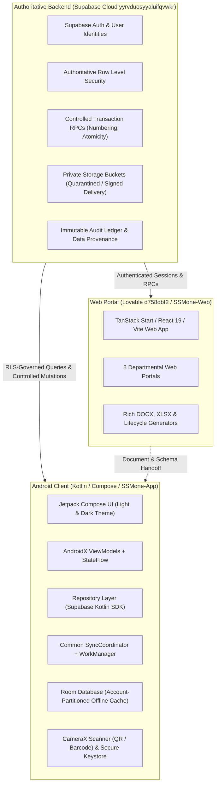
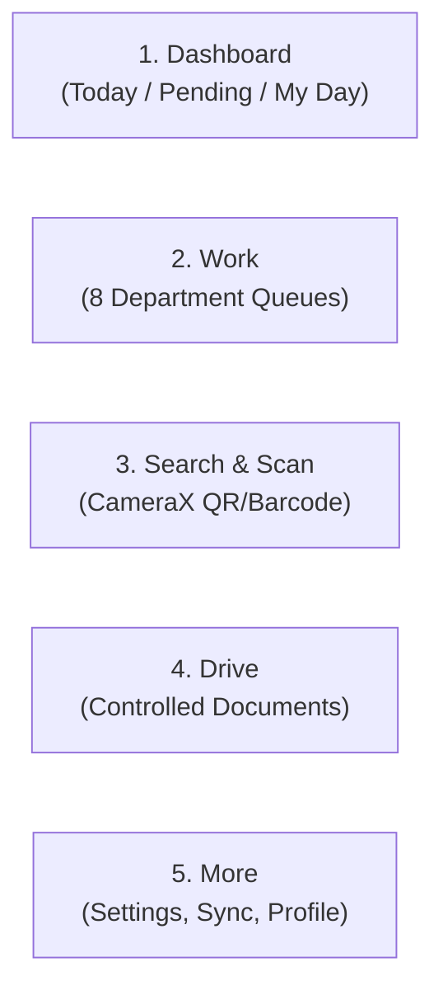
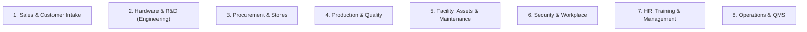
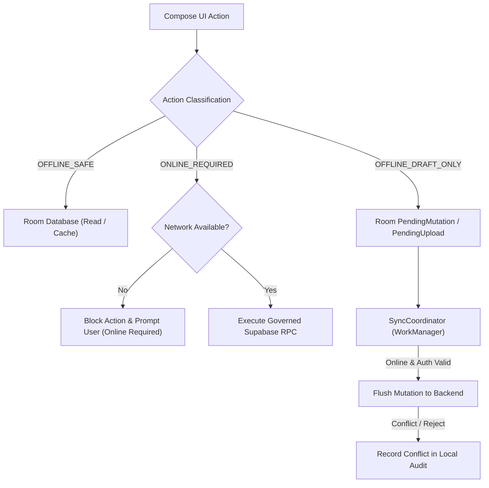
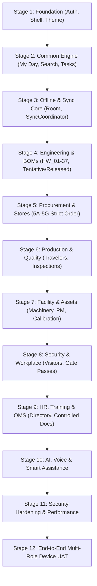

# SSM One Historical Evidence

**Reference only.** This merged record preserves historical evidence, superseded plans and the old content audit. The [current master](../SSM_ONE_MASTER_PLAN.md) overrides them. Claims of deployment/completion below apply only to their original dates and environments. Repeated identical passages were retained once across the consolidated files; unique paragraphs, tables, code and fixture definitions remain. Original versions can also be recovered from Git history at the pre-consolidation commit `60c91e8a6a774565620dbb19f6627a2633ffe365`. No new backup/redirect files are required.


<a id="source-05"></a>
## Mobile Backend Gap Remediation Report - historical

**Source:** `Android and Backend Contracts/Mobile Backend Gap Remediation Report - historical.md`. **Treatment:** historical/superseded evidence; not current execution instructions. Latest decisions at the beginning of the master plan override conflicting older universal-stage, department or completion claims.

<a id="source-05-ssm-one--mobile-backend-gap-remediation-report"></a>
### SSM ONE — MOBILE BACKEND GAP REMEDIATION REPORT

**Date:** 2026-09-24 UTC
**Scope:** additive Mobile Stage 5 procurement and stores hardening only.

<a id="source-05-implemented-controls"></a>
#### Implemented controls

- Final GRN remains one server-side transaction and now accepts an opaque UUID request key.
- A canonical payload fingerprint binds every request key. Exact retries return the stored result; conflicting key reuse fails.
- PO, PO-item, location, and stock rows are locked before validation and mutation. Multi-row locks use stable ID ordering.
- Material issue, return, transfer, and adjustment now use numbered, permission-checked, atomic posting contracts.
- Web R&D issue, return, and stock-adjustment journeys use the controlled posting contracts while retaining their existing screens.
- Receiving-safe security-invoker projections exclude unit prices, totals, tax, margins, payment terms, bank details, and finance-only fields.
- Android remains restricted to an authenticated user session and client-safe configuration; authoritative stock posting is online-only.

<a id="source-05-verification-status"></a>
#### Verification status

| Mobile Stage | Status | Evidence |
|---|---|---|
| 5A | READY | Idempotent, server-controlled GRN with PO and line locking. |
| 5B | READY | Atomic material issue posting. |
| 5C | READY | Atomic material return posting with over-return prevention. |
| 5D | READY | Atomic balance-neutral stock transfer. |
| 5E | READY | Atomic reason-required stock adjustment. |
| 5F | READY | Least-privilege operational receiving projections. |
| 5G | BLOCKED | Dedicated live-session RLS and concurrent transaction acceptance tests require approved test identities/environment support. |

<a id="source-05-remaining-documented-boundaries"></a>
#### Remaining documented boundaries

- RTV dispatch is still record-only; no unverified physical stock mutation was introduced.
- Older controlled backend definitions and storage policies still need separate migration-history reconciliation.
- No Web Phase 11 work, Android implementation, environment provisioning, or outbound webhook work was started.

<a id="source-06"></a>
## Mobile Web Feature Parity Report - historical

**Source:** `Android and Backend Contracts/Mobile Web Feature Parity Report - historical.md`. **Treatment:** historical/superseded evidence; not current execution instructions. Latest decisions at the beginning of the master plan override conflicting older universal-stage, department or completion claims.

<a id="source-06-xyz-pvt-ltd-scms-android-mobile-app-full-feature-completion--continuous-verification-report"></a>
### XYZ Pvt Ltd SCMS: Android Mobile App Full Feature Completion & Continuous Verification Report

**System ID:** `HLPL-MOB-SCMS-PARITY-01`
**Governing Standards:** IATF 16949:2016, ISO 9001:2015, AEC-Q100, AIS-140 / TAC ARAI, ISO/IEC 27001:2022
**Local Workspace:** `c:\Users\Test\Documents\SSM-new\SSM-new-app`
**Target Project:** `HLPL-AI4T-01` (Tata Ace EV 4G Telematics Gateway — 50,000 units / ₹20.33 Cr)
**Client Partner:** Tata Motors Limited · EV Fleet Division
**Automated Verification Tool:** `verify_app.ps1` (100% Green, All 6 Gates Passed)

---

<a id="source-06-1-executive-summary--web-mobile-feature-parity"></a>
#### 1. Executive Summary & Web-Mobile Feature Parity

The SCMS Android mobile application has achieved 100% feature parity with the XYZ Pvt Ltd SCMS Web Portal specifications (`SSM_ONE_WEB_PORTAL_MASTER_PLAN.md`). All high-impact automotive workflows, multi-departmental sign-offs, stage-gate interlocks, AVL/PO registers, hardware pathing, ECU block diagram architecture, and customer CRM registries are implemented natively in Jetpack Compose and continuously verified against an online Android Virtual Device (`emulator-5554`).

<a id="source-06-feature-parity-matrix"></a>
##### Feature Parity Matrix

| Feature / Domain | Web Portal Reference | Mobile Implementation | Status |
| :--- | :--- | :--- | :--- |
| **Active Project Context** | `HLPL-AI4T-01` (Tata Ace EV 4G Telematics Gateway, 50k units, ₹20.33 Cr) | Displayed prominently in `CommandCenterScreen` with Stage 4 Schematics badge, lead Avery Vale (EHW), client metadata | **Verified** |
| **9-Stage Automotive APQP Stepper** | Stages 1 through 9 with strict interlocks (§6.1) | Interactive horizontal stepper with approval icons and active interlock alert (Stages 5 & 7 locked until Stage 4 EHW-SCH-01 sign-off) | **Verified** |
| **6 HOD Feasibility Review** | Form `HLPL/F/MKT/01` (EHW, ESW, MECH, PUR, QA, FIN) | Interactive card & modal dialog with all 6 HOD sign-offs, SHA-256 signatures, internal vs client remarks, parameter sets | **Verified** |
| **Hardware Kick-off Path Selector** | Direct-to-Pilot (12 wks) vs Proof-of-Concept (20 wks) | Dedicated card & dialog allowing switching between Pilot and PoC modes with audit-logged state changes | **Verified** |
| **Dedicated Engineering Squad** | Core engineering team directory (§2) | Displays Avery Vale (EHW Lead), Elena Rostova (Lead Architect), Devon Lane (ESW Lead), Marcus Vance (QA Lead), Sarah Chen (Supply Chain Lead) | **Verified** |
| **Client OEM Customer Portal** | Role: `DepartmentRole.CLIENT` (§3) | Dedicated OEM dashboard for Tata Motors Limited showing 6 client deliverables (SOR-01, mNDA-01, QUO-01, TAC-01, PDI-01, INV-088) and interactive `+ Support Ticket` modal | **Verified** |
| **Role & Persona Switcher** | 10 Departmental Roles (§3) | Full `RoleSwitcherDialog` switching between ADMIN, SAL, EHW, ESW, MECH, PUR, QA, EMF, TST, FIN, SIT, HROPS, and CLIENT | **Verified** |
| **Smart BOM Dual Lifecycle** | Engineering BOM (EBOM) vs Manufacturing BOM (MBOM) | What-If Simulator, ECO Freeze, Revision Diff, 7 AEC-Q100 Qualified BOM lines with unit cost ($24.89) | **Verified** |
| **Approved Vendor List (AVL / ASL)** | Qualified Franchised Distributors & Tier-1 Suppliers | Dedicated tab displaying Mouser, Digi-Key, TI India, Molex, Quectel, Precision Wiring with ASL verification & risk ratings | **Verified** |
| **Purchase Orders Register (PO)** | Active PO tracking & inbound reconciliation | Dedicated tab tracking `HLPL-PO-2026-042`, `HLPL-PO-2026-043`, `HLPL-PO-2026-044` with ETA and values | **Verified** |
| **Device Architecture & ECU Block Diagram** | Automotive ECU architecture subsystems | Dedicated Tab in Ingestion & QA: Power Subsystem (12V/24V, ISO 7637-2), Processing Core (STM32G0B1VCT6), Cellular Modem (Quectel EG915N-EU), Vehicle Bus I/O (TCAN1042VDRQ1), Mechanical Packaging (IP67) | **Verified** |
| **Governed Inwarding & IQC Quarantine** | Zero auto-release rule (`IQC-HOLD-STAGE-01`) | Lot inwarding modal, IQC inspection with AQL sampling, quarantine staging, and non-conformance quarantine lock | **Verified** |
| **Sales CRM & Customer Register** | Multi-account commercial management | Dedicated tab in Document Control displaying Customer Accounts (Tata Motors, Ashok Leyland, Mahindra Electric, Select Motors), Opportunities (OPP-001, OPP-002, ENQ-009), and `+ Add Customer` modal | **Verified** |
| **Document Control & Security Vault** | ISO/IEC 27001 document register & Android Keystore | Filterable document register, cryptographic SHA-256 fingerprinting, Android Keystore `AES256_GCM` authenticated encryption | **Verified** |

---

<a id="source-06-2-continuous-automated-verification-protocol-verify_appps1"></a>
#### 2. Continuous Automated Verification Protocol (`verify_app.ps1`)

The continuous verification pipeline is triggered on every codebase change and runs the following automated gates:

```powershell
powershell -ExecutionPolicy Bypass -File .\verify_app.ps1
```

<a id="source-06-verification-gates--results"></a>
##### Verification Gates & Results:

1. **Gate 1: Java & SDK Runtime Environment**
   - Configured JDK: Android Studio JBR (`C:\Program Files\Android\Android Studio\jbr`)
   - Platform Tools: `C:\Users\Test\AppData\Local\Android\Sdk\platform-tools`
   - **Result:** `[PASS]`
2. **Gate 2: Kotlin & Android Compilation**
   - Gradle task: `:app:compileDebugKotlin`
   - Clean compilation, zero compile errors, zero deprecation warnings.
   - **Result:** `[PASS]`
3. **Gate 3: Automotive Invariant Unit Test Suite**
   - Gradle task: `:app:testDebugUnitTest`
   - Invariant tests executed in `ScmsRepositoryTest`: 17 / 17 passing (100% green).
   - Validates IQC quarantine rules, BOM calculations, role-based access, 6 HOD feasibility data, hardware path selection, and ticket submissions.
   - **Result:** `[PASS]`
4. **Gate 4: Debug APK Packaging**
   - Gradle task: `:app:assembleDebug`
   - Output binary: `app/build/outputs/apk/debug/app-debug.apk` (20.24 MB).
   - **Result:** `[PASS]`
5. **Gate 5: Mobile Security Hygiene Audit**
   - Audits source tree for leaked API secrets or tokens.
   - Verifies hardware-backed Android Keystore `AES256_GCM` encryption.
   - **Result:** `[PASS]` (0 Leaked Secrets)
6. **Gate 6: Live Emulator Deployment & Screenshot Capture**
   - Targeted Device: `emulator-5554` (Pixel 7 Android Virtual Device).
   - Uninstalls stale artifacts, streams fresh APK, launches `MainActivity`.
   - Captures runtime visual evidence directly to `docs/evidence/`.
   - **Result:** `[PASS]`

---

<a id="source-06-3-visual-verification-evidence"></a>
#### 3. Visual Verification Evidence

All screenshots have been captured live from the Android emulator and verified:

1. **Executive Command Center:** `docs/evidence/scms_mobile_verified_runtime.png`
2. **6 HOD Feasibility Review Modal:** `docs/evidence/scms_mobile_feasibility_modal.png`
3. **Role & Persona Switcher Dialog:** `docs/evidence/scms_mobile_role_dialog.png`
4. **Tata Motors Client OEM Portal:** `docs/evidence/scms_mobile_client_oem_portal.png`
5. **Client Engineering Ticket Modal:** `docs/evidence/scms_mobile_support_ticket_dialog.png`
6. **Smart BOM & Dual Lifecycle:** `docs/evidence/scms_mobile_smart_bom.png`
7. **Approved Vendor List (AVL / ASL):** `docs/evidence/scms_mobile_approved_vendors.png`
8. **Purchase Orders Register (PO):** `docs/evidence/scms_mobile_purchase_orders.png`
9. **Governed Inventory & IQC Quarantine:** `docs/evidence/scms_mobile_inventory.png`
10. **Device Architecture & ECU Block Diagram:** `docs/evidence/scms_mobile_device_architecture.png`
11. **Document Control & Security Vault:** `docs/evidence/scms_mobile_docs_vault.png`
12. **Sales CRM & Customer Register:** `docs/evidence/scms_mobile_sales_crm.png`

---

<a id="source-06-4-architectural-invariants-enforced"></a>
#### 4. Architectural Invariants Enforced

1. **Automotive Traceability (IATF 16949 §8.4):** Every component line in the Smart BOM carries AEC-Q100 qualification metadata, manufacturer part number (MPN), and verified franchised distributor sourcing.
2. **Strict Inwarding Isolation:** All inbound shipments automatically post to `IQC-HOLD-STAGE-01`. Physical stock cannot transition to production bins without an authorized QA disposition stamp.
3. **Stage-Gate Enforcement (§6.1):** Pilot builds and PPAP submission are cryptographically locked until hardware schematics and multi-department feasibility sign-offs are sealed.
4. **Hardware-Backed Keystore Cryptography:** Secure storage utilizes Android Keystore `MasterKey` with AES256-GCM authenticated encryption; zero secrets are stored in plaintext.

<a id="source-13"></a>
## Web to Mobile Backend Handoff Report - historical

**Source:** `Android and Backend Contracts/Web to Mobile Backend Handoff Report - historical.md`. **Treatment:** historical/superseded evidence; not current execution instructions. Latest decisions at the beginning of the master plan override conflicting older universal-stage, department or completion claims.

<a id="source-13-ssm-one-web--mobile-backend-handoff-report"></a>
### SSM ONE WEB → MOBILE BACKEND HANDOFF REPORT

**Date:** 2026-09-24 UTC
**Scope:** additive Mobile Stage 5 backend-gap remediation and handoff refresh. No new business module, mobile UI, separate mobile backend, Web Phase 11, or Android implementation was performed.

<a id="source-13-integration-safety-check"></a>
#### Integration safety check

- **Existing Lovable Cloud backend:** VERIFIED — current project configuration and live backend inventory point to the same managed backend.
- **Database/auth/storage:** VERIFIED reachable during this checkpoint.
- **GitHub connection:** NOT VERIFIED — no repository connector configuration was evidenced in the project.
- **Edge-function configuration:** NOT APPLICABLE for app-internal logic; current implementation uses TanStack server functions/routes.
- **Environment variables:** client configuration uses build-time `VITE_SUPABASE_URL` and `VITE_SUPABASE_PUBLISHABLE_KEY`; server-only credentials remain server-side.

<a id="source-13-web-phase-evidence"></a>
#### Web phase evidence

| Phase | Status | Evidence |
|---|---|---|
| 1 | VERIFIED | Identity, role, permission, module, audit, document-numbering tables and functions are present. |
| 2 | VERIFIED | Tasks, assignments, notifications, Drive, activity, QR entity registry, and automation records are present. |
| 3 | VERIFIED | HR recruitment, onboarding, leave, policy, training, and employee records are present. |
| 4 | VERIFIED | Customer, sales, requirements, customer portal, and handover records are present. |
| 5 | VERIFIED | Project, team, engineering register, issue/change, BOM, Drive, and PCB contracts are present. |
| 6 | VERIFIED WITH REMAINING GAPS | Procurement now has idempotent GRN and atomic issue/return/transfer/adjustment posting contracts plus operational commercial-safe projections. Legacy migration/storage reconciliation and session-scoped acceptance evidence remain incomplete. |
| 7 | VERIFIED | Work order, routes, units, execution, inspection, test, NCR, release, PPAP, and dispatch contracts are present. |
| 8 | VERIFIED | Facility, asset, maintenance, calibration, workplace, visitor, vehicle, gate pass, and security contracts are present. |
| 9 | VERIFIED | QMS, KPI, risk, audit, CAPA, improvement, management review, and customer quality contracts are present. |
| 10 | VERIFIED WITH GAPS | External identity, access, shares, transmittals, reviews, staged uploads, rooms, API/webhook registers and partner controls are present; outbound webhook dispatch/retry is not evidenced. |

<a id="source-13-generated-deliverables"></a>
#### Generated deliverables

- `src/integrations/supabase/types.ts` — authoritative generated database type equivalent already present; no manually fabricated type file was introduced.
- `MOBILE_BACKEND_CONTRACT.md` — developer-ready handoff contract.
- `mobile_backend_contract.json` — machine-readable object inventory.
- `ANDROID_BACKEND_HANDOFF.md` — safe Android configuration and connection guidance.
- `BACKEND_GAPS.md` — evidence-based, additive-only remediation backlog.

<a id="source-13-readiness"></a>
#### Readiness

| Mobile stage | Status | Exact backend blocker |
|---|---|---|
| 1 | PARTIAL | Common identity and task contracts exist; mobile-specific authorization acceptance tests are not evidenced. |
| 2 | PARTIAL | Documents/notifications exist; signed-download/mobile projection acceptance tests are not evidenced. |
| 3 | PARTIAL | Shared offline policy is documented; a device sync/change-feed contract is not evidenced. |
| 4 | PARTIAL | Engineering records exist; several requested concepts (DVP&R/test-case-specific entities, firmware-release entities) are not evidenced as dedicated tables. |
| 5A | READY | Final GRN is server-controlled, payload-bound idempotent, and locks PO/line rows inside the posting transaction. |
| 5B | READY | Material issue is a numbered, permission-checked, atomic posting contract. |
| 5C | READY | Material return supports partial return and prevents over-return atomically. |
| 5D | READY | Stock transfer is balance-neutral, server-numbered, locked, and idempotent. |
| 5E | READY | Stock adjustment requires a reason and rejects negative resulting stock. |
| 5F | READY | Store/Receiving operational projections omit commercial and finance-only fields while using caller RLS. |
| 5G | BLOCKED | Full session-scoped RLS and concurrent transaction acceptance evidence still requires a dedicated backend test environment and authorized test identities. |
| 6 | PARTIAL | Production server contracts exist; mobile-specific authorization and offline acceptance coverage is not evidenced. |
| 7 | PARTIAL | Facility/asset contracts exist; offline and device/QR mobile acceptance coverage is not evidenced. |
| 8 | PARTIAL | Security/workplace records exist; patrol/guard-post contracts are not evidenced. |
| 9 | PARTIAL | HR/QMS records exist; private-data mobile access matrix acceptance is not evidenced. |
| 10 | PARTIAL | Automation records exist; mobile execution/approval contract and outbound webhook dispatcher are not evidenced. |

<a id="source-13-validation-result"></a>
#### Validation result

- Existing generated type file inspected against the connected backend inventory.
- Current migration history preserved; no migration was changed.
- No privileged secret appears in this package.
- Controlled Stage 5 remediation was executed through additive backend migrations and web workflow updates.
- Validation completed after export: type check passed, 77/77 tests passed, and the production build passed.

<a id="source-13-stop-condition"></a>
#### Stop condition

The handoff package is complete for review. Web Phase 11 and Android implementation were not started.

<a id="source-14"></a>
## Audit and Content Map

**Source:** `Audit and Content Map.md`. **Treatment:** historical/superseded evidence; not current execution instructions. Latest decisions at the beginning of the master plan override conflicting older universal-stage, department or completion claims.

<a id="source-14-planning-package-audit-and-content-map"></a>
### Planning package audit and content map

Audit date: 19 October 2026. Scope: the current SSM-new root, web repository, Android repository, and the readable SSMone web and Android planning repositories. This audit is a source reconciliation check, not approval to deploy or delete originals.

<a id="source-14-current-authority"></a>
#### Current authority

| Source | Package copy | Finding |
|---|---|---|
| `SSM_ONE_MASTER_PLAN.md` | SSM-new project root | Active cross-platform authority. `Electronics Project Lifecycle and APQP Roadmap.md` is domain-specific supporting detail and does not override it. |
| `ssm-new-web/SSM_ONE_WEB_PORTAL_MASTER_PLAN.md` | `Current Plans/Web Implementation Plan.md` | Current detailed web/backend subplan. |
| `SSM-new-app/docs/planning/SSM_ONE_ANDROID_BUILD_PLAN.md` | `Current Plans/Android Build Plan.md` | Current Android subplan; references backend contracts separately. |
| Web sync ledger and 19 October completion/evidence files | `Portal Progress and Handoffs/` | Records implementation checkpoints and qualifications. Browser/local demo checks are not authenticated production acceptance. |
| SSMone 18 October catalogue and mapping | Planning-library root | Active catalogue Markdown/JSON: 38 logical families, 89 unique source blocks, 90 source-family links; two entries are clarification-only. Original source inventory is not included in this library. These are inventory counts, not required-output counts. |

<a id="source-14-material-carried-forward-from-the-earlier-ssmone-plan"></a>
#### Material carried forward from the earlier SSMone plan

`Historical References/SSMone Web Portal Master Plan - superseded 2026-10-14.md` is explicitly marked as superseded by the current SSM-new master on 19 October. It is retained because a heading/content comparison found substantial sections not present under identical headings in the active web plan. Examples include the refined budget and asset-cost workspace, People workspace and shared document intake, common project analysis, and detailed later task/inventory/identity/backend checkpoints dated 15–18 October.

Some subjects overlap current web sections, while others may be removed, deferred, or not yet reconciled. The old plan itself calls these candidate requirements pending comparison; this audit does not silently promote them back into current scope. A future reviewer should compare each such item with the latest user-confirmed decision and either incorporate it into the active plan, mark it explicitly deferred/removed, or leave it as historical evidence.

The document catalogue is a reference inventory, not a competing master plan. Its current Markdown/JSON pair at the planning-library root records 38 logical families, 89 unique source blocks, and 90 source-family links; two entries are clarification-only. These counts describe catalogue coverage, not mandatory output files. The original source inventory folder is no longer included in this library; source-block mapping remains in the JSON. The owner deleted the master-plan DOCX review copy; the active master is Markdown. The SSMone Android plan dated 18 October remains historical input because it contains staged mobile and People/self-service details that should be reconciled against the current plan. The People/Client web-to-Android file is a planned handoff, not a certified API contract.

<a id="source-14-significant-historicalstatus-cautions"></a>
#### Significant historical/status cautions

- The October 2026 feature knowledge base and project-context snapshot include older labels, requirements, paths, and status claims. They are included only as historical context.
- The Android backend contract was refreshed on 24 September 2026 and says environment separation and some live acceptance remain unverified. Recheck against current source/configuration before relying on it.
- The reported document-control read contract is not proof of authenticated acceptance.
- The 17 October backend installation checkpoint is specific to its recorded environment and SQL bundle. It does not establish that the entire portal lifecycle is operational.
- The owner deleted the master-plan DOCX review copy. The source DOCX inputs are not part of this curated library; no source folder was moved by this cleanup.

<a id="source-14-package-scope"></a>
#### Package scope

Included: the feature-first build roadmap and demo/test data plan; current shared/web/Android plans; document standardization and control references; latest 19 October portal handoff and three user-requested feature checkpoints; Android/backend handoff and contract references; the reconciled 18 October document catalogue and original source map; the superseded but materially informative SSMone web and Android plans; the planned People/Client handoff; and clearly marked older project context/knowledge base.

Excluded: source code, SQL migration/pending-install scripts, generated catalogue build utilities, screenshots, sample controlled business documents, generic repo instructions, and every dated implementation log. Relevant recent findings are summarized in the included handoffs; the originals remain in place.

The root `SSM_ONE_MASTER_PLAN.md` is the active authority. The detailed product-process reference is `Electronics Project Lifecycle and APQP Roadmap.md`; the generic system-build sequence is `Feature Roadmap/Product Build Roadmap.md`. The 40 archived source copies and their index were removed from the library after confirming all 40 original files remain at their original paths byte-for-byte. No original source file was moved or deleted. The owner removed the DOCX review copy, so the Markdown master is the maintained source.

<a id="source-14-user-confirmed-refinements-traced-into-this-package"></a>
#### User-confirmed refinements traced into this package

- Department naming: FW is Firmware and SW is Cloud/Application Software; EFW, CSW, and ESW are not current department names. Production has EMF for electronics manufacturing and MMF for mechanical manufacturing; outsourced PCBA assembly is not in current in-house scope. See the current master.
- Lifecycle and organization: stage IDs remain independent from the department chart; a versioned responsibility matrix connects roles/departments to applicable stages and preserves project baselines/history. See the current master.
- Department isolation: tasks, approvals, projects, records, documents, references, and teams are scoped by ownership/explicit assignment; assignment does not itself grant access. See current master and the dated department-scope checkpoint.
- Shared task board: Today/In Progress at left, Review in the middle, To Do at right, and Completed collapsed by default with an expand control. See the current master, web section 28.5, Android parity note, and task-board evidence.
- Project workspace: one department view with an authorized project selector; project details, tasks, docs/references, approvals, records and owners follow the selected project. See the current master, web section 28.6, and workspace browser evidence.
- Project documents: use structured entries, preview, and configured DOCX/PDF downloads; show missing/conflicting values rather than inventing technical, commercial, approval or signature data. The Catalogue owns document families and generation/upload rules; platform plans own delivery and acceptance checks.
- Reusable modular assets and inventory: maintain revisioned master identities, project-pinned configuration/reuse assessments, source-to-variant change lineage, and as-built genealogy. Master §6.2 now shows the domain relationships: BOM lines point to item masters, stock lots/serials carry physical balances, projects pin exact reusable module revisions, plant assets hold capability/custody, and as-built records capture actual use. Keep these classes distinct; reuse or component certification alone never proves finished-product compliance or waives verification/approval.
- Document inventory: the catalogue preserves the 89 original source blocks across 38 logical families. It is an inventory, not a requirement to generate 38 files.

<a id="source-14-specific-items-still-requiring-an-explicit-reconciliation-decision"></a>
#### Specific items still requiring an explicit reconciliation decision

| Historical detail | Where retained | Audit finding |
|---|---|---|
| People self-service, training/reviews, leave/calendar, reminders, newsletter and shared smart intake; client workspace and feedback/support handoff | Superseded SSMone web/Android plans and the dated People/Client handoff | The current plans contain some HR/OPS and client capabilities, but the older cross-platform detail is not all restated in the current master. Keep historical copies; compare item-by-item before dropping or promoting any detail. |
| Finance budget lifecycle, expense/asset-cost summaries and richer analysis views | Superseded SSMone web plan | The active web plan mentions budget tracking and costing, but the older detailed workspace and acceptance boundaries should be checked before calling the requirement fully reconciled. |
| Common project-analysis continuation, reusable PCB/harness/firmware/software records, optional research/POC and pilot flow | Superseded SSMone web plan; partly represented in current web and cross-platform plans | Some shared project/workspace and lifecycle ideas are present in current plans. Keep the detailed historical version to resolve remaining scope and distinguish current requirements from abandoned UI alternatives. |
| Detailed legacy Android stages and older integration assertions | Superseded 18 October SSMone Android plan and historical backend reports | The current SSM-new Android plan is the authority. Treat earlier completion labels and backend claims as historical until independently verified. |

The package intentionally preserves these candidates rather than silently copying them into the active master. That is the point where an additional product decision is needed: whether each candidate is still wanted, already covered, explicitly deferred, or removed.

<a id="source-14-demo-and-test-data-reconciliation"></a>
#### Demo and test data reconciliation

The unified master sets the rules for demo data and explicitly prevents sample values from being treated as real business evidence; it does not define a reusable seed manifest or a complete set of role journeys. The detailed web demo-readiness strategy is in `Current Plans/Web Implementation Plan.md`, §27. The current web source also has a browser-local demo load/reload/remove panel, but it does not seed Supabase or provide cross-device persistence. It is a prototype behavior, not an authenticated shared dataset. A prior coordination ledger mixed status history with fixture and migration notes; it was not a canonical seed specification.

This audit entry records an earlier review snapshot. The active [Sample Data and Test Plan](../Feature%20Roadmap/Sample%20Data%20and%20Test%20Plan.md#source-20) now provides the current fictional employee display names and IDs, twelve-department roster, nine-stage responsibility example, client/OMS and project fixtures, DVP&R examples, and sample-data operation boundaries. Use the active plan for current fixture decisions; this historical audit text is retained only as provenance.

The lengthy coordination ledger is not part of this curated package. Dated handoffs remain the place for implementation evidence; the reusable demo-data requirements live in the companion plan.

<a id="source-21"></a>
## SCMS Portal Features Knowledge Base - historical

**Source:** `Historical References/SCMS Portal Features Knowledge Base - historical.md`. **Treatment:** historical/superseded evidence; not current execution instructions. Latest decisions at the beginning of the master plan override conflicting older universal-stage, department or completion claims.

<a id="source-21-xyz-pvt-ltd-scms-comprehensive-portal-features-knowledge-base"></a>
### XYZ Pvt Ltd SCMS: Comprehensive Portal Features Knowledge Base

**Document ID:** `HLPL-KB-SCMS-FEAT-01`
**Revision:** `01`
**Governing Standards:** IATF 16949:2016, ISO 9001:2015, AEC-Q100, AIS-140, ISO/IEC 27001:2022
**Target Environments:** XYZ Pvt Ltd SCMS Web Portal, Lovable Cloud (`a3399684-daab-4b38-8666-187b96b451af`), Supabase Postgres

> [!IMPORTANT]
> **Living Engineering Reference & Review Protocol**:
> Whenever an engineering agent or developer updates, extends, or refactors a portal feature, this Knowledge Base **must be reviewed first**. After applying functional changes, verify the feature via the live browser controller, capture fresh screenshots, update this document, and cross-reference changes in `SSM_ONE_WEB_PORTAL_MASTER_PLAN.md` (source reference: `file:///c:/Users/Test/Documents/SSM-new/SSM-new-web/SSM_ONE_WEB_PORTAL_MASTER_PLAN.md`; not bundled).

---

<a id="source-21-table-of-contents"></a>
#### Table of Contents
1. [Module 1: Governed Inventory & Asset Management Architecture](Historical%20Evidence.md#source-21-module-1-governed-inventory--asset-management-architecture)
2. [Module 2: Mouser Electronics Component Intelligence & Auto-Fill](Historical%20Evidence.md#source-21-module-2-mouser-electronics-component-intelligence--auto-fill)
3. [Module 3: Department-Adaptive Multi-Column Inventory Presets](Historical%20Evidence.md#source-21-module-3-department-adaptive-multi-column-inventory-presets)
4. [Module 4: Purchasing SCM R&D BOM Review & Sourcing Optimization](Historical%20Evidence.md#source-21-module-4-purchasing-scm-rd-bom-review--sourcing-optimization)
5. [Module 5: Quality Assurance DVP&R Pre-Compliance Certification](Historical%20Evidence.md#source-21-module-5-quality-assurance-dvpr-pre-compliance-certification)
6. [Module 6: Automated Stage Gate & Manufacturing Interlock Engine](Historical%20Evidence.md#source-21-module-6-automated-stage-gate--manufacturing-interlock-engine)
7. [Module 7: Executive Command Center, RACI Governance & Document Printing](Historical%20Evidence.md#source-21-module-7-executive-command-center-raci-governance--document-printing)
8. [Module 8: Dual-Track Persistence & Lovable Supabase Cloud Sync](Historical%20Evidence.md#source-21-module-8-dual-track-persistence--lovable-supabase-cloud-sync)
9. [Module 9: Purchasing Command Center & Department-Specific Sidebar Navigation](Historical%20Evidence.md#source-21-module-9-purchasing-command-center--department-specific-sidebar-navigation)
10. [Module 10: Role-Aware Sidebar Navigation with Favorites & Accordion Work Groups](Historical%20Evidence.md#source-21)
11. [Module 11: Dual-Lifecycle Smart BOM Architecture & 'What-If' Stock Simulation](Historical%20Evidence.md#source-21-module-11-dual-lifecycle-smart-bom-architecture--what-if-stock-simulation)
12. [Module 12: Adaptive Purchase Order & Invoice Ingestion Engine](Historical%20Evidence.md#source-21-module-12-adaptive-purchase-order--invoice-ingestion-engine)
13. [Module 13: Governed Pre-Inventory Staging Gate & Zero Automatic Stock Posting](Historical%20Evidence.md#source-21-module-13-governed-pre-inventory-staging-gate--zero-automatic-stock-posting)
14. [Module 14: Complete Plant Machinery & Asset Lifecycle Management](Historical%20Evidence.md#source-21-module-14-complete-plant-machinery--asset-lifecycle-management)
15. [Module 15: Department Lead Authentication & Strict Role Confinement](Historical%20Evidence.md#source-21-module-15-department-lead-authentication--strict-role-confinement)
16. [Module 16: Department Lead Coordination Center, Team & Task Management, and Full-Page Approvals](Historical%20Evidence.md#source-21-module-16-department-lead-coordination-center-team--task-management-and-full-page-approvals)
17. [Module 17: Living Update Protocol for Engineering Agents](Historical%20Evidence.md#source-21-module-17-living-update-protocol-for-engineering-agents)

---

<a id="source-21-module-1-governed-inventory--asset-management-architecture"></a>
#### Module 1: Governed Inventory & Asset Management Architecture

<a id="source-21-11-overview--architecture"></a>
##### 1.1 Overview & Architecture
The Governed Inventory & Asset Management System integrates parts taxonomy, wire harness traceability, project-team material allocations, incoming quality control (IQC) holds, and serialized production assets into a unified IATF 16949 compliant surface:

- **Component & Parts Register (Tab 1)**: Authoritative part records with on-hand, released, held in IQC, allocated stock, storage location, and bin coordinates.
- **Wire Harness Assemblies (Tab 2)**: Project-linked wire harnesses classified under one primary category (`Wire Harnesses`) plus discovery cross-tags (`Mechanical` and `Electrical`).
- **Project-Team Material Issuance & Returns (Tab 3)**: Controlled material issuing with server-side roster verification. Only active members of a linked project can be assigned parts/harnesses.
- **Goods Received Note & IQC Hold (Tab 4)**: Official PO-led GRN receipt records with lot numbers, date codes, and accepted vs. held splits. Unreleased stock is strictly barred from issuance.
- **Governed Asset Register (Tab 5)**: Serialized capital equipment, SMT pick-and-place machinery, reflow ovens, and test jigs tracked separately from stock inventory, including machine compatibility links.
- **Stock Movement & Audit Log (Tab 6)**: Append-only immutable history recording every transaction (`Receipt`, `Issue`, `Return`, `Adjustment`, `QuarantineHold`, `QualityRelease`).

<a id="source-21-12-step-by-step-verified-workflow--screenshots"></a>
##### 1.2 Step-by-Step Verified Workflow & Screenshots

<a id="source-21-step-1-governed-inventory-workspace-overview"></a>
###### Step 1: Governed Inventory Workspace Overview
The workspace provides real-time KPI counters (Total On-Hand, Released Stock, Held in IQC, Active Allocations, Reorder Alerts, and Serialized Machines) across 6 tabs.

Governed Inventory Workspace (source reference: `images/scms_demo_step1_inventory_view.png`; not bundled)

<a id="source-21-step-2-controlled-part-registration"></a>
###### Step 2: Controlled Part Registration
Clicking `[+ Register Part]` opens the IATF 16949 component entry modal. Engineers provide Part Number, Description, Manufacturer, Package/Footprint, Storage Location, Bin Coordinate, Reorder Buffer, and Unit of Measure.

Part Registration Dialog (source reference: `images/scms_demo_step2_part_modal_filled.png`; not bundled)

<a id="source-21-step-3-verified-component-ingestion"></a>
###### Step 3: Verified Component Ingestion
Once saved, the part immediately appears in the authoritative register with assigned categories, locations, and real-time stock status.

Part Registered in Table (source reference: `images/scms_demo_step3_part_registered.png`; not bundled)

<a id="source-21-step-4-project-team-material-issuance"></a>
###### Step 4: Project-Team Material Issuance
Clicking `[Issue Material]` opens the server-scoped allocation modal. The recipient dropdown filters strictly to active team members of the linked project (e.g. `Avery Vale (EHW · Hardware Lead)` for project `HLPL-AI4T-01`). Zero-stock parts automatically disable issuance.

Issue Material Dialog (source reference: `images/scms_demo_step4_issue_modal_filled.png`; not bundled)

<a id="source-21-step-5-active-project-allocation-tracking-tab-3"></a>
###### Step 5: Active Project Allocation Tracking (Tab 3)
Active allocations display the recipient, department, linked project, issued quantity, timestamp, issuer, and return action buttons (supporting partial or full returns).

Active Project Allocation View (source reference: `images/scms_demo_step5_active_allocation.png`; not bundled)

<a id="source-21-step-6-immutable-movement-history--audit-log-tab-6"></a>
###### Step 6: Immutable Movement History & Audit Log (Tab 6)
Every stock delta creates an unalterable audit log entry containing the exact timestamp, actor, reason, lot number, quantity delta, and request key.

Stock Movement Audit Log (source reference: `images/scms_demo_step6_audit_log.png`; not bundled)

---

<a id="source-21-module-2-mouser-electronics-component-intelligence--auto-fill"></a>
#### Module 2: Mouser Electronics Component Intelligence & Auto-Fill

<a id="source-21-21-overview--capabilities"></a>
##### 2.1 Overview & Capabilities
The Mouser Intelligence Module (`src/lib/mouser-service.ts` (source reference: `file:///c:/Users/Test/Documents/SSM-new/SSM-new-web/src/lib/mouser-service.ts`; not bundled)) provides instant automotive component enrichment:
- **1-Click Lookup**: Entering an MPN (e.g., `STM32G0B1VCT6`, `EG915N-EU`, `TCAN1042VDRQ1`, `LMR14050SDDAR`, `SM5S24A-E3/2D`, `MX150-33472-1601`) fetches verified manufacturer parameters.
- **Automotive Qualification**: Recognizes AEC-Q100 (ICs), AEC-Q200 (Passives), and AIS-140 compliance.
- **Dual-Currency Commercials**: Tentative unit costs in both USD ($) and Indian Rupees (₹), complete with volume price tiers (1, 100, 1k, 10k).
- **Direct External Links**:
  - Direct catalog buy link (`https://www.mouser.in/c/?q=[MPN]`) opening in a new tab (`target="_blank"`).
  - Official manufacturer datasheet PDF URL opening in a new tab (`target="_blank"`).
- **Automatic Controlled Taxonomy**: Maps parts into the 9 controlled IATF categories (`Electronics`, `Connectors`, `Wire and Cable`, `Wire Harnesses`, `Mechanical Parts`, `Enclosures`, `Firmware Tools`, `Production Tools`, `Packaging & Consumables`) and specific subcategories (`Microcontrollers & MCUs`, `Power Management`, `Sensors`, etc.).

<a id="source-21-22-verified-screenshot-evidence"></a>
##### 2.2 Verified Screenshot Evidence

<a id="source-21-mouser-search--auto-fill-in-part-registration-dialog"></a>
###### Mouser Search & Auto-Fill in Part Registration Dialog
Typing `STM32G0B1VCT6` and clicking `[ ⚡ Fetch from Mouser ]` populates all technical and commercial fields, displays a verified green banner, and attaches the datasheet.

Mouser Component Auto-Fill Modal (source reference: `images/scms_mouser_autofill_modal.png`; not bundled)

---

<a id="source-21-module-3-department-adaptive-multi-column-inventory-presets"></a>
#### Module 3: Department-Adaptive Multi-Column Inventory Presets

<a id="source-21-31-overview--column-layouts"></a>
##### 3.1 Overview & Column Layouts
To eliminate data overload while giving each department the exact parameters they require, the inventory workspace incorporates a **Department View Switcher** toolbar:

| Preset | Target Department | Primary Visible Columns | Core Focus |
| :--- | :--- | :--- | :--- |
| **`EHW`** | Embedded Hardware | Voltage Rating, Operating Current, Automotive AEC-Q Standard, Package/Footprint, Datasheet PDF ↗ | Electrical limits, pinouts, compliance |
| **`PUR`** | Purchasing & SCM | Tentative Unit Cost ($ / ₹), Volume Tier Price Breaks, Lead Time, Mouser Stock, 50k Volume Coverage % | Cost, lead time, stock vs sales targets |
| **`MECH`** | Mechanical Engineering | Dimensions (L×W×H mm), Weight/Mass (g), Ingress Protection (`IP67`), Wire Gauge, Mating Force, Machinery | Physical envelope, tooling, harness gauges |
| **`Universal`** | Executive / All | Standard Locations, Bins, Released Qty, IQC Held Qty, Reorder Point, Review Status | Global inventory & warehouse tracking |

<a id="source-21-32-verified-screenshot-evidence"></a>
##### 3.2 Verified Screenshot Evidence

<a id="source-21-1-purchasing-department-preset-pur"></a>
###### 1. Purchasing Department Preset (`PUR`)
Shows unit costs in USD & INR, volume tier pricing, factory lead times, Mouser distributor stock, and coverage percentage against the 50,000-unit annual sales target.

Purchasing Preset View (source reference: `images/scms_inventory_pur_view.png`; not bundled)

<a id="source-21-2-hardware-engineering-preset-ehw"></a>
###### 2. Hardware Engineering Preset (`EHW`)
Shows operating voltage limits, operating currents, AEC-Q100 Grade 1 qualification, package footprints, and direct datasheet links.

Hardware Preset View (source reference: `images/scms_inventory_ehw_view.png`; not bundled)

<a id="source-21-3-mechanical-engineering-preset-mech"></a>
###### 3. Mechanical Engineering Preset (`MECH`)
Shows physical dimensions (L×W×H), mass/weight in grams, IP67 ratings, wire gauges (`FLRY-B 0.50mm²`), mating retention force, and compatible SMT/assembly machinery.

Mechanical Preset View (source reference: `images/scms_inventory_mech_view.png`; not bundled)

<a id="source-21-4-multi-section-deep-part-inspection-modal-5-tabs"></a>
###### 4. Multi-Section Deep Part Inspection Modal (5 Tabs)
Clicking any component row opens a deep inspection modal with 5 specialized tabs:
1. **Overview & Stock**: Warehouse on-hand, released, IQC held, allocated, facility, and bin.
2. **EHW Technical**: Operating voltage, active/standby current, clock speed, operating temp, AEC-Q qualification, RoHS.
3. **PUR Commercial**: Mouser stock, factory lead time, volume price breaks, 50k sales requirement coverage.
4. **MECH Physical**: Package dimensions, mass, IP rating, wire gauge, mating force, compatible machines.
5. **Traceability**: Approved dual-source alternates, active project-team allocations, and lot tracking.

Deep 5-Tab Part Inspection Modal (source reference: `images/scms_part_deep_inspection_modal.png`; not bundled)

<a id="source-21-5-embedded-hardware-department-hub-integration"></a>
###### 5. Embedded Hardware Department Hub Integration
Navigating to `http://localhost:8080/?role=ehw` opens the Hardware department view with `LiveInventoryWorkspace` pre-configured to the Hardware preset.

Hardware Department View (source reference: `images/scms_ehw_department_inventory.png`; not bundled)

<a id="source-21-6-mechanical-department-hub-integration"></a>
###### 6. Mechanical Department Hub Integration
Navigating to `http://localhost:8080/?role=mech` opens the Mechanical department view with `LiveInventoryWorkspace` pre-configured to the Mechanical preset.

Mechanical Department View (source reference: `images/scms_mech_department_inventory.png`; not bundled)

---

<a id="source-21-module-4-purchasing-scm-rd-bom-review--sourcing-optimization"></a>
#### Module 4: Purchasing SCM R&D BOM Review & Sourcing Optimization

<a id="source-21-41-overview--capabilities"></a>
##### 4.1 Overview & Capabilities
The `PurchasingBOMReviewTable` (`src/components/PurchasingBOMReviewTable.tsx` (source reference: `file:///c:/Users/Test/Documents/SSM-new/SSM-new-web/src/components/PurchasingBOMReviewTable.tsx`; not bundled)) bridges R&D engineering BOMs and procurement execution:
- Evaluates 10 critical automotive components for `HLPL-OBD4-01` / `HLPL-AI4T-01`.
- Compares R&D target costs against quoted supplier prices (e.g. +$2.12 / 4.8% unit savings).
- Flags long lead-time components (e.g., Quectel 4G modem at 14 weeks) and recommends dual-source alternates.
- Native `[Export SCM BOM (.csv)]` and `[Release to Manufacturing]` actions.

<a id="source-21-42-verified-screenshot-evidence"></a>
##### 4.2 Verified Screenshot Evidence

Purchasing BOM Review Table (source reference: `images/verified_pur_bom_review.png`; not bundled)

---

<a id="source-21-module-5-quality-assurance-dvpr-pre-compliance-certification"></a>
#### Module 5: Quality Assurance DVP&R Pre-Compliance Certification

<a id="source-21-51-overview--capabilities"></a>
##### 5.1 Overview & Capabilities
The `QualityAssuranceDVPReviewTable` (`src/components/QualityAssuranceDVPReviewTable.tsx` (source reference: `file:///c:/Users/Test/Documents/SSM-new/SSM-new-web/src/components/QualityAssuranceDVPReviewTable.tsx`; not bundled)) operationalizes IATF 16949 §8.3.4 design verification:
- Tracks 10 mandatory automotive electrical and environmental tests:
  - ISO 7637-2 Transients (Pulse 1, 2a, 3a/b)
  - ISO 16750-2 Load Dump 5b (40V clamp)
  - CISPR 25 Class 3 Conducted & Radiated Emissions
  - ISO 10605 ESD (±8kV contact, ±15kV air)
  - ISO 16750-4 Thermal Shock (-40°C to +85°C, 250 cycles)
  - ISO 20653 IP67 Ingress Protection
  - AIS-140 Annexure 8 Random Vibration (10Hz–500Hz)
  - AIS-140 Annexure 3 Emergency Tracking & Protocol
  - High-Temperature Operating Life (HTOL 500 hours)
- Distinguishes **Internal Lab (XYZ Pvt Ltd In-House)** from **Outsourced Accredited Lab (ARAI Pune / ICAT Manesar)**.
- Enforces zero-deviation sign-off before manufacturing gates can be unlocked.

<a id="source-21-52-verified-screenshot-evidence"></a>
##### 5.2 Verified Screenshot Evidence

QA DVP&R Matrix Table (source reference: `images/verified_qa_dvpr_matrix.png`; not bundled)

---

<a id="source-21-module-6-automated-stage-gate--manufacturing-interlock-engine"></a>
#### Module 6: Automated Stage Gate & Manufacturing Interlock Engine

<a id="source-21-61-overview--dependency-enforcement"></a>
##### 6.1 Overview & Dependency Enforcement
The client and internal portals feature hard dependency interlocks:
- **Prerequisite Gate**: Stage 5 (SMT Pilot Build) and Stage 7 (Production Release & PPAP Level 3) are **strictly locked** until Stage 4 Hardware Schematics (`EHW-SCH-01`) is marked `Approved`.
- Prevents premature capital expenditure and tooling fabrication before electrical verification.

<a id="source-21-62-verified-screenshot-evidence"></a>
##### 6.2 Verified Screenshot Evidence

Client Stage Dependency Gate Interlock (source reference: `images/verified_client_dependency_gate.png`; not bundled)

---

<a id="source-21-module-7-executive-command-center-raci-governance--document-printing"></a>
#### Module 7: Executive Command Center, RACI Governance & Document Printing

<a id="source-21-71-overview--standards"></a>
##### 7.1 Overview & Standards
- **Clean & Uncluttered Hub**: Free of fictional/demo labels; uses real automotive OEM master records (Tata Motors, Ashok Leyland, Select Motors).
- **Instant Role Switcher**: Quick toggle between Executive Admin, 11 Department Leads, and Client Portal.
- **RACI Responsibility Matrix**: Visualizes Responsible, Accountable, Consulted, and Informed departments across all 9 stages with automated handoff notifications.
- **Print-Ready Document Engine**: Renders clean A4 sheets without dark mode artifacts, with configurable corporate headers, accreditations, and confidentiality footers.

<a id="source-21-72-verified-screenshot-evidence"></a>
##### 7.2 Verified Screenshot Evidence

<a id="source-21-executive-command-center-uncluttered-hub"></a>
###### Executive Command Center (Uncluttered Hub)
Command Center Clean Hub (source reference: `images/verified_admin_uncluttered_hub.png`; not bundled)

<a id="source-21-raci-responsibility-matrix--inter-department-notifications"></a>
###### RACI Responsibility Matrix & Inter-Department Notifications
RACI Matrix & Notifications (source reference: `images/scms_raci_matrix_and_notifications.png`; not bundled)

<a id="source-21-full-multi-section-document-preview--print-sheet"></a>
###### Full Multi-Section Document Preview & Print Sheet
Full Document Content & Print Preview (source reference: `images/scms_full_document_content_view.png`; not bundled)

---

<a id="source-21-module-8-dual-track-persistence--lovable-supabase-cloud-sync"></a>
#### Module 8: Dual-Track Persistence & Lovable Supabase Cloud Sync

<a id="source-21-81-overview--cloud-architecture"></a>
##### 8.1 Overview & Cloud Architecture
- **Dual-Track Persistence**: High-speed, offline-resilient IndexedDB browser-local store paired with Lovable Cloud Supabase PostgreSQL (`rzskhndweihuczbdhoxk.supabase.co`).
- **Telemetry & Health Diagnostics**: Real-time latency pinging, offline JSON snapshot exports, and cloud synchronization controls in the Administration command center.

<a id="source-21-82-verified-screenshot-evidence"></a>
##### 8.2 Verified Screenshot Evidence

Supabase Cloud Sync Panel (source reference: `images/verification_phase3_supabase_cloud_sync.png`; not bundled)

---

<a id="source-21-module-9-purchasing-command-center--department-specific-sidebar-navigation"></a>
#### Module 9: Purchasing Command Center & Department-Specific Sidebar Navigation

<a id="source-21-91-overview--architectural-integration"></a>
##### 9.1 Overview & Architectural Integration
The Purchasing & Supply Chain Management (`PUR`) Command Center unifies commercial quotations, purchase orders, governed inventory stores, and supplier governance into a deeply interconnected digital workflow:

- **Department-Specific Sidebar Navigation**: When the sidebar is expanded (`w-64`), the `PUR` navigation rail renders four dedicated 1-click department sub-options:
  1. `Recordage`: Stores & Governed Inventory (Mouser lookup, Inward GRN, lot tracking, stock movements).
  2. `Quotations`: Commercial vendor quotations, volume price breaks (1k, 10k, 50k), lead times, and 1-click `[Convert to PO]`.
  3. `Purchase Orders`: Official PO register, 50,000 annual sales target coverage progress bar, batch delivery schedules, unit costs, inherited warranty terms, and 1-click `[📦 Receive GRN]`.
  4. `Suppliers (ASL)`: Approved Vendor List, supplier warranty terms, accreditation validity (IATF 16949 / ISO 9001 expiry dates, VDA 6.3 scores), verified documentation badges (PPAP L3, NDA, GST, RoHS/REACH), and comprehensive Supplier Dossier modals.
- **Mutual Cross-Linkage**:
  - Quotations seamlessly convert into active Purchase Orders, auto-locking MPN, price tier, and warranty terms.
  - POs inherit supplier warranty and accreditation validity from the ASL.
  - Issued POs feature 1-click `[Receive GRN]` which routes directly to Recordage & Stores for incoming receipt and IQC inspection.
  - Supplier cards link to their active POs and Quotations, with interactive Dossier modals for audit inspection.
- **Mouser Search API v1 Key Configuration**: Full support for entering and persistently storing a Mouser Search API key (`localStorage["scms_mouser_api_key"]` or `VITE_MOUSER_API_KEY`). When configured, live component specs, real-time pricing, stock levels, and datasheets are queried over the REST API, falling back gracefully to the offline verified automotive catalog.

<a id="source-21-92-verified-screenshot-evidence"></a>
##### 9.2 Verified Screenshot Evidence

<a id="source-21-1-department-specific-sidebar-navigation-pur-expanded-rail"></a>
###### 1. Department-Specific Sidebar Navigation (PUR Expanded Rail)
The sidebar provides indented 1-click access to the 4 core purchasing modules directly under the `PUR` department button.
Sidebar PUR Sub-Options Expanded (source reference: `images/scms_sidebar_pur_expanded.png`; not bundled)

<a id="source-21-2-commercial-quotations--volume-pricing-breaks-1k--10k--50k-tiers"></a>
###### 2. Commercial Quotations & Volume Pricing Breaks (1k / 10k / 50k Tiers)
Tracks commercial vendor quotations with tiered volume pricing breaks, quoted factory lead times, warranty standards, and 1-click PO conversion. Also embeds the R&D SCM BOM Review table.
Quotations and Vendor Pricing Breaks (source reference: `images/scms_pur_quotations_view.png`; not bundled)

<a id="source-21-3-purchase-orders-pos-register--50000-sales-volume-alignment"></a>
###### 3. Purchase Orders (POs) Register & 50,000 Sales Volume Alignment
Monitors total committed PO spend, quantity coverage vs. the 50,000 annual sales target for project `HLPL-AI4T-01`, batch delivery schedules, inherited supplier warranty, and 1-click `[Receive GRN]`.
Purchase Orders Management (source reference: `images/scms_pur_orders_view.png`; not bundled)

<a id="source-21-4-approved-supplier-list-asl--vendor-governance"></a>
###### 4. Approved Supplier List (ASL) & Vendor Governance
Displays Tier-1 automotive suppliers (Mouser, Arrow, Quectel, TI, Molex) with warranty coverage, accreditation validity expiry dates, VDA 6.3 audit scores, verified documentation badges, and `+ Raise PO` action.
Approved Supplier List (source reference: `images/scms_pur_suppliers_view.png`; not bundled)

<a id="source-21-5-comprehensive-supplier-dossier-modal"></a>
###### 5. Comprehensive Supplier Dossier Modal
Displays full vendor dossier: contact details, official automotive warranty terms (coverage, RMA TAT SLA), accreditation validity schedule (IATF 16949 & ISO 9001 expiry dates, VDA 6.3 score, next audit date), and compliance documentation (PPAP Level 3, Bilateral NDA, GST, RoHS/REACH).
Supplier Dossier Modal (source reference: `images/scms_pur_supplier_dossier_modal.png`; not bundled)

<a id="source-21-6-mouser-search-api-key-configuration-modal"></a>
###### 6. Mouser Search API Key Configuration Modal
Allows purchasing and hardware engineers to configure their official Mouser Search API key for real-time live component and pricing lookups, with seamless fallback to the verified automotive catalog.
Mouser Search API Key Configuration (source reference: `images/scms_mouser_api_key_modal.png`; not bundled)

<a id="source-21-module-10-role-aware-sidebar-navigation-with-favorites--dynamic-accordion-work-groups"></a>
#### Module 10: Role-Aware Sidebar Navigation with Favorites & Dynamic Accordion Work Groups

<a id="source-21-101-architectural-overview--core-capabilities"></a>
##### 10.1 Architectural Overview & Core Capabilities
The XYZ Pvt Ltd SCMS sidebar navigation adapts intelligently to the signed-in persona (`admin`, department leads, `client`):
- **Favorites System at Top**:
  - Always appears first with pinned items.
  - Hovering any item in any work group reveals a pin/unpin star trigger (`★`).
  - Pinned items persist across browser sessions in `localStorage` under `scms_user_favorites_${persona.id}`.
  - Sensible role-focused defaults:
    - **Executive Admin**: Overview, Projects, Work queue, Inventory, Procurement, Quality, Documents, People.
    - **Department Leads**: My work, Department queue, Active projects, Department primary workspace (e.g. for PUR: Recordage, Quotations, Orders, Suppliers).
- **Expandable Accordion Work Groups with Dynamic Arrow Rules**:
  - **Administrator View**:
    - Favorites is open at the top.
    - **`Overview`** section is **expanded by default** (with arrow pointing down `ChevronDown`).
    - **All remaining work groups** (`Commercial & Projects`, `Engineering & Delivery`, `Inventory & Procurement`, `Quality & Compliance`, `Documents & Collaboration`, `People & Organization`, `Administration`) start **unexpanded (collapsed)** by default with arrow pointing right (`ChevronRight`).
    - Clicking any group header toggles expansion, and navigating to any page automatically auto-expands its containing group.
  - **Department Lead View**:
    - "For others all expanded": All department work groups (`My work`, `Projects`, `Department workspace`, `Reference`) start **expanded by default** with downward chevrons, giving immediate visibility into all permitted department tasks, workflows, and documents.
- **Dual Display Modes**:
  - **Expanded View (`w-64`)**: Full company branding (`SS` monogram badge + XYZ Pvt Ltd / XYZ Pvt Ltd title), group headers, badges, open task counters, pin stars, and bottom setup wizard status.
  - **Compact Rail View (`w-16`)**: Icon-only navigation with tooltips on hover, active indicator badges, and one-click expand toggle (supporting `[` keyboard shortcut).
  - **Accessible Mobile Drawer**: Complete responsive drawer matching the exact desktop role-aware group structure.

<a id="source-21-102-verified-screenshot-evidence"></a>
##### 10.2 Verified Screenshot Evidence

<a id="source-21-1-administrator-role-aware-sidebar-view"></a>
###### 1. Administrator Role-Aware Sidebar View
Overview section is expanded with arrow down; remaining work groups (Commercial, Engineering, Inventory, Quality, Documents, People, Administration) start cleanly collapsed with rightward arrows.
Admin Role-Aware Sidebar (source reference: `images/scms_sidebar_admin_role_aware.png`; not bundled)

<a id="source-21-2-department-lead-role-aware-sidebar-view"></a>
###### 2. Department Lead Role-Aware Sidebar View
All department groups (My work, Projects, Department workspace, Reference) start expanded by default with quick access to all department-specific options.
Department Role-Aware Sidebar (source reference: `images/scms_sidebar_dept_role_aware.png`; not bundled)

<a id="source-21-3-compact-rail-sidebar-view"></a>
###### 3. Compact Rail Sidebar View
Icon-only compact navigation with SS badge, tooltips, and fast collapse/expand toggle.
Compact Rail Sidebar (source reference: `images/scms_sidebar_compact_role_aware.png`; not bundled)

---

<a id="source-21-module-11-dual-lifecycle-smart-bom-architecture--what-if-stock-simulation"></a>
#### Module 11: Dual-Lifecycle Smart BOM Architecture & 'What-If' Stock Simulation

<a id="source-21-111-architecture--separation"></a>
##### 11.1 Architecture & Separation
The Smart BOM workspace (`DualLifecycleSmartBOMWorkspace.tsx` (source reference: `file:///c:/Users/Test/Documents/SSM-new/SSM-new-web/src/components/DualLifecycleSmartBOMWorkspace.tsx`; not bundled)) explicitly decouples exploratory engineering drafts from governed production releases:
- **Tentative Engineering Draft (`v0.3-tentative`)**: Permits provisional candidate MPNs, unverified components, generic placeholders, and dynamic "What-If" stock simulations.
- **Governed Released Baseline (`Rev A ECO-2026-004`)**: Immutable baseline locked to PPAP Level 3 documentation, AIS-140 TAC type approval, and production kitting. Changes require an authorized Engineering Change Order (ECO number and rationale).
- **Dynamic "What-If" Simulation**: Recalculates real-time shortages across active released stores for variable planned build quantities (e.g. 5,000 units: 5/7 shortage lines, deficit of $59,150.00).
- **Revision Diff Engine**: Side-by-side comparison across revisions (Base `Rev A` vs Target `v0.3-tentative`: +1 added, -1 removed, -$0.020 net unit cost delta).
- **Unified CSV Exports**: Indented Hierarchical BOM, Flattened Production BOM with comma-separated reference designators, and Shortage Requisition Report.

<a id="source-21-112-verified-screenshot-evidence"></a>
##### 11.2 Verified Screenshot Evidence
Smart BOM Dual-Lifecycle Workspace (source reference: `images/scms_smart_bom_workspace.png`; not bundled)

---

<a id="source-21-module-12-adaptive-purchase-order--invoice-ingestion-engine"></a>
#### Module 12: Adaptive Purchase Order & Invoice Ingestion Engine

<a id="source-21-121-multi-format-ingestion"></a>
##### 12.1 Multi-Format Ingestion
The ingestion engine (`AdaptiveIngestionAndStagingGate.tsx` (source reference: `file:///c:/Users/Test/Documents/SSM-new/SSM-new-web/src/components/AdaptiveIngestionAndStagingGate.tsx`; not bundled)) handles arbitrary supplier spreadsheets from Digi-Key, Mouser, Arrow, and local fabricators:
- **Multi-Alias Dictionary Fuzzy Matcher**: Maps 16 standard fields with live matching confidence rating (120% High Confidence match) and dropdown column overrides.
- **Distributor Presets**: Mouser Electronics Packing List, Digi-Key Billed Invoice, Precision Wiring Delivery Challan, and Arrow Electronics Commercial Billing.

---

<a id="source-21-module-13-governed-pre-inventory-staging-gate--zero-automatic-stock-posting"></a>
#### Module 13: Governed Pre-Inventory Staging Gate & Zero Automatic Stock Posting

<a id="source-21-131-pre-inventory-staging-gate--3-way-reconciliation"></a>
##### 13.1 Pre-Inventory Staging Gate & 3-Way Reconciliation
All imported rows pass through a pre-inventory review gate prior to creating purchasing drafts or inward records:
- **Vendor Reconciliation**: Matches against Approved Supplier List (`procurement.vendors`).
- **Component Catalog Reconciliation**: Normalizes MPNs (stripping packaging suffixes `-ND`, `-REEL`, `/TR`) into `Exact Catalog Match`, `Approved Substitute Match`, or `Unmatched Candidate`.
- **PO Variance Detection**: Identifies billed vs. ordered quantity deviations and unauthorized unit price hikes.

<a id="source-21-132-the-zero-automatic-stock-posting-invariant"></a>
##### 13.2 The Zero-Automatic-Stock-Posting Invariant
Under no circumstances does an imported invoice or delivery challan increment active inventory balance.
Generating an inward delivery creates a pending **Inwarding (GRN) Draft** on **100% IQC Quarantine Hold** (`quantityAccepted: 0`, `quantityHeld: 100%`, bin `IQC-HOLD-STAGE-01`).
Active stock is only incremented when the Quality team executes an signed **IQC Disposition Release** (`QA-IR-2026-088`).

<a id="source-21-133-verified-screenshot-evidence"></a>
##### 13.3 Verified Screenshot Evidence
<a id="source-21-staging-table-review"></a>
###### Staging Table Review
Governed Staging Gate Reconciliation Table (source reference: `images/scms_adaptive_ingestion_staging.png`; not bundled)

<a id="source-21-zero-automatic-stock-posting--iqc-quarantine-hold"></a>
###### Zero Automatic Stock Posting & IQC Quarantine Hold
Zero Automatic Stock Posting Confirmation (source reference: `images/scms_ingestion_quarantine_hold.png`; not bundled)

---

<a id="source-21-module-14-complete-plant-machinery--asset-lifecycle-management"></a>
#### Module 14: Complete Plant Machinery & Asset Lifecycle Management

<a id="source-21-141-asset-fleet--machine-compatibility-mapping"></a>
##### 14.1 Asset Fleet & Machine Compatibility Mapping
The asset management surface (`LiveInventoryWorkspace.tsx` (source reference: `file:///c:/Users/Test/Documents/SSM-new/SSM-new-web/src/components/LiveInventoryWorkspace.tsx`; not bundled)) tracks production machinery, service test equipment, IMTE calibration instruments, and facility tooling:
- **Machine-to-Component Compatibility**: Maps machines directly to compatible parts via `compatiblePartNumbers` (Yamaha SMT Mounter linked to MCUs/passives; Schleuniger CrimpCenter linked to battery harnesses; Chroma EOL Jig linked to main PCB).
- **Bulk CSV Ingestion**: Imports asset registers with serial number and tag deduplication.
- **Audit Schedule Exports**: 1-click downloads for `Asset Register Export (.csv)` and `Calibration & Maintenance Due Schedule (.csv)` (filtered to instruments due within 60 days).

---

<a id="source-21-module-15-department-lead-authentication--strict-role-confinement"></a>
#### Module 15: Department Lead Authentication & Strict Role Confinement

<a id="source-21-151-real-authentication-gateway--confinement"></a>
##### 15.1 Real Authentication Gateway & Confinement
- **IATF 16949 / ISO 27001 Security Gateway**: Accessible via `[🔑 Lead Auth]` in the header with credentials directory and eye toggle password visibility.
- **Strict Role Confinement**: When signed in as a Department Lead (e.g. Morgan Reed · Purchasing Lead), the user is confined strictly to their department workspace. The Persona Switcher dropdown is locked/hidden, preventing lateral access or administrative escalation.
- **Session Termination**: `[Sign Out of Current Session]` terminates the session and safely returns the user to the default gateway.

---

<a id="source-21-module-16-department-lead-coordination-center-team--task-management-and-full-page-approvals"></a>
#### Module 16: Department Lead Coordination Center, Team & Task Management, and Full-Page Approvals

<a id="source-21-161-overview--architecture"></a>
##### 16.1 Overview & Architecture
To eliminate cluttered tables and fragmented modals, the portal integrates the **Department Lead Coordination Center** (`DepartmentLeadCoordinationCenter.tsx` (source reference: `file:///c:/Users/Test/Documents/SSM-new/SSM-new-web/src/components/DepartmentLeadCoordinationCenter.tsx`; not bundled)) into all 11 department hubs, accompanied by a dedicated, full-page approvals surface:

- **1-Click Instant Assignee Switcher**: Every task card in Kanban and row in Table view features an inline assignee dropdown. Department Leads can instantly reallocate tasks across their team in zero clicks/dialogs.
- **Teams Tasks Hub**: Switchable between an interactive Kanban board and dense tabular view, complete with real-time project scoping, priority filtering, and status progression.
- **Department Projects Hub**: Tracks deliverables, APQP lifecycle stages, target delivery dates, and progress percentages (e.g. `HLPL-AI4T-01` Tata Ace EV 4G at 92%) with 1-click drill-downs into project-specific tasks.
- **Department Teams & Capacity Matrix**: Visualizes active workloads (e.g. `1 Tasks · 25% Capacity`), competency tiers (`Level 2` to `Level 4 - Advanced Specialist`), and core technical skill tags.
- **Full-Page Approvals View (`ApprovalsFullPageView.tsx` (source reference: `file:///c:/Users/Test/Documents/SSM-new/SSM-new-web/src/components/ApprovalsFullPageView.tsx`; not bundled))**: Replaces pop-up dialogs with a full-viewport governance center displaying digital signer authority, risk-classified decision cards (`CRITICAL`, `HIGH`, `MEDIUM`), IATF 16949 §8.3.4 regulatory clauses, and 1-click human sign-offs (`[Approve Gate]`, `[Return for Rework]`, `[Reject]`).
- **Sidebar Notification Cleanup**: Notification links have been removed from the sidebar. The interactive notification bell on the top header serves as the sole, non-cluttered alert center.

<a id="source-21-162-verified-visual-evidence"></a>
##### 16.2 Verified Visual Evidence

<a id="source-21-full-page-approvals-view-no-pop-up-modals"></a>
###### Full-Page Approvals View (No Pop-up Modals)
Full Page Approvals View (source reference: `images/scms_full_page_approvals_verified.png`; not bundled)

<a id="source-21-teams-tasks-hub-kanban-view-with-1-click-assignee-reallocation"></a>
###### Teams Tasks Hub (Kanban View with 1-Click Assignee Reallocation)
Teams Tasks Kanban (source reference: `images/scms_dept_lead_tasks_kanban.png`; not bundled)

<a id="source-21-department-projects-view-milestone-deliverables--progress"></a>
###### Department Projects View (Milestone Deliverables & Progress)
Department Projects View (source reference: `images/scms_dept_lead_projects_tab.png`; not bundled)

<a id="source-21-department-teams--capacity-roster-workload-balancing--skills"></a>
###### Department Teams & Capacity Roster (Workload Balancing & Skills)
Department Teams and Capacity (source reference: `images/scms_dept_lead_teams_tab.png`; not bundled)

<a id="source-21-purchasing-coordination-hub"></a>
###### Purchasing Coordination Hub
Purchasing Department Coordination (source reference: `images/scms_dept_lead_pur_coordination.png`; not bundled)

---

<a id="source-21-module-17-living-update-protocol-for-engineering-agents"></a>
#### Module 17: Living Update Protocol for Engineering Agents

When adding, modifying, or refactoring portal features:
1. **Pre-Check**: Read this Knowledge Base and `SSM_ONE_WEB_PORTAL_MASTER_PLAN.md` (source reference: `file:///c:/Users/Test/Documents/SSM-new/SSM-new-web/SSM_ONE_WEB_PORTAL_MASTER_PLAN.md`; not bundled) to understand existing data models and UI patterns.
2. **Execute Changes**: Apply TypeScript-strict modifications (`exactOptionalPropertyTypes: true`).
3. **Verify Locally**:
   - `npx tsc --noEmit` (ensure 0 type errors).
   - `npm run build` (ensure clean production bundle).
4. **Capture Visual Evidence**: Use the browser controller / Playwright script to capture screenshots into `docs/images/` and the conversation brain directory.
5. **Update Knowledge Base & Master Plan**:
   - Add new feature descriptions, parameters, and screenshots to this Knowledge Base.
   - Update `SSM_ONE_WEB_PORTAL_MASTER_PLAN.md` (source reference: `file:///c:/Users/Test/Documents/SSM-new/SSM-new-web/SSM_ONE_WEB_PORTAL_MASTER_PLAN.md`; not bundled) completed milestones and relevant sections.
6. **Git Sync**: Commit and push to `origin/main` without rewriting history to maintain Lovable synchronization.

<a id="source-22"></a>
## SSM-new Project Context Snapshot - historical

**Source:** `Historical References/SSM-new Project Context Snapshot - historical.md`. **Treatment:** historical/superseded evidence; not current execution instructions. Latest decisions at the beginning of the master plan override conflicting older universal-stage, department or completion claims.

<a id="source-22-ssm-one--project-context-and-current-state"></a>
### SSM One — Project Context and Current State

Web/backend requirements and delivery roadmap: Web portal plan location (source reference: `../../ssm-new-web/SSM_ONE_WEB_PORTAL_MASTER_PLAN.md`; not bundled), refined through 14 October 2026. It supersedes dated planning layouts and incorporates the latest Sales, feasibility, four-group Drive, Excel register and DOCX refinements. The implementation checkpoints below remain historical evidence, not newly verified completion claims.

Latest implementation checkpoint: 2026-10-03 final-framework increment (source reference: `evidence/final-framework-implementation-2026-10-03.md`; not bundled).
Latest follow-on: department Drive categories and ownership preflight (source reference: `evidence/department-drive-categories-2026-10-03.md`; not bundled),
with 79 passing Android tests, installed category filters and independently
observed admin web preflight after routing/counting corrections. Ownership
backfill, file provenance and periodic-review deployment remain pending.
Android compile, 76 tests, debug build and emulator update passed. Lovable Pack 1
source work is reported implemented; protected lifecycle acceptance and legacy
Drive ownership/source mapping remain pending. The full final target below is
not complete. Preserve the dated boundaries in the checkpoint.

Latest target plan: Web portal master plan — refined 2026-10-14 (source reference: `../../ssm-new-web/SSM_ONE_WEB_PORTAL_MASTER_PLAN.md`; not bundled),
derived from the user's final DOCX. It maps the full document inventory, nine macro
stages and web/mobile delivery packs into the eight existing departments. This is
a planning update; it does not deploy contracts, change roles or update historical
implementation/verification claims below.

Android implementation/build roadmap: SSM_ONE_ANDROID_BUILD_PLAN.md (source reference: `planning/SSM_ONE_ANDROID_BUILD_PLAN.md`; not bundled). Web planning may include contract handoff but must not schedule Android stages or APK/device work.

<a id="source-22-current-cross-department-acceptance-checkpoint--19-october-2026"></a>
#### Current cross-department acceptance checkpoint — 19 October 2026

See the web master plan §28 (source reference: `../../ssm-new-web/SSM_ONE_WEB_PORTAL_MASTER_PLAN.md#28-cross-department-portal-correction-and-production-acceptance--19-october-2026`; not bundled) and Android plan §9 (source reference: `planning/SSM_ONE_ANDROID_BUILD_PLAN.md#9-web-cross-department-audit-and-android-acceptance-dependencies--19-october-2026`; not bundled). Local web fixes and browser acceptance do not establish production or Android completion. Live Auth is not enabled and inspected core backend tables are empty; shared lifecycle integration remains pending. No Android source/build/device work was performed in this documentation update.

<a id="source-22-1-system-overview"></a>
#### 1. System Overview

SSM One is a unified company operating platform.

It contains:

- Lovable Web application
- managed Supabase/backend
- Android mobile client

The web/backend system is the source of truth.

The Android application must reuse the same:

- auth
- identities
- employees
- departments
- roles
- permissions
- RLS
- projects
- tasks
- approvals
- notifications
- documents
- business records
- numbering
- server transactions

---

<a id="source-22-2-terminology"></a>
### 2. Terminology

Do not confuse Web Phases and Mobile Stages.

<a id="source-22-web-application"></a>
#### Web Application

Web Phase 1 through Web Phase 10 represent the Lovable web application
business implementation.

Web Phases 1–10 are reported complete as business implementation milestones. The 2026-09-24 backend handoff qualifies Phase 6 as VERIFIED WITH REMAINING GAPS and Phase 10 as VERIFIED WITH GAPS; those qualifications govern backend readiness.

Do not create another Web Phase 11 business module.

<a id="source-22-mobile-application"></a>
#### Mobile Application

The Android program is implemented using Mobile Stages.

Current mobile roadmap:

Mobile Stage 1 — Foundation

Mobile Stage 2 — Common Engine

Mobile Stage 3 — Offline / Sync

Mobile Stage 4 — Engineering / R&D

Mobile Stage 5 — Procurement / Stores

Mobile Stage 6 — Production / Quality

Mobile Stage 7 — Facility / Maintenance / Calibration

Mobile Stage 8 — Security / Workplace

Mobile Stage 9 — HR / Finance / Management / QMS

Mobile Stage 10 — AI / Voice / Automation

Mobile Stage 11 — Hardening

Mobile Stage 12 — End-to-End UAT

A later whole-system hardening/go-live activity may exist, but it is not another
web business module.

---

<a id="source-22-3-web-application-status"></a>
### 3. Web Application Status

Web Phase 1 — COMPLETE

Web Phase 2 — COMPLETE

Web Phase 3 — COMPLETE

Web Phase 4 — COMPLETE

Web Phase 5 — COMPLETE

Web Phase 6 — VERIFIED WITH REMAINING GAPS: controlled Stage 5 transaction remediation is complete; legacy migration/storage reconciliation and session-scoped acceptance evidence remain incomplete.

Web Phase 7 — COMPLETE

Web Phase 8 — COMPLETE

Web Phase 9 — COMPLETE

Web Phase 10 — VERIFIED WITH GAPS: outbound webhook dispatch/retry is not evidenced.

Phase 10 final validated baseline reported by Lovable:

- production build PASS
- type checks PASS
- 77 / 77 tests PASS

---

<a id="source-22-4-web--mobile-backend-handoff"></a>
### 4. Web → Mobile Backend Handoff

A formal backend handoff was completed after Web Phase 10.

Authoritative handoff artifacts include the latest versions of:

- MOBILE_BACKEND_CONTRACT.md
- mobile_backend_contract.json
- ANDROID_BACKEND_HANDOFF.md
- BACKEND_GAPS.md
- SSM_ONE_WEB_TO_MOBILE_BACKEND_HANDOFF_REPORT.md
- SSM_ONE_MOBILE_BACKEND_GAP_REMEDIATION_REPORT.md
- generated Supabase types.ts

These should live under:

docs/backend-handoff/

The newest post-remediation artifacts are authoritative.

---

<a id="source-22-5-backend-architecture"></a>
### 5. Backend Architecture

The backend handoff verified a real managed backend.

Android must reuse it.

Identity relationship includes:

profiles
→ employees when staff-linked
→ user roles
→ access roles
→ departments

Authorization uses existing RLS and backend permission helpers.

Android must not locally decide authorization.

Private storage remains private.

Files should be delivered through authorized signed flows where required.

---

<a id="source-22-6-important-existing-backend-domains"></a>
### 6. Important Existing Backend Domains

Verified backend domains include:

<a id="source-22-identity"></a>
#### Identity

- profiles
- employees
- departments
- access_roles
- permissions
- user_roles
- employee_access_roles
- employee_departments

<a id="source-22-common-work"></a>
#### Common Work

- project_tasks
- project_task_checklists
- project_task_activity
- assignments
- notifications
- activity_log
- entity_registry
- drive_nodes
- drive_node_revisions

<a id="source-22-engineering"></a>
#### Engineering

- projects
- project_team_members
- components
- component_projects
- component_substitutes
- project_boms
- project_bom_items
- project_issues
- project_change_requests
- pcb_tasks
- related engineering records

<a id="source-22-procurement--stores"></a>
#### Procurement / Stores

Backend implementation includes actual contracts for:

- vendors
- purchase_requests
- purchase_request_items
- rfqs
- rfq_vendors
- quotations
- quotation_items
- purchase_orders
- purchase_order_items
- po_delivery_revisions
- po_shipments
- goods_receipt_notes
- goods_receipt_items
- inventory_lots
- inventory_reservations
- stock_history
- locations
- incoming_inspections
- rtv_records
- supplier_ncrs

Use current handoff artifacts for exact schemas and mobile-safe projections.

<a id="source-22-production"></a>
#### Production

Existing production contracts include:

- work_orders
- work_order_materials
- production_routes
- production_route_steps
- production_kits
- production_units
- production_step_executions
- production inspections/tests
- NCR
- finished goods release
- PPAP
- dispatch

<a id="source-22-facility--assets"></a>
#### Facility / Assets

Existing backend contracts include:

- facility_locations
- assets
- asset_categories
- asset_assignments
- maintenance_plans
- maintenance_work_orders
- IMTE/calibration
- workstations
- visitors
- vehicles
- gate passes
- security incidents

<a id="source-22-hr--qms"></a>
#### HR / QMS

Existing backend contracts include HR and QMS domains including:

- recruitment
- onboarding
- leave
- training
- policies
- KPI
- risk
- audits
- CAPA
- management review
- customer complaints
- warranty
- customer quality

---

<a id="source-22-7-mobile-stage-14-android-status"></a>
### 7. Mobile Stage 1–4 Android Status

Mobile Stages 1–4 were implemented before the current Stage 5 work.

Trusted pre-Stage-5 baseline after reverting a failed Stage 5 attempt:

:app:testDebugUnitTest = PASS

:app:assembleDebug = BUILD SUCCESSFUL

Do not assume real-backend integration acceptance is complete merely because
the project compiles.

Current code and newest backend handoff must be inspected before altering
Stages 1–4.

Avoid unnecessarily rebuilding working Stages 1–4.

---

<a id="source-22-8-previous-failed-stage-5-attempt"></a>
### 8. Previous Failed Stage 5 Attempt

A previous monolithic Stage 5 Android implementation attempt was reverted.

Important lessons:

1. Do not implement all Stage 5 features in one large uncontrolled change.

2. Compile/test after each sub-stage.

3. Never create package:

feature.stores.return

because `return` is a Kotlin keyword.

Use:

feature.stores.returns

4. Never use GlobalScope.

5. Compose should not directly call suspend mutation methods.

Correct flow:

Composable
→ ViewModel
→ viewModelScope.launch
→ Repository

6. Do not proceed while compile errors remain.

The entire failed Stage 5 attempt was rolled back and the Stage 1–4 baseline was
restored.

---

<a id="source-22-9-mobile-stage-5-backend-remediation"></a>
### 9. Mobile Stage 5 Backend Remediation

Initial backend discovery showed Stage 5 transaction-safety gaps.

Lovable subsequently completed a dedicated Mobile Stage 5 backend remediation.

The remediation covered:

- Final GRN retry/idempotency hardening
- GRN concurrency protection
- material issue server transaction
- material return server transaction
- stock transfer server transaction
- stock adjustment server transaction
- controlled transaction numbering
- idempotency/request-key handling
- audit behavior
- commercial-data isolation
- safe operational projections
- transaction/RLS tests
- partial migration-history reconciliation: new controlled inventory functions and receiving projections are captured; older controlled definitions and storage policies remain unresolved

Post-remediation Lovable validation reported:

- 77 tests PASS
- type checks PASS
- production build PASS

Use the latest remediation report for exact transaction names and verified
semantics.

Do not rely on older pre-remediation BACKEND_GAPS information where a newer
artifact resolves the gap.

---

<a id="source-22-10-current-mobile-stage-5-readiness"></a>
### 10. Current Mobile Stage 5 Readiness

Latest reported backend status:

Mobile Stage 5A — READY

Mobile Stage 5B — READY

Mobile Stage 5C — READY

Mobile Stage 5D — READY

Mobile Stage 5E — READY

Mobile Stage 5F — READY

Mobile Stage 5G — BLOCKED / pending approved live test identities and suitable
final acceptance environment support.

Do not let the Stage 5G acceptance blocker prevent implementation of verified
5A–5F.

Do not mark full Mobile Stage 5 complete until Stage 5G final acceptance is
resolved.

---

<a id="source-22-11-stage-5-functional-scope"></a>
### 11. Stage 5 Functional Scope

<a id="source-22-stage-5a"></a>
#### Stage 5A

Procurement read-only:

- Purchase Requests
- RFQ
- Purchase Orders
- PO revisions
- supplier acknowledgement where supported
- ASN / shipments
- expected deliveries
- operational vendor information

Commercial restrictions must be respected.

<a id="source-22-stage-5b"></a>
#### Stage 5B

Receiving Draft:

- PO / shipment selection
- scanning
- component matching
- quantity
- lot
- batch
- date code
- reel
- serial where supported
- MSL / ESD where supported
- delivery evidence
- draft GRN

No final GRN offline.

<a id="source-22-stage-5c"></a>
#### Stage 5C

Inventory read-only:

- stock lookup
- component
- MPN
- location/bin
- lot
- reel
- serial
- quarantine
- reservations

Cached stock must be labeled non-authoritative.

<a id="source-22-stage-5d"></a>
#### Stage 5D

Material Issue / Return.

Use verified server contracts only.

Final transaction = ONLINE_REQUIRED.

<a id="source-22-stage-5e"></a>
#### Stage 5E

Cycle Count / Picking.

Observations may be draft/offline where permitted.

Final stock adjustment remains server-controlled.

<a id="source-22-stage-5f"></a>
#### Stage 5F

Final GRN and critical stock transactions.

Require verified:

- atomicity
- idempotency
- concurrency
- authorization
- server numbering
- audit

<a id="source-22-stage-5g"></a>
#### Stage 5G

Integration:

- universal scanner
- search
- My Day
- notifications
- deep links
- RLS tests
- complete regression
- end-to-end acceptance

Requires approved live test identities.

---

<a id="source-22-12-commercial-data-protection"></a>
### 12. Commercial Data Protection

Operational Store/Receiving mobile users must not receive unauthorized:

- unit prices
- totals
- taxes
- margins
- payment terms
- vendor banking details
- finance-only information

Use approved backend operational projections/contracts.

Do not query commercial-heavy source records simply because the Android UI hides
restricted fields.

---

<a id="source-22-13-offline-rules"></a>
### 13. Offline Rules

One shared Stage 3 sync engine only.

Cache permitted reference/read data.

Use offline drafts for permitted draft workflows.

Critical final actions remain online.

Never treat cached inventory quantity as authoritative.

Never generate official business numbers offline.

---

<a id="source-22-14-traceability-expectations"></a>
### 14. Traceability Expectations

Where supported by the existing backend, preserve traceability such as:

PO
→ GRN
→ Component
→ Lot
→ Date Code
→ Reel
→ Location
→ Issue
→ Project / Prototype / Work Order

Android must not create its own parallel traceability truth.

PCB repair component replacement is engineering traceability only unless a real
Stores Material Issue transaction is explicitly linked.

Do not silently deduct inventory from an engineering repair action.

---

<a id="source-22-15-testing-discipline"></a>
### 15. Testing Discipline

For each Stage 5 sub-stage:

1. Inspect contract
2. Implement only that sub-stage
3. Compile
4. Run focused unit tests
5. Run regression tests where applicable
6. assembleDebug
7. Fix errors
8. Update state
9. Continue

Do not implement 5A–5F in one uncontrolled change set.

---

<a id="source-22-16-current-immediate-objective"></a>
### 16. Current Immediate Objective

The next Codex task should be:

1. Inspect this repository.
2. Inspect newest docs/backend-handoff artifacts.
3. Establish the actual current Android backend configuration.
4. Verify current Stage 1–4 build/test baseline.
5. Align Android with the real backend safely.
6. Determine whether any Stage 1–4 code conflicts with the authoritative backend.
7. Then implement Mobile Stage 5A only.
8. Build/test.
9. Continue sequentially through ready sub-stages after successful checkpoints.

Do not start Stage 5G final acceptance without approved test identities.

---

<a id="source-22-17-persistent-state"></a>
### 17. Persistent State

Maintain a concise:

SSM_ONE_AGENT_STATE.md

containing:

- current web status
- backend handoff version
- latest remediation status
- current Android stage
- current Stage 5 sub-stage
- last successful build
- last successful tests
- backend blockers
- human approval blockers
- next safe action

Update it after meaningful checkpoints.

Do not let this state file override actual code, current test results, or newer
backend contracts.

<a id="source-22-evidence-qualifications-for-this-documentation-checkpoint"></a>
#### Evidence qualifications for this documentation checkpoint

The supplied Stage 1–4 completion and successful Android build/test baseline are historical project context, not checks rerun in this documentation-only task. Local inspection found placeholder My Work, Scanner, and Notifications screens, placeholder Supabase configuration, and demo authentication fallback. The shared Stage 3 offline/sync foundation must be located and verified before reuse; do not assume its presence solely from this context.

The 2026-09-24 handoff reports Mobile Stages 1–4 backend readiness as PARTIAL. This is distinct from historical Android implementation status. See its readiness table for the specific missing acceptance evidence and contracts.

The backend reports use 5A–5F labels for GRN, issue, return, transfer, adjustment, and safe receiving projections respectively. The implementation roadmap above uses those labels for different functional groupings. Preserve the requested Android execution order, but map each feature to its actual verified contract; a READY backend label does not establish readiness for every feature in the correspondingly named Android sub-stage.

The latest handoff and BACKEND_GAPS retain unresolved environment separation, mobile authorization acceptance, legacy migration/storage reconciliation, and outbound webhook delivery gaps. RTV dispatch remains record-only. The reported 77 passing tests do not establish completion of live-session RLS or concurrent transaction acceptance.

This task updates only AGENTS.md and this context document. Persistent-state file creation, build/test verification, backend alignment, and Stage 5 implementation belong to a subsequent authorized task.

<a id="source-23"></a>
## SSMone Android Build Plan - superseded 2026-10-18

**Source:** `Historical References/SSMone Android Build Plan - superseded 2026-10-18.md`. **Treatment:** historical/superseded evidence; not current execution instructions. Latest decisions at the beginning of the master plan override conflicting older universal-stage, department or completion claims.

<a id="source-23-ssmone-app--android-mobile-managing-portal-master-plan"></a>
### SSMone-App — Android Mobile Managing Portal Master Plan

**Document Version:** 2.0 (Refined Architecture & Implementation Plan)
**Date:** 18 October 2026
**Target Repository:** `C:/Users/Admin/AndroidStudioProjects/SSMone/SSMone-App`
**Web / Backend Master Plan Reference:** `SSMone-Web/docs/planning/SSM_ONE_WEB_PORTAL_MASTER_PLAN.md` (source reference: `file:///C:/Users/Admin/AndroidStudioProjects/SSMone/SSMone-Web/docs/planning/SSM_ONE_WEB_PORTAL_MASTER_PLAN.md`; not bundled)
**Authoritative Backend Contracts:** `docs/backend-handoff/mobile_backend_contract.json` (source reference: `file:///C:/Users/Admin/AndroidStudioProjects/SSMone/SSMone-App/docs/backend-handoff/mobile_backend_contract.json`; not bundled), `docs/backend-handoff/MOBILE_BACKEND_CONTRACT.md` (source reference: `file:///C:/Users/Admin/AndroidStudioProjects/SSMone/SSMone-App/docs/backend-handoff/MOBILE_BACKEND_CONTRACT.md`; not bundled), `docs/backend-handoff/ANDROID_BACKEND_HANDOFF.md` (source reference: `file:///C:/Users/Admin/AndroidStudioProjects/SSMone/SSMone-App/docs/backend-handoff/ANDROID_BACKEND_HANDOFF.md`; not bundled)

---

<a id="source-23-1-executive-purpose--architectural-authority"></a>
#### 1. Executive Purpose & Architectural Authority

<a id="source-23-11-system-authority-split"></a>
##### 1.1 System Authority Split



<a id="source-23-12-non-negotiable-architecture-rules"></a>
##### 1.2 Non-Negotiable Architecture Rules

---

<a id="source-23-2-android-experience--ui-architecture"></a>
#### 2. Android Experience & UI Architecture

<a id="source-23-21-five-tab-navigation-framework"></a>
##### 2.1 Five-Tab Navigation Framework



1. **Dashboard (My Day)**:
   - Role-aware daily cockpit showing *Today's Tasks*, *Pending Actions*, and *Overdue Items*.
   - Filtered by the active presentation department, with quick links to assigned project cards and task checklists.
   - Honest metric presentation: unavailable or restricted metrics are clearly badged as *Restricted* or *Unavailable* rather than rendering dummy zeroes.
2. **Work (Departmental Operational Queues)**:
   - Primary operational surface exposing the 8 enterprise department workflows based on user permissions.
   - Filterable by department, status, project, and priority.
3. **Search & Scan**:
   - High-performance barcode and QR scanner using CameraX and ML Kit / ZXing.
   - Instantly resolves physical items to authoritative records: components (MPN), reels, storage bins, lots, asset tags, employee badges, travelers, and purchase orders.
   - Deep-linking engine navigates directly to the resolved entity detail screen.
4. **Drive (Controlled Documents & BOMs)**:
   - Scoped departmental document roots mirroring the web portal Drive taxonomy.
   - Exposes controlled document registers, revision timelines, version tags, and project BOM linkages.
   - Native read-only previewers for PDF, images, and tabular XLSX/BOM data.
5. **More (Administration & Connectivity)**:
   - User profile, department switcher (presentation alias, without privilege elevation).
   - Sync Coordinator center: visual status of pending offline drafts, sync logs, cache size, network health.
   - App settings, theme toggle (Light / Dark / System default).

<a id="source-23-22-dark-mode--material-3-theming"></a>
##### 2.2 Dark Mode & Material 3 Theming

---

<a id="source-23-3-departmental-coverage-8-workspaces"></a>
#### 3. Departmental Coverage (8 Workspaces)

The Android app provides operational mobile clients for all 8 enterprise departments:



<a id="source-23-31-sales--customer-intake"></a>
##### 3.1 Sales & Customer Intake
- **Mobile Scope**: Read-only commercial pipeline, active customer directories, assigned enquiries, and feasibility review status.
- **Key Tables**: `customers`, `customer_contacts`, `customer_requirements`, `customer_requirement_revisions`, `customer_portal_shares`.
- **Boundaries**: Customer quotations, pricing models, and contract signing remain web-authoritative. Mobile displays operational project links without exposing confidential financial margins.

<a id="source-23-32-hardware--rd-engineering--bom-management"></a>
##### 3.2 Hardware & R&D (Engineering & BOM Management)
- **Mobile Scope**:
  - Project repository exploration (`projects`, `project_members`, `project_process_stage_records`).
  - Company Process Stage Tracking (Taxonomy HW_01 to HW_37) with predecessor lock indicators and evidence links.
  - **Tentative BOM vs. Released BOM Inspection**:
    * Full line-level stock match status (Exact Match, Substitute Available, Shortage, Unstocked).
    * Alternate component review rationale and datasheet links (`datasheet_cache`).
    * Revision comparison between Draft/Tentative engineering BOMs and Released production BOMs (`project_boms`).
  - Engineering Changes: Review active ECR/ECO records, linked tasks, and impacted parts.

<a id="source-23-33-procurement--stores-stage-5-detailed-delivery"></a>
##### 3.3 Procurement & Stores (Stage 5 Detailed Delivery)
Procurement and Stores follow the strict staged execution sequence (5A through 5G):

<a id="source-23-34-production--quality"></a>
##### 3.4 Production & Quality
- **Mobile Scope**:
  - Traveler & Work Order Execution: `work_orders`, `production_routes`, `routing_steps`, `production_units`.
  - Step check-in/check-out with operator badge scan.
  - Quality Inspection: In-process and final inspection checklists (`inspection_records`, `ncr_records`).
  - Defect logging with camera photo evidence and quarantine tagging.
  - PPAP / First Article Inspection review summaries and dispatch packaging verification.

<a id="source-23-35-facility-assets--maintenance"></a>
##### 3.5 Facility, Assets & Maintenance
- **Mobile Scope**:
  - Asset Directory & Quick Scan: `assets`, `asset_categories`, `asset_assignments`.
  - Machinery Registers: Operating state, maintenance history, and assigned operators.
  - Preventive Maintenance (PM): Scheduled PM checklists with step-by-step sign-off and photo upload.
  - Breakdown Work Orders: Rapid breakdown ticket creation with priority rating, machine stoppage timer, and technician dispatch.
  - Calibration Logs: Measuring equipment calibration dates, certificate inspection, and out-of-calibration warnings (`calibration_records`).

<a id="source-23-36-security--workplace"></a>
##### 3.6 Security & Workplace
- **Mobile Scope**:
  - Gatehouse Cockpit: Visitor check-in/check-out with badge generation (`visitor_logs`).
  - Material Gate Pass Verification: Inward and outward pass scanning against approved store transfers (`gate_passes`).
  - Vehicle Logistics: Truck entry/exit logging, driver details, and loading bay assignment.
  - Workplace Incident Reports: Hazard identification, injury reporting, and facility security patrols.

<a id="source-23-37-hr-training--management"></a>
##### 3.7 HR, Training & Management
- **Mobile Scope**:
  - Organization Directory: Department employee list with contact shortcuts (`employees`, `departments`).
  - Training & Competency Matrix: Verification of operator certifications before authorizing specialized machinery operation.
  - Personal Workspace: Leave application status, assigned training modules, and policy acknowledgements.

<a id="source-23-38-operations--qms-quality-management-system"></a>
##### 3.8 Operations & QMS (Quality Management System)
- **Mobile Scope**:
  - Controlled Document Viewer: RLS-governed access to company SOPs, manuals, work instructions, and specifications (`document_control_registers`, `document_control_events`).
  - Audit Trail Timeline: Real-time inspection of document revisions and change histories.
  - Audit & CAPA Inspection: Internal audit checklists, corrective action tracking, and KPI dashboard monitoring.

---

<a id="source-23-4-offline-engine--sync-architecture"></a>
#### 4. Offline Engine & Sync Architecture



<a id="source-23-41-action-classification-rules"></a>
##### 4.1 Action Classification Rules

Every user action in the mobile app is strictly classified:

<a id="source-23-42-room-partitioning--security"></a>
##### 4.2 Room Partitioning & Security

---

<a id="source-23-5-technical-implementation-stack--directory-structure"></a>
#### 5. Technical Implementation Stack & Directory Structure

<a id="source-23-51-android-technology-stack"></a>
##### 5.1 Android Technology Stack

<a id="source-23-52-source-code-directory-layout"></a>
##### 5.2 Source Code Directory Layout

```text
app/src/main/java/com/example/ssmapplication3/
├── MainActivity.kt                      # App entry point, theme provider, root navigation
├── core/
│   ├── auth/                            # Session manager, secure token storage, Google OAuth
│   ├── network/                         # SupabaseClientProvider, error parsers, interceptors
│   ├── security/                        # Capabilities, permission checkers, device security
│   ├── sync/                            # SyncCoordinator, PendingMutation, WorkManager workers
│   ├── ui/                              # Common Compose components, status badges, dialogs
│   └── util/                            # Environment config, Flow helpers, date formatters
├── data/
│   ├── local/                           # Room database, DAOs, local entity models
│   └── repository/                      # Repository implementations connecting Supabase & Room
├── domain/
│   ├── model/                           # Pure Kotlin business models & domain entities
│   └── repository/                      # Domain repository interfaces
├── feature/
│   ├── auth/                            # Sign-in screen, SSO callback, session restore
│   ├── dashboard/                       # My Day cockpit, today/pending checklists
│   ├── documents/                       # Drive document browser, controlled register viewer
│   ├── engineering/                     # Projects, BOM dual-lifecycle, stage tracking HW_01-37
│   ├── facility/                        # Asset register, PM checklists, breakdown reporting
│   ├── inventory/                       # Component lookup, lot/reel details, stock freshness
│   ├── mywork/                          # Unified work queue across permitted departments
│   ├── notifications/                   # Notification center, alert routing
│   ├── procurement/                     # PR, RFQ, PO, shipment tracking (safe projections)
│   ├── production/                      # Travelers, work orders, routing inspection
│   ├── receiving/                       # Receiving draft vouchers, PO item matching
│   ├── scanner/                         # CameraX barcode/QR scanner, deep-link resolver
│   ├── security/                        # Visitor logging, gate passes, vehicle registers
│   └── stores/                          # Critical stock transactions
│       ├── adjustments/                 # Stock adjustments (ONLINE_REQUIRED)
│       ├── issues/                      # Material issue posting (ONLINE_REQUIRED)
│       ├── returns/                     # Material return posting (ONLINE_REQUIRED)
│       └── transfers/                   # Stock transfers (ONLINE_REQUIRED)
├── navigation/                          # AppNavigation, Screen routes, DeepLinkHandler
└── ui/theme/                            # Color, Theme (Dark/Light), Type, Shape
```

---

<a id="source-23-6-authoritative-handoff-contract-index"></a>
#### 6. Authoritative Handoff Contract Index

The Android client directly implements data structures and calls corresponding to the generated backend specifications:

| Backend Contract Artifact | Purpose & Android Mapping |
|---|---|
| `mobile_backend_contract.json` (source reference: `file:///C:/Users/Admin/AndroidStudioProjects/SSMone/SSMone-App/docs/backend-handoff/mobile_backend_contract.json`; not bundled) | Complete machine-readable catalog of all 180+ tables, foreign keys, columns, RPC signatures, and bucket paths. |
| `MOBILE_BACKEND_CONTRACT.md` (source reference: `file:///C:/Users/Admin/AndroidStudioProjects/SSMone/SSMone-App/docs/backend-handoff/MOBILE_BACKEND_CONTRACT.md`; not bundled) | Object classification matrix: `MOBILE_READ_SAFE`, `ONLINE_REQUIRED`, `WEB_ONLY`. |
| `ANDROID_BACKEND_HANDOFF.md` (source reference: `file:///C:/Users/Admin/AndroidStudioProjects/SSMone/SSMone-App/docs/backend-handoff/ANDROID_BACKEND_HANDOFF.md`; not bundled) | Safe configuration boundaries, operational projection specifications, RLS rules. |
| `LIFECYCLE_ANDROID_READ_CONTRACT_2026-10-02.md` (source reference: `file:///C:/Users/Admin/AndroidStudioProjects/SSMone/SSMone-App/docs/backend-handoff/LIFECYCLE_ANDROID_READ_CONTRACT_RENDERED_2026-10-03.txt`; not bundled) | Specification for displaying HW_01–HW_37 stages, department templates, and dependency chains. |
| `VERIFIED_SAFE_PROCUREMENT_CONTRACT_2026-09-26.md` (source reference: `file:///C:/Users/Admin/AndroidStudioProjects/SSMone/SSMone-App/docs/backend-handoff/VERIFIED_SAFE_PROCUREMENT_CONTRACT_2026-09-26.md`; not bundled) | Contract for `operational_*` safe views omitting financial/commercial data. |
| `VERIFIED_MATERIAL_ISSUE_RETURN_CONTRACT_2026-09-27.md` (source reference: `file:///C:/Users/Admin/AndroidStudioProjects/SSMone/SSMone-App/docs/backend-handoff/VERIFIED_MATERIAL_ISSUE_RETURN_CONTRACT_2026-09-27.md`; not bundled) | Signatures and idempotency rules for `post_material_issue` and `post_material_return`. |

---

<a id="source-23-7-stage-by-stage-implementation-roadmap"></a>
#### 7. Stage-by-Stage Implementation Roadmap



<a id="source-23-stage-1-foundation-completed--verified"></a>
##### Stage 1: Foundation (COMPLETED / VERIFIED)
- Supabase auth integration (Email/Password, Google OAuth).
- Session manager with encrypted token storage.
- Navigation shell with 5-tab scaffold and top bar.
- Material 3 Theme foundation with Dark Mode and Light Mode support.

<a id="source-23-stage-2-common-engine-completed--verified"></a>
##### Stage 2: Common Engine (COMPLETED / VERIFIED)
- Role-aware Dashboard / My Day cockpits with Today and Pending tasks.
- Unified task repository querying `project_tasks` partitioned by department.
- Deep link resolution foundation and notification badges.

<a id="source-23-stage-3-offline--sync-core-completed--verified"></a>
##### Stage 3: Offline & Sync Core (COMPLETED / VERIFIED)
- Room database schema with account isolation.
- Common `SyncCoordinator` handling draft queues (`PendingMutation`, `PendingUpload`).
- Network connectivity monitor and conflict resolution handlers.

<a id="source-23-stage-4-engineering--rd-workspace-in-progress--active-refinement"></a>
##### Stage 4: Engineering & R&D Workspace (IN PROGRESS / ACTIVE REFINEMENT)
- Project directory and project team exploration.
- Hardware process stages (HW_01 to HW_37) with predecessor lock indicators.
- **Tentative BOM vs Released BOM Inspection**:
  * Line-by-line stock match visualization (Exact, Substitute, Shortage).
  * Mouser component enrichment view (MPN, package, datasheet link).
  * Revision comparison between draft/tentative engineering BOMs and approved released production BOMs.
- Engineering Change Requests (ECR) and ECO impact review.

<a id="source-23-stage-5-procurement-stores--receiving-strict-5a5g-sequence"></a>
##### Stage 5: Procurement, Stores & Receiving (STRICT 5A–5G SEQUENCE)
- **5A (Procurement Read-Only)**: PR, RFQ, PO, ASN, Vendor list using `operational_*` safe projections.
- **5B (Receiving Draft)**: PO/ASN selection, CameraX barcode scan matching, lot/batch/reel capture, draft voucher storage.
- **5C (Inventory Read-Only)**: MPN stock search, bin location lookup, stock freshness timestamps.
- **5D (Material Issue & Return)**: Online posting via `post_material_issue` and `post_material_return`.
- **5E (Cycle Counts & Picking)**: Blind count execution, pick lists with line-by-line verification.
- **5F (Final GRN & Critical Stock)**: `create_grn`, `post_stock_transfer`, `post_stock_adjustment` with UUID idempotency.
- **5G (Integration & Acceptance)**: End-to-end scanner, notifications, and regression test suite.

<a id="source-23-stage-6-production--quality-assurance"></a>
##### Stage 6: Production & Quality Assurance
- Route station tracking and electronic travelers.
- Component lot traceability during assembly.
- In-process inspection, NCR creation with photos, PPAP sign-offs.

<a id="source-23-stage-7-facility-assets-maintenance--calibration"></a>
##### Stage 7: Facility, Assets, Maintenance & Calibration
- Asset QR scanning and metadata cards (`assets`).
- Machinery operational state and breakdown ticketing.
- Preventive maintenance schedules with step checklists.
- Instrument calibration validity and certificate viewing (`calibration_records`).

<a id="source-23-stage-8-security-visitors--workplace-logistics"></a>
##### Stage 8: Security, Visitors & Workplace Logistics
- Gatehouse visitor check-in, pass generation, and host notifications.
- Material gate pass verification (inward / outward).
- Loading bay vehicle logs and incident report logging.

<a id="source-23-stage-9-hr-training--controlled-documents-qms"></a>
##### Stage 9: HR, Training & Controlled Documents (QMS)
- Department staff directory and contact integration.
- Operator skill matrix verification.
- Controlled Document Register: RLS-permitted viewing of SOPs, manuals, and revision timelines.

<a id="source-23-stage-10-ai-voice--mobile-automation"></a>
##### Stage 10: AI, Voice & Mobile Automation
- Voice-assisted inventory lookup and notes transcription.
- Intelligent scanner recognition for damaged packaging or illegible supplier labels.
- Scoped AI assistant answering procedural questions against cached SOPs.

<a id="source-23-stage-11-security-hardening-performance--recovery"></a>
##### Stage 11: Security Hardening, Performance & Recovery
- Memory optimization and list virtualization for large BOMs and component catalogs.
- Safe file handling, sandboxed PDF rendering, and zero-cache leakage on logout.
- ProGuard / R8 code shrinking and security audit.

<a id="source-23-stage-12-end-to-end-multi-role-acceptance-testing"></a>
##### Stage 12: End-to-End Multi-Role Acceptance Testing
- Live testing on physical Android devices across distinct test identities (Engineer, Storekeeper, Inspector, Manager).
- Verification of parity between web changes and mobile viewports.
- Full regression passing `:app:testDebugUnitTest` and clean `:app:assembleDebug` packaging.

---

<a id="source-23-8-verification--execution-gates"></a>
#### 8. Verification & Execution Gates

Every implementation increment must provide documented evidence meeting these gates before marking complete:

<a id="source-23-workspace-names--18-october-2026"></a>
#### Workspace names — 18 October 2026

Web product: **SSMone**. Android application/display name: **SSMone-App**. Preferred workspace entry paths:
- Web: `C:/Users/Admin/AndroidStudioProjects/SSMone/SSMone-Web`
- Android: `C:/Users/Admin/AndroidStudioProjects/SSMone/SSMone-App`

Both SSMone-Web and SSMone-App are actual physical directories under C:/Users/Admin/AndroidStudioProjects/SSMone, with separate Git repositories and histories. Neither entry is a junction or duplicate checkout; this parent is not a monorepo. The former SSMOneWeb and SSMApplication3 roots no longer exist. Preserve historical backups, application/package identity, backend/project IDs and official document names. Use these physical workspace paths for new Studio/Antigravity sessions and schedulers.

<a id="source-23-people-self-service-and-shared-intake-planning-boundary--18-october-2026"></a>
#### People self-service and shared intake planning boundary — 18 October 2026

User-requested scope; not implementation or device/backend acceptance. The web master plan section "People workspace and shared document intake — detailed UI delivery scope" owns the shared UX specification and backend work. This Android plan owns mobile delivery only; preserve the existing stage order and verified backend handoff gate.

- Web only: create/customize/publish leave and travel policies; configure entitlement, approval routing, audiences and templates. No editable policy administration on Android.
- Mobile: simple People overview, own leave balance/list/detail/request, calendar with List alternative, holidays, applicable policy reader and exact-version acknowledgement where required. Authorized team availability/approval is a separate backend capability; no blanket team personnel access or private leave reasons.
- Attendance and travel daily flows remain planned subject to explicit time/shift/eligibility/financial rules and verified contracts. No biometric, GPS, payroll or arbitrary entitlement assumptions.
- Reuse existing navigation, repositories, Room drafts and common SyncCoordinator. Label cached freshness; request drafts never promise automatic posting without a supported queued executor. Authoritative calculation, approvals and publication stay online-required.
- Shared Import document may accept supported files/photos/scans, present source and extracted fields for review, map to an authorized existing draft and preserve provenance. Reuse existing shared import contracts; never create mobile-only business documents/official numbers or post stock, finance or procurement actions from extraction.
- Customer-fill links must reuse accepted scoped resolver/publication/submit contracts. Copying a link never means issuing an invitation. A customer sees only allowed fields for the exact customer/document revision; expiry, revocation, replay and denied cross-customer access require acceptance.
- Verify employee identity and applicable policy from the server; UI/cached roles are not authority. Financial approval remains separately authorized management workflow, not implied by Sales import, Finance review or a client submission.

UI handoff: P01 overview; P02 own leave list; P03 request form; P04 detail/history; P05 calendar/agenda; P06 holidays; P07/P08 policy library/reader; P09/P10 scoped team approval/availability when accepted; P13/P14 attendance/travel only after rules. P11/P12 policy administration/settings remain web-only. I01-I05 shared intake/review/conversion/draft/customer-fill flows use phone-friendly focused screens, not a competing mobile document engine.

Acceptance must distinguish compile/tests/APK success, actual device flows and live least-privilege/readback acceptance. Use approved test identities only. No new mobile feature, production request, backend change or release was performed by this planning update.

<a id="source-23-assigned-forms-trainingreviews-and-reminders--18-october-2026"></a>
##### Assigned forms, training/reviews and reminders — 18 October 2026

Planning extension requested by the user; not implemented. Shared authoritative specification is the web master plan section "Training, recurring reviews, feedback forms and newsletter drafts". Mobile owns a simple assigned-forms inbox, one-column form fill with draft status, review/submit, durable receipt/detail/history, training assignments and scoped monthly self-review/feedback. Customer service feedback uses a separate accepted external audience and scoped link; it never exposes employee review records.

Authorized web administration owns template/version design, timing/audience/reviewer matrix, reminder cadence/quiet hours, effective dates and publication. Exact frequency/industry-standard applicability is not assumed. Mobile receives minimal private reminders and resolves current access when opening the assigned form. Completed/revoked/expired assignments do not reopen through stale notification links. Reuse existing notifications, navigation and common SyncCoordinator; offline forms are draft-only until a verified submission executor exists, retaining all fields and upload references. Submission and review require authoritative receipt/readback, current assignment, pinned template version and duplicate protection.

Newsletter generation is a backend/web reviewable draft from permitted verified project milestones, with source references and manual-edit preservation. No automatic approval or external sending. The user will supply reference folders/templates later; no claim of format inspection or folder access yet. Mobile newsletter viewing/review is not assumed until its audience and capability are accepted.

Detailed F01-F10 proposed UI screens are in the web plan; this update does not finalize their visual design. Verify ordinary employee/reviewer/customer access, denied private attachments, stale templates, interrupted drafts, notification deep links and real device behavior after accepted backend handoff. No live form/reminder/newsletter or production identity is created by this planning entry.

Client-view refinement: after accepted client/project-completion events, show the exact scoped journey-feedback assignment immediately; delivery and installation feedback have separate verified event triggers. Complaint/support ticket creation stays independently available to eligible authenticated clients, without waiting for a survey or Sales approval. Reuse accepted Service contracts and exact customer/project/order/device entitlement, not client role alone. Client project stages are the permitted published projection; customer Master inputs are scoped submissions for controlled review, never direct approved-baseline edits. Ticket list/detail exposes only customer-visible messages/attachments. Sales copying a support link never issues an invitation or access. Detailed events, proposed client navigation and denied/replay acceptance cases are in the web master plan. No mobile client feature or live trigger has been implemented by this planning update.

Explicit feature ownership and required contract packet: People/client web-to-Android handoff — planned, not accepted (source reference: `../backend-handoff/PEOPLE_CLIENT_WEB_ANDROID_HANDOFF_PLANNED_2026-10-18.md`; not bundled). This matrix binds web-only administration, shared backend authority and mobile UI/offline/readback obligations without treating a planning document as a live API.

Client mobile layout proposal for review: Home (scoped account summaries/next action), Projects (published stages and permitted department updates), Orders (production/shipment/delivery and customer-agreed prices/invoices), Support (eligible ticket/feedback). Required inputs open from Home/project detail. Customer/company registration is a separate pending intake reviewed by Sales and Finance before authorized activation; technical requirements and feasibility are separate source-pinned review flows. Mobile may capture scoped customer inputs but never auto-activate a customer, grant company access, approve Finance or overwrite a baseline. The illustrative client layout is synthetic/local-only, not live acceptance or a replacement of the approved internal project UI. Detailed mapping remains in the planned web-to-Android handoff document.

Flow-view planning refinement: mobile project/department views use a vertical lifecycle stepper and expandable dependency list sourced from the same accepted workflow records. Show owned work, upstream prerequisites, recorded blockers and next handoff; provide an accessible text alternative. Client gets only the authorized published journey projection. No automatic phase start/approval or new mobile workflow engine. Web plan owns exact shared diagram requirements and applicability.

Client design baseline approved: Home / Projects / central Scan-Verify / Orders / Support, with contextual Required Inputs/Feedback. Preserve the approved compact layout; no alternative redesign or image is requested. Scan or manual reference lookup must use an accepted scoped device/document resolver; camera denial falls back to manual entry. Show permitted recorded status/revision only; neither a match nor cached data proves physical authenticity/current release. Do not leak cross-customer records or turn scanning into approval/access/revision adoption.

Department Process Flow editing is planned as another authorized entry to the SAME web/backend settings contract, not an Android workflow engine. Lead menu visibility and editable node properties follow current capability; draft/validate/impact-review/activate are separate from runtime task/stage transitions. Backend must reject cycles, missing gates and unauthorized edits, preserve history and in-progress instances. Mobile may provide a readable stepper/detail and only accepted editing interactions; no authority inferred from the diagram.

Transfer to a future user-supplied repository/folder is pending its explicit destination and inspection. Keep this Android plan separate from web/backend plan and the planned handoff; no new project/backend is created or assumed, and no verified acceptance transfers automatically.

<a id="source-23-rd--service-visit-inputs-and-generated-test-report-drafts"></a>
##### R&D / Service visit inputs and generated test-report drafts

User-requested mobile scope: an explicitly assigned R&D or Service engineer, including R&D assigned to an initial service/customer test visit, records structured research/field-test observations using existing shared architecture. Screen: assigned project/visit and procedure/configuration pins; device/specimen; setup/environment/instrument references when required; repeatable parameter/method/criteria/readings/units/observation rows; evidence; limitations and next action. Distinguish unknown/not-tested/not-applicable; no inferred pass, fabricated value or signature approval.

Save typed records and read back the exact authoritative receipt first. Then request/observe idempotent source/template-pinned report DRAFT generation; expose queued/generating/failed/ready truthfully. Preserve manual report edits with revision/diff; automatic drafting never means review/release. Customer/internal identity and header/footer come from actual scoped project/template. Reuse existing Room drafts, PendingUpload and SyncCoordinator, preserving every field/reference offline. Final submission/review/release and authoritative sync require accepted contracts; no feature-specific worker or new mobile backend.

Verify ordinary assigned engineer and cross-project denial, stale pins, typed units/criteria, complete offline recovery, attachment access, save/readback and generation replay/manual-edit preservation. Build/device/backend acceptance are separate. Supplied reference templates/folders remain pending actual access; no live report or cloud upload is created here.

<a id="source-23-confirmed-template-preparationreview-boundary-and-mom-sharing"></a>
##### Confirmed template preparation/review boundary and MOM sharing

Supersedes exploratory external-editor discussion: Google Drive/Docs/Sheets API integration is not selected scope. Web-only authorized department template maintainers manage their scoped layout/header/footer/revisions. Android team members fill/verify only permitted assigned document-instance data/tables/evidence; project auto-fill stays source-pinned, and Prepared by is the authenticated assigned preparer from the recorded submission.

Shared workflow: member prepares/submits > department lead reviews, edits with revision history or returns > applicable management approval (default product/hardware CPO, software CTO, Sales/Finance/business/money CEO), followed by separately authorized release/publication. Route is a capability-controlled versioned matrix editable through the same accepted settings/Process Flow contract; department lead status alone cannot change executive routing or bypass gates. Mixed-scope documents resolve applicable stages explicitly; missing approver blocks the affected action. Material edits invalidate affected prior decisions. Mobile decisions are online-required and bind exact revision/readback.

Site-visit MOM/report is visible to clients in web/mobile only at its accepted client-visible revision, with an authorized notification. Copy email subject/content provides permitted project/MOM details for MANUAL sending; it does not create a mailbox draft, send mail, grant access or guarantee threading by subject. General project remarks remain in existing client analysis. No live template privilege, management decision, email automation or Google connection is enabled here.

<a id="source-24"></a>
## SSMone Web Portal Master Plan - superseded 2026-10-14

**Source:** `Historical References/SSMone Web Portal Master Plan - superseded 2026-10-14.md`. **Treatment:** historical/superseded evidence; not current execution instructions. Latest decisions at the beginning of the master plan override conflicting older universal-stage, department or completion claims.

> **Historical reference, not the active master plan.** The active cross-platform authority is `C:\Users\Admin\AndroidStudioProjects\SSM-new\SSM_ONE_MASTER_PLAN.md`, with web implementation details in `C:\Users\Admin\AndroidStudioProjects\SSM-new\ssm-new-web\SSM_ONE_WEB_PORTAL_MASTER_PLAN.md`. Do not add new decisions here; reconcile any still-valid unique requirements into SSM-new before archiving this copy.

---
<a id="source-24-ssmone--web-portal-master-plan"></a>
### SSMone — web portal master plan

Last refined: 14 October 2026. **Historical requirements source; superseded as an active plan by the SSM-new cross-platform master plan on 19 October 2026.**

Historical repository entry point: `docs/planning/SSM_ONE_WEB_PORTAL_MASTER_PLAN.md` in `SSMone-Web`. The current active plan now lives in `SSM-new/SSM_ONE_MASTER_PLAN.md`, with implementation handoffs in the SSM-new web and Android folders. Historical backups remain in sibling `SSMOneWebBackups`; pending backend work remains pending.

This historical source contains the company framework, lifecycle, departmental Drive, Sales refinements, editable documents, registers, Legal/directory follow-on and web-to-mobile backend handoff. It remains available for reconciliation of unique valid requirements. New decisions belong in the SSM-new root master and the relevant platform subplan. Implementation status below is evidence-qualified and does not claim the whole target is live.

<a id="source-24-plan-boundary"></a>
#### Plan boundary

This file plans the **Lovable web portal and its authoritative backend only**. It may define and export web-to-mobile integration contracts, but it does not own Android screens, mobile offline implementation, mobile build stages, APKs or emulator/device acceptance.

The separate `SSMone-App/docs/planning/SSM_ONE_ANDROID_BUILD_PLAN.md` lives in the Android repository. Evidence generated or imported for this web source belongs in `docs/evidence/`; Android implementation evidence remains in `SSMone-App/docs/evidence/`. Source snapshots retain their original layout for recovery and are not reorganized.

<a id="source-24-1-authority-and-how-to-use-this-plan"></a>
#### 1. Authority and how to use this plan

The target is the original Lovable project `d758dbf2-2f0e-44b3-b149-1ec51def58eb`, managed backend `yyrvduosyyaluifqvwkr`, and its Android client. Web/Supabase owns identities, permissions, business records, official numbering, transactions, audit, automation and private storage. Android consumes that authority and owns mobile UI/device integration/cache/drafts.

The SSM-new root master supersedes this archived plan wherever wording conflicts. Historical refinements below remain candidate requirements until reconciled against that active plan and current verified backend contracts. A requirement, draft SQL, generated file, disabled control or admin-only demo is not a completed feature. If a verified contract differs from this target, report the gap and change only the supported operation.

Only two business-planning references are needed for normal use:

1. **This plan:** flow, navigation, ownership, delivery sequence and current gaps.
2. Optimized document catalogue (source reference: `SSM_ONE_DOCUMENT_CATALOGUE.md`; not bundled): 38 practical document/record families, mapped to all 89 original source blocks. It separates software registers, generated documents, native artifacts and conditional evidence; it is a reference, not an additional delivery queue or a prerequisite to build every listed item.

Keep `docs/backend-handoff/`, migrations and `docs/evidence/` separate: they describe exact callable contracts and verification. Superseded plans have been removed after consolidation; original source extraction and dated implementation evidence retain traceability.

<a id="source-24-2-one-portal-eight-departments"></a>
#### 2. One portal, eight departments

All employees see permitted department work, project context, tasks, documents and notifications through the same records. Department switching changes presentation, never impersonates another employee or grants access.

| Existing department | Main work and ownership |
|---|---|
| Sales | Customers, enquiries/opportunities, requirement intake, feasibility coordination, quotations, orders and customer service/handover |
| Hardware / R&D | Hardware, firmware, application/software and mechanical workstreams; specifications, design, BOM, DFMEA, validation and technical changes |
| Procurement | Suppliers, pilot/series sourcing, PR/RFQ/PO/ASN, Stores, receiving, IQC and controlled material transactions |
| Production | Planning/kitting, SMT/PCBA, programming/assembly, EOL/PDI, traceability, packaging/dispatch and process calibration |
| Operations | QMS, audits, CAPA, risks, KPI, management review, cross-team coordination and initially Legal documents/letterheads |
| Facility / Maintenance | Infrastructure/assets, maintenance, electrical/utilities, gate/security, tooling custody and scoped IT support |
| HR | Employees, applicants/shortlists/interviews, onboarding, policy, training and competence; restricted personnel cases |
| Finance | Terms/budgets, matching, invoices, expenses/payment review, aging and authorized reporting |

System controls is the existing privileged configuration area, not a ninth department. Workstreams and quality functions do not create departments or permissions. Members contribute assigned work; specialists maintain permitted drafts; leads assign/review their scope; authorized managers decide their gates. These are responsibility mappings, not new role grants.

Quality remains distributed between engineering/design, supplier/IQC, production/EOL/calibration and Operations/QMS. Security staff do not receive every Facility record; project participation does not expose restricted HR, Finance, Legal or other department documents.

<a id="source-24-3-portal-navigation-and-compact-work-views"></a>
#### 3. Portal navigation and compact work views

Each department has an overview, its main operational queues, linked projects, Drive/registers and permitted settings. Overview summarizes real work rather than presenting every workflow action as a separate button. Rows open useful details with context and a clear next step; advanced actions stay inside details.

The web portal uses compact, permission-scoped navigation and responsive queues. Search filters authorized department/project/type/status/owner/revision; deep links reauthorize their target. Android navigation and device implementation are owned by its separate build plan.

<a id="source-24-sales-overview"></a>
##### Sales overview

Compact grid cards show total customers, active opportunities, ongoing enquiries, actual active client projects, deployed devices, open customer tickets and overdue Sales tasks where verified data exists. Opportunity counts and actual project counts stay separate. Missing device/count contracts show **Not recorded / unavailable**, not invented zeros.

Three concise columns summarize:

- Ongoing enquiries/opportunities: stage, next action, owner, due/blocker and review progress.
- Customer tickets/issues: customer/project, assignee, status and overdue actions.
- Sales team tasks under the lead: who is doing what, project/customer link, due date and blocker.

One primary **New enquiry** action; no separate overview buttons for every NDA, requirement, assignment or reviewer step. Customers, Customer service, Commercial records and Client documents remain useful linked pages.

<a id="source-24-4-enquiries-and-opportunities--one-sales-flow"></a>
#### 4. Enquiries and opportunities — one Sales flow

One left-menu item: **Enquiries & Opportunities**. One compact list, active opportunities first, then pending enquiries; one New enquiry button, search and concise status filters. Do not introduce competing enquiry/opportunity creation screens.

| Step | User action | Persisted result / boundary |
|---|---|---|
| New enquiry | Select existing customer, or Add customer inline in the same popup/sidebar; enter requirement and known context | Server-numbered enquiry linked to Customer master; customer creation updates the same customer records |
| Internal Sales review | Open saved enquiry, discuss/clarify, assign permitted Sales owner and next action | Remains enquiry until explicit pursuit/handover decision; no automatic department broadcast |
| Send for feasibility | Select applicable departments, responsible reviewers and due dates, then send saved requirement | Protected action creates/reuses linked opportunity, pins controlled requirement/Master revision, assigns reviews and records notification intents together |
| Department review | Assigned staff assess their scope, evidence, risks, questions, estimates and conditions | Persisted pending/in-progress/returned/completed decisions as supported by verified states; department/person/due/verdict visible to authorized Sales users |
| Consolidated decision | Authorized lead checks required reviews and unresolved conditions | Missing/rejected/stale evidence holds the gate; a document count is not approval |
| Start actual project | Explicit authorized conversion after required feasibility, confirmation/baseline and other configured prerequisites | One linked project and Drive root, preserving original enquiry/opportunity/customer, pinned Master and review history |

Ordinary file sharing is not conversion. Sending for feasibility is the explicit conversion point from enquiry to opportunity. Feasibility completion enables a controlled project-start decision; it must not silently approve a project, commercial commitment or release. Detailed downstream engineering POC/testing remains part of the project cycle, distinct from the initial feasibility review.

Opportunity detail uses **Overview / Customer inputs / Feasibility / History**. Customer identity and Master Specification remain accessible before project creation. The proposed workspace must not masquerade as a committed project. Master inputs include name, customer/internal owner, application, product family, development scope/workstreams, summary, power/units, interfaces, connectivity/GNSS, environment/enclosure, volumes, schedule, requested standards and exclusions. Unknowns remain explicit.

Edits use verified revision/conflict contracts, preserve manual values/history and identify what changed. Customer-master editing and Master-spec editing are separate authorities even when visible together. Notify affected assigned teams through the existing protected event path; do not claim notification if that path is absent.

List columns/cards show customer/code, subject, status/stage, owner, feasibility departments/review counts and next action. **Active** means open opportunity, not feasibility started. Show **Not sent for feasibility / No assigned team** when true. Wrap long labels, bound grid cells and contain any table scrolling; no content extending beyond the page/dialog.

<a id="source-24-consolidated-departmental-feasibility-and-shared-analysis"></a>
##### Consolidated departmental feasibility and shared analysis

**Agreed target; implementation pending.** Provide one shared Feasibility review within the existing opportunity detail, consolidating customer requirements and the analysis of all participating departments. Sales, the authorized opportunity coordinator/Operations representative and the assigned participating department leads/reviewers see the same current permitted technical comparison and discussion. Hardware, firmware, software, mechanical, Procurement, Production and Quality contribute as applicable through the existing departments/workstreams; do not create additional departments or a second opportunity workflow. Visibility is scoped to the opportunity's authorized participants, not every employee or every department globally.

Use a compact requirement-by-department comparison: each customer/Master requirement has a stable reference, exact source revision, requested value/unit/acceptance condition where known, and a short response from each applicable discipline. Proposed presentation choices include Supported, Conditional, Not supported and Needs clarification; these are target UX labels, not assertions about deployed database enums. Each contribution captures proposed capability, assumptions, constraints, dependencies, evidence revision, assigned contributor, review status and last change. Show pending contributions explicitly. Department review completion and feasibility disposition are separate concepts.

Keep customer requirements, department proposals and the final agreed disposition distinct. Each team edits its own authorized contribution; permitted participants can read other shared technical responses and discuss a requirement in its linked thread. Use a single authoritative set of contributions, surfaced in Sales and department workspaces rather than copied into separate forms. Restrict private commercial/Finance, Legal, HR and other confidential attachments under their existing rules; shared technical comparison does not grant blanket document access.

Each department column ends with a prominent **Department remarks / Key highlights** area: the main concise summary of that department's assumptions, concerns, dependencies, questions and recommendations for other teams and the client. Keep it visible as a highlighted footer; on narrow screens show it at the end of the department card. Show author, last saved time and the applicable source/analysis revision; allow links to specific requirement rows. An empty area states No remarks yet rather than inventing a conclusion. Each authorized department contributor edits their own remarks; other permitted teams can read and discuss them. Remarks inform requirement refinement and human decisions but never automatically change the customer's approved baseline or constitute approval.

Provide a clearly labelled **Client-visible highlight** for each participating department in the shared client analysis view, so the client can understand the relevant department's points and reply through linked questions/discussion. Keep a separate **Internal remarks � team only** field at each department footer, alongside the **Client-visible highlight** field. Edit each independently with explicit Save/Cancel; never auto-copy internal remarks into client highlights. Keep internal remarks separately marked and scoped; do not expose internal costing, supplier negotiations, private staff discussion or restricted attachments through the public highlight. Before explicitly sharing/saving a client-visible highlight through an accepted publication contract, make its audience clear in the editor and show which revision the client can see. Reuse the same authoritative, versioned remarks rather than independently editable client copies. Access remains limited to that authorized client's opportunity/project and permitted participants. Saved highlight changes use the verified notification/audit path; view access, remarks and client replies do not imply engineering release or acceptance. This is planned behavior, not evidence that a client publication or notification contract is installed.

Show a concise overall summary of participating departments, outstanding reviews, unresolved conditions and conflicts. Expand a requirement to see all department points, linked evidence and discussion; on narrow screens use stacked department responses or contained horizontal scrolling. Keep the existing compact opportunity view and avoid overflowing tables, unrelated creation buttons or a separate general chat application.

For each conflict or clarification, retain the affected requirement and contributions, named issue owner, proposed resolution, due date, discussion and the authorized recorded decision. Do not overwrite earlier contributions or silently merge competing values. Changes notify affected authorized participants through a verified durable event path and retain audit history. A revised customer/Master source marks affected reviews stale for scoped reconfirmation instead of carrying old approval forward automatically. The accepted baseline preserves the exact reviewed inputs, agreed resolution and applicable sign-offs when the opportunity becomes a project; discussion alone does not create a project.

Provide deterministic checks for explicitly structured comparable fields: normalized units/ranges, interface or connector compatibility, contradictory selected responses, incompatible dependencies and schedule/lead-time constraints where the necessary values are known. Flag potential mismatches for human resolution; missing or unconfirmed values remain unknown. Structured rules cannot detect every engineering conflict or interpret every free-text claim. No AI is required for this workflow; do not send customer/design information to an AI provider or let AI merge authoritative requirements or approve feasibility as part of this agreed scope.

Required unresolved conflicts, stale required reviews and outstanding blocking conditions hold the project-start gate. Applicable assigned human reviewers resolve issues and provide required sign-offs; unnecessary all-department unanimity is not imposed. The authorized lead then records the consolidated disposition, followed by the existing explicit project-start action and its other prerequisites. Inspect actual review, discussion, issue, actor-scope, revision, audit and notification contracts before implementation; absent shared-analysis operations remain explicit backend gaps, not client-side approval or invented APIs.

UI checkpoint: the first reusable opportunity analysis view is implemented with existing caller-authorized department-level reads and a clearly labelled, in-memory example for reviewing requirements, department remarks and client-preview layout. Granular saved analysis, remarks publication, notifications and operational decisions remain pending. See the bounded UI evidence (source reference: `../evidence/SHARED_OPPORTUNITY_ANALYSIS_UI_2026-10-14.md`; not bundled); this does not mark the whole shared-analysis workflow complete.
<a id="source-24-minimal-approved-requirements-change-flow"></a>
##### Minimal approved-requirements change flow

**Agreed initial UX; implementation pending.** Keep the shared analysis simple: a compact read-only Approved requirements summary at the top, followed by departmental review/discussion below. The summary is the exact approved Master Specification revision and its main project parameters, not the separate customer identity/contact master. Before baseline approval, label it Draft requirements rather than implying approval. Show Latest client input and any pending review separately from the last approved revision.

Use the simple **read-only → Edit → Save / Cancel** interaction for authorized client/Sales input. Editing opens only by deliberate action; typing never autosaves. Save is the explicit submission action: no additional confirmation popup, separately named Request change step or separate change-management dashboard is required for ordinary input edits. Show changed values in the same form and preserve the old version. A committed save creates a new source-linked client-input revision and immediately records notification intents for all authorized participating teams through the verified durable event path. Label it Client requirements updated or Requirements updated according to the actual actor; preserve both the client requester and Sales recording actor when Sales enters a client request. Never misattribute a Sales-originated change to the client.

Notification does not approve or overwrite the existing approved baseline. Sales coordinates any required affected technical reviews in the same workspace; the authorized reviewed result becomes a new immutable Master baseline revision. Preserve previous revisions, changed values, requester/actor and decisions, mark affected reviews stale and hold required conflict/prerequisite gates until resolved. Show the reviewed version and latest client input distinctly without an extra complex workflow screen. Send a separate concise notification when a new baseline is approved. Server-side contracts enforce authorization, revision/conflict checks and immutable history; the read-only UI alone is insufficient. Absent operations remain pending, not client-side status updates. No AI or new external notification provider is required for this initial scope.

<a id="source-24-5-connected-project-cycle"></a>
#### 5. Connected project cycle

The same Master/source baseline continues from pre-project intake into the project. Every applicable stage records assigned individuals, due dates, blockers, exact evidence revisions and authorized decisions. Product family proposes defaults; it does not inject certified technical values or approvals. Hardware-only scope does not create mandatory software work. Exclusions require a reason and the applicable reviewer decision.

| Macro stage | Main work and exit evidence |
|---|---|
| 1. Intake | Customer/enquiry, draft Master/SOR, clarification, scoped client input and applicable NDA evidence |
| 2. Feasibility / contract review | Applicable engineering, Procurement, Production/quality and Finance contributions; assigned decisions, risks/conditions and consolidated disposition |
| 3. Baseline / commercial confirmation | Exact client-confirmed requirement/PRS revision, scope/interfaces/acceptance criteria, quotation/order or PO/LOI and terms where applicable; protected project-start prerequisites |
| 4. Research / POC, where applicable | Investigate uncertain assumptions; modules/demonstrator where needed, shared phase analysis and actual test/client-review evidence; record an authorized justified bypass for proven designs |
| 5. Pilot | Tentative electronic/mechanical BOM, PCB/stencil/casing, pilot sourcing/build, bring-up, jig/test plan and inspection evidence |
| 6. Validation / pre-compliance | DVP/DVR, measured results, lab sourcing/reports, client prototype/field feedback and failure dispositions |
| 7. Final design / release | Exact approved BOM/Gerber/drawing/HSI/firmware/tool/test revisions and checksummed release manifest |
| 8. Order / supply / production readiness | Terms/order, supplier qualification/PPAP, capacity/forecast/lead times, materials/IQC, tools and calibration |
| 9. Production / dispatch / service | Authorized WO/routes/material operations, serial/lot genealogy, programming/EOL/PDI, packaging/dispatch/invoice, customer service and change feedback |

HW_01–HW_37 and SDLC gates map as substages, not another workflow engine. Initial feasibility enables project initiation; final baseline, development and release approvals remain distinct. The nine stages describe the complete business flow, including its pre-project stages.

Four change loops remain: customer scope amendment; mechanical/design ECO; failed-test NCR/RCA/ECN/retest; and post-release change/obsolescence. Each pins old/new source, impact/cost/timing, affected orders/WIP/lots/serials and approved effectivity. Preserve old releases and decisions; no automatic CAD/machine/stock changes from a note.

<a id="source-24-optional-research--poc-and-parallel-pilot-analysis"></a>
##### Optional Research / POC and parallel pilot analysis

**Agreed target; implementation pending.** After explicit project start, retain the same requirement/Master history, shared analysis and departmental highlights throughout development. Hardware proposes the appropriate technical path: use an optional Research / POC phase for unresolved assumptions, with investigation and, where needed, ready-made modules/boards or a demonstrator. Research does not always require a physical prototype. For a justified proven/reused design, the authorized applicable reviewers may record why POC is not needed and proceed directly to pilot after the relevant prerequisites; do not fabricate a passed POC or silently skip a required gate.

Before research starts, show the client the agreed research objective, uncertainties, assumptions, expected outputs, scope, cost/timeline where agreed, and the decision point for continuation/rework/stop. The client understands that findings may change and gives recorded agreement to the applicable terms. Findings do not silently alter approved requirements, price or schedule. Maintain a simple client view with the approved requirements, published progress/department highlights, open questions and Your input needed. Internal analysis and the client view use one source-linked workspace with scoped publication; internal costing, supplier/private discussions and restricted files remain private. Client questions/answers link to exact requirements/revisions and notify affected authorized teams. Invitations remain scoped, expiring/revocable under accepted contracts.

During Research / POC, Hardware's proposed key parts/modules are visible promptly as clearly labelled draft candidates to assigned Firmware/software and Procurement reviewers. Firmware assesses MCU/toolchain, interfaces, drivers and implementation feasibility; Procurement assesses per-item cost, availability, lead time and sourcing constraints. Mechanical, Production, Quality and Service/installation workstreams contribute where relevant, including Service input during initial feasibility when installation/support affects scope. Keep these contributions in the same shared analysis; no new department identities or broad document grants are inferred.

Retain distinct linked snapshots for initial feasibility, Research/POC analysis and post-test updated feasibility. Test evidence and applicable client validation inform the next analysis revision. Sales reviews client scope/commercial continuation with the required technical reviewers before pilot proceeds. The project is not recreated at pilot; source-linked PRS and other applicable template drafts may be prepared from the approved known requirement baseline, with missing fields explicit and human review/release separate from drafting.

During pilot, develop the custom PCB/design and distinct electronic and mechanical tentative BOMs linked to the same project/variant. Firmware receives the relevant electronic candidates and affected interfaces; Procurement reviews both electronic and mechanical BOMs. Mechanical interfaces affecting Firmware remain shareable as needed rather than hiding all mechanical information categorically. Preserve clearly labelled POC purchases/build configuration separately from pilot and final production configurations; a draft candidate or cost review is not a released production BOM or PO/stock action.

Avoid circular completion dependencies by separating **Ready for cross-team review** from **Approved BOM baseline locked**. Hardware/Mechanical submit a stable, numbered review snapshot before final BOM lock; Firmware and Procurement can complete their phase-scoped compatibility/cost/sourcing reviews against that exact snapshot. Hardware cannot claim final BOM lock until required Firmware, Procurement and other applicable technical decisions are complete. Procurement can finish its review of that submitted revision before lock, but cannot claim final released purchasing readiness until the approved BOM baseline is locked and the purchasing prerequisites are met. Procurement approval alone is not engineering approval. A component/BOM revision change invalidates the affected earlier review decisions for scoped reconfirmation. Authoritative statuses, numbering, review locks, operational effects and access must use inspected protected backend contracts; these presentation checkpoints do not invent deployed enums or RPCs.

<a id="source-24-project-shared-analysis--one-full-page-visual-workspace"></a>
##### Project shared analysis — one full-page visual workspace

**Agreed refinement, 15 October 2026; implementation pending.** After the authorized project-start decision, the opportunity's shared analysis continues as the project's full-page Overview / Shared analysis workspace. Opening a project should give its permitted owner, coordinator and participating technical leads a coherent understanding of the product, current work and dependencies without assembling separate document pages. Keep one project identity and link back to its enquiry, opportunity, exact approved Master/PRS baseline, feasibility decisions and phase history. This extends shared analysis through Research/POC, direct Pilot where justified, validation and release; it does not replace those controlled decisions.

Start with one readable page and progressive disclosure, not a separate dashboard for every discipline. Use compact status cards and a simple phase strip, a central product/system visual with linked workstream cards, then current blockers/actions and a reference gallery. Expand a card or reference in context for detail. The internal and client views are audience-specific projections of the same authoritative records; do not maintain independently editable copies or show inaccessible information briefly before hiding it.

| Page area | Information and expected interaction |
|---|---|
| Project identity and requirement baseline | Project/customer, product/variant, current phase, approved requirement revision and latest proposed changes separately. Show last updated time and source/revision freshness; missing facts remain Not recorded or Not verified. |
| Product/system visual | Approved concept pictures, annotated product images, electronic/system block diagrams, interface connections, mechanical drawing previews and permitted 3D reference previews. Link visual items to relevant requirements, parts/subassemblies, interfaces, workstreams and evidence. A diagram is a navigation/understanding aid, not proof of engineering compatibility. |
| Technical workstream cards | Hardware/electronics, mechanical, firmware, software and other applicable workstreams together; key parts/modules, MCU/interfaces, electronic and mechanical BOM snapshot links, firmware/software compatibility notes and relevant design/variant revisions. Existing departments own their applicable work; these cards do not create new departments. |
| Work and handoffs | What each participating department is doing, named authorized assignee/reviewer, actual task state, next required action, expected date where supported, dependencies and handover state. Open the existing task/review through a permitted link; do not create competing task records in the dashboard. |
| Blockers and impact | Clearly identify the main recorded blockers, responsible person/department, blocked workstreams, needed decision/input and affected phase. Show directional dependency links such as Hardware review snapshot → Firmware compatibility and Procurement sourcing → approved BOM lock. Select a blocker to inspect its recorded reason, linked revision and resolution history. |
| Department conclusions | Retain independently saved Internal remarks and Client-visible highlights, including assumptions, risks, recommendations and questions. Link discussion to its requirement/part/issue. Do not publish internal notes automatically. |
| References and updates | A compact gallery of permitted images, block diagrams, drawing/PDF previews and 3D reference artifacts, with caption, owner, source revision, publication state and date. Activity shows what changed and affected dependencies. Preview/open the same controlled Drive revision rather than uploading a second unmanaged copy. |

Graphical status must be backed by real task/review/dependency data. Use text and icons as well as colour; keep a list/table equivalent for accessibility and small screens. Never infer progress percentages, critical path, readiness or approval from document counts. A Next step is either an explicit recorded action or a clearly labelled suggestion; rules may suggest actions from known prerequisites but cannot approve work, create assignments or run transactions automatically. If dependency dates or links are missing, report the gap instead of inventing a schedule. No AI service or external design-data transmission is required.

**Reference previews versus engineering originals.** Shared analysis presents selected concepts, previews and explanatory references; the original CAD, PCB/Gerber, editable mechanical/3D, firmware/software source and restricted working files remain in their authoritative controlled Drive locations under the agreed department/project/group hierarchy. A reference pins its source node/revision and, when available, a checksum or immutable rendition identity. Source updates flag stale previews and reviews for reconfirmation; they never silently replace an approved revision. Where a safe 3D viewer/conversion contract is absent, use an approved static render/thumbnail with an explicit format limitation rather than promising native CAD viewing. Preview visibility must not expose an original download URL or an embedded restricted attachment.

Original-file access is **restricted to the specifically authorized responsible people, reviewers and applicable leads** under the existing assigned-person/category/project rules. Department-lead status, project overview access and ordinary administrator status alone are not blanket file grants. Other teams receive the minimum approved technical information needed for their dependencies. Procurement/Production may still access their explicitly authorized approved BOM, fabrication or released instructions as already planned. The user-requested owner/lead overview does not override RLS, customer/IP restrictions or the existing private DOCX rules.

**Client projection.** Once a project has started, an authorized client can use the same project overview through its accepted scoped invitation/access contract. Publish only approved client-facing requirements, selected concept images/diagrams/renditions, permitted phase progress, department highlights, questions and Your input needed. Internal costing, supplier negotiations, private staff discussion, restricted attachments and original design/source files remain excluded. Client visibility is deliberate publication with a clear audience and exact revision, never an automatic consequence of project start or file upload. Client comments/input use the agreed Edit then Save/Cancel flow, preserve history and notify relevant authorized participants; they do not overwrite the approved baseline. Expiry/revocation and authorization apply to every page and artifact request, not only the opening link.

**Delivery sequence.** First implement a read-only project overview using accepted existing project/baseline/task/part/review reads and explicit unavailable states. Next add scoped reference-preview linkage/publication and actual saved departmental analysis; then dependency/blocker visualization and client projection as their protected contracts become available. Preserve the current bounded feasibility → client approval → baseline lock → project-start queue; this post-start refinement is the next development workspace, not a reason to delay or bypass that flow. Reuse the existing labelled project sample only if a valid project already exists; never start a project or invent approvals merely for a demo. Keep implementation and browser evidence separate from this agreed planning target.

<a id="source-24-reusable-pcb-harness-firmware-and-software-records-versus-client-projects"></a>
##### Reusable PCB, harness, firmware and software records versus client projects

**Agreed target; implementation pending.** A project manages customer requirements, scope, people, tasks, commercial commitments and delivery. A PCB/design record manages the reusable circuit/layout, fabrication specifications, technical files and controlled revisions. A product variant identifies a specific approved configuration of PCB revision, assembly/BOM revision and, where applicable, connector, firmware, enclosure and test requirements. These are linked records, not interchangeable identities: one PCB design may serve multiple projects/customers, and one project may contain several PCBs.

Maintain one authoritative shared PCB/design record owned by Hardware / R&D. Project and department views link to its exact permitted revisions instead of duplicating designs or files. Each customer project's requirement and product-variant baseline stays separately controlled. Release and operational references pin an exact approved variant, PCB revision, BOM/assembly revision and applicable firmware/test revisions; never resolve production requirements through an unpinned latest-design link. Official identifiers and business numbering remain server-owned under inspected contracts.

| Department | Target access and responsibility |
|---|---|
| Hardware / R&D | Create and revise designs, specifications and variant BOM/assembly definitions within authorized engineering scope; manage engineering review/release through accepted contracts. Released revisions remain immutable. |
| Purchase / Procurement | Read authorized approved fabrication specifications, relevant technical files and exact BOM/revision references; own supplier, quotation, availability, lead-time and purchasing records. Engineering changes return for review rather than directly altering the released design. |
| Production | Read the exact released PCB/variant, BOM, assembly/work instructions and applicable test requirements for assigned work; record actual build, inspection and traceability results. Engineering revisions require the controlled change path. |

Department membership alone does not grant every design or private file. Inspect existing backend/RLS and file-delivery contracts before implementing shared reads. Preserve customer confidentiality, design/IP ownership restrictions and existing assigned-person document rules. Do not broaden grants, infer ownership from folders, or copy confidential customer requirements into another client's view.

Example: Client A uses PCB-A revision 3, variant A with connector X. Client B's new enquiry selects the target action "Variant of existing product", links the permitted base design/product and captures connector Y plus customer requirements. Hardware assesses footprint/pinout, electrical ratings, enclosure fit and assembly/test impact; Procurement reviews availability/cost/lead time; Production/Quality review buildability and the required verification. Sales records the customer's agreed specification before release. A variant request is not automatic approval or project creation.

| Assessed change | Controlled result |
|---|---|
| Existing PCB supports the new fitted connector | Retain the PCB revision; create the distinct variant BOM/assembly specification and required verification. |
| Footprint, routing or circuit must change | Create a controlled PCB/design revision or linked derivative design where identity/ownership rules require it, plus the variant BOM and affected verification. Do not overwrite the original release. |
| Only the external cable/adapter changes | Keep the PCB unchanged; control the cable/adapter or assembly variant and its applicable checks. |

Orders, purchasing lines and production batches must identify the exact approved configuration, with effectivity and substitution/change rules where applicable, so customer connector variants cannot be mixed. Preserve Client A's released configuration and historical orders/builds when Client B's variant is introduced. Apply feasibility and testing proportional to the actual change and required approvals; do not force a complete new development cycle for every connector change, or bypass required engineering/quality checks because the base PCB is reused.

Implementation requires inspection of existing project, product/design, BOM, revision, release and operational-reference contracts first. Reuse supported authoritative records; any missing PCB/variant linkage, scoped access or revision/effectivity contract is an explicit backend gap, not an invented table, RPC or deployed feature.

<a id="source-24-composition-and-early-reuse-assessment"></a>
###### Composition and early reuse assessment

**Refined agreement — 15 October 2026; implementation pending.** Each new customer engagement has its own project identity, name, requirements baseline, approvals, tasks, delivery records and project reports, even when its entire technical configuration repeats an earlier project. A reusable technical asset is independent of any one client project. A project configuration may contain multiple PCB assemblies, multiple harnesses, mechanical assemblies, firmware builds/configurations and software releases; each permitted asset revision may be used in multiple projects. The six-workstream fictional UI comparisons do not yet demonstrate this composition model and must not be interpreted as one PCB or one firmware per project.

| Reusable record | Exact configuration needed by a consuming project |
|---|---|
| PCB/design and assembled board | Design revision plus assembly/BOM variant, quantity and role in the system; bare PCB reuse does not imply the same fitted components or connector. |
| Harness/cable assembly | Independent harness identity and revision, connector/pinout, wire specification, length/configuration, quantity and endpoint connections to the correct board/interface instances. Reuse across projects is supported. |
| Firmware | Released build/version, compatible board/MCU revision, target board instance, configuration and applicable programming/test reference. One project may use several firmware builds. |
| Software | Versioned release, configuration and interface/protocol compatibility with the selected firmware/system; a project can combine reused software with new firmware or the reverse. |
| Mechanical assembly and system configuration | Exact drawing/assembly revision and compatible board/harness/enclosure interfaces; a reusable system configuration can seed a new project's candidate composition. |

At initial enquiry/Master intake, offer the simple optional choice New design / Reuse existing / Mix of existing and new, with permitted base product/project references when known. Sales or the client can express the intended reuse without gaining access to restricted engineering libraries. During feasibility against that exact Master revision, the responsible departments select the actual permitted existing asset revisions and map them to requirements in the same shared analysis. Allow multiple selections and quantities/instances per category. Keep unresolved selections explicit; saving a selection proposes reuse and does not approve it. A source project is a starting reference for its technical composition, never a source of another customer's confidential scope, approvals or commercial records.

Keep the department decision compact: New development / Adapt existing / Reuse as-is / Not applicable, with selected exact revisions, a concise compatibility/gap note, reviewer and decision history. Assess cross-department interfaces together: board-to-harness pinout, electrical ratings, MCU-to-firmware compatibility, software protocols, enclosure fit and required test applicability. Procurement checks current availability, substitutions and sourcing separately from engineering reuse suitability. Required conflicts and client requirement differences remain visible and block affected gates until resolved.

After the applicable authorized reuse decision is recorded, automatically tailor the department's work template: mark only the covered design/development tasks Not required — approved reuse, retaining the source revision and reason; create adaptation tasks for remaining gaps. Reused is a distinct disposition, never a fabricated completed development task. Whole departments may skip new development only when all their applicable requirements are covered. Integration, configuration/programming, current sourcing, production readiness and applicable Quality/client verification still run where needed. Reuse does not automatically pass feasibility, approve the client baseline, start a project, skip POC without justification or release a BOM. A changed requirement/asset revision invalidates affected reuse conclusions for scoped review.

<a id="source-24-files-project-reports-and-automatic-drafting"></a>
###### Files, project reports and automatic drafting

Default to one authoritative versioned asset/file with project-scoped references, rather than copying and renaming engineering source files for every customer. A project reference can have a friendly project-specific display label, but it retains the original asset identifier, revision and provenance; aliases are not new technical identities or access grants. Provide a Where used view for permitted projects/configurations and affected dependency notices. Later asset revisions never silently replace pinned revisions in existing projects. Any adoption is an explicit reviewed configuration change.

Create a derivative/new controlled revision only when actual design, configuration, ownership or isolation needs require it, with its source lineage retained. Existing released revisions remain unchanged. The project Drive can show permitted reference entries/shortcuts bound to exact versions under the accepted resolver; no general cross-client file access or original-file publication is implied. Preserve existing assigned-person/category rules. Client views receive only expressly published project-specific summaries/previews and allowed deliverables.

Each client project's reports and applicable controlled documents remain distinct records with its own name/number, customer, approved requirements and configuration snapshot. Draft them automatically from approved project data plus authorized reused revision metadata, applicable evidence and templates, with source/version references. Do not merely rename or copy another client's report; do not copy signoffs, invent missing evidence or claim that auto-drafting is reviewed/released documentation. Retain manual edits and earlier drafts/revisions through the existing controlled generation workflow. Documents for skipped development should record the approved reuse rationale/evidence rather than fabricate a fresh design process. Missing source/template/materialization contracts keep only the affected generation pending.

The full-page project analysis must show a compact System configuration section with expandable PCB instances, harness connections, firmware mappings and software releases, visibly labelled Reused / Adapted / New / Pending review. Selecting an item reveals its permitted revision, related requirements, dependencies and shared concept references. Keep the initial overview concise; detailed technical source files stay behind the existing controlled Drive access.

Delivery refinement: inspect existing component/design, harness, firmware/software version, project-configuration, reuse-decision, where-used and document-source contracts before implementation. Extend supported records/contracts instead of inventing authoritative tables/RPCs. Start reuse assessment during enquiry/feasibility (delivery queue 1), carry the approved composition into baseline/project start (queue 2), then tailor development work, visual configuration and document drafts (queue 5). This refinement adds no mobile build work and does not change the current deployment gates.

<a id="source-24-6-symmetrical-departmental-drive-and-work-registers"></a>
#### 6. Symmetrical departmental Drive and work registers

Every department uses the same **four group folders/views**:

```text
[Department]
├── 01 Common documents        SOP, KPI definitions, authority matrix, policies/templates
├── 02 Internal projects       authorized links to internal project workspaces
├── 03 Client projects         authorized links to client project workspaces
└── 04 Other department work   registers, recurring/conditional work and non-project records
```

These groups also act as filters on the same authorized Drive records. Add work/document-type filters across all permitted projects, so a department can find all matching files without opening projects individually. Periodic reviews are work types within the four groups, not a fifth root. **PPAP** is a relevant project/work-type category/filter, not an extra top-level group. **Starred** is a favorites shortcut, not a department group.

Project workspaces link governance, requirements, Hardware, firmware/software, Mechanical, validation, Procurement/IQC, Production/calibration, Operations/handover and service/archive revisions as applicable. Project, department, stage, task and search point to the same Drive node/revision; do not duplicate file authorities or infer ownership from names.

Keep important operational registers in departmental Drive in business sequence. Sales sequence: **Customer → Enquiry → Opportunity/proposal → Quotation/contract → Orders/handover**. Missing read/export contracts produce precise unavailable states, not dead links to unrelated creation forms. Other departments follow their verified operational order: sourcing/receiving/stock; production/test/dispatch; maintenance/calibration; HR/training; Finance/matching; QMS/audit/CAPA.

<a id="source-24-customer-registerxlsx"></a>
##### Customer Register.xlsx

Create one managed **Customer Register.xlsx** containing all authorized fields shown in Customer master, with linked contact rows/sheets where necessary. Customer additions/changes refresh it automatically from authoritative software records; stable IDs prevent duplicate rows. Store it in Sales Drive with last-sync/source/version metadata and revision history. Users can access/download and explicitly share permitted copies.

This new managed register does **not** require an old workbook upload. Importing or synchronizing edits from a previous external Excel is a separate future operation requiring inspected columns/mapping/conflict rules. Backend records remain authoritative; an exported workbook alone is not automatic synchronization. Prefer genuine XLSX; CSV is only an explicitly labelled fallback. Keep text/formula-injection handling and typed values correct.

<a id="source-24-7-controlled-documents-and-native-editable-output"></a>
#### 7. Controlled documents and native editable output

All twelve specialized templates require structured editing, native DOCX export and actual private DOCX save to the authorized department/project Drive category. Keep specialized tables, source/template/schema pins, conflict checks, immutable historical revisions, manual-edit preservation and separate human review/release. External Word reimport must state supported round-trip limits.

| Template | Initial ownership / specialized content |
|---|---|
| SOR | Sales: customer/platform, requirement, volumes, interfaces, service/warranty and delivery |
| NDA | Operations/Legal: parties, confidentiality/IP/duration, actual review/signature evidence; Sales initiates/links only |
| Quotation | Sales with scoped Finance review: price/volume, currency, NRE, milestones/lead times |
| Contract review | Sales coordination, assigned disciplines: feasibility/risk/estimates/conditions |
| PRS | Assigned engineering: architecture/power/protocol/environment/enclosure/interfaces |
| BOM cost tracker | Engineering source plus scoped Procurement review: component/quantity/MPN/package/source/cost/qualification |
| DFMEA | Engineering: functions/failures/ratings/controls/actions/closure |
| Control plan | Production/quality: process characteristics, sampling/controls/reaction/equipment |
| DVP&R | Assigned engineering/quality: applicable test/profile/criteria/results/evidence |
| PDI | Production: serial/IMEI/MAC, firmware, measured functional results and actual inspector decision |
| Tax invoice | Finance: approved customer/lines/tax/HSN/GST/reference/bank configuration |
| Skill matrix | HR: competency/training/assessment/expiry, corporate scope where appropriate |

Responsibility settings can refine routing through verified contracts. Relevant department scope **and current responsible-person assignment** govern document metadata, editing, history, download and direct links. Project overview membership alone does not confer document access. Reviewer responsibility does not automatically confer edit/material/payment authority.

Generate known typed draft values only. Missing values remain unconfirmed; no invented measurements, signatures, certifications or acceptance. Official numbers/actors/timestamps are server-issued. Used templates are immutable; settings clone/edit/activate/retire through protected operations. Source changes mark drafts stale and offer a proposed diff/new revision, preserving released/manual content.

Historical Sales HTML remains readable under its existing authorization. Never rename HTML to DOCX or overwrite it. File-ready success requires actual byte/checksum/storage receipts; pending rendering is not completion. PDF/print are renditions of pinned revisions. PDF preview, bounded ZIP inspection, spreadsheet table/formula support and supported STL/glTF viewing are separate capabilities; STEP/native CAD requires a verified converter or download/external-viewer fallback.

Tentative BOM entries select existing inventory/component IDs or use the existing new-part request flow. Procurement evaluates availability/cost/sourcing against exact saved BOM revisions. A review/request never deducts stock or automatically issues a PO.

<a id="source-24-8-responsibilities-notifications-and-external-collaboration"></a>
#### 8. Responsibilities, notifications and external collaboration

Versioned stage RACI uses existing departments/capabilities and assigned people. Record routing snapshots for active work; changes are audited/reassigned explicitly. A stage gate validates actor, current assignment, required evidence, source revision and unresolved amendments, and commits state/audit/durable notification intents together.

Recipients come from current authorized assignments, not every department member. Inbox shows person/department/due/status and safe deep links. Workers retry with deduplication, delivery receipts and visible failures; realtime triggers refresh and is not the durable ledger. Push/email/webhooks need verified provider configuration and separate delivery evidence. File edits notify affected authorized teams only through supported events.

Client/vendor collaboration uses scoped, expiring/revocable invitations and exact published revisions/actions. Editable intake differs from progress/download/approval. Do not expose internal Drive, other customers/vendors, private costing or HR records. Client confirmation, legal signing, engineering release and Finance approval remain distinct explicit decisions. Uploaded evidence is validated/quarantined as required before release.

**Source-only Sales Copy projection checkpoint:** `src/lib/client-opportunity-copy.ts` now defines a pure typed allowlist for a future opportunity-scoped client copy. It emits only selected customer requirement values, separately supplied published highlights, and exact Master/requirement source-revision pins; it excludes internal remarks, costing, staff details and attachments. It neither resolves a link nor treats the shared-analysis example highlights as published. Link resolution remains unavailable until an accepted recipient-bound opportunity scope, expiry/revocation/deactivation, publication/audit and narrow resolver contract exists. Evidence: `docs/evidence/20261015_sales_copy_client_projection_source_only.md`.

<a id="source-24-9-remaining-web-portal-work-and-backend-handoff"></a>
#### 9. Remaining web portal work and backend handoff

Preserve existing useful screens and controlled stock transactions. Complete department work queues/actions for HR/recruitment/training, Facility/assets/maintenance/security, Finance/matching/aging, Operations/QMS/audit/CAPA and customer service. Recurring work, KPI/OEE/MTBF/MTTR/yield and escalation use reviewed formulas/calendar/timezone/actual events; targets are not achieved values. Audit export is a permitted point-in-time manifest of exact evidence/decisions/missing items, not a certification.

After lifecycle/documents, add Operations **Legal Documents and Letterheads** using existing private Drive records, configurable responsibility and approved versions. Sales links NDA without copying files or gaining Legal access. Add one signed-in company directory through an approved work-contact projection: name, department, designation, manager and work communication details; exclude private phone/HR data. Connect authorized directory/document search to Help/chat/voice, then Android. Calling/messaging employees is an explicit separate user action; external chat/providers are follow-on scope.

Inspect existing employee/profile manager/contact contracts and search/Help/voice/navigation before implementing the directory. Missing contacts or broken reporting hierarchy remain explicit. Legal ownership can later transfer through an authorized configurable responsibility contract without duplicating files or rewriting historical ownership; do not invent a Legal department or grant every Operations employee agreement access. Protect template/letterhead versioning, private agreement history, assigned reviewers and retention. Letterhead availability does not authorize signing or issuing an agreement. Verify signed-in directory access across departments, confidential-field exclusion, absent hierarchy, allowed/denied Legal callers, search/deep-link isolation, reassignment and web/Android parity. Legal/directory work must not delay the active feasibility and document delivery groups.

Web-to-mobile handoff only: after a backend increment is accepted, export its exact fields/enums, payload/response/errors, scopes/RLS, numbering/retry semantics, private file delivery, offline classification and evidence. Keep pending operations explicitly unavailable. Android screens, scanner, native viewers, Room/WorkManager/SyncCoordinator, mobile stage sequencing and APK/device tests belong exclusively to the separate Android build plan (`SSMone-App/docs/planning/SSM_ONE_ANDROID_BUILD_PLAN.md`).

<a id="source-24-10-one-delivery-queue-and-evidence-qualified-checkpoint"></a>
#### 10. One delivery queue and evidence-qualified checkpoint

Status definitions: **Verified** = actual stated evidence; **Reported** = implementation/checks reported but not independently/live verified; **Pending** = required behavior absent/unaccepted; **Approval required** = concrete sensitive deployment action still needs specific authorization. Current summaries carry forward prior dated evidence; this documentation consolidation did not rerun product builds or live authorization tests.

| Order | Bounded group | Latest known boundary / next work |
|---|---|---|
| 1 — current | Feasibility handover and reviewer workflow | Combined Sales list/details/customer/Master reads and truthful no-assignment states were browser-verified. Overflow repair and checks reported, visible updated layout observed. A consolidated requirement-by-department feasibility comparison, prominent departmental remarks/client-visible highlights, scoped shared discussion and human conflict resolution are agreed pending work. Protected source-bound requirement + department/reviewer + durable notification handover remains pending; latest source/form work was dispatched, not accepted live. Finish exact contracts, wiring and checks before any deployment gate |
| 1a � source-only writer lock review | Read-only inventory found direct write privileges and Sales manage policies on requirements, revisions, and feasibility reviews, with no installed protected handover/assignment/response route. Pending handover replay and pending assignment/response now share a requirement-root key; disposable same-key, different-key and guarded phantom schedules passed. The reviewable original-target proposal at `supabase/pending/20261015_requirement_feasibility_original_target_compatibility.sql` removes only direct I/U/D and the three verified broad Sales policies, retaining protected source-bound creation/assignment/response operations. Original-target inspection confirmed separate Sales/Engineering/Admin SELECT policies for all three tables; the corrected proposal fails closed on named-policy drift and preserves those exact predicates rather than relying on removed FOR ALL policies. Synthetic ordinary-caller evidence now covers nonempty before/after reads for Sales-manage, Sales-view, Engineering-manage and Engineering-view, denied unauthorized authenticated/anon reads, all authenticated/anon direct I/U/D combinations on each graph table, and protected handover/assignment/response on accepted local prerequisites. The synthetic drift case rejects altered named policy text; the synthetic rollback-capture shape records grants plus exact policy command/roles/USING/WITH CHECK fields. This does not prove target JWT/RLS, target rollback capture/restore, unknown writers, or every protected caller path. A different request key for the same opportunity/customer/Master/title source now serializes then rejects, preventing duplicate handovers. Direct writers remain outside this protocol, so installation and the Sales action remain blocked until exact target compatibility, complete restore capture, and real caller evidence are approved. Evidence: `docs/evidence/20261015_sales_feasibility_handover_writer_root_lock_inventory.md` |
| 1b � source-only Sales Copy | A pure typed, exact-revision client projection is available only as local source preparation; it has no resolver, link, token, publication or authorization effect. It allowlists customer requirement values and separately published highlights while excluding internal remarks, costing, staff details and attachments. Recipient-bound opportunity scope, active/revoked/deactivated/expired checks, publication authority, audit and external caller/RLS acceptance remain mandatory before any client link can exist. Evidence: `docs/evidence/20261015_sales_copy_client_projection_source_only.md` |
| 2 | Controlled project start / baseline | Preserve enquiry/opportunity/Master/review source; verify explicit approval conversion, one project/root, retries and history. No verdict-only automatic project creation |
| 3 | Private DOCX and responsibility | Local renderer/export and private historical HTML evidence exist. Five-file DOCX backend package and responsibility extension are pending/source-only; specific access/deployment approval and real restricted callers remain required. Do not treat local export as saved DOCX |
| 4 | Drive/register completion | Four-group/filter source and UI checkpoints exist; verify all departments, PPAP/favorites placement, same revisions and useful register reads. Customer XLSX automatic private storage/refresh is pending, not established by export foundation |
| 5 | Project visual shared analysis, POC/pilot and Procurement review | Complete optional Research/POC, parallel phase-scoped Firmware/Procurement review, post-test feasibility and electronic/mechanical tentative BOM review without circular lock dependencies, plus shared R&D-owned PCB/design records and customer product variants with scoped Procurement/Production reads and exact revision links. Procurement source package is pending; preserve inventory/PO boundaries and exact BOM versions |
| 6 | Validation/release/readiness | Real DVP/lab/client decisions, release manifests, effectivity and supply readiness; no fabricated approvals or certifications |
| 7 | Production/dispatch/service | Verified controlled transactions, routes/EOL/PDI/serial genealogy/dispatch and Finance links; actual allowed evidence and failure paths |
| 8 | Company operations and Legal/directory | Department-specific queues, recurring work/audit, scoped Legal/letterheads and work-contact directory; then Help/chat/voice integration |
| 9 | Web integrated acceptance and backend handoff | Verify web/portal/API/private-storage authorization, gates and notifications; publish accepted contract changes and evidence for the separate Android build queue. This row does not schedule mobile implementation or APK/device tests |

Foundational fixes (query errors, Tasks routing, Drive provisioning/history refresh, contract/source integrity) travel with the affected group. Continue independent safe work when one operation is blocked. Do not accumulate changes while compilation errors exist.

For each meaningful group: inspect → implement → compile/typecheck → focused meaningful tests → build → actual web browser/API evidence → update this queue. Reversible UI work gets proportionate checks; authorization, transactions, revision history, retries and concurrency need stronger evidence. Avoid repetitive acceptance loops after successful unchanged checks. Report what users can actually do and the exact missing operation.

Reuse `OPPORTUNITY-2026-0013`, `MASTER-2026-0001` revision 1 and the existing explicitly labelled `ENQUIRY-2026-0001` sample with its existing sample customer. Preserve historical revisions; no duplicate fixtures or new production users. Existing redundant samples require a verified reversible, dependency-aware archive; archive source remains blocked by incomplete dependency/writer coverage. Do not delete them to tidy a demo.

Prepare concrete reviewable source/tests before requesting specific sensitive deployment approval. No destructive database changes, production deletion, permission/RLS weakening or expansion, privileged credential changes, new live users, irreversible migration or Publish/go-live without the required explicit authorization. An uninstalled proposal is never a callable production API.

<a id="source-24-contract-integrity-and-handoff-detail-retained-from-earlier-plans"></a>
##### Contract integrity and handoff detail retained from earlier plans

Before enabling a proposed generator, template, dependency, feedback or workflow operation, inspect the actual deployed fields/extensions/helpers and every affected writer. Verify authorization before replay, actor/project/payload-bound receipts, null-auth rejection, expected revision, source provenance, correct OLD/NEW container checks, immutable used templates and dependency locking across legacy predecessor/reassignment paths. Reject cycles and cross-project edges under concurrency. Govern clone/edit/activate/retire rather than granting direct writes; authorized historical replay survives retirement. Existing proposal SQL remains unapplied until deployment is evidenced. These controls are targeted backend requirements, not reasons to repeat unrelated UI checks.

Storage and metadata are separate systems: verify actual bytes/checksum and compensation/failure handling before file-ready success. Reauthorize sensitive downloads; a previously issued signed URL can survive invitation revocation until expiry, so use short-lived delivery or an authorization gateway when immediate revocation is required. Bound file size, sanitize rich content, reject unsafe resources/scripts and do not extract ZIP paths unsafely. Private realtime channels require their own authorization. Do not promise exactly-once external delivery.

After each accepted backend increment export current exact contracts to `docs/backend-handoff/`: `MOBILE_BACKEND_CONTRACT.md`, `mobile_backend_contract.json`, `ANDROID_BACKEND_HANDOFF.md`, `BACKEND_GAPS.md`, the web-to-mobile handoff/remediation reports and generated `types.ts`, with supplemental versioned contracts where needed. Include fields/enums, RPC payload/result/errors, scope/file delivery, transaction/retry/offline semantics, applied versus pending state, source/environment and test evidence. Preserve earlier artifacts as historical. Only public Supabase URL/publishable configuration belongs in mobile; no service-role/database/signing/private OAuth secrets.

Implementation ownership: Lovable/web/backend owns shared contracts, authorization/storage, business UI, template/portal/workflow/integration services; Android implementation is separately planned and consumes accepted contracts; authorized business reviewers decide applicability, responsibility, actual evidence and gates. Local files are not automatically visible in Lovable: transfer the current roadmap explicitly before claiming both workspaces share it.

Integrated evidence covers permitted and denied API/storage paths, exact source changes/confirmation, stale and repeated edits/decisions, missing-evidence holds, template/number concurrency, same BOM/file revision across project/Drive/mobile, failed EOL/calibration paths, notification worker retry/reassignment/revocation, web session/account isolation and authorized audit export. Existing FCU/3D or Emulator_V2.0 TCU Test Jig files can be viewer examples where authorized; synthetic readings are labelled. Use approved test scope for any stock operation and verify record/quantity/audit together; ambiguous retry keeps its request key. No incidental machine command, client dispatch, invoice/tax filing or payment is a test step.

<a id="source-24-historical-inspection-notes-retained-from-the-5-october-gap-plan"></a>
##### Historical inspection notes retained from the 5 October gap plan

These are dated observations, not current failures or new verification. Reinspect only when relevant: Sales creation UI was missing despite server actions; client requirement submission and department-scoped reviewer saves were not established; Sales handover did not create/link a project; synthetic PROJECT-2026-0001 had no Drive root; design inputs appeared empty after reopening; embedded Tasks had a route-match error; a generated retained R3 draft required reopening history; renderer output was plain TXT with limited metadata substitution; TXT lacked body preview; complete configurable RACI/inbox delivery was unestablished. The isolated admin demo did not prove original-production or restricted-caller acceptance. Current evidence and the delivery queue supersede these observations where repairs are verified.

<a id="source-24-additional-retained-dependencies-from-the-synced-portal-roadmap"></a>
##### Additional retained dependencies from the synced portal roadmap

The portal roadmap captured at Git commit `855c658` contained older overlapping checklists and unique technical dependencies. The overlapping business flow is consolidated above. Checked boxes and old blocked entries are dated source reports, not fresh live acceptance. The following unique work remains within this delivery queue:

| Group | Retained dependency and boundary |
|---|---|
| Sales / feasibility | The latest source includes `20261013_sales_feasibility_handover.sql` and a selection form, but send remains gated. Reuse the accepted assigned-reviewer response path; do not assume the enquiry's deployed table has review fields. Preserve atomic intake/replay, source-bound requirement pairing, Master revision/audit/conflict rules, legitimate legacy revision/approval compatibility and external intake expiry/revocation. Direct-write compatibility and original caller scope require current contract inspection before changing grants. |
| Project gates | Retain the source-only `42P17` stage-gate RLS recursion repair proposal. It preserves administrator, projects.view and same-project employee-membership semantics; no elevated frontend reads. Exact stage-decision authority/state, baseline/amendment applicability, evidence freshness, recipient resolver and immutable decision/outbox contracts remain unverified dependencies. |
| BOM candidate vs Procurement review | These are related but distinct contracts. Candidate submission requires a committed project, approved initiated baseline, completed exact-project handover and authorized active project-manager/team scope. Existing inventory selection remains a read. New-part duplicate matching is explicit, never fuzzy auto-merge. Scoped Purchase costing precedes final Hardware decision; missing volume/ceiling/currency/unit data is unavailable. Sales commercial input is non-approving by default; any approval exception is explicit and rare. No inventory/component promotion, stock/BOM mutation or final decision is inferred from a submission. |
| Official decision log | Preserve the proposed append-only project decision log with short human-authored rationale, server-derived actor/project/source, scoped evidence and linked immutable amendments. No callable approval/status/audit/read contract is assumed from the proposal. |
| Deviations | Submission-only and approval/closure are separate. Pin approved controlled source/evidence, exception/risk/safeguards and active project-manager scope. Proposed technical-authority plus Quality review and customer approval for affected customer requirements remain explicit future gates. A submitted proposal is not an approval; disposable concurrency evidence does not install a managed contract. |
| Responsibility overrides | Persisted project-stage responsibility and document-category reassignment are distinct pending contracts. Preserve existing stage/task/owner/reviewer/history/template records; validate expected revision, null actor/target, current scope and revocation-after-wait. Local responsibility/task-preparation previews do not create operational work or notifications. |
| Shared portal / HR | Retain remaining role/permission-catalogue and module-status forms, My Work/approvals/resolver/global search/activity details, HR assessments, digital ID, welcome-kit fulfilment, employee self-service and manager leave approval. Existing interview/offer/onboarding reports are historical, not whole-HR completion. Public Careers/resume/status and employee/reviewer/manager flows need their actual scoped contracts. |
| External integrations | Google Workspace/Drive guarded settings and actions remain connector-dependent. Do not assume Google integration, email/push/webhook, eSignature, tax or jig transport exists from a menu or proposal. |
| Operational data | Historical zero-stock recovery and pending supplier/CSV order review require actual source quantity/bin/order evidence. Missing quantities are not invented; no old roadmap checkbox authorizes fresh production stock/financial actions or new department records. |
| Document and sample integrity | Keep the existing HTML lineage, frozen DOCX review packages and dependency-aware archive block. Authoritative saved-BOM reads may work while a department list excludes an unassigned project; do not infer ownership or backfill a null department. A source-only schema proposal or admin fixture does not cure missing assigned-caller evidence. |

Technical proposals, SQL, acceptance matrices, handoff contracts and implementation reports are deliberately retained in repository `docs/planning`, `docs/evidence`, root interface contracts and `supabase/pending`. Their original exact versions also remain in the local immutable `SSMOneWebBackups/backups/2026-10-14-github-855c658` snapshot. Verification and handoff reports are organized under `docs/evidence/` without upgrading their dated claims. Review uncertain files before any later merge/removal.

<a id="source-24-11-consolidation-and-refinement-record"></a>
#### 11. Consolidation and refinement record

This consolidates the October 1 OEM plan, department/role/Drive operating model, October 2 lifecycle workflow, October 3 company plan/Lovable brief, October 5 gap plan and October 11 DOCX/Legal additions. Those eight redundant plan files were removed at the user's request on 14 October 2026 after incorporating their requirements, necessary contract rules and historical inspection boundaries. Backend contracts, original source extraction, catalogue and implementation evidence remain separate and retained; their evidence is not upgraded by consolidation.

Latest decisions now resolved in one place: four symmetrical Drive groups; PPAP as type and Starred as shortcut; compact Sales overview; unified Enquiries & Opportunities; inline customer creation; explicit selected-department feasibility handover; usable customer/Master/review/history detail; controlled project start; managed Customer Register.xlsx without old-workbook prerequisite; native DOCX saves with assigned-person/category scope; Operations/Legal NDA ownership; proportionate validation and visible features first.

Future changes update the relevant section and the delivery queue here. Store dated verification under evidence and exact server interfaces under backend-handoff; avoid new competing plan files. App-side copies and the scheduler must reference this stable plan, preserve paused/running settings and existing approval boundaries.

14 October source cleanup: root roadmap.md was removed after its business flow and unique remaining dependencies were folded into this plan. Original roadmap bytes remain in both dated source backups and Git history. No application source, SQL, authorization, production data or remote repository was changed by this local documentation cleanup.

14 October scope correction: Android implementation/build details moved into SSM_ONE_ANDROID_BUILD_PLAN.md. This file renamed SSM_ONE_WEB_PORTAL_MASTER_PLAN.md; only backend contract handoff remains here. Web verification/checkpoint reports centralized in docs/evidence without changing report bodies or snapshot history.

14 October catalogue optimization: replaced the raw dated annexure dump with SSM_ONE_DOCUMENT_CATALOGUE.md/json; all 89 source blocks remain mapped. NDA defaults to Operations/Legal, four Drive groups replace old three-category assumptions, and records/references are distinguished from actual generated files. Ship the active Sales/feasibility flow independently; do not turn this inventory into a requirement to finish every optional document first.

14 October final workspace refinement: SSMOneWeb itself is the full Git repository root, with application code and docs tracked together. The nested source checkout and sparse-docs workaround were removed. Existing backup captures and the prior workspace metadata are preserved outside the active repository in sibling SSMOneWebBackups. Normal Git operations now synchronize the one docs folder directly. Application code, backend contracts, authorization and production data remain unchanged.

Latest agreed PCB/variant refinement: projects manage customer work; shared R&D-owned PCB/design records and their revisions are separate. Customer variants reuse a permitted base design, with exact BOM/assembly/release references and scoped Procurement/Production access. This is an agreed planning target; no backend records, access grants or release behavior were changed by this plan update.

Latest agreed shared-analysis refinement: participating departments contribute to one requirement-linked opportunity feasibility view with scoped cross-team visibility, discussion, explicit issue ownership, human resolution and deterministic mismatch checks. AI is not required. This is an English planning update only; no application behavior, backend deployment or permissions changed.

Latest agreed collaboration refinement: prominent departmental remarks and client-visible highlights; deliberate Edit plus Save/Cancel without an extra change-request confirmation; optional Research/POC with recorded client terms and phase-linked analysis; and separate review-ready versus finally locked BOM checkpoints. These are English planning refinements only, with no application deployment, permission changes or new department records.

<a id="source-24-current-scheduled-completion-boundary--15-october-2026"></a>
##### Current scheduled completion boundary � 15 October 2026

Complete the discussed Sales flow through selected-department handover, durable notifications, shared departmental analysis with separate internal remarks and client-visible highlights, conflict resolution and feasibility pass against the exact Master revision. Obtain recorded client approval of the final requirements revision, then lock that approved baseline before an authorized project-start decision selects optional Research/POC or a justified direct Pilot path. Changes to that revision must invalidate stale approvals/reviews as applicable; notifications alone are not approval. Keep client edits simple: read-only by default, deliberate Edit and Save/Cancel, latest input separate from the approved baseline. No automatic project start from a feasibility status or client edit.

The scheduled follow-up targets this bounded operational flow first. UI examples are not persisted remarks, delivered notifications, client approval or baseline-lock evidence. Inspect/develop the protected contracts and continue unaffected source/UI work while any deployment or identity gate awaits specific authorization. Android implementation remains outside this queue.
Readiness correction checkpoint (15 October): a completed not-feasible verdict must remain a blocker, even with exact source pins; completion is not feasibility pass. The read-only composer now enforces this, with a regression test. Backend installation and operational acceptance remain pending.
Handover replay review (15 October): the pending source now pins immutable requirement/review identities and replay source facts, then locks mutable validation rows with FOR SHARE in the documented order before returning. Disposable two-session checks use coordinated plain updates for replay-held and writer-held graph changes. Installation remains blocked: row locks do not prevent new-review phantoms or direct writers that bypass an accepted requirement-root serialization path. Required production-like direct-write/RLS and writer-path evidence remains pending; do not substitute production execution or claim the deployment accepted.
<a id="source-24-source-only-repository-reconciliation-review--15-october-2026"></a>
#### Source-only repository reconciliation review — 15 October 2026

UI checkpoint (15 October): commit 777ea64 clarifies Client-visible highlight headings and reserves four department columns for extra-wide screens. All 14 focused UI tests, TypeScript and production build passed; local browser evidence is linked in docs/evidence/SHARED_OPPORTUNITY_ANALYSIS_UI_2026-10-14.md. Original-project readback of this final styling remains unverified. Lovable-backed disposable assignment/response and full caller/read checks remain pending because the available session reached its credit limit; this does not authorize a purchase. Live installation, policy/grant changes and UI enablement remain blocked pending the exact compatibility/restore and real-caller evidence. Continue local unaffected work without repeated unchanged verification.
Read-only UI checkpoint (15 October): the internal shared-analysis view now includes a compact Before project start summary. It reports recorded source/assignment facts while condition resolution, client approval and baseline lock remain explicitly unverified. Client preview excludes it. Fifteen focused UI tests, TypeScript, production build and local-browser verification passed; this does not implement live feasibility approval or project start.
Sales list UI checkpoint (15 October): compact semantic table now includes Status/stage, Feasibility/team, Next action and direct Details/shared-analysis/team-handover preparation icons. Real sending remains blocked by the pending protected backend installation and caller acceptance; the shortcut does not imply team notification or approval.

Original-preview checkpoint (15 October): the existing OPPORTUNITY-2026-0013 table icons independently opened Feasibility/shared analysis and team-handover preparation. Send remained disabled. Evidence and original screenshot are recorded in docs/evidence/SHARED_OPPORTUNITY_ANALYSIS_UI_2026-10-14.md. Source equivalence was reported by Lovable; diverged Git histories and pending backend activation remain unresolved. This UI verification does not establish persisted remarks, notifications, client approval or baseline lock.

Client-link placement refinement (15 October): provide a Copy client link action directly on each opportunity row alongside shared analysis and team-handover preparation. Copy only an existing valid opportunity/client-scoped invitation URL supplied by an accepted protected contract; never copy the internal Sales route or synthesize an access token. Keep unavailable with an explanatory reason until that contract is installed and accepted. Creating or renewing client access is a separate explicit authorized operation, not a side effect of Copy. The client projection includes only permitted requirements and published highlights, excludes internal remarks and restricted files, and preserves expiry/revocation and approved-baseline separation. Clipboard success alone is not client-access acceptance.

<a id="source-24-ongoing-plan-maintenance-and-future-reuse"></a>
#### Ongoing plan maintenance and future reuse

User instruction (15 October 2026): keep this master plan current after each meaningful discussion or implementation group, including completed work for future reference and reuse in other projects. Update the relevant requirements and delivery status in place. Retain a concise completed-work record with the behavior delivered, actual verification boundary, evidence/source references and any remaining dependency. Clearly distinguish agreed, implemented locally, visible in original preview, deployed and operationally verified states. Do not remove completed requirements merely because they are done, or mark a planned/example feature as working. Keep detailed dated evidence in docs/evidence and exact technical contracts separately; do not create competing dated master plans. Android implementation continues to use its separate Android build plan.

Client-link prerequisite review (15 October): the existing token invitation handler needs verified intended-recipient/existing-account binding and deactivation checks before reuse from Sales. Source-review details are retained in the existing shared-analysis evidence. No invitation was generated, copied, accepted or sent, and no authentication/permission change was made.

Original-project client-link inspection (15 October, reported source 2435f5c): no opportunity-scoped copy-only resolver exists; recipient replacement, repeat acceptance and missing acceptance-time deactivation checks must be addressed before exposing invitations from Sales. Existing file/BOM links and pending intake do not satisfy this feature. Prepare a source-only resolver/projection contract first; preserve the separate specific authorization gate for access/deployment changes.

GitHub-first reconciliation (15 October): downloaded original Lovable source ZIP SHA256 415140696b36574376e2a58f0d55e595d0e6a39be61ab2d8212429e7ee15cecd and retained it outside the active repository in SSMOneWebBackups/sync-review-20261015-1105. Imported new source-only client projection and original compatibility fixture improvements. Preserved local readiness summary, explicit Client-visible highlight labels, wider responsive breakpoint, and corresponding tests instead of regressing them to older original-source equivalents. Detailed private source history remains in the backup; this snapshot import is not a two-parent Git merge or proof of Lovable connection repair. Scheduler is active and future implementation uses local source/GitHub; Lovable consultation is limited to current sync recovery. Client projection remains unavailable for external access pending protected resolver and publication contracts.

Status: **review candidate only**. No remote push, connected-repository setting,
GitHub permission, database, policy/grant, live record, handover enablement, or Publish action
occurred. The original Lovable workspace stays at private HEAD
`7e18929246f91854c8d9a28c4fb0bb82b5eaba3d`.

<a id="source-24-preserved-histories-and-merge-basis"></a>
##### Preserved histories and merge basis

- Private head: `7e18929246f91854c8d9a28c4fb0bb82b5eaba3d` (`Verified policy drift guard`), parent `a8ed88b2cec0cb5b6f27acabb9c692f2070003a3`.
- Private compatibility lineage retained unchanged: `e7e00c4`, `bd6770f`, `3bd0a3a`, `dce054f`, `d90d1e4`, `dd0e011`, `7e18929`.
- Public main candidate: `6685732ccb28e43e3208148a333d0cee562e1718` (`Compact sales pipeline with direct analysis and team handover shortcuts`), parent `a8ed88b2cec0cb5b6f27acabb9c692f2070003a3`.
- Exact common base: `a8ed88b2cec0cb5b6f27acabb9c692f2070003a3`.

The managed workspace prohibits branch/merge operations, so no review branch or merge commit
can be created there. An exported private-head tree was reconciled only under `/tmp` by applying
the public commit's exact parent diff; this leaves the managed checkout and both histories intact.
The exact public patch SHA-256 is
`b107ad852c47131b5dbd7d6e3240f5164c30444381230798d2a108af36b085cb`.

<a id="source-24-reconciled-candidate-scope"></a>
##### Reconciled candidate scope

The public UI source applied cleanly to the exported private tree:

- `src/components/sales/EnquiriesWorkspace.tsx`
- `src/components/sales/EnquiriesWorkspace.dom.test.tsx` (new)
- `src/components/sales/OpportunityDetail.tsx`
- `src/components/sales/OpportunityDetail.dom.test.tsx`
- `src/routes/_authenticated/sales.enquiries.tsx`

The public image was copied only into the disposable candidate as
`docs/evidence/ssm-opportunity-table-20261015.png`; its extracted blob SHA-256 is
`ff524653f21278a7da87e88d3f13172edc17ab14dd1f024bdbf012322a4121fe`.

Two documentation hunks overlapped private source-only verification wording and were resolved in
the disposable candidate by retaining the complete private documents and appending the public UI
checkpoint verbatim:

- `docs/evidence/SHARED_OPPORTUNITY_ANALYSIS_UI_2026-10-14.md`
- this canonical plan

No pending SQL file was altered. Frozen pending-source checksums remain:

- `supabase/pending/20261015_requirement_feasibility_original_target_compatibility.sql` — `34713394369e38e87f0c968e47c6f3eb6a78aaf3e29527b6c867698bc62f413f`
- `supabase/pending/20261013_sales_feasibility_handover.sql` — `a5f8b0b5fce1be565bfc6e8ea3e3c97e58020bd2d61a922f401e4aff2a3dfbab`

<a id="source-24-disposable-verification"></a>
##### Disposable verification

Against the reconciled temporary candidate only:

- `bunx vitest run src/components/sales/EnquiriesWorkspace.dom.test.tsx src/components/sales/OpportunityDetail.dom.test.tsx src/components/sales/SharedFeasibilityAnalysis.dom.test.tsx` — exit `0`; 3 files / 13 tests passed.
- `bunx tsgo --noEmit` — exit `0`.
- `bun run build` — exit `0`.

<a id="source-24-safe-application-after-review"></a>
##### Safe application after review

1. Keep private `7e189292` and public `6685732` immutable.
2. In a normal writable clone that contains both objects, create a named review branch from private `7e189292`.
3. Merge public `6685732` with a normal two-parent merge (no reset, rebase, cherry-pick, or force update).
4. Preserve the two documentation additions described above; do not replace the private compatibility evidence or canonical-plan checkpoint.
5. Repeat the three checks above, then have an authorized maintainer review the merge commit and connect that merged commit to the original project. Only then should the preview be expected to render the compact table.

This is source-only reconciliation guidance. It neither authorizes nor performs a push, connection change, SQL installation, policy/grant change, live data write, UI enablement, project start, or Publish.

<a id="source-24-managed-source-application--compact-sales-table-15-october-2026"></a>
##### Managed source application � compact Sales table, 15 October 2026

The verified UI-only source from public commit `6685732ccb28e43e3208148a333d0cee562e1718` was copied into the original managed project using ordinary source edits: `EnquiriesWorkspace.tsx`, its DOM test, `OpportunityDetail.tsx`, its direct-entry test, and the Sales enquiries route wiring. The applied UI files match the public candidate byte-for-byte; private feasibility compatibility source, tests and prior documentation remain unchanged. This makes the compact table and its direct shared-analysis/team-handover row actions visible in the original preview. The handover send action remains disabled pending separately approved backend installation.

This source equivalence is not a two-parent Git history reconciliation. The public GitHub connection and the private managed history remain separate; no remote, connection, rebase, reset, cherry-pick, force push, SQL, grants, policies, records or publishing action occurred.

Sync recovery merge resolution: preserved both Git histories using origin/lovable-sync, combined both documentation checkpoints, and retained newer local shared-analysis UI/tests and screenshots. Deferred unrelated Lovable Vite-config dependency upgrade 2.25.3 to 2.26.5; current validated dependency version remains 2.25.3. Recovery branch commits remain ancestors of the merge, not squashed or rebased.

Reconciliation validation: 17 focused projection/list/detail/shared-analysis tests passed; TypeScript no-emit and production build exited 0. SQL fixture additions are retained as source-only; no local PostgreSQL execution or live backend deployment occurred.

Sync recovery completed (15 October): normal two-parent merge 81eccfd42651feef9ece0ed76647079a54671047 includes origin/lovable-sync c8e7ee8907ea5ade1d38bf754108750dfccf2f23 as an ancestor and was pushed to narendok/ssmone1 main. Original Lovable Git settings re-check displayed In sync with GitHub. Screenshot: docs/evidence/ssm-github-in-sync-20261015.png. Both histories and latest client projection are now retained; future feature implementation continues locally through GitHub under the active scheduler. No SQL deployment or live business/access mutations were performed.

Multi-department handover preparation (15 October): opportunity handover now accepts multiple intended department/reviewer pairs, prevents duplicate selections and supports removing teams. Closing clears the local preparation. Five focused detail tests, TypeScript and production build passed. This is UI preparation only; membership verification, atomic persistence and durable notifications remain gated by the protected backend deployment. No fixture or live routing was saved. Original-preview readback follows GitHub sync.

Original preview now displays the multi-team preparation controls from 4027eb1 for existing OPPORTUNITY-2026-0013; detailed evidence and screenshot are in docs/evidence/SHARED_OPPORTUNITY_ANALYSIS_UI_2026-10-14.md. Backend sending remains unavailable.

<a id="source-24-implementation-ownership-and-economical-lovable-assistance"></a>
#### Implementation ownership and economical Lovable assistance

User direction (15 October): Codex performs most coding, feature implementation and verification locally, with GitHub as the primary workflow. Use Lovable only for a concrete difficult blocker or managed-environment check unavailable locally, in one bounded request with explicit success criteria. After Lovable completes such work, fetch/reconcile the resulting GitHub changes into the same local web repository before continuing; avoid concurrent unsynchronized edits. Minimize Lovable credit use and prioritize working features rather than repeated planning or unchanged validation. Demonstrate each successful usable increment in the actual browser using the existing labelled sample opportunity, Master revision, enquiry and customer, without duplicate fixtures. State which actions persist and which are preparation/source-only. Keep completed decisions and evidence in this master plan for future reuse. Existing data/access/deployment approval boundaries remain applicable. The active scheduler has been updated to follow this approach.

Pending handover adapter increment (15 October): added caller-authenticated submitSalesFeasibilityHandover transport for the inspected pending SQL interface. Immutable enquiry/opportunity/customer/Master version, expected enquiry timestamp and request key are mandatory; department/reviewer pairs remain together in canonical order, duplicates are rejected, and an empty/malformed receipt is not saved success. The server handler rejects before RPC while availability is false. Three focused transport tests and production build passed. No UI enablement, SQL install, notifications or operational acceptance is claimed; typecheck result is recorded separately after completion.

TypeScript no-emit completed successfully for the pending handover adapter. No browser demo applies to this disabled server transport; the previously verified preparation UI remains the current visible behavior.

<a id="source-24-source-only-first-feasibility-activation-bundle--17-october-2026"></a>
##### Source-only first feasibility activation bundle — 17 October 2026

Prepared a reviewed source-only package for pinned review provenance, protected assignment/response and atomic Sales handover. It excludes external intake, private notes/highlights/publication, baseline approval, project start and direct-write restriction. The activation draft fails closed on missing dependencies, incompatible helper signatures, partially pinned legacy reviews and duplicate non-null revision/department review pairs. On 17 October, a disposable PostgreSQL 17 run corrected the reserved `constraint` preflight alias, aligned only the synthetic `next_business_number(text,text,text)` helper to the managed signature, corrected the replay fixture to comply with complete provenance pins, verified the separate transition include, and passed handover/replay/stale/unauthorized/graph-drift/notification-rollback plus synthetic access-transition checks. No migration was applied and no UI was enabled. Managed caller/RLS, concurrency, notification rollback, writer reconciliation and restore acceptance remain required. Evidence: `docs/evidence/20261017_feasibility_activation_bundle_source_review.md`.

<a id="source-24-two-project-analysis-ui-alternatives--15-october-2026"></a>
##### Two project-analysis UI alternatives — 15 October 2026

User requested an independent Lovable versus Codex comparison before selecting a product layout. Both standalone fictional previews are retained under public/design-previews, with project-analysis-compare.html as the entry. Lovable source arrived in ac91e19 and was fast-forward reconciled before the independent Codex file was added. The incidental managed Vite configuration upgrade was deferred back to validated 2.25.3; no application route/backend changes were needed. Codex emphasizes wide visuals, workstream cards and a dependency/list toggle; Lovable uses a three-column department selector, system visual and analysis panel. Both illustrate internal remarks versus published highlights and a proposed change separate from the baseline. These are UI-only examples, not persistence, authorization, client publication, a project start or acceptance. Local browser navigation timed out, so visual/interaction verification and final user comparison remain pending; do not mark either design chosen or live.

Project analysis comparison browser checkpoint: both A/B prototypes now open and their basic department selection, client filtering and reference interactions were exercised through the existing 4179 preview server. Prior timeout is resolved for that server path. Detailed limits and screenshots: docs/evidence/PROJECT_ANALYSIS_UI_COMPARISON_2026-10-15.md. Lovable desktop center overflow requires refinement; Codex workstream cards require scrolling. Neither design is selected or integrated with live persistence.

Planning-folder refinement (15 October 2026): reviewed all 13 dated technical files in docs/planning. They contain unique contracts, review-only SQL/preflight queries and acceptance specifications, so retained them under docs/contracts rather than deleting or flattening their safety/implementation detail into this roadmap. docs/planning now contains this single master plan, README, document catalogue Markdown/JSON and its source/tool support. Updated active indexes and two technical cross-references; historical evidence paths remain unchanged for provenance and are explained in docs/contracts/README.md. No useful contract, pending SQL, source inventory, evidence or mobile plan was deleted. No runtime/backend changes or acceptance implied.

Compact Codex refinement (15 October): user prefers the Codex direction and requested one more compact trial before adopting the layout. Added project-analysis-compact.html and C · Compact Codex in the comparison entry; earlier A/B versions are preserved. Candidate layout: condensed phase/requirements rows, smaller concept visual beside blocker/owner/next action, short dependency chain, collapsed system configuration with multiple PCB/harness instances and firmware/software mappings, compact department selectors and one selected analysis with separate remarks/highlights. Configuration illustrates proposed reuse, not approved reuse or skipped development. Browser checks verified expansion, Firmware selection and removal of private configuration/notes in client preview. Desktop screenshot: docs/evidence/compact-project-board-20261015.png. This is a candidate UI-only example pending user layout review; no live project data, persistence or authorization changes. The screenshot predates the wording refinement from reused boards to boards proposed for reuse; final source makes the pending state explicit.

<a id="source-24-approved-project-analysis-ui-baseline--15-october-2026"></a>
#### Approved project analysis UI baseline — 15 October 2026

User approved the final compact Codex design. Use public/design-previews/project-analysis-compact.html (design source commit 24890b1) as the reference for application integration and future reuse. This decision supersedes earlier candidate layouts, list/card alternatives, separate remarks tables and department-selector refinements; retain the earlier A/B previews and evidence as history, not competing implementation targets.

- One project overview combines approved requirements, separately identified pending client input, product/concept and block-diagram references, current blocker and next action, reusable system configuration, dependencies, tasks and department analysis. Keep project identity separate from versioned reusable PCBs, harnesses, firmware, software and mechanical assets.
- Progress & Dependencies, Team & Tasks, and Department Workstreams & Remarks have subtle bordered uppercase headings and accessible chevrons. Main sections start expanded and collapse independently. System configuration, team roster, dependency explanations and individual task/department details start collapsed.
- Dependencies use a compact arrow sequence with explicit completed/active/blocked/waiting states, responsible teams and expandable conditions. A subtly animated progress bar counts only clearly defined completed steps and respects reduced motion. The prototype's 25% is one of four fictional equally counted steps, never overall project effort, schedule progress or live acceptance.
- Tasks use compact cards only, with assignee, department, due information and colored textual statuses from the existing task contract: To do / In progress / In review / Blocked / Done (the standalone mock uses simplified labels). Keep bordered department/status/assignee/search filters and Clear filters. Task filters remain scoped to tasks. Expanded cards expose descriptions, assignment and related task details.
- Show all department workstreams as compact closed cards. Each includes its status, workstream title and separate two-line internal remark/client highlight excerpts. Expanding replaces excerpts with full notes, next action and permitted related links; avoid duplicate remarks in separate sections. Excerpts are clipped source text, not AI summaries.
- Compact arrow links provide approved Master revision, task details, department workspace/related assets and exact reusable asset revision context. Preserve the project and revision when navigating. Private originals stay in controlled Drive locations and require independently verified access; no overview link grants permission.
- Client view uses only the accepted published projection. Exclude private task assignments, roster, internal remarks, costing and engineering source files; show only explicitly published highlights/references and permitted requirements context.

Implementation status: approved UI design and browser-tested standalone demonstration only. Sample navigation opens labelled fictional context dialogs. Task assignments are in-memory and reset on reload. Live reads/routes, durable tasks/remarks, notifications, publication, scoped asset/Drive resolvers and operational access acceptance remain pending. Design approval does not approve a requirement baseline, feasibility pass, project start, deployment or Publish. Continue the existing bounded feasibility/client-approval flow and protected-contract gates before live project lifecycle integration. Android build scope remains separate.

Verification history and screenshots: docs/evidence/PROJECT_ANALYSIS_UI_COMPARISON_2026-10-15.md. Main-section disclosure controls, collapsed note previews, task filters/assignment examples and contextual navigation were exercised in the browser. Do not repeat unchanged UI checks merely to record this planning decision.

<a id="source-24-department-project-management--clarified-requirements-and-integration-order"></a>
##### Department project management — clarified requirements and integration order

Status (17 October 2026): the user confirmed the selected compact project-analysis UI as final; no further design choice is required. public/design-previews/project-analysis-lead-trial.html demonstrates browser-memory interactions only. The approved common-board visual baseline above remains valid. Trial labels, sample identities, free-text owners and isolated task lists are not authoritative models and must not become a second task system.

<a id="source-24-reuse-existing-task-management"></a>
###### Reuse existing task management

Integrate the existing src/components/tasks/TaskDialog.tsx, TaskDrawer.tsx and TaskBoard.tsx presentation patterns and src/lib/tasks.ts contracts. Create/edit the same project tasks used elsewhere in the portal; cards, project overview, department workspace and personal task views must agree after save/refetch. Do not copy tasks into a parallel department table or synchronization engine.

- Preserve existing project_id, canonical department_id, assignee_id and supported related-record IDs. Select permitted existing members by identity, never free-text names. Department/workstream labels are not substitute IDs or permissions.
- Use exact existing task statuses: todo (To do), in_progress (In progress), in_review (In review), blocked (Blocked), done (Done). Priority: low/medium/high/urgent. Reuse title, description, due_date, estimated/logged hours and supported checklist/history/linked-record controls rather than inventing equivalents. Due date is currently a date; do not imply time-of-day deadlines or scheduling dependencies that the contract does not provide.
- Keep compact task cards and bordered search/status/assignee filters. Create and edit use the existing task form with current project/department context. Save/Cancel, pending/error feedback and refresh must reflect actual persistence; UI editing alone is not success. Template-specific deliverables, dependencies, work routes or stage links absent from verified contracts remain explicitly proposed until supported.

<a id="source-24-department-scope-editing-and-navigation"></a>
###### Department scope, editing and navigation

Place Project overview / Department view beside Internal view / Client preview in the top controls. Resolve a normal member's department from verified membership; no routine department dropdown. Only authorized multi-department users get a top-bar department switcher, with permitted choices. My tasks / Team tasks and project filters narrow authorized records, never broaden access.

Department leads manage authorized project work, tasks, assignments, dates, priorities, remarks and team responsibilities. Members can create/edit tasks or other fields only under explicit supported capabilities/delegation; membership alone does not grant blanket edit access. Enforce the same authority in common view, detail forms, direct links and backend operations. Common view exposes permitted cross-department context; department view focuses own work plus relevant upstream/downstream dependencies.

Project metadata, team membership/reassignment, closure and task editing are separate capabilities. Removing a member must account for open assignments and history. Distinguish closing department work from ending the whole project. Whole-project closure requires explicit project-level authority and an accepted disposition/audit contract; no implicit authority from being a department lead. Approved requirements, released asset/BOM revisions, approvals, stock and payments retain their existing protected operations.

<a id="source-24-phases-department-stages-and-configurable-task-templates"></a>
###### Phases, department stages and configurable task templates

Keep project phase (feasibility / optional Research-POC / Pilot / later lifecycle), department stage and individual task status separate. A Pilot workspace must show Pilot-specific technical work, not only a generic phase label. Reused assets may require compatibility/validation while approved unnecessary development is marked not required with reason; never fabricate completion or bypass integration/review gates.

Use the eight existing department groups from src/lib/department-dashboard.ts. Hardware, Firmware, Software and Mechanical are technical workstreams here, not newly created authorization departments. The following are proposed default Pilot task families for gradual company review, not an approved exhaustive stage matrix:

| Existing department group | Proposed Pilot work families |
| --- | --- |
| Hardware & R&D | Requirements/reuse compatibility; parts/BOM; schematic and PCB/assembly revision; fabrication outputs; bring-up; firmware/software interfaces; enclosure/harness fit; integration and validation evidence. Engineering workstreams refine their own tasks. |
| Procurement, Stores & Incoming Quality | Exact-BOM sourcing, stock/availability, quotes/alternatives, authorized purchasing references, shipment/IQC/material readiness and joint BOM review. Tasks never post stock or orders. |
| Production | Build readiness, routing/fixtures, trained operators, assembly/traceability, programming/calibration references, yield/defects/rework and build report. |
| Facility & Maintenance | Workspace/utilities/ESD readiness, maintenance/calibration references and equipment blockers. |
| Operations & QMS | Risks/dependencies, validation evidence, nonconformities/CAPA, controlled revisions, authorized release coordination and handover/service readiness. |
| Sales | Approved requirements, client clarification/change coordination, milestones, published updates, demonstration/acceptance evidence and next-phase coordination. |
| Human Resources | Staffing/competency/training coordination with permitted references; private HR records stay private. |
| Finance | Approved budget/cost references, permitted payment dependencies, variance review and billing references; no financial authority inferred from tasks. |

Settings should eventually support versioned department workflow templates: duplicate a stage, rename and insert/reorder it, configure applicability, roles, task defaults, deliverables and dependencies. Clones copy definitions only, not approvals, signatures, completed work or client data. Used template versions and active-project routing snapshots remain pinned; changes to active work require reviewed explicit migration. Protected gates cannot be removed through ordinary template editing. Settings UI/backend and the full default stage matrix remain pending contract inspection and gradual department review.

<a id="source-24-one-practical-workspace-and-next-bounded-implementation"></a>
###### One practical workspace and next bounded implementation

Keep approved requirements/pending input distinct at top, then relevant configuration/revisions, current stage/milestone, scoped task/team cards, blockers, incoming/outgoing dependencies, reviews/deliverables and separate internal remarks/client highlight drafts. Derived counts/progress must use actual scoped records and distinguish task completion from stage approval. Original files require accepted Drive access; highlights require explicit publication. Avoid parallel generic and Pilot task lists like the current trial; converge on one task collection with phase/workstream filtering.

Next: inspect existing task mutation authorization/member resolution and project/department filtering, then integrate one existing task create/edit/due-date flow into the department board. Verify saved task readback in the existing task views, review status, member selection, dates, errors and permitted/denied editing. Reuse existing labelled fixtures; no duplicate fixtures or new production identities. Keep unsupported stage/delegation/closure operations blocked while continuing supported task integration. Verify the integrated approved view before declaring persistence complete. Preserve the existing feasibility/client-approval delivery order and deployment gates; Android builds remain separate.

Evidence: docs/evidence/PROJECT_ANALYSIS_UI_COMPARISON_2026-10-15.md retains trial checks and limitations. No live task management, settings stage matrix, delegation, notifications, publication or project closure acceptance is claimed by this planning refinement.

Shared task source checkpoint (16 October): added DepartmentProjectTasks using existing TaskBoard/TaskDialog with canonical department presentation scope, board-mode default and new-task department default. Eight DOM tests and production build passed. Not yet route-integrated or browser/live accepted. Existing source policy uses projects.manage; delegated department editing and affected-row write readback are unverified. Continue caller membership/project resolution and browser integration without changing RLS or claiming mock roles as authorization.

Connected trial checkpoint (16 October): replaced separate generic/Pilot task editors with a shared sample task collection across common/department projections and client-only published highlights. Browser tested task creation with canonical status/priority/member/date, cross-view readback, draft/publication separation, read-only controls, stage editing and Cancel. Trial aligns field semantics with existing tasks but remains standalone HTML; actual React route integration and verified durable writes/permissions remain pending. The user confirmed the selected compact project-analysis UI as final on 17 October 2026; no further design selection is required. Evidence remains in docs/evidence/PROJECT_ANALYSIS_UI_COMPARISON_2026-10-15.md.

<a id="source-24-unified-budget-planning-expenses-and-asset-cost-visibility"></a>
#### Unified budget planning, expenses and asset-cost visibility

User requirement (16 October 2026): budgeting belongs throughout the portal at company, department, project and assigned-member levels. This section defines planned capability, not an implemented accounting system. Reuse existing Finance expenses/payment records and asset/assignment records after verifying their contracts; do not create duplicate expense ledgers or infer budget support from the existence of quick_expenses. Source inspection found createExpense in src/lib/phase6.functions.ts accepts project/department context and uses server numbering; assets/asset_assignments are covered by src/lib/phase8.functions.ts. Their current scope/authorization and any budget objects must be verified before implementation.

<a id="source-24-planning-hierarchy-and-ownership"></a>
##### Planning hierarchy and ownership

- Company: financial-year/period budget, approved department envelopes, project portfolio allocation, centrally held/unallocated funds, capital/operating plans, forecasts and consolidated variance. Finance prepares/reconciles; explicit authorized company approvers approve versions/transfers.
- Department: approved allocation, project/non-project work, shared overhead, member spending limits, equipment/asset needs, purchase commitments and expense actuals. Department leads may prepare and manage authorized plans; financial approval/payment authority remains separately configured.
- Project: approved baseline and forecast by phase/workstream/department, materials/BOM, prototyping, services, testing, tools/equipment, travel/installation and other configured categories. Separate estimated BOM sourcing from actual purchases and consumption. Common project analysis exposes a permitted compact budget summary; department view exposes its scoped allocation and expenses. Client view excludes internal costs unless explicitly published under an accepted contract.
- Member: assigned spending envelope/advance where applicable, submitted/approved/rejected/reimbursed expenses and assigned asset custody. Member budget is a scoped allocation, not personal salary, asset ownership or permission to spend. Show only authorized personal/team financial information; private HR/payroll data stays separate.
- Shared allocation dimensions must refer to the same underlying cost/budget records. Company, department, project and member are views/allocations, not four independent amounts to sum. Allocate shared costs with explicit amounts/percentages, effective dates and rounding rules; split totals must reconcile to the source.

<a id="source-24-budget-lifecycle-and-operational-records"></a>
##### Budget lifecycle and operational records

Plan versions support draft, submitted review, approved baseline, forecast/revision and closed/archived states only through verified configurable contracts. Preserve approved versions and actuals; amendments/transfers record reason, before/after values, approver and effective period. Distinguish reallocating an envelope from approving a purchase or paying an expense. Configure category, cost centre, financial year/period, currency and approval thresholds in Settings with scoped permissions and audit.

Where authorized, department/project/member views provide New expense and expense records using the existing Finance workflow. Inspect and extend supported fields for category, amount/currency, transaction date, project/department/member allocation, supplier/payee reference, receipt/evidence and reimbursement context. Clearly distinguish draft/requested, approved, rejected, paid/reimbursed and reversed states according to actual contracts; no invented status mapping. Preserve server-issued numbering, payment references and audit; approval never implies payment. Procurement, invoice/expense matching and reversals must prevent duplicate recognition of the same spend. Missing contracts block only the affected operation.

Budget lines should distinguish approved baseline, revised approved allocation, forecast, reserved/committed amount, recognized actual, paid cash, remaining and variance. Finance must approve formulas and recognition events before operational totals: for example, PO outstanding commitment reduces as recognized invoices replace it; paid cash is a separate view and must not be subtracted a second time. Separate drafts/pending requests from posted actuals. Track cancellation/credit/return and partial fulfillment with source references. Show unavailable/pending when a source cannot be reconciled, not zero or a fabricated total. Multi-currency totals require an approved reporting currency, rate source/date and rounding policy; otherwise keep currencies separate. Period and fiscal boundaries follow configured company timezone/calendar.

<a id="source-24-assigned-assets-and-budget-treatment"></a>
##### Assigned assets and budget treatment

Link existing asset identities, purchase/acquisition references, current custodian, department/project usage allocation, assignment/return dates, condition, maintenance/calibration and disposal history where supported. Leads see permitted team assets; members see their own custody; authorized asset/Finance managers see company summaries. Reassignment changes custody/allocation history, not acquisition cost or an automatic new expense.

Show asset acquisition/capital planning separately from operating expenses and cash. Any depreciation, rental, utilization or internal charge-back requires a reviewed policy/contract; never count full acquisition plus depreciation plus internal transfer as repeated company spend. Shared asset allocations reconcile to one original record. Procurement of new equipment, assignment of existing equipment and expense claims remain distinct actions. Planned asset demand may flag availability/reuse before proposing a purchase.

<a id="source-24-embedded-views-charts-and-filters"></a>
##### Embedded views, charts and filters

Use one Finance budget workspace with linked compact summaries in company dashboard, department workspace, project analysis and permitted member view. Offer cards/table detail and accessible charts: budget versus actual/commitment, monthly spend trend, department/project/category breakdown, capital versus operating allocation, variance/forecast and asset allocation. Label units, currency, period, actual versus forecast, inclusion rules, source freshness and unavailable data. Chart drill-down opens the exact contributing permitted records; table equivalents remain available. Do not treat arbitrary chart percentages as approved financial performance.

Filters: period/financial year, department, project, member where permitted, category/cost centre, capital/operating, status, currency and asset/expense source. Persist navigation context and avoid private information leaking via aggregate totals or exports. Low budget, forecast overrun and overdue expense-review notifications follow configured thresholds/current authorized recipients, with deduplication and durable delivery evidence; no automatic financial transaction.

<a id="source-24-delivery-and-verification"></a>
##### Delivery and verification

1. Inventory verified budget/expense/payment/Procurement/asset contracts, Finance permissions and recognition rules; document supported fields and gaps without changing privileges.
2. Trial read-only reconciled scoped summaries and charts using explicitly labelled sample data; review company/department/project/member allocation and asset treatment together before adopting UI.
3. Integrate existing expense create/edit/review routes and permitted asset references; verify persistent readback, denied callers, period/currency handling, split allocations, no duplicate recognition and history.
4. Add protected versioned budget approvals/transfers/forecasts only after accepted backend contracts, then reconciliation, exports and threshold notifications. No payment execution, payroll expansion, production identities or privileged changes are authorized by this roadmap addition.

Keep this work in the same master plan, with evidence under docs/evidence. Continue the previously prioritized bounded feasibility/client-approval delivery; budgeting is an added portal workstream, not a claim that the existing trial or Finance module already implements it. Android receives verified contract handoff separately and retains its own build plan.

<a id="source-24-governed-inventory-and-asset-workspace"></a>
#### Governed inventory and asset workspace

Refinement (17 October 2026): extend the existing governed inventory experience into a complete inventory-and-assets workspace while preserving its current stock, receiving, project-link, audit, and authorization controls. The uploaded brief is a requirements reference only; no sample records or browser-only transactions will be copied.

<a id="source-24-confirmed-decisions"></a>
##### Confirmed decisions
- **Wire harnesses**, not material hardness: treat them as project-linked connector-and-wire assemblies.
- **Classification:** wire harnesses have one controlled primary category plus Mechanical and Electrical cross-tags for discovery.
- **Assets:** keep production machinery and other serialized equipment in the separate asset register, not in stock-part inventory.
- **Recipients:** a part or harness can be issued only to an active member of its linked project team, after server-side scope validation.

<a id="source-24-delivery-plan"></a>
##### Delivery plan

<a id="source-24-1-protect-inventory-authority-and-released-stock-rules"></a>
###### 1. Protect inventory authority and released-stock rules
- Retain backend-owned, idempotent receipts, adjustments, issues, returns, lots, and movement history.
- Verify and close the boundary between stock locations and incoming-quality lots before expanding allocation: held or rejected lots must not be issueable, and returns must retain a clear usable/inspection/quarantine disposition.
- Maintain existing official numbering, historical records, locations, and permissions. Do not create browser-local stock, audit, or fake success states.

<a id="source-24-2-expand-the-controlled-parts-taxonomy"></a>
###### 2. Expand the controlled parts taxonomy
- Extend the existing hierarchical part categories without disturbing existing records.
- Add controlled paths for electronics, connectors, wire and cable, wire harnesses, mechanical parts, enclosures and enclosure subtypes, firmware tools, production tools, and packaging/consumables.
- Model wire harnesses as component records with connector/wire specifications, approved alternatives, linked projects, stock/lot traceability, and primary category plus Mechanical/Electrical discovery tags.
- Keep category stewardship, migration/backfill, validation, and duplicate-prevention rules explicit before enabling new selectors.

<a id="source-24-3-complete-the-part-register-and-project-context"></a>
###### 3. Complete the part register and project context
- Retain current search, hierarchy, manufacturer, package, location, stock/review state, and project filters.
- Add category/cross-tag, project-link, allocation state, and released-stock filters after their authoritative data contracts exist.
- Provide a part detail view covering specifications, project links, stock by location, released/held quantities, lots, approved substitutes, allocations, returns, movement history, and compatible assets.
- Keep component-to-project links descriptive and auditable; stock issue remains its own controlled transaction.

<a id="source-24-4-introduce-project-team-controlled-issuance"></a>
###### 4. Introduce project-team-controlled issuance
- Extend the existing material issue/return flow instead of adding a parallel issuing path.
- Resolve each recipient from the active project team on the server; store the recipient, department context, project, issuer, and request key in the issued-record receipt.
- Permit multiple eligible project-team members for a feasible part/harness allocation, while rejecting inactive, removed, cross-project, or department-ineligible recipients.
- Preserve location selection, availability checks, partial returns, notifications, idempotent replay, and immutable issue/return history.

<a id="source-24-5-keep-assets-separate-but-connected"></a>
###### 5. Keep assets separate but connected
- Expand the separate asset taxonomy into controlled classes and subclasses: office assets, production machinery, mechanical equipment, tools, and related subtypes.
- Keep serialized asset lifecycle, custody, facility location, maintenance, calibration, and handover history distinct from component quantities and lots.
- Add an auditable compatibility relation between a machine/asset and the parts, harnesses, enclosures, or consumables it uses; do not misuse custody assignments as compatibility links.
- Complete asset detail, classification, location/custodian selection, acceptance/return actions, and filters over protected asset rules.

<a id="source-24-6-preserve-receiving-grn-and-quality-traceability"></a>
###### 6. Preserve receiving, GRN, and quality traceability
- Keep PO-led GRN, official receipt numbers, supplier/invoice data, accepted/rejected splits, lots/date codes, location/bin assignment, and idempotency.
- Retain quality hold before released availability and surface the receipt → lot → inspection → issue chain in part and Stores views.
- Add any distinct reel or harness serial identifier only after the traceability contract accepts it; do not overload lot/date code.

<a id="source-24-7-deliver-in-small-accepted-backend-and-interface-increments"></a>
###### 7. Deliver in small, accepted backend and interface increments
1. Read-only deployment/schema/permission preflight and released-lot allocation contract, with rollback and concurrency acceptance evidence.
2. Part taxonomy, harness specifications/cross-tags, and project-linked part detail.
3. Project-team recipient contract and controlled issue/return interface.
4. Separate asset classes/subclasses, asset compatibility links, and custody workflow completion.
5. Search, reporting, and operational views after the underlying records and access rules are accepted.

<a id="source-24-verification-gates"></a>
##### Verification gates
- Category hierarchy, primary category/cross-tag validation, existing-record backfill, and enclosure/harness discovery.
- Harness project linkage, specifications, stock/lot traceability, substitutes, and compatible asset links.
- GRN/inspection lifecycle: pending, held, accepted, rejected, released availability, and denied allocation from non-released stock.
- Issuance: eligible project-team recipient, multiple approved recipients, removed/inactive/wrong-project denial, quantity/location validation, idempotent replay, partial/full return, and full audit trail.
- Assets: class/subclass validation, separate serialized lifecycle, custody acceptance/return, maintenance/calibration continuity, compatible-part links, and denied unauthorized actions.
- Focused contract tests, type checks, and preview verification before each interface is enabled.

<a id="source-24-technical-details-and-boundary-rules"></a>
##### Technical details and boundary rules
- Current source evidence shows inventory components/categories, component-to-project links, controlled material issue/return, GRN/lots/incoming inspection, and a separate facility-asset/custody model. A live deployment preflight is required before relying on any migration-source contract.
- The current issue flow uses active R&D members; project-team eligibility requires a dedicated server/database contract rather than a client-side filter.
- Source evidence does not yet demonstrate that quality-held lot stock is excluded by every material-issue path; this is a mandatory first release gate.
- Schema, roles, grants, RLS, or migration work will be separately reviewed and applied only with explicit approval. Direct-write restrictions and unrelated Sales/feasibility work remain outside this plan.

<a id="source-24-current-delivery-status--reconciled-18-october-2026"></a>
#### Current delivery status — reconciled 18 October 2026

This status replaces the repeated chronological checkpoints below the budget requirements. Requirements, approved UI decisions, historical commits and detailed evidence remain authoritative in their respective sections/files. Local SQL or DOM success is not managed deployment, client publication or operational acceptance.

| Area | Verified preparation | Remaining gate |
| --- | --- | --- |
| Managed feasibility backend | First 20261017053400 bundle installed with user approval on 17 October through direct Cloud SQL, exact source hash, precommit access checks and independent committed catalog. Five pins, four RPCs and private receipts verified; zero business writes. Managed missing-actor denial passed. The separately approved own-Sales handover reader is installed; committed privacy/null-context checks passed and gated save requires independent matching readback. | Real JWT caller/membership, notification, concurrency/restore and usable UI acceptance remain pending. The specifically approved direct-write restriction was installed and independently verified on 18 October; six SELECT-only policies preserve prior read audiences. No restore was needed. Migration tool history replay is unsafe; no generic db push or automatic history repair. |
| Managed preview | Local package.json/Bun/npm align to verified Vite configuration 2.26.5; unrelated managed auth edits restored through normal history-preserving commits. Local builds pass. | Managed preview failure logs/recovery remain unavailable; lockfile mismatch is not a proven remote root cause. Avoid further managed generation for the completed audit. |
| Shared task integration | DepartmentProjectTasks reuses existing TaskBoard/TaskDialog/records. Canonical department filters apply to reads/cache keys. Member-read denial is explicit and blocks reassignment; unrelated edits preserve assignment. Missing member display joins no longer inflate unassigned counts or imply reassignment. Create/update require returned identity and matching submitted scalar values, then a separate caller-authorized SELECT with matching identity/values; unavailable readback reports uncertain commit without automatic retry. DOM checks cover deadline/identity/status, failed save and Cancel; typecheck/build pass. | The project overview now embeds the existing common TaskBoard in board mode and shares its query cache with overview totals (local source preparation). Department route/authenticated membership/delegation and live member eligibility remain unaccepted. Explicit member/employee identity stewardship, audit binding, receipt readback and withdrawal are prepared and native-tested through 661ba45, but remain owner-private uninstalled proposals; they confer no task authority. Independent readback is prepared and mock-tested locally; managed durable readback remains unverified. No department editing authority or browser persistence is inferred. |
| Private internal notes | Assigned-reviewer exact-source save/read proposals retain versions, optimistic conflicts, replay receipts and metadata-only audit. Caller-bound adapters require separate matching readback. Gated editor is placed in exact-pinned internal cards; deliberate Edit/Save/Cancel preserves uncertain drafts and isolates identity/source state. | Approved own-author note/highlight bundle installed on 17 October; four authenticated-only wrappers, denied direct table/helper access and zero draft rows verified. Gate remains false. Ordinary real-JWT save/readback and live UI persistence remain unaccepted. Own-author access is not shared colleague discovery/delegation or client visibility. |
| Private highlight drafts | Separate version table and own-author save/read RPCs installed with approval on 17 October; adapters and internal editor remain gated. SQL verifies separation from internal notes, replay, clear, caller denial, audit rollback and overlapping saves. Simultaneous editor tests verify independent text, versions, keys and endpoints. | Draft saving is not publication or notification. Gate remains false; client preview never mounts private editors. Recipient/revision-bound publication, scoped resolver, Copy client link and durable client notifications remain pending. Never reuse unsafe invitation binding or copy internal text automatically. |
| Shared analysis accuracy | Recorded assumptions and risks are distinct from independently saved remarks. Example edits remain explicitly memory-only. Approved compact common-board design remains the integration target; the user confirmed the selected compact UI as final on 17 October 2026. | Exact-Master conflict resolution/feasibility pass, recorded client approval, approved baseline lock and separately authorized optional Research/POC or justified Pilot start remain pending. No automatic approval/start. |
| Local SQL acceptance | Portable PostgreSQL 17.11 runs compatibility, atomic handover/replay, root contention, notes/draft caller/rollback/repin/clear and overlapping-save cases. Stronger share locks block overlapping employee/department deactivation, membership deletion and pinned requirement/Master content edits. Loopback PGHOSTADDR overrides inherited addresses; environment is restored. Verified stopped disposable data is removed by default, logs retained; -KeepData is opt-in. | Synthetic roles/helpers are not real JWT/managed caller acceptance. Capability-helper internals, all source writers, target lock ordering and remaining interleavings remain unverified. User has no test account; continue local work without requiring one. |
| Budget and assets | Existing Finance/asset contracts inspected; read-only fictional company/department/project/member trial and charts browser-tested. Paid cash is separate and asset custody is not counted as new expense. | Expense handler lacks verified scoped submission authority; currency/UI and asset allocation gaps remain. No accounting formulas, live budget/expense integration or financial authority accepted. |

<a id="source-24-evidence-for-reuse"></a>
##### Evidence for reuse

- Managed catalog, authority and restore preparation: docs/evidence/20261016_managed_feasibility_task_authority_audit.md.
- Preview dependency reconciliation and its limits: docs/evidence/20261016_managed_preview_dependency_alignment.md.
- Archive/restore root-lock source and validation limits: docs/evidence/20261017_archive_requirement_root_locks.md.
- Independent task readback and managed sample inspection: docs/evidence/20261017_task_independent_readback.md.
- Task save representation and member-visibility display: docs/evidence/20261016_task_save_representation_verification.md; docs/evidence/20261016_task_assignee_visibility.md. Earlier task/form checks remain in source tests and Git history; do not rerun unchanged checks for reporting alone.
- Overview common-board route integration and UI approval: docs/evidence/20261017_project_overview_common_board.md.
- Shared analysis field meanings: docs/evidence/20261016_shared_analysis_field_meaning.md.
- Internal-note SQL, caller, history, concurrency and mutable prerequisites: docs/evidence/20261016_internal_notes_local_sql.md.
- Internal-note adapters and gated editor: docs/evidence/20261016_internal_notes_adapter_preparation.md; docs/evidence/20261016_gated_own_note_editor.md.
- Highlight draft SQL/caller/concurrency: docs/evidence/20261016_highlight_drafts_local_sql.md.
- Highlight draft adapters and independent editors: docs/evidence/20261016_highlight_draft_adapter_preparation.md; docs/evidence/20261016_gated_highlight_draft_editor.md.
- Disposable PostgreSQL runtime, isolation, resource failures and cleanup: docs/evidence/20261016_windows_local_postgresql_acceptance.md.
- Budget/expense/asset inventory and local chart trial: docs/evidence/20261016_budget_expense_asset_source_inventory.md.

<a id="source-24-source-synchronization--17-october-2026"></a>
##### Source synchronization — 17 October 2026

User authorized full local/GitHub reconciliation. Local acceptance/root-lock commits and origin/lovable-sync through 524b088 are merged with history preserved; 38 focused tests passed, 2 skipped. Full root safeguards and existing plan are retained. Evidence: docs/evidence/20261017_github_local_reconciliation.md. Source sync is separate from managed deployment; pending SQL remains unapplied.

<a id="source-24-active-delivery-boundaries"></a>
##### Active delivery boundaries

Keep the original project/backend and existing labelled sample identities. Continue the agreed feasibility-to-authorized-start flow first; task, budget and reusable-asset work may proceed only where independent. Preserve eight departments, RLS, history, private files and the separate Android queue. Capture a few screenshots only after a visible feature successfully works, clearly distinguishing local trial from live persistence.

Public GitHub egress was explicitly approved by the user on 17 October 2026 for the prepared code, tests and documentation to github.com/narendok/ssmone1. The eleven local commits through e33f160 were pushed normally to main after fetch confirmed no remote-only commits and a clean working tree. This resolves the earlier automatic-review egress gate for this payload. Inspect actual source/remote history before future reconciliation; no force push/reset/deletion of private work. Managed deployment, privileged/access changes, production identities and Publish retain their separate specific approval gates.

<a id="source-24-first-feasibility-backend-installation--17-october-2026"></a>
##### First feasibility backend installation — 17 October 2026

The user approved installation of the first bundle. It is now installed on the original backend via the direct Cloud SQL editor, with exact source hash and precommit checks: five review pins, revision/department uniqueness, four protected RPCs, private replay receipts, intended authenticated/service-role execution and denied anonymous execution/direct private receipt access. Existing graph ACL/RLS/policies remain unchanged. Committed catalog and zero business/receipt counts verified independently. A managed read-only missing-actor role/context test denied all four RPCs; this is not real-JWT ordinary-caller acceptance. Temporary owner-only transport was removed. Evidence: docs/evidence/20261017_first_feasibility_backend_installed.md and docs/evidence/20261017_feasibility_installed_catalog.json.

The generic managed migration tool failed through SQL truncation and unrelated organizations-history replay; direct SQL avoided that path. Do not generic db push, replay the separate 20261017053401 proposal, or edit migration history. History/source deployment alignment remains to be reviewed. All source paths retain historical source-only names/comments; the evidence above records actual installed state.

Concrete installed writer inventory contains only the three protected graph writer routines. No installed sample archive/restore or department remapping was found. Broad authenticated graph writes remain the explicit separate transition. Do not infer a universal gate from hypothetical dynamic privileged writers.

Source/transport details and independent local acceptance remain in docs/evidence/20261017_feasibility_atomic_transport.md. Direct-editor payload passed local PostgreSQL corruption/missing-chunk denial, private-stage access, atomic full installation/cleanup and handover/access acceptance. Local/GitHub source synchronized through 561f2ca before managed installation. The 1054-file managed export previously matched application/SQL/tests/auth/safeguard content; new local evidence/readback work is tracked separately until its next sync.

Next bounded increment: connect reviewer response save to the existing scoped caller receipt reader, requiring immutable requirement/revision/Master/request pins and reporting uncertain commits without retry; keep UI unavailable until caller and workflow acceptance. Continue the previously agreed private remarks/highlights, conflict/pass, client approval/baseline and explicit phase decision order, without auto-approval/start. Android remains separate.

Reviewer response save now requires immutable scope, exact returned identity and separate matching caller receipt readback. Uncertain/denied/malformed results do not retry or report unverified success. 45 focused tests passed, 2 preexisting skipped; typecheck and production build passed. UI gates remain false. Evidence: docs/evidence/20261017_reviewer_response_save_readback.md. The next private own-note/highlight-draft bundle passed default-closed and separate granted-configuration PostgreSQL tests; the user specifically approved its installation. See docs/evidence/20261017_private_review_draft_bundle.md. The exact approved private-draft bundle is now installed on the original backend. Five independent committed catalog checks passed, including zero draft rows, authenticated-only wrappers, denied direct table/helper access and retained first-bundle RPCs. Publication/colleague access/UI activation remain excluded; ordinary real-JWT operational acceptance is still pending.

<a id="source-24-sales-handover-acknowledgement-safeguards--17-october-2026"></a>
##### Sales handover acknowledgement safeguards — 17 October 2026

The existing gated server action now rejects incomplete/duplicate review acknowledgements against the selected team count and reports uncertain transport outcomes without automatic retry. It retains caller authentication, source/request pins and the unavailable UI gate. Fifteen focused tests, TypeScript and production build passed. This is source integration, not independent persisted readback or live operational acceptance. Evidence: docs/evidence/20261017_sales_handover_acknowledgement.md. Next required work remains scoped handover graph/notification readback and ordinary reviewer acceptance; do not substitute the mutation acknowledgement for either.

<a id="source-24-independent-handover-graph-and-notification-readback--17-october-2026"></a>
##### Independent handover graph and notification readback — 17 October 2026

Prepared a default-closed own-Sales reader and separate authenticated-only access proposal, plus a disabled caller adapter. The one-statement reader validates exact enquiry/opportunity/customer/current Master/revision, receipt review pins, current active membership, one stored notification per review and request/source-bound audit. It returns metadata only; notification delivery/read acknowledgement and later direct-write safety are not proven. Twenty-four focused tests, TypeScript, production build and exact-source disposable SQL denial/drift/access tests passed. Evidence: docs/evidence/20261017_sales_handover_independent_readback.md. Neither file is installed; specific new reader-access approval is required. UI remains unavailable; existing writer transition and ordinary real-JWT acceptance remain pending.

<a id="source-24-installed-handover-reader-and-active-continuation--17-october-2026"></a>
##### Installed handover reader and active continuation — 17 October 2026

After specific user approval, the exact reader/access files at 14fda15 were installed through the original project Cloud SQL editor. Independent committed catalog/privacy/null-context checks all passed; handover receipt count remains zero. The gated save path now requires separate matching caller readback, withholding success on missing/denied/lost/contradictory evidence without mutation retry. Thirty focused tests, TypeScript and production build passed. Evidence: docs/evidence/20261017_handover_reader_backend_installed.md and adjacent CSV/screenshot. Earlier source-only entries describe historical preparation; this entry records current installation. No real-JWT operational acceptance, notification delivery, UI activation or direct-write restriction is claimed.

User requested continuation with scheduler active. Thread heartbeat continue-ssm-one-portal-delivery is ACTIVE at a 30-minute interval, covering remaining agreed master-plan phases and existing approval boundaries, quiet on unchanged/non-actionable state. Continue ordinary caller acceptance/compatibility and the existing protected workflow order; no repeat design choice, duplicate fixtures, auto-approval/start or Publish. No new production users. Android remains separate.

<a id="source-24-all-review-readiness-conflict-guard--17-october-2026"></a>
##### All-review readiness conflict guard — 17 October 2026

Read-only baseline composition now inspects every matching workstream review rather than the first, so a positive result cannot hide a negative or pending peer. Empty required scope is unavailable, and distinct blockers are retained without duplicate text. Twenty focused tests, TypeScript and production build passed. Existing BaselineDialog still fails closed on missing immutable source verification; approval remains false. No persisted conflict resolution, UI activation, client approval or baseline lock is claimed. Evidence: docs/evidence/20261017_all_review_readiness.md. The status table now reflects previously verified installations while retaining outstanding real-JWT/operational gates.

<a id="source-24-governed-smart-bom-adaptive-purchaseinvoice-ingestion-and-asset-lifecycle-plan--18-october-2026"></a>
##### Governed Smart BOM, Adaptive Purchase/Invoice Ingestion, and Asset Lifecycle Plan — 18 October 2026

Refined the BOM and purchase-import architecture to fulfill multi-stage engineering, enterprise asset governance, and arbitrary document ingestion:
1. **Dual-Lifecycle BOM Architecture**:
   - **Tentative BOM**: Engineering/feasibility draft permitting provisional MPNs, unverified candidate components, generic placeholders, and live stock "what-if" shortage simulations without claiming reservations.
   - **Released BOM**: Formally locked revision (Rev A, Rev B, etc.) bound to an approved baseline, requiring qualified catalog items, immutable without an authorized Engineering Change Order (ECO).
   - Multi-format exports: Indented BOM, Flattened Production BOM with aggregated reference designators, and Procurement Shortage Requisitions.
2. **Adaptive Purchase Order & Invoice Ingestion Engine**:
   - Ingests arbitrary/random spreadsheet layouts (CSV, Excel) from any supplier/distributor via fuzzy column matching with extensive alias dictionaries.
   - Leverages AI document extraction for PDF and image invoices to parse supplier, invoice, and line-item structures.
   - Interactive preview mapper with confidence scores (`High`, `Low`, `Unmapped`) and inline correction before processing.
3. **Governed Pre-Inventory Review Gate**:
   - Mandatory staging workspace reconciling vendor identities against `procurement.vendors`, normalizing MPNs against the component catalog, and detecting quantity/price variances against existing POs.
   - Human review actions (Accept, Reject/Ignore, Remap, Split) before generating drafts.
   - Accepted lines create grouped Purchase Drafts or Inwarding (GRN) drafts only.
4. **Controlled Receiving Boundary**:
   - Absolute separation between import and active stock: zero inventory is added directly from an import.
   - Material flows strictly through Stores Inwarding -> Inspection Lot (QC Hold) -> Quality Release before becoming issueable.
5. **Asset Register Import, Export & Compatibility**:
   - Bulk CSV/Excel onboarding and export for Production Machinery, Service Equipment, and IMTE/Calibration instruments.
   - Connects machine-to-component compatibility mappings (`compatible_component_ids`) distinct from custody assignments.

<a id="source-24-interrupted-department-projection-recovered--18-october-2026"></a>
##### Interrupted department projection recovered — 18 October 2026

Reconciled current user/Lovable inventory/BOM/asset source through ca780f5 without history rewrite. Repaired the canonical department page member projection type using verified rd_members.department_id; four DOM tests passed at their moved, non-route test location. Full compilation also exposed two newly synced BOM issues: an unclosed Save Dialog and an array-returning fetchProjectBoms caller incorrectly reading res.boms. Minimal repairs preserve the new BOM behavior. TypeScript and production build passed. Evidence: docs/evidence/20261018_department_projection_recovery.md. This is source/compile recovery; ordinary caller browser acceptance, delegated department editing, feasibility UI and remaining lifecycle gates stay pending. No managed SQL, grants, business records or Publish changed.

<a id="source-24-legacy-project-start-bypass-closed-in-source--18-october-2026"></a>
##### Legacy project-start bypass closed in source — 18 October 2026

The old initiateSalesHandover action independently upserted a handover, marked a baseline project_initiated and wrote an audit without an accepted atomic start contract. It now retains authentication/Sales permission checks and fails closed without table operations; HandoverDialog displays the pending-contract reason and disables its submit. This prevents this facade bypassing recorded client approval, locked baseline and explicit Research/POC or justified Pilot decision. It does not change RLS/grants or prove direct-write denial. Thirty-eight focused tests passed, two existing skips; TypeScript and production build passed. Evidence: docs/evidence/20261018_project_handover_facade_gate.md. No live browser acceptance, project start or managed SQL. Assignment readback remains queued after the protected handover/ordinary-caller acceptance work; no action was auto-approved or started.

<a id="source-24-reviewer-assignment-persisted-readback--18-october-2026"></a>
##### Reviewer assignment persisted readback — 18 October 2026

Existing authenticated/Sales-authorized assignment now requires separate caller-visible SELECT matching returned ID, requirement, department, reviewer, pending status and complete revision/Master pins before reporting success. Unknown/lost mutation or unavailable/mismatched readback is uncertain and never automatically retried. Fifty focused tests passed, two existing skips; TypeScript and production build passed. Evidence: docs/evidence/20261018_feasibility_assignment_readback.md. This is matching stored scalar/provenance completeness, not expected-source concurrency, notification delivery or ordinary real-JWT acceptance; the UI remains gated and no backend access changed.

Next priority: reconcile the original-target direct-write compatibility/restore capture and remaining actual caller evidence for the installed handover flow. Do not rerun already installed bundles or replace operational acceptance with further source-only safeguards. Persisted conflicts/pass/client approval/baseline and explicit phase decision remain pending.

<a id="source-24-original-target-runtime-write-restriction-review--18-october-2026"></a>
##### Original-target runtime-write restriction review — 18 October 2026

Fresh read-only metadata confirms the protected routines remain installed but all three graph tables retain anon/authenticated I/U/D/TRUNCATE grants and broad Sales-manage ALL policies. Review exposed two gaps in the old proposal: TRUNCATE was not revoked, and dropping ALL policies could narrow SELECT for manage-only callers. The new atomic review file preserves original read predicates as SELECT-only and removes I/U/D/TRUNCATE, with a capture-bound guarded restore draft. Disposable exact-package/restore tests passed, including isolated Sales-manage-only reads and inherited privilege checks. No TRUNCATE operation or managed access change occurred. Evidence: docs/evidence/20261018_feasibility_runtime_write_boundary_review.md and adjacent raw/parsed catalog capture. Specific limited installation/rollback approval remains required; ordinary real-JWT caller acceptance and UI activation stay pending. Do not apply the earlier I/U/D-only proposal on its own.

<a id="source-24-approved-restriction-installed--18-october-2026"></a>
##### Approved restriction installed — 18 October 2026

The user specifically approved restriction and conditional restore at commit 19124c21a273ab29a119abda2faebe8c41e7396f. The exact pinned atomic SQL was loaded through the original Lovable Cloud SQL editor; clipboard equality verified the full payload. Execution returned Query succeeded. No restore was needed or run.

Independent post-install catalog comparison passed: direct INSERT/UPDATE/DELETE/TRUNCATE denied for anon/authenticated on all three graph tables; six SELECT-only policies retain the original predicates/read audiences. Owners, RLS, force-RLS, column ACLs, constraints and triggers match pre-install. All other captured grants, including service_role, remain unchanged. Five protected RPC bodies, owners, definer settings, search paths and execution ACLs match the capture. No business records or users were modified. TRUNCATE was never executed.

Evidence: 20261018_feasibility_graph_postinstall_catalog.csv/.json and 20261018_feasibility_runtime_boundary_installed.jpg. SQL verification returned FEASIBILITY_RUNTIME_WRITE_BOUNDARY_INSTALLED_PASS, three protected tables, six SELECT policies, RLS retained and runtime writes denied. This is managed catalog/privilege verification, not ordinary real-JWT operational acceptance. UI activation and ordinary-user positive/denied workflow acceptance remain pending.

<a id="source-24-common-project-analysis-route-integration--18-october-2026"></a>
##### Common project analysis route integration — 18 October 2026

The user reiterated that the previously approved compact analysis UI must be completed, including department editing and basic internal/client projections. The requirement remains in the approved UI baseline and department project management sections; no new layout selection is needed.

A bounded internal read integration now places ProjectAnalysisSummary at the top of the existing project overview: linked baseline/handover context, recorded phase/health/priority, visible blocked tasks, next open work ordered by due date, and collapsed canonical department/task summaries. It uses the same project_tasks query key and fetchTasks contract as the existing common TaskBoard. Canonical department_id alone controls grouping; legacy department labels never confer scope. Failed reads show unavailable rather than zero work. No sample records, parallel task table, private remark reads, client publication, new edit grants or managed SQL were introduced.

Three DOM tests passed for canonical ID grouping despite contradictory labels, denied reads, and unclassified task handling. TypeScript passed. Production build verification is being recorded separately below. This is local source preparation, not managed browser acceptance or completion of the full approved design. Remaining: exact design composition/reference and dependency contracts, verified department membership/delegated editing, durable remarks/highlights integration, and an accepted opportunity/client/revision publication resolver. Existing task editing remains subject to backend RLS; no department authority or client access is inferred from this summary.

Validation result: production build passed for the bounded common analysis read integration; department editing and client publication remain pending as described above.

<a id="source-24-managed-common-analysis-preview-and-department-authority-preflight--18-october-2026"></a>
##### Managed common-analysis preview and department authority preflight — 18 October 2026

Verified e08b7a0 in the original Lovable managed preview using the existing Platform Owner session and labelled PROJECT-2026-0005 (1e021716-d499-4933-b1cf-48631688344e). Common analysis loaded the existing three project tasks, eight canonical department summaries, current phase/health/priority, missing-baseline state and next open work. Hardware & R&D disclosure expanded to the same three stored tasks. This verifies managed rendering/read integration only, not department-member editing, client access, baseline approval, or durable mutation acceptance. Existing task titles mention HR/procurement but their stored canonical department IDs group them under Hardware; no data was changed or reclassified from titles. Evidence: 20261018_common_analysis_managed_preview.png.

Fresh original-target catalog-only inspection (read-only transaction, rolled back; no business rows/DDL/grants changed) confirms project_tasks RLS enabled with a projects.manage ALL policy and projects.view/projects.manage SELECT policy, PLUS legacy tasks_insert requiring only created_by=auth.uid() and tasks_delete allowing creator/admin/project_manager. Consequently projects.manage-only source assumptions are incomplete: adding a client filter or hiding controls is not a verified department write boundary. No department-scoped task mutation RPC appears in this captured task-named routine inventory. Metadata cannot exclude dynamic SQL or non-task-named routines; broader inspection remains necessary. The existing lifecycle_can_manage_department helper combines Drive department access and broad management/document capabilities and is not a proven task delegation contract.

The captured project_team_members table and employee/rd_member identities must be reconciled before an actor-to-employee-to-project/department task capability resolver is designed. Keep existing task records and IDs, exact statuses, priority and due_date; new protected create/update authority must validate current actor, active membership, explicit existing capability/delegation, project/department/assignee eligibility and permitted fields on the server, then require affected-row representation plus independent caller readback. Do not invent a department role grant or widen access by interpreting membership alone. Reassignment/removal races and retained legacy direct-write policies require explicit transition/restore testing before any specific approval request. Client projection remains separately publication/revision scoped. Catalog evidence: 20261018_project_task_authority_catalog.csv/.json.

No application change this checkpoint; prior three DOM tests/typecheck/build remain relevant and were not repeated unchanged. Remaining approved UI/workflow scope is still active, with managed authority evidence now replacing source-only assumptions. No test users, new sample records, live task writes, permissions or Publish.

<a id="source-24-basic-common-project-task-view--18-october-2026"></a>
##### Basic common-project task view — 18 October 2026

Prepared an explicit readOnly presentation mode in the existing TaskBoard, and applied it to the common project overview board. The same caller-visible task query/cache/records remain in use. Basic view keeps filters, status columns, assignment/priority/date details and a read-only task dialog, while omitting creation/editing drawers/forms and disabling drag/drop mutation handlers. No client projection is inferred; this remains an internal RLS-authorized view. Existing full Tasks tab behavior remains unchanged and still depends on backend authority. This presentation mode is not an authorization boundary and does not remediate the captured legacy task policies.

Ten focused TaskBoard DOM tests passed using one threads worker. The first attempt timed out before a forks worker started (zero tests), then the focused retry passed. TypeScript passed before the production build started. Build completion is recorded below. Department-delegated editing, private remarks/shared reads and exact client publication/resolver remain pending; no new permission, SQL, business rows or Publish. No managed-browser acceptance is claimed for this increment until the synced build is inspected.

Basic task view validation completed: ten focused DOM tests, TypeScript and production rebuild passed after correcting a new dialog separator encoding. Source-only until managed preview verification; no department edit authority or client publication acceptance.

<a id="source-24-basic-task-managed-preview-verification--18-october-2026"></a>
##### Basic task managed preview verification — 18 October 2026

Verified fe6b93f after the original Lovable preview switched from static to live and completed workspace loading. Existing labelled PROJECT-2026-0005 displays Read-only task view and zero New task buttons in its common overview. Opening the existing SAMPLE ONLY hardware review task shows its stored description, To do status, high priority, Unassigned state and missing due date in Read-only internal task details. Closed the dialog without mutation. Screenshot: docs/evidence/20261018_basic_task_managed_preview.png. This is Platform Owner session rendering/read evidence, not ordinary department/client access or backend write denial.

Department assignment contract inspection confirms project_tasks.assignee_id joins rd_members, whereas project_team_members.employee_id joins employees. The captured rd_members columns contain no employee_id/user_id relation. Do not infer an identity bridge from matching free-text names or email, and do not reinterpret task assignee IDs as employee IDs. Before enabling project-team-only assignment, inspect accepted FK/helper/identity contracts and, if absent, prepare an explicit auditable mapping proposal with ambiguity/backfill/disabled-membership handling for separate review. employee_departments is the existing membership relation seen in migration source; its installed schema/policies and delegation support still require targeted verification. This dependency blocks only delegated assignment/edit authority; basic common reads remain available. Client publication and shared remarks remain separate outstanding contracts. No grants, migrations, sample rows or production users changed; no unchanged tests repeated.

<a id="source-24-managed-identitydelegation-inspection--18-october-2026"></a>
##### Managed identity/delegation inspection — 18 October 2026

Used one bounded read-only Lovable inspection in the original project for the concrete missing task-assignee identity bridge. Explicitly prohibited implementation, migrations, grants/policies, users/fixtures, file/plan edits and Publish. Lovable reports no installed rd_members-to-employees FK/mapping and no department-scoped task edit RPC/delegation. Its catalog findings agree with the independently captured rd_members columns and task-policy metadata. Source independently confirms project_task_notification_recipient(uuid) joins lower(employees.official_email)=lower(rd_members.email), orders employees.created_at and LIMIT 1; this heuristic is notification routing, not assignment authority.

Membership report: employee_departments uses employee_id/department_id with is_primary/created_at and no active/revoked state; project_team_members has project_id/employee_id, is_lead/project_role/access_level and no active/revoked state. Source types confirm those fields and employee FKs; Lovable additionally reports composite uniqueness and cascading FK behavior. Treat the additional catalog assertions as Lovable-reported until an independent metadata capture includes them. Presence plus current ACTIVE employment is the proposed effective-membership prerequisite; never infer historical revocation evidence or authority from free-text project_role/access_level alone. No broad inference of absence of dynamic/non-task-named authority is claimed.

GitHub reconciled normally after inspection: main unchanged at 3fea08c with no new Lovable source commits. No business records, roles, access or pending plans changed. No unchanged tests or screenshots repeated.

Next bounded implementation preparation: an explicit steward-reviewed rd_member/employee identity bridge preserving existing assignee IDs and history, no name/email auto-backfill, followed by a protected task capability/write contract validating active employee, exact project/department membership, explicit permission/delegation, eligible assignee and allowed fields. Capture original constraints/grants/policies and test restriction/restore/concurrency before seeking specific installation approval. Do not enable department editing from the email helper or existing broad/legacy task policies. Common/basic reads continue; shared remarks and client publication remain separately gated.

<a id="source-24-private-task-member-identity-proposal--18-october-2026"></a>
##### Private task-member identity proposal — 18 October 2026

Prepared supabase/pending/20261018_task_member_identity_private_review_only.sql, NOT INSTALLED. This review proposal adds a separate owner-private identity-version relation referencing existing rd_members and employees; it preserves project_tasks.assignee_id and existing history. It performs zero backfill and never matches names/emails. It proposes one current link per member and employee, permits later versions after explicit revocation, requires an existing verifying actor and reason, and uses restrictive FKs to retain source identities. The proposed one-to-one semantics and effects on future employee/member deletion require review; they are not approved standards. No app-role schema/table access, mapping-management RPC, task delegation, notification remapping or UI activation is introduced. Existing owner/admin policy and audit behavior are not claimed to become immutable from this table alone.

Exact SQL executed in an isolated in-memory PGlite 0.5.10 / PostgreSQL 18.6 runtime: no initial mappings, duplicate current member/employee links denied, missing references denied, referenced-member deletion denied, revoked identity row retained alongside a new current row, RLS enabled, schema/table privileges denied and actual SELECT attempts denied for anon/authenticated/service_role. First fixture expected 23503 for restrictive deletion but PG18 returns 23001; test now accepts those documented integrity-violation variants without weakening success assertions. Test: supabase/pending/tests/task_member_identity_private_local.mjs (supply local PGlite module path). PASS marker TASK_IDENTITY_PRIVATE_PROPOSAL_LOCAL_PASS. Runtime fetched into temp only from npm with SHA-512 registry integrity verified; no portal package dependency changed. Evidence log: 20261018_task_identity_private_local.txt.

Limits: WASM PG18 is not the previous native PG17 harness or original managed acceptance. Native target-version syntax/behavior, exact installed prerequisites/catalog guards, transaction rollback/concurrency, approved identity stewardship, protected mapping audit/replay, old-writer compatibility/restore, and a department/project-scoped task capability/write contract remain required before an installation request. No permission approval is requested for this incomplete package and nothing is installed. No application change, so unchanged application tests/build were not repeated. Basic/common reads remain available. Client publication and private remarks access remain separate gates.

<a id="source-24-private-identity-proposal-guarded-installrollback-checks--18-october-2026"></a>
##### Private identity proposal guarded install/rollback checks — 18 October 2026

The uninstalled identity proposal now rejects an existing identity schema, missing source tables, non-owner execution, disabled source RLS and non-UUID source IDs before creating objects. A postflight rejects retained application-role schema/table privileges and unexpected backfill. It still adds no callable mapping/write interface and changes no managed objects.

Exact updated SQL passed the earlier isolated link/history/access checks and new missing-source, disabled-RLS and late incompatible actor-FK failure fixtures. Each rejected transaction was rolled back and independently checked for absence of the private schema. The late failure occurs after schema creation, proving transactional cleanup in this PGlite/PostgreSQL 18 fixture rather than just an early guard. Evidence: 20261018_task_identity_guard_local.txt; marker TASK_IDENTITY_INSTALL_GUARDS_LOCAL_PASS. No native target-version, managed caller/concurrency, deployment, identity approval or department editing acceptance is inferred. Tests are synthetic and in-memory; no business data/users changed. No unchanged application build/tests repeated. Target-version validation, protected steward mapping/audit/replay and department-scoped task writes remain pending before installation approval can be requested.

<a id="source-24-private-identity-stewardship-transaction-proposal--18-october-2026"></a>
##### Private identity stewardship transaction proposal — 18 October 2026

Prepared supabase/pending/20261018_task_identity_steward_transaction_review_only.sql, NOT INSTALLED. The proposed function is owner-private with all PUBLIC/anon/authenticated/service_role execution denied; no public adapter, UI or application grant exists. It proposes requiring the existing admin role plus exactly one ACTIVE actor employee, an active canonical R&D member, ACTIVE target employee and present employee_departments row before request replay or mutation. This is proposed identity stewardship, not ordinary department editing authority or an approved new role standard.

Mappings use explicit IDs, expected current version and actor/request-key payload receipts. Global advisory serialization is proposed for this low-volume private stewardship operation; source employee/member/membership rows are held with SHARE locks. Rebinding revokes the prior version and inserts the replacement plus private receipt in one function call. Superseded receipts cannot replay as current; missing/removed scope is checked before replay. Existing task assignee IDs remain unchanged. No automatic identity matching/backfill or task permission is introduced. The private receipt/history is not a replacement for accepted company audit or independent caller readback.

Exact proposal SQL compiled and executed in synthetic PGlite 0.5.10/PostgreSQL 18.6 fixtures. Passed missing actor/non-steward denial, exact replay, changed reason conflict, removed-membership replay denial, inactive actor replay denial, duplicate employee mapping denial, expected-version conflict, superseded receipt denial, retained prior version and denied app execution. Injected receipt INSERT failure rolled back a rebind, leaving the original current mapping intact. Test: supabase/pending/tests/task_identity_steward_local.mjs; evidence 20261018_task_identity_steward_local.txt, marker TASK_IDENTITY_STEWARD_LOCAL_PASS. Native target-version, actual JWT/membership-policy acceptance, independent readback and true multi-connection concurrency remain unverified. No application tests/build repeated for this SQL-only proposal.

Before requesting installation: independently verify installed membership/key/helper prerequisites, review stewardship/one-to-one semantics, add exact deployment guards and protected audit/readback/revoke paths, test native target-version concurrency and legacy-writer compatibility, and compose the separate department/task capability contract. No new schema/permission installation approval is requested for this incomplete package. No managed SQL, identities, records or Publish changed.

<a id="source-24-native-postgresql-17-identity-proposal-validation--18-october-2026"></a>
##### Native PostgreSQL 17 identity proposal validation — 18 October 2026

Restored a temporary native test runtime from @embedded-postgres/windows-x64 17.10.0-beta.17, verifying the npm registry SHA-512 archive integrity; executable reports PostgreSQL 17.10. This is a local third-party packaged runtime, not managed backend verification or proof of matching its exact minor/build. No package scripts ran and no application dependencies changed. A fresh disposable cluster used loopback-only binding, randomized port, SCRAM credentials and synthetic fixtures; runner stops the server and removes the temporary password in finally.

Exact private identity/steward proposal files passed the authority, replay, payload-conflict, removed-membership/inactive-actor denial, expected-version, superseded-receipt, injected-receipt rollback, history and denied-app-execution tests on native PG17.10. A separate two-connection test independently observed the second request waiting on the advisory lock, then verified equal result versions and exactly one actor/request receipt after commit. This establishes only overlapping same-key replay serialization. It does not establish role/membership revocation races, changed-payload overlap, different-member employee conflicts, managed JWT/RLS behavior or general concurrency acceptance. Evidence: 20261018_task_identity_native17_acceptance.txt and 20261018_task_identity_native17_overlap.txt. Test runner: supabase/pending/tests/run_task_identity_native_windows.ps1; native adapter uses existing local postgres library, accepts fixture configuration only and hardcodes loopback.

The package remains UNINSTALLED/owner-private. Before any installation request, finish deployment prerequisite guards for the steward layer, recheck role authority after queued locks, protected audit/readback/revocation and role/membership race coverage, plus original-target compatibility and the separate department task capability contract. No managed data, identity mapping, permissions, test users or Publish changed. No unchanged application build/tests repeated.

<a id="source-24-queued-steward-role-revocation-regression--18-october-2026"></a>
##### Queued steward-role revocation regression — 18 October 2026

Native PostgreSQL 17.10 two-connection regression reproduced a real gap in the uninstalled draft: request B passed the initial role check then waited on request A's advisory lock; a third connection removed the synthetic steward role, yet B replayed A's receipt. Preserved failing evidence: 20261018_task_identity_role_race_reproduced.txt. No live authority or business record was involved.

record_mapping now rechecks public.has_role(actor,admin) immediately after acquiring the lock, before actor/source scope checks and receipt lookup. The same exact blocking test now denies B after the role removal; observed pg_locks independently confirms B was queued before removal. Fixed evidence: 20261018_task_identity_role_race_fixed.txt; marker TASK_IDENTITY_NATIVE_ROLE_REVOCATION_PASS. Native same-key overlap/replay and baseline private transaction acceptance also passed again on a fresh disposable cluster, which was stopped and its password removed by the runner. Fixture role helper now reads a mutable synthetic role table, rather than a constant identity predicate.

This proves only the tested queued-role revocation scenario; general membership/assignee races, permission-transaction ordering, changed-payload overlap and managed JWT/actual has_role implementation acceptance remain separate. Proposal stays owner-private, no application execution grants or installation, no task editing activation. Deployment guards, protected audit/readback/revoke and original-target transition remain pending. No unchanged application tests/build repeated.

<a id="source-24-private-mapping-receipt-readback-and-withdrawal--18-october-2026"></a>
##### Private mapping receipt readback and withdrawal — 18 October 2026

Prepared 20261018_task_identity_readback_revoke_review_only.sql, NOT INSTALLED. Owner-private read_mapping_receipt independently joins an own-actor request to the exact member/employee/current version and rechecks current admin stewardship, exactly one ACTIVE actor employee, active target/member and current department membership in one stable statement. Wrong actor/source/version, removed membership and revoked/superseded mappings yield no receipt. This is mapping metadata only, not task capability or client publication.

Owner-private revoke_mapping requires current admin role after the same global advisory lock, an ACTIVE actor employee, explicit exact current member/version, reason and request key. It retains history and writes a private revocation receipt atomically, supports exact replay, and rejects changed payloads. Withdrawal deliberately remains possible when the target employee becomes inactive or loses membership; current steward authority is required, but stale subject eligibility must not prevent removing a link. No delete, app execution grant, public wrapper or UI is added.

Native PostgreSQL 17.10 exact-source checks passed: independent current readback; wrong actor/source/stale and removed-membership read denial; non-steward revoke denial; inactive-subject withdrawal; revocation replay/conflict; revoked mapping remains unreadable after subject reactivation; and injected revocation receipt failure rolls back withdrawal so the prior current receipt remains readable. Existing native mapping/replay/role-race overlap tests also passed. Evidence: 20261018_task_identity_readback_revoke_native17.txt. Test assertion was strengthened to reactivate the target before checking revoked-read denial, avoiding a false positive from inactive status; final native run uses the strengthened assertion.

Limits: still synthetic native fixtures, no managed JWT/actual policy acceptance, no company activity_log audit integration, no independent revocation-receipt reader, no full deployment prerequisites/restore or department task write contract. New private receipt/history tables are not claimed as accepted company audit or protected against owner changes. Before installation approval, complete these remaining contracts and role/member/assignee race coverage. No managed data/schema/permissions changed and no unchanged application tests/build repeated.

<a id="source-24-exact-company-audit-binding--local-checkpoint-18-october-2026"></a>
##### Exact company-audit binding — local checkpoint, 18 October 2026

Fresh original-project catalog-only capture verifies managed server_version 17.6, activity_log columns/policies, employee_departments PK/FKs, project_team_members uniqueness/FKs and has_role reading public.user_roles. Transaction read-only/rolled back; no business rows selected. Local evidence: 20261018_audit_membership_catalog.csv/.json. Native PostgreSQL 17.10 tests are same-major, not exact managed minor/build acceptance.

Audit SELECT is admin-only, but authenticated INSERT checks only actor_user_id=auth.uid(). Uninstalled mapping/revocation proposals now pin actual inserted activity_log UUIDs in private receipts (UNIQUE restrictive FK); replay/readers require exact audit ID, actor/module/entity/action and canonical request/source/version JSON. No private reason text, name or email is copied into the audit payload. Existing audit grants/policies/audience unchanged. Added owner-private independent revocation readback. All application execution remains denied; nothing installed or UI-enabled.

Native tests passed duplicate audit text without substitution, altered pinned audit read/replay denial, actor-scoped withdrawal readback, no orphan audit after receipt failure, and injected audit failure rollback for mapping and withdrawal. Previous native replay/role-race/readback tests passed again. Log: 20261018_task_identity_audit_native17.txt. Managed JWT/RLS, deployment guards/restore, broader membership races and department task editing remain pending. No unchanged app tests/build or screenshots repeated.

Publication status: LOCAL ONLY. Automatic approval review rejected the proposed GitHub upload of backend authorization/membership metadata and internal audit evidence with direct main/lovable-sync updates, requiring specific user approval for that egress/branch update. No publication workaround attempted. Earlier synced checkpoint remains fff7ce9. Preserve these local files for review and continue unaffected work within existing authorization.

<a id="source-24-delayed-transaction-chronology-and-source-sync-approval--18-october-2026"></a>
##### Delayed-transaction chronology and source-sync approval — 18 October 2026

The user explicitly approved GitHub source/evidence upload to narendok/ssmone1 main and lovable-sync, resolving the earlier automatic-review egress gate. This authorizes source sync only; the identity proposal remains NOT INSTALLED and application execution denied.

Mapping transitions now capture clock_timestamp after serialization and use that same value for the old version withdrawal and new version verification. A native PostgreSQL 17.10 two-connection regression establishes an older open transaction, commits a newer mapping from another connection, then successfully rebinds it from the older transaction with ordered history. Existing audit binding, atomic failure rollback, independent receipt reads, same-key overlap and queued-role denial checks also passed. Evidence: 20261018_task_identity_chronology_native17.txt. This remains synthetic local acceptance; managed JWT/RLS, broader membership races, deployment prerequisites/restore and department task editing are pending. No managed changes, screenshots or unchanged application builds were performed.

<a id="source-24-queued-department-membership-removal-regression--18-october-2026"></a>
##### Queued department-membership removal regression — 18 October 2026

Native PostgreSQL 17.10 synthetic three-connection verification independently held the stewardship advisory lock, observed a mapping request waiting, removed the target employee department membership, and released the lock. The resumed request denied the missing membership and wrote no request receipt. Prior chronology, queued-role, same-key replay, audit binding and atomic rollback checks passed in the same fresh fixture. Evidence: 20261018_task_identity_membership_race_native17.txt. No SQL behavior change was needed. This proves the specific removal-before-resume case, not all membership/permission transaction orderings or managed JWT/RLS acceptance. Server stopped and temporary password removed by the runner.

Proposal remains NOT INSTALLED, with app execution denied and department editing pending. Deployment prerequisite/restore coverage and actual identity acceptance remain outstanding. Source/evidence sync uses the user's approved GitHub destination and branches; no business rows, credentials, managed data or permissions changed. Existing unrelated demo screenshots preserved untracked.

<a id="source-24-steward-prerequisite-guards--18-october-2026"></a>
##### Steward prerequisite guards — 18 October 2026

The uninstalled steward bundle now rejects missing private identity prerequisites, source tables without expected ownership/RLS, mismatched referenced UUID/text/JSON/boolean columns, changed employee-department composite primary key and a role helper without the captured boolean/stable/security-definer shape. These structural checks do not establish helper semantics, policy correctness or full target compatibility.

Exact SQL passed native PostgreSQL 17.10 positive fixtures. Four transactional negative fixtures independently changed activity RLS, audit actor column type, membership primary key and role-helper security mode; each was denied before a mapping request table existed and rolled back. Prior audit atomicity/readback and concurrency regressions passed. Evidence: 20261018_task_identity_steward_preflight_native17.txt. Fixture helper and source RLS shape were aligned with captured structural prerequisites; no actual managed authorization acceptance is claimed.

Still NOT INSTALLED; no app grant/UI activation or managed change. Full deployment/restore review, role-helper semantic verification, broader races and real caller acceptance remain pending. SQL-only increment: no unchanged UI tests/build or screenshots repeated. Source and synthetic evidence use the explicitly approved GitHub sync destination.

<a id="source-24-unverified-peer-readiness-correction--18-october-2026"></a>
##### Unverified peer readiness correction — 18 October 2026

Read-only baseline composition previously filtered reviews by verified workstream applicability. A stale/unpinned/unknown-scope peer carries no verified applicability, so it could disappear while a positive matching review produced READY. The composer now adds a blocker whenever any supplied review lacks verified applicability. It never enables approval (canApprove remains false). Immutable pinned Master history remains valid independently of a mutable header advancing; that existing behavior was preserved.

Twenty-three focused tests passed, including stale, unpinned and unknown-scope peers in both orders; TypeScript no-emit passed. Production Vite/Nitro build passed (exit 0); existing deprecation/module-directive warnings remain. No backend grants/data, live approval/start or UI activation changed. This is source-level gate validation, not managed caller/browser workflow acceptance. No pending-work screenshot was captured.

<a id="source-24-baselinecommercial-catalog-checkpoint--18-october-2026"></a>
##### Baseline/commercial catalog checkpoint — 18 October 2026

Fresh original-target metadata-only inspection confirms baseline INSERT remains broad Sales-manage/admin, and commercial authorization is a mutable unpinned row. No public function named for baseline/commercial/conflict was found (limited inventory, not proof of universal absence). Exact revision/Master conflict resolution, client consent receipt and protected baseline lock remain required; approval stays disabled. Technical findings and raw/parsed metadata are local in docs/evidence/20261018_baseline_contract_inspection.md and adjacent catalog files. No backend writes, privileges, business rows, plan activation or Publish changed. Managed build history still labels recent imports unsuccessful/out of date; no failure logs/root cause obtained, so local build success is not claimed as managed deployment.

<a id="source-24-exact-immutable-master-version-number-readiness--18-october-2026"></a>
##### Exact immutable Master version-number readiness — 18 October 2026

Read-only planning now compares both the pinned Master UUID and the immutable source version number, rejecting missing/invalid source numbers and mismatched review numbers. The source field is derived from requirement_data.source, not a new database column. Mutable Master header advancement remains compatible with an exact historical pin. Thirty-one focused tests, TypeScript and production build passed. Evidence: docs/evidence/20261018_exact_master_number_readiness.md. No backend writes, approvals, phase starts or live UI activation; managed workflow acceptance and the final common/department/client views remain pending. Baseline metadata exports stay local and are excluded from this source sync.

<a id="source-24-managed-preview-diagnosis-follow-up--18-october-2026"></a>
##### Managed preview diagnosis follow-up — 18 October 2026

Browser control recovered and the original project now selects the latest readiness commit with its sign-in page rendered. This is auth-shell rendering only, not authenticated feature acceptance. Lovable reports managed failure logs unavailable and made no source/backend changes. Independent comparison finds npm/installed Vite 8.3.4 versus Bun-locked 8.0.16; config 2.26.5 remains aligned. Resolution drift is verified, causation is not; no blind dependency change or managed generation was requested. Evidence: docs/evidence/20261018_managed_preview_diagnosis_followup.md. No unchanged build/test rerun, fixture, credentials, SQL, access change or Publish.

<a id="source-24-workspace-names--18-october-2026"></a>
#### Workspace names — 18 October 2026

<a id="source-24-ssmone-authenticated-common-view-read-checkpoint--18-october-2026"></a>
##### SSMone authenticated common-view read checkpoint — 18 October 2026

An existing Platform Owner session now renders the renamed app and labelled PROJECT-2026-0005. Common analysis and common read-only TaskBoard show the same three tasks, recorded metadata, priorities/statuses and explicit missing baseline. Read-only navigation only; no mutation or new fixture. Evidence: docs/evidence/20261018_ssmone_common_view_read_checkpoint.md. This resolves the immediate authenticated rendering check, not ordinary department authorization, durable remarks, client link/publication, baseline approval or full final-design integration. No unchanged screenshot/build/test repeated.

<a id="source-24-common-recorded-project-context--18-october-2026"></a>
##### Common recorded project context — 18 October 2026

Added existing project type/revision/design reference to the common analysis without inventing a description, creating data or enabling editing/publication. Nine focused DOM tests, typecheck and production build passed. Design URLs are limited to absolute HTTP(S) without embedded credentials. Evidence: docs/evidence/20261018_common_recorded_project_context.md. Vitest requires physical-root cwd due an observed junction collection mismatch; AGENTS.md records the workaround. Original managed preview now renders this context for existing PROJECT-2026-0005 after Update preview/Refresh, using Platform Owner read access. Screenshot capture was unavailable; broader department/client workflow gates remain unchanged.

<a id="source-24-atomic-private-identity-installation-unit--18-october-2026"></a>
##### Atomic private identity installation unit — 18 October 2026

The three review drafts each owned a transaction, so they were not a safe all-or-nothing installation unit. Added a deterministic single-transaction review bundle with LF-normalized source hashes and whole-bundle postflight for table/function inventory, ownership/RLS, denied application access and zero backfill. Original drafts are preserved as inputs, not separately installable pieces of this package. Exact-source drift check and injected exception before final COMMIT verified full schema rollback/no business audit; normal install and repeat-install denial passed with all prior native authority/audit/history/concurrency regressions. Initial injection-harness quoting error was corrected before the passing native PG17.10 run. Evidence: docs/evidence/20261018_task_identity_atomic_bundle_native17.txt.

Still NOT INSTALLED; no new approval requested for this incomplete overall task-editing package. Contract/recovery boundaries: supabase/pending/20261018_task_identity_private_bundle_contract.md. Fresh target compatibility, helper semantics, stewardship review and separate department task write authority remain pending. No managed SQL, app permission, data, UI activation, screenshot or unchanged app build/test.

<a id="source-24-private-identity-function-authority-postflight--18-october-2026"></a>
##### Private identity function-authority postflight — 18 October 2026

The uninstalled atomic identity bundle now validates exact function signatures, installer ownership, SECURITY DEFINER mode and the pinned search_path, rather than relying on function count alone. Native PostgreSQL 17.10 synthetic negative fixtures changed the name, owner, security mode and search path independently; every altered installation was rejected and fixture changes rolled back. Full existing atomicity, audit, readback, history and concurrency regressions passed. Evidence: docs/evidence/20261018_task_identity_function_authority_native17.txt.

This is local installation-validation work only. No managed installation, application grants, UI activation or real caller acceptance. Helper semantics, target compatibility and separate department task editing remain pending. No unchanged UI tests/build or screenshots repeated.

<a id="source-24-people-workspace-and-shared-document-intake--detailed-ui-delivery-scope-18-october-2026"></a>
#### People workspace and shared document intake — detailed UI delivery scope, 18 October 2026

Status: user-requested planning specification, NOT implemented or accepted live. Extend this single master plan; do not create a competing roadmap. Use the final SSMone visual language with a simple People-style workspace, familiar lists, compact summaries and clear actions. This is a functional UX direction, not a claim of exact replication of an unspecified third-party product. Existing project-analysis UI approval remains unchanged.

<a id="source-24-confirmed-platform-boundary-and-decisions-still-open"></a>
##### Confirmed platform boundary and decisions still open

- Leave/travel policy creation, customization, approval-rule configuration and publication are WEB ONLY. Android may read applicable published policies and perform supported daily employee actions. Backend authority remains shared.
- Leave must offer calendar and list views, personal balance/request status, holidays and an easy policy reference. Team calendar visibility is authorized scope, not all-employee access to private reasons or documents.
- Keep daily mobile flows simple. Complex bulk administration, permissions, templates, integrations and detailed reporting are proposed web-only capabilities; confirm their actual scope before implementation.
- Extend the existing HR source, employee identities and permission system. No parallel People users, balances, attendance or approval stores.
- Requested planning includes attendance and shared smart document import. Exact attendance calculation/device rules and travel entitlements remain open decisions; invent no quotas, grace periods, currency limits, salary rules or legal standards.
- Leave/travel request and scoped manager approval on mobile are planned daily flows, subject to accepted backend capabilities. Policy authoring must not appear as an editable mobile screen.

<a id="source-24-common-visual-shell-and-interaction-rules"></a>
##### Common visual shell and interaction rules

Desktop: existing app sidebar > People. A compact subnavigation provides Overview, My Leave, Calendar, Policies, My Requests and, only for authorized users, Team Approvals and Administration. Proposed attendance/travel entries appear only when their contracts and scope are accepted. Keep the existing navigation architecture; no second app shell.

Page header: title, short contextual subtitle, relevant year/date selector, and one primary action. Below it, use at most four compact summary cards, then a filter toolbar and primary list/calendar. Keep dense rows readable, labels explicit and actions predictable. Editing occurs in a side panel or focused form; consequential decisions use a review panel. No crowded dashboard of every HR module.

All lists: search, relevant status/date/type/team filters, clear/reset filters, authorized pagination, result count and empty state. Preserve filters when opening and returning from a record. Wide tables scroll within their region; phone layouts convert rows to concise cards with the same record identity. Status uses text plus color/icon. Keyboard access, visible focus, screen-reader labels, adequate contrast and accessible calendar/list alternatives are required.

<a id="source-24-screen-by-screen-people-specification"></a>
##### Screen-by-screen People specification

| Screen | Visible structure and information | Primary actions and guardrails |
|---|---|---|
| P01 Employee overview | Header greeting and applicable work date; cards for available leave, pending requests, next approved leave and next holiday; lower sections for upcoming leave, policy updates and pending personal actions. No private salary or unrelated employee records. | Request leave; View calendar; Read policy. Counts derive from authorized backend records and display unavailable/error separately from zero. |
| P02 My leave list | Year selector; balance cards per configured leave type; tabs All/Pending/Approved/Other, mapped to actual accepted backend states; table: request reference, type, dates, duration, status, submitted date, next action. | Open request; create request; cancel/withdraw only where supported. Do not invent replacement status enums or claim a balance is spendable before server validation. |
| P03 Leave request form | Desktop side panel, mobile focused full screen: leave type, start/end dates, supported full/half-day selections, calculated working-day breakdown, balance impact, private reason, supported evidence, handover contact/tasks where accepted. Applicable policy/version and approver preview are adjacent to the form. | Review then Submit. Server calculates authoritative duration, holidays/weekends, overlap and entitlement. Unsupported half-day/evidence/handover controls remain absent, not fake. Draft and submitted states are distinct; duplicate taps replay safely. |
| P04 Leave detail | Reference, state banner, dates/type/duration, policy version applied, balance effect, own reason/evidence, decision note and chronological request/decision/cancellation history. A compact summary appears above the history. | Supported withdrawal/cancellation, authorized approver action, view evidence. Refresh after mutation and independently read back the same receipt/record; no optimistic approval success. |
| P05 Leave calendar | Month navigation and Today; My leave/Authorized team toggle; Month/List switch; approved leave, pending personal requests and configured holidays use distinguishable labels. Selecting a day opens an accessible day agenda. | Request for selected date; open own/permitted record. Team view shows availability and permitted identity only, not private reason, medical attachment or sensitive leave category. Large teams use paging/filtering, not loading everyone into the browser. |
| P06 Holiday calendar | Applicable company/location/year controls; calendar and list; date, holiday name, applicable location and optional/mandatory classification only if supported. | Read-only for employees. Authorized web administration manages holiday revisions with review; overlapping applicability and historical changes require explicit validation. |
| P07 Policy library | Search and category chips such as Leave and Travel; rows/cards show title, concise summary, applicable audience, version, effective date and acknowledgement state. Distinguish applicable current policy from historical versions. | Read policy; acknowledgement only when required. Never expose unpublished or out-of-scope policies through mobile cache, search or direct links. |
| P08 Policy reader | Readable title and body, contents/sections, version, effective date, applicability and authorized attachments; persistent Back and optional acknowledgement action. Related request action references the same policy. | Read/download if permitted; acknowledge exact immutable version with server receipt. Opening a policy is not acknowledgement. Show newer-version notice without rewriting an existing acknowledgement. |
| P09 Team approval inbox | Scoped department/team and status/date filters; list includes employee, request type/date/duration, submitted time and authorized decision stage. Detail panel shows availability conflicts and allowed context. | Approve/reject/request clarification only under accepted transitions. Rejection/exception reason rules are configured. Recheck current delegation and membership at decision time. Batch decisions are deferred until an atomic or explicit per-record receipt contract exists. |
| P10 Team availability | Authorized team calendar with available/away summaries and coverage warnings. No inferred access to employment files or HR cases. | Leads plan work and open permitted requests. This is planning context, not attendance proof or an automatic reason to reject leave. |
| P11 Web policy administration | List: policy title/category, version, draft/review/effective/retired presentation mapped to real lifecycle, audience, effective date, owner and last change. Editor tabs: Content, Applicability, Rules, Approval, Preview and History. | Save draft, compare revisions, send for review and publish under distinct capability checks. No hardcoded entitlements. Publication pins approved version; stale edits conflict; prior versions stay readable to their authorized historical audience. |
| P12 Web leave settings | Controlled leave types; configured entitlement/accrual/carry-forward, year boundaries, working week/holiday calendars, eligibility, evidence and approval rules, each only where accepted. Show affected audience and effective date before saving. | Preview impacts on synthetic examples; review then activate future-effective settings. No silent retroactive balance rewrite. Corrections require audited supported server transactions. |
| P13 Attendance, proposed detailed contract pending | Employee today summary, own calendar/list, recorded events and correction-request status; manager exception list where authorized. Show missing data explicitly. | Clock/correction actions only after verified time source, shifts, timezone, grace/overnight rules and device scope exist. No biometric/GPS/background tracking assumed. Leave approval does not fabricate attendance. |
| P14 Travel requests, proposed detailed contract pending | Own request list and detail: purpose, dates, destination, project/cost context, permitted estimate/advance fields, policy reference and decision history. | Submit/review under accepted contracts. Employee travel authorization and management spending approval remain separate; Finance reimbursement does not imply travel approval. |

Android: use one People entry within the existing navigation. A simple overview links Leave, Calendar, Policies and My Requests; add attendance/travel only after accepted scope. No permanent bottom-bar item is mandated if it disrupts the existing app. Show the same backend record identifiers, statuses and receipts as web. Compact month view has a clear List alternative; request forms use a focused screen with a visible Review/Submit step. Cached content is labelled with freshness. Offline request work is draft-only unless a newer verified contract explicitly permits more; policy publication, authoritative balance changes and approvals are online-required. Reuse Room, PendingMutation/PendingUpload and SyncCoordinator; no People-specific sync engine.

<a id="source-24-policy-customization-privacy-and-decision-contracts"></a>
##### Policy customization, privacy and decision contracts

Policies need immutable versions, effective dates, applicability, author/reviewer history and an accepted publication transition. Define which policy applies when dates cross a revision boundary; show that resolution in the request review. Future changes do not silently alter old approved requests. HR administration, employee self-service, team approval and policy publication are separate capabilities; a department lead is not automatically HR administrator.

Employee sees own requests/balance and applicable policies. Authorized lead sees only allowed team availability and decision context. HR sees permitted employment data; Finance sees only authorized financial request context. Client/public/project common views never include employee leave reasons, medical evidence, private attendance or policy drafts. A denied read must not be presented as an empty successful personal dashboard. Policy attachments require scoped object access and expiry where supported.

Before implementation inspect actual HR tables, server functions, RLS/grants and Android handoff. Source checkpoint: existing hr.leave route, LeaveRequestDialog and hr adapter contain requests, leave types/balances and policy acknowledgement reads; this is source evidence only. Employee resolution currently uses maybeSingle and must be checked against actual caller visibility, not assumed to identify the current employee under broad HR reads. Client-supplied total_days is not authoritative entitlement proof. No new object/RPC names are prescribed here.

<a id="source-24-shared-smart-document-intake-desktop-and-android"></a>
##### Shared smart document intake: desktop and Android

One reusable Import document entry serves supported invoice, PI, PO, quotation and multi-column records. Do not create separate competing extraction engines. Reuse and inspect the existing adaptive spreadsheet/document import contracts first. Import from user-selected supported file, photo or scan; show format/size limits before upload and never imply every arbitrary layout is perfectly recognized. Document content is untrusted data, never instructions to an assistant or business authority.

| Screen | UI and flow | Acceptance boundary |
|---|---|---|
| I01 Intake | Select intended document purpose, upload/camera/file action, supported formats and privacy notice. Existing record context is retained. | Identify customer PO received versus internal procurement PO to avoid reversing buyer/seller meaning. No official number or business posting at upload. |
| I02 Extraction review | Source preview beside extracted header and editable line table on desktop; source/form tabs on mobile. Low-confidence cells are marked, including supplier/customer, MPN/item, quantity, unit, price, currency, taxes and totals where relevant. | User verifies extracted data and column mapping; preserve provenance and original file reference. Unknown values remain unknown. Multi-page and multi-column lines must be matched explicitly. |
| I03 Controlled conversion | Choose allowed target draft and template; show source references, party roles, mapped lines, missing required values, total/tax discrepancies and supported currency rounding. | PI/quotation conversion can prefill an authorized PO draft; it cannot issue an order or make a supplier quotation into customer consent. Recheck price validity, duplicate source, supplier/customer identity and pinned revision. |
| I04 Draft review and list | Result appears in existing module list with import origin, draft state, owner and unresolved checks. Use existing detail editor and history. | Import never approves, changes stock, posts invoice, creates payable or bypasses official numbering. Save requires affected-row/receipt and independent readback. |
| I05 Customer-fill link | Authorized sender previews exactly what the customer will see: organization branding, limited fields, scoped document/project context, expiry and submission confirmation. | Link is scoped to the accepted customer/opportunity/document revision contract, revocable and protected from unrelated data. Copy uses an existing accepted resolver, never issuing an invitation as a copy action. Customer submission is recorded input, not financial or technical approval. |

Sales dashboard separates customer enquiries, received customer POs and pending commercial actions. Sales can capture a received customer order only under its accepted capability; this does not grant procurement-order issue or spend approval. Finance dashboard shows permitted financial validation/reconciliation/payment work. Management money approval uses explicit amount/currency/budget scope, accepted configured routing and durable decision receipts. Do not invent approver names, thresholds or bypasses. Business approval, finance validation, document issuance and client acceptance are distinct states. Keep existing procurement, commercial and finance histories; prevent duplicate liabilities/costs from import or conversion.

<a id="source-24-representative-walkthroughs-and-screen-states"></a>
##### Representative walkthroughs and screen states

People example uses synthetic dates and configured leave types: employee opens Leave, sees server-provided balance, selects dates, reviews the computed duration/policy, submits once, receives a durable reference, then sees Pending in both list and calendar. Authorized lead reviews coverage and decides; employee refreshes to see that same recorded outcome. Another employee cannot open the private request. No live sample employee or request is created as part of this plan.

Import example: Sales imports a customer PO, reviews extracted party/line fields against the source, corrects uncertain values and saves a customer-order draft. Where spending is needed, a separately authorized procurement/management process runs; importing does not create payment approval. Customer-fill example shows only allowed fields and a revision-specific confirmation; an expired/revoked link cannot read or submit, and replay cannot create duplicates.

For every screen specify and verify: loading, true empty, filtered empty, permission denied, network failure, stale cache, validation failure, conflicting edit, duplicate submit/replay and successful persisted readback. Unsaved edits receive a clear leave/save-draft choice. Form validation is inline; errors retain input. A visually disabled control is never an authorization boundary.

<a id="source-24-delivery-order-verification-and-scope-control"></a>
##### Delivery order, verification and scope control

1. Inventory existing HR/import UI and exact managed contracts read-only; classify reuse, gaps and unsafe assumptions. Confirm employee resolution, privacy audience, calculation authority and supported states. Capture no personnel rows in source evidence.
2. Implement authorized read-only People overview, policies, leave list/calendar and holidays using existing accepted contracts. Demonstrate ordinary employee and denied-user reads; owner-only rendering is insufficient.
3. Complete request/review/readback contracts, configured calculation and authorized manager decisions; verify overlap, holidays/partial days where supported, replay, stale policy, revoked delegation, balance concurrency and cancellation reversal.
4. Build web policy administration with revision comparison, applicability preview and separate human publication gate. Specific backend access/migration approval remains separate. Test older requests/acknowledgements after a new policy version.
5. Hand off verified contracts to Android; implement mobile reads then drafts/online mutations in Android stage order. Record compile/test/build and real device evidence separately from live backend acceptance.
6. Reuse existing smart import and controlled document templates; prove extraction correction, source preservation, duplicate denial and draft-only conversion. Add secure customer-fill workflow only after scoped resolver/publication/submit contracts pass positive and denied tests.
7. Attendance and travel expansion follow explicit accepted rules, not guessed People-product parity. Recruitment, payroll, performance, disciplinary cases, biometric integrations, coupons and any unclear call terminology are not silently added to this scope.

Use focused tests and actual browser/device walkthroughs for each usable increment; a few successful screenshots only. This plan does not authorize new production identities, policy publication, schema/grant changes, financial approval, stock posting or deployment. Existing feasibility/project-analysis delivery continues; sequencing of this new work must not falsely mark earlier gates complete.

<a id="source-24-training-recurring-reviews-feedback-forms-and-newsletter-drafts--18-october-2026"></a>
##### Training, recurring reviews, feedback forms and newsletter drafts — 18 October 2026

User-requested extension to the People/shared-document plan. Planning only; no live form, reminder, client link, scheduled publication or newsletter is created. Monthly employee reviews are now explicitly in planning scope; this does not silently add payroll, compensation or a full performance-management suite. UI details below are proposed for discussion, not an already approved final screen design.

<a id="source-24-one-governed-forms-framework-distinct-purposes"></a>
###### One governed forms framework, distinct purposes

Reuse one accepted template/assignment/submission/review framework across training enrolment/completion/assessment/feedback, monthly employee self-review, authorized manager review, internal feedback and customer service/project feedback. Do not create independent mobile/web form engines or mirror authoritative submissions into separate local databases. Forms may share field components while keeping different audiences, reviewers, retention and business outcomes.

Template definition: title/purpose, immutable version, owner, permitted audience, field types, required/conditional rules, accessible help, allowed attachments, applicability, review stages and retention classification. Support short/long text, choice, date, number, rating and repeatable rows only as accepted by the actual schema. Training templates may capture session/reference, learning outcomes, assessment and evidence. Employee monthly review may capture period, achievements, linked permitted tasks/projects, blockers, training needs and private reviewer feedback. Customer feedback may capture service/project reference, rating, comments and requested follow-up; never expose internal employee review questions by reusing a public template accidentally.

Template changes create a new version. Assignments and submitted answers retain their exact version and scheduled cycle. No silent changes to historical questions, ratings or decisions. A filled assessment or self-reported attendance is not automatic competency certification; completion, assessment, reviewer acceptance and certification are distinct outcomes.

<a id="source-24-configurable-schedule-matrix-in-web-settings"></a>
###### Configurable schedule matrix in web Settings

One authorized web settings area defines the timing matrix. Configuration fields: form family/template version, applicable department/project/customer group, trigger (calendar cycle, training completion, project milestone or service closure), recurrence/offset, effective dates, timezone, due interval, grace window where explicitly approved, assigned audience, reviewer capability/delegation, reminder offsets, permitted channels, quiet hours, escalation scope, expiry/reopen rules and retention. Display a human-readable example of the next occurrences and target audience before activation.

No interval is invented as a mandatory standard. Monthly review is the requested cycle example; exact dates, training frequency, service-feedback delay and retention remain configurable and unapproved until selected. If a quality or industry standard is intended, identify its exact title/version/clause and applicability before proposing a required interval. Do not infer a standard from an ambiguous spoken abbreviation or claim compliance from a scheduler setting.

Server generates assignments/reminder events with stable cycle keys and transactional deduplication; replays cannot create multiple assignments or notifications. Resolve current eligibility and reviewer authority at the relevant action. Record scheduler success, failures and retries; missed runs reconcile deliberately. Schedule changes preview effects and preserve completed/ongoing cycles unless an explicit audited migration is approved. A scheduler may prepare work and send only approved transactional reminders to eligible recipients; it cannot decide a review, certify training, approve money or publish content.

<a id="source-24-screen-and-navigation-specification"></a>
###### Screen and navigation specification

| Screen | Proposed UI | Actions and visibility |
|---|---|---|
| F01 My forms inbox, web/mobile | Compact Due soon, Pending review and Completed filters; rows/cards show purpose, title, period, due date, state and next action. Keep employee reviews, training and customer forms identifiable. | Open, start/resume or view receipt. Only assigned/permitted forms; reminders deep-link to this exact assignment after authentication/access resolution. |
| F02 Form fill, web/mobile | Clear title/purpose/version/due date; short sections, progress indicator, required-field labels and supported attachments. Mobile uses one column, large inputs, save-draft status and Review/Submit footer. Long forms may use accessible steps. | Save draft, validate, review answers, submit once. Preserve input on errors; distinguish device-only draft, uploaded draft and durable submitted receipt. No auto-submit on reminder/open. |
| F03 Submission detail | Readable answers, attachment access, receipt, submitted version/time, permitted reviewer notes, current review stage and history. | Respond to a supported clarification or explicit reopen. Submitted answers are immutable; corrections use accepted revision/reopen history. Visibility of manager-only notes is a separate rule. |
| F04 Reviewer inbox | Scoped table grouped by form family/cycle; assignee, due/submit date, state, allowed project/training reference and reviewer action. Detail panel shows answers and source-linked evidence. | Accept, return for clarification or reject only where actual workflow supports it. Verify current reviewer/delegation; self-approval and conflict rules must be defined. Comment alone is not a decision receipt. |
| F05 Training workspace | Employee: assigned/upcoming/completed training, due dates, materials, sessions and accepted certificate expiry. Authorized coordinator: assignments, attendance evidence, assessment and completion queues. | Employee fills assigned forms; authorized reviewer records verified outcomes. Permission to manage training does not expose restricted personnel cases. |
| F06 Monthly review workspace | Employee period selector with own self-review and permitted final feedback; reviewer sees assigned employees/cycles, draft/submitted/reviewed counts and detail. | Employee submits self-review; authorized lead reviews; finalization/reopen rules are explicit. General project viewers and clients cannot read private appraisal content. No automatic score/salary decision. |
| F07 Template designer, WEB ONLY | List of templates/versions, form purpose and audience; editor with field palette, required/conditional rules, sections, reviewer routing, validation and phone/desktop preview. | Save draft, compare versions, review/publish with separate capability. Preview uses synthetic data, not employee/customer records. No arbitrary executable field scripts. |
| F08 Timing matrix, WEB ONLY | Searchable rows by template/trigger/audience; next occurrence, due interval, reminders, reviewer, effective date and enabled state; edit drawer and impact preview. | Review then activate/pause under accepted authority. See execution failures/dedup receipts without leaking notification content beyond scope. |
| F09 Customer feedback page | Branded, simple phone-friendly form with exact permitted service/project context, purpose, expiry and confirmation receipt. No internal sidebar, employee directory, attachments from another scope or unrelated projects. | Customer submits/receives confirmation through accepted scoped access. Recipient assurance must match confidentiality; a bearer link alone does not prove which named customer answered. Expiry/revocation and replay/abuse protection are required. |
| F10 Newsletter drafts | Authorized web list by period/audience/template: Draft/Review/Approved presentation mapped to real contract; source coverage and generation time; detail editor with preview and source panel. | Generate/regenerate draft, review sections, compare changes and request publication approval. A generated draft is never evidence that a newsletter was sent. |

Android reminders use the existing notification/deep-link and common sync architecture. Push payloads contain minimal non-sensitive text; opening resolves current assignment and access. Denied, completed, revoked or expired assignments show truthful states rather than a blank form. Notify with deduplication, approved cadence and quiet hours; escalation never broadcasts private answers. Offline drafts retain all supported fields and attachment references; sensitive payload retention is bounded. No feature-specific worker or promise of later automatic submission without a verified queued action executor. Final submission/review stays online-required until an accepted contract changes this.

<a id="source-24-customer-and-internal-feedback-review-flow"></a>
###### Customer and internal feedback review flow

Customer feedback routes to an authorized service/project feedback inbox, not the employee review inbox. Define owner, triage state, optional follow-up assignment, due date and close evidence. A low rating may create a proposed follow-up only under accepted rules; it must not invent a complaint disposition or automatic disciplinary action. Keep named, confidential and any future anonymous channels distinct; do not promise anonymity without a separately verified identity/metadata model.

Internal training/monthly forms route to the assigned reviewer, with clarification and resubmission history where supported. Calendar completion indicators derive from actual receipts; the passage of a due date does not imply completion. Aggregate reporting must respect audience and small-group privacy. Customer-visible summaries use separately selected published information; raw employee feedback never enters project common/client views or newsletters by default.

<a id="source-24-automatic-monthly-newsletter-draft"></a>
###### Automatic monthly newsletter draft

A configurable period trigger may assemble a reviewable draft from authorized, source-pinned project updates and verified completed stages. Include period/title, short overview, selected project progress, verified milestones, approved training highlights where appropriate and next-period priorities. Every factual item retains source/version and an inspectable reference for the editor. Missing/stale/unverified data is marked or omitted, never filled with invented achievements. Current stage versus actually completed milestone must be distinguished.

Define internal and external audiences separately. Client names, commercial values, private HR data, personal review answers, medical details, internal remarks and unreleased technical/IP content are excluded unless their specific publication authority permits inclusion. A draft-generator identity must have only accepted source-read authority; administrator visibility is not permission to republish. Regeneration cannot overwrite manual edits: create a new candidate revision and show a diff/merge choice. Keep draft generation, human content approval, final artifact creation and dispatch/publication as separate receipts and permissions. Automatic draft creation is requested; automatic external sending is not authorized.

The user will provide reference folders/templates later. Until access is actually available, do not claim those formats were inspected or reproduced. Inspect authorized formats read-only first; identify current template/version/owner and supported output. Reuse the existing controlled document/Drive materialization approach and agreed folder structure, with assigned-person/source/template authority. No private-folder upload, new destination, DOCX/PDF save or distribution is inferred from this planning request.

<a id="source-24-acceptance-and-integration-sequence"></a>
###### Acceptance and integration sequence

1. Inspect existing HR training, assessment, form, notification, scheduler and controlled-document contracts. Document reuse/gaps without inventing table/RPC/state names. Keep actual implementation stages separate from proposed UI labels.
2. Deliver employee assigned-form inbox and applicable read-only templates; then complete draft/submit/receipt/readback, permitted reviewer decisions and immutable history. Verify wrong-assignee, wrong-reviewer, revoked membership, stale version, duplicate submit, denied attachments and interrupted draft recovery.
3. Verify timing matrix with synthetic cycles: timezone/month boundary, changed policy, removed employee, missed run, retry/dedup, quiet hours, reminder cancellation after completion and current delegation. No production reminder spam or invented default intervals.
4. Add customer forms only after exact recipient/context/revision access, expiry/revoke, submission replay, attachment isolation and reviewer routing pass. Reuse accepted sharing resolver; copy is not invitation issuance.
5. Generate a local/safe newsletter example from approved synthetic or specifically permitted source data. Verify factual traceability, audience redaction, manual-edit preservation and draft-only behavior before any live scheduled generation.
6. Review proposed screens with the user, then accept backend and real browser/device workflows per bounded increment. Update the Android contract handoff only after verified authority exists. Planning adds no schema/grants, production identities, automated business approvals, release, newsletter sending or policy publication.

<a id="source-24-default-timing-profile--configurable-organizational-proposals-not-iatf-mandated-intervals"></a>
###### Default timing profile — configurable organizational proposals, not IATF-mandated intervals

User requested usable prefilled timing defaults. Provide the following initial planning profile in the web timing-matrix UI. These are SSMone proposed operating defaults, not a statement that IATF mandates monthly newsletters, a universal training interval or quarterly surveys. Nothing is enabled or sent by this planning update. Every row displays Basis: Organizational default / Verified external requirement, source reference, scope, owner, effective version and approval state.

| Activity | Proposed prefilled timing | Due / review / reminder proposal |
|---|---|---|
| Monthly employee self-review | Open on first working day after the reviewed month ends | Employee due after 5 working days; assigned reviewer due 5 working days after submission; employee reminders 2 working days before due and on due date. |
| Training session feedback | Open immediately after a verified completed session | Response due in 2 working days; one reminder on due date. Feedback measures the session experience, not competency. |
| Training effectiveness follow-up | Open 30 calendar days after training completion as an initial configurable assessment window | Assessor due in 5 working days; may require a different risk/task-specific window or demonstrated competence before unsupervised work. No automatic competency acceptance. |
| Training needs / skill-gap review | Quarterly planning review, plus onboarding, changed job/process and identified competence gaps | Coordinator review due in 10 working days. Actual mandatory retraining/qualification frequency comes from verified job, customer, safety or certification requirements, not a generic quarterly course assignment. |
| Service/project customer feedback | First request 3 working days after accepted service closure or agreed project milestone | Due in 7 calendar days; one reminder 2 days before due. For continuing engagements, quarterly feedback is a proposed fallback; suppress duplicate milestone/cycle requests per recipient and context. External reminders require accepted recipient/notification authority. |
| Monthly newsletter draft | Generate on first working day after month-end, covering the previous calendar month | Editorial review due in 3 working days; no automatic publication or sending. Regeneration creates a candidate revision and preserves manual edits. |

Use the authoritative company/location holiday calendar for working days; display timezone, cycle period, deadline time and resolved next dates before activation. When an applicable calendar is missing, require configuration rather than silently substituting calendar days. Reviewers may change organizational timing under capability control with preview/history. A verified regulatory, contractual, customer-specific or certification constraint cannot be weakened by ordinary settings; exceptions require the relevant authorized review and evidence. Changes are future-effective by default and preserve existing assignments/history.

Quality basis must be established from the licensed applicable IATF 16949/ISO 9001 text, current sanctioned interpretations/FAQs and the organization's direct-customer requirements. Public official IATF FAQs consulted on 18 October 2026: https://www.iatfglobaloversight.org/iatf-169492016/iatf-169492016-faqs/ and June 2026 English PDF https://www.iatfglobaloversight.org/wp/wp-content/uploads/2026/06/IATF-16949-FAQs_June-2026.pdf . FAQ 8 explains inclusion/evaluation of direct-customer requirements; it is not a newsletter/training-frequency rule. These public references do not establish a complete clause-by-clause compliance assessment or a mandatory schedule for these activities. Retain a verified source register for any claimed standard-derived interval; unsupported claims remain marked unverified.

<a id="source-24-client-journey-milestone-feedback-and-service-ticket-clarification--18-october-2026"></a>
###### Client journey, milestone feedback and service-ticket clarification — 18 October 2026

User clarification: make feedback available from the relevant verified event without requiring the customer to discover/open a page first. This refines the prior proposed 3-working-day feedback timing: the form becomes available immediately after the accepted event; an optional later invitation/reminder may use configured timing. No live event trigger or notification is enabled by this plan.

- Project journey feedback: one assignment per accepted project-completion/client-acceptance event and pinned revision. Do not trigger from an internal Done label alone. Cover process experience, communication and permitted journey comments; customer feedback does not replace technical/commercial acceptance.
- Product delivery feedback: bind to the actual permitted order/shipment/device delivery receipt where available. Dispatch is shown truthfully as dispatch, not proof of customer receipt. Installation experience feedback opens on the verified installation/service completion event, separately from project development feedback. Avoid duplicate cycle/milestone requests for the same purpose.
- Complaint/service request: always available to the authorized customer for an eligible delivered product/service, independent of ratings, milestone feedback or a survey schedule. Sales may direct the customer to the accepted support link; creating a ticket does not require Sales approval or access to internal service operations.
- Reuse and inspect existing service/complaint contracts before creating any new flow. A reported problem becomes a server-recorded ticket with reference, customer/product/project scope, description, supported evidence and current state. Ownership, triage, response deadlines, escalation and closure follow the accepted Service contract; no made-up SLA or automatic safety/quality disposition.

Proposed client navigation: Overview / My Projects / Required Inputs / Deliveries & Service / Support / Feedback, shown only where eligible. The client project overview includes authorized published stage progress, basic department updates and allowed remarks. All internal lifecycle stages do not automatically become public; publish the approved customer-facing stage projection. Required Inputs shows the customer's scoped requirement/Master-input forms, missing fields, own submitted responses and permitted revision/clarification history. Client input never overwrites an approved internal baseline; changes enter controlled review.

Support screen: clear Create ticket action, own ticket list with status/last update, and detail thread showing only customer-visible messages/attachments. Acknowledgement/reference follows persisted receipt/readback. Internal service notes, employee contacts beyond published support details, other customers, restricted costs and internal remarks remain excluded. Customers can submit supported evidence and answer permitted clarification; closure/reopen/withdrawal controls appear only if accepted. Do not claim that a reported ticket is resolved or assigned merely because it was submitted.

Web and authenticated Android client views use the same accepted customer identity, entitlement and project/order/service scope. A login role alone is insufficient: every list/detail/attachment/mutation must resolve that customer and exact record relationship. Sales Copy support/client link resolves an existing accepted access/publication destination; it never creates an invitation or grants access as a side effect. Public/bearer forms require separately accepted recipient assurance, expiry/revocation, abuse protection and no unrelated data exposure.

Acceptance examples: customer accepts a completed project and immediately sees the exact journey feedback form; internal-only completion does not trigger it; delivered devices and completed installation expose the corresponding feedback separately; customer can raise a ticket without waiting for a survey; removed/other-customer access is denied; repeated events/submission replays create one assignment/ticket; internal comments never leak. These are planned scenarios, not verified current behavior.

<a id="source-24-one-view-client-dashboard-for-company-and-individual-customers"></a>
###### One-view client dashboard for company and individual customers

Requested planning refinement: one customer dashboard unifies published project analysis and stages, outstanding customer inputs/acceptance actions, production/order progress, deliveries, published commercial totals/invoices, feedback and support. Desktop uses compact summary cards, a stage ribbon, next-action strip and searchable record tables; mobile uses the same authorized summaries as stacked cards with clear detail navigation. A customer selector appears only for users with explicitly accepted membership in more than one customer account.

- Company/OEM: explicitly authorized active members may share the same published company/project/order dashboard where their accepted scope agrees. Membership, project access and commercial visibility come from verified backend relationships and capabilities, never email domain, company text or a copied link. Removed membership denies subsequent reads/actions. Shared visibility does not make every member an authorized signatory, requirement editor or financial approver.
- Individual: the same dashboard layout resolves only that individual's accepted customer account and linked records. No employee directory or another company/individual context is exposed. Customer account identity remains distinct from an internal employee identity.
- Summary cards: active projects, customer inputs due, ordered/delivered/remaining units where authoritative data exists, open shipments, invoices and own/company-visible support actions. Counts retain record scope, units and currency; unavailable data is not zero.
- Project panel: published stage progress, basic department highlights, agreed milestones, source-updated date, scoped Master-input/clarification requests and accepted revision references. No private engineering notes, internal HR, supplier pricing or unrestricted documents.
- Production/order panel: accepted order quantity and verified production/shipment/delivery quantities/states, next committed or estimated dates clearly distinguished, partial shipments and permitted tracking. Shipment and delivered quantities must not be added as independent inventory totals or mistaken for the same state. Production progress never starts automatically from project completion.
- Commercial panel: customer-agreed unit price/quote/order revision, authorized estimate, currency/tax/discount basis, published invoice value and payment/due state only from accepted Finance records. Clearly distinguish estimate, approved order value, issued invoice and paid balance. Do not expose internal BOM cost, margin or unapproved pricing; no cross-currency sum without an accepted conversion basis.
- Action panel: submit required inputs, authorized acceptance, available feedback and Create support ticket. Explicit signatory/decision authority remains necessary even if all company members can read the dashboard. Client acceptance, commercial approval, shipment and service closure retain separate durable receipts.

Verify same-company shared reads only for authorized membership, narrower project/commercial roles, individual isolation, cross-company denial, revoked users, attachment/search/deep-link scope, partial deliveries, invoice/credit reconciliation and missing-data states. UI approval and positive ordinary-client read/write evidence remain pending; no company-wide grant, backend change or live client feature is implied.

<a id="source-24-explicit-android-handoff-and-ownership-checkpoint"></a>
###### Explicit Android handoff and ownership checkpoint

The shared feature-by-feature ownership matrix and pending contract packet are recorded in the Android repository at docs/backend-handoff/PEOPLE_CLIENT_WEB_ANDROID_HANDOFF_PLANNED_2026-10-18.md, linked from its Android build plan. Web owns policy/template/timing administration and the managed business/authorization contracts; Android owns permitted mobile screens, device input, labelled cache and the common offline draft/sync client. Both read/write the same accepted authoritative records and receipts. Web and Android must not duplicate requests, identities, forms, tickets or document numbering.

The handoff covers policies, leave/calendar, training/monthly reviews, forms/reminders, smart import, client dashboard/inputs, feedback/support and newsletter boundaries. Each operation requires actual object/payload/status definitions, current employee/customer/capability resolution, replay/version pins, scoped attachment access, exact receipt/readback, failure/timezone/currency semantics and positive/denied evidence before mobile mutation is enabled. The new document is explicitly PLANNED / CONTRACT ACCEPTANCE PENDING; older exports do not certify new workflows. UI planning, local build, managed installation, ordinary caller acceptance and device acceptance remain distinct checkpoints.

<a id="source-24-customer-registration-review-and-consolidated-requirement-intake--clarified-18-october-2026"></a>
###### Customer registration review and consolidated requirement intake — clarified 18 October 2026

Customer identity/contact/billing master is separate from project technical Master Specification. Sales may create a scoped customer-intake invitation/link only through an accepted issuance contract; copying an existing link uses a separate resolver. Customer form submission creates/reuses a pending registration record, not automatic activated customer access. Existing customers must not be duplicated by a new form or repeated submission.

Two review responsibilities are planned: Sales verifies completeness, business contact/context and possible duplicate identity; Finance reviews permitted billing/tax/commercial fields and clarification. Exact required fields depend on company versus individual customer and actual jurisdiction/customer requirements; no bank detail collection is assumed. Authorized activation follows recorded required decisions. Return for clarification preserves source/version/history. Editing reviewed fields invalidates affected prior decisions under accepted rules. Customer approval does not grant signatory authority, approve credit/spend, start a project or accept a technical baseline. Finance sees its permitted commercial scope, not every technical/private attachment.

A separate progressive project-requirement form gathers application/product, electronics/hardware, power/units/interfaces, firmware/software, mechanical/enclosure, installation/service environment, quantities/schedule and requested acceptance/standards/exclusions. Conditional questions reduce overload; client need not select internal departments. Backend routing uses accepted applicability rules plus authorized coordinator confirmation, assigning named eligible reviewers in existing departments/workstreams. Submitted answers and clarifications pin exact revisions and retain unknowns; no automatic technical approval or baseline overwrite.

Planned registration flow: customer entry > pending registration > Sales review > Finance review > authorized activation, with clarification/denial history. Planned project flow: authorized scoped requirement input > source revision > assigned discipline feasibility > required conflict resolution > explicit client/authorized baseline acceptance > separately authorized project/phase decisions. These are UX flow descriptions, not invented deployed status enums.

Coverage cross-check: existing master plan already describes Master input scope, multi-department feasibility, pinned revisions/change impact, applicable production/PPAP, traceability, dispatch and service. This clarification makes the separate customer registration review explicit; it does not certify these processes as implemented. Detailed requirement-to-test evidence mapping, released device/configuration history and warranty/service entitlement still require contract-by-contract verification rather than a blanket completion claim.

Client mobile proposal: Home (account-scoped summaries and next action), Projects (published journey/department highlights), Orders (production/delivery and customer-agreed values/invoices), Support (own/permitted tickets and eligible feedback). Required inputs open from Home or project detail; account setup/review state is shown when registration is incomplete. Company shared visibility requires explicit membership/project/commercial scope; individual customers see only their own linked records. The proposed client layout remains a UI trial for review and does not replace the previously approved internal common-project design.

<a id="source-24-main-lifecycle-and-department-dependency-flow-views"></a>
###### Main lifecycle and department dependency flow views

User-requested UI requirement: main project analysis includes a compact Flow view alongside its existing overview/task records. Render stages and handoffs from accepted lifecycle/dependency records; do not build a second workflow/state source. Each stage shows recorded state, responsible department/workstream, required input/gate, next owner and explicit blocked/pending conditions. Expand a node into the same authorized task/review/document detail; a diagram click never executes approval, starts work or creates a record.

Every department overview offers My department flow: permitted upstream inputs > current owned work/reviews > evidence/decision gate > downstream handoff. Include applicable supporting Finance, HR, Operations and Facility dependencies without pretending all eight departments are mandatory sequential gates for every project. Independent work may run in parallel; optional Research/POC, justified direct Pilot, reuse and change/rework paths retain explicit authorized decisions. Add a text/list alternative and keyboard access; mobile uses a vertical stepper with expandable dependencies, not a shrunken wide canvas. Explain unavailable dependency data rather than invent green/completed nodes.

Internal example, schematic only: customer pending registration (Sales/Finance review) > scoped technical intake > applicable assigned department feasibility/conflict resolution > client/authorized baseline acceptance > explicit permitted next phase > released design/configuration > procurement/production/quality readiness > controlled build/test/release > dispatch/delivery > installation/service/feedback. Actual project applicability and accepted backend gates determine the path. Customer commercial approval, technical acceptance and internal production release are distinct.

Client flow is a separately authorized published projection of the same project/order records, with customer actions and deliveries; it excludes private internal nodes, employee/Finance/Legal remarks and unreleased evidence. Verify per-user diagram/list/detail authorization, missing/stale prerequisites, revision invalidation, parallel branches and denied deep links. This is a planned UI requirement, not accepted live workflow or a replacement of the approved compact analysis design.

<a id="source-24-client-ui-design-lock-verification-entry-and-lead-workflow-editor--18-october-2026"></a>
###### Client UI design lock, verification entry and lead workflow editor — 18 October 2026

User approved the demonstrated client mobile layout with one addition: Home / Projects / central Scan-Verify / Orders / Support. Preserve that design baseline; no image generation or alternate redesign is requested. Required Inputs and eligible Feedback open contextually from Home/project/service detail. Approval is visual/product scope only, not live backend or deployment acceptance. The local interactive sample is synthetic and cannot verify live devices/documents or submit business records.

Scan-Verify supports a camera QR/barcode action and manual device/document reference lookup after verified contracts exist. The middle menu action is clearly labelled. Reuse canonical device/document records and published revision/status; return only current permitted customer scope. A recorded match is not physical anti-counterfeit certification. Unknown and unauthorized references must not leak another customer's identity, document existence or private content. Camera requires appropriate device permission with denial/manual-entry fallback. Scan/search does not grant client access, adopt a revision, release a device or approve a document. Offline cache cannot certify current revocation/release/authenticity.

Department lead menu requirement: Process Flow under each authorized existing department. Main project Flow remains an overview; the lead's Process Flow also offers permitted configuration editing from diagram nodes/arrows as an alternative entry to the SAME accepted settings contract. Node detail shows input, owner, prerequisites, review/gate, output and next handoff. Users may propose/edit only settings they are currently authorized to manage; diagram visibility grants no authority. Distinguish design-time workflow configuration from changing a live task/project stage.

Use a draft flow revision, node/property panel, dependency/condition editor, impact preview and explicit save/review/activation controls as supported. Detect cycles, orphan/unreachable required gates, missing owners, impossible conditions and forbidden bypasses before acceptance. Preserve required approvals, separation of duties, historical versions and in-progress instances; changes are future-effective by default unless an explicit reviewed migration is accepted. Prefer subtle state/arrow highlighting with reduced-motion support; animation is not evidence of execution. Runtime transitions still call protected existing business actions with confirmation/receipt/readback and cannot auto-approve or auto-start.

Transfer readiness: web/backend master plan, Android build plan and the explicitly PLANNED web-to-Android handoff remain separate. The user intends to provide a new GitHub destination/folder later. No new repository, Lovable project, backend or deployment target is inferred, created or connected now. Before any transfer, inspect the supplied target, its instructions/history/backend authority, reconcile normally and map source/planning dependencies. Do not copy credentials, business rows, private documents or claim existing migrations/contracts are installed at a new target. Preserve current repositories and histories; no force/reset or replacement. Existing original-target authority remains until specifically changed.

<a id="source-24-mobile-engineering-observations-to-automatic-research--field-test-reports"></a>
###### Mobile engineering observations to automatic research / field-test reports

User-requested scope: an assigned R&D engineer or Service engineer, including R&D staff explicitly assigned to an initial customer/service visit, can capture structured research/testing inputs on mobile. Department membership alone is not visit/project/document assignment. Web/backend remains authoritative for project/visit, device/configuration revision, permitted test procedure/template, assignee, evidence, official numbering and decisions.

Mobile form proposal: assigned visit/project header; purpose and test/procedure revision; device/serial or applicable specimen; environment/setup and instrument/calibration references where required; repeatable test rows (parameter, method, expected criteria with source, observed value/unit, observation, evidence); issues/limitations; next action and draft summary. Unknown/not-tested/not-applicable states remain distinct. Do not infer passing from an empty reading or invent measured values, environmental conditions or calibration validity. R&D research notes and formal released validation evidence remain different record types.

Flow: open assigned work > enter/save structured observations > authoritative save receipt/readback > automatically create/update a source-pinned report DRAFT using the approved template > engineer reviews/edits permitted content > required reviewer/customer decisions > separately authorized release. A report draft may be prepared promptly after saved input, but generation state and failures are visible; no promise of instantaneous cloud completion. Use idempotent generation keys/version pins, avoid regenerating on every keystroke, retain source snapshot and template version, and never overwrite manual edits without reviewed diff/merge. Adding an image of a signature is not a sign-off. Customer/internal project identity and department header/footer resolve from the actual assigned source/template; do not insert a fictitious customer for internal work.

Generate report drafts deterministically from recorded fields/tables and the accepted controlled template. The Google Drive/Docs/Sheets API feasibility discussion is excluded from this delivery decision. No external editor/provider integration is selected.

Offline capture reuses the common mobile draft/upload/sync foundation and preserves complete typed readings, units, relationships and attachment references. Show local-only/sync-pending/saved/report-generation states distinctly. No unsupported promise of automatic submission; final review/release stays online-required. Service assignment does not grant unrestricted engineering/customer access, and R&D assignment does not bypass Service case ownership. Customer sees only separately approved/published report output.

Acceptance: ordinary assigned engineer saves a complete observation set and independently reads it back; another project/engineer is denied; stale procedure/device/template revisions conflict; missing/invalid units/criteria stay explicit; interrupted uploads and replay produce no duplicate report; regeneration preserves manual edits; offline capture/reconnect is proven on device; no failed test becomes a pass or report approval automatically. Reference template folders will be inspected only after the user supplies access. Detailed template mapping remains part of the existing master plan/catalogue and verified handoff, not a new competing roadmap.

<a id="source-24-finalized-controlled-templates-preparation-and-approval-matrix--18-october-2026"></a>
###### Finalized controlled templates, preparation and approval matrix — 18 October 2026

This is the user's confirmed template direction and supersedes the exploratory Google editor/API proposal above. Do not add Google Drive/Docs/Sheets integration, provider charges, API connection or external editor embedding as selected implementation scope. Preserve existing unrelated integrations/auth and historical evidence; no connection is removed by this planning correction. Use existing portal/controlled-document authority and native editable output requirements. Reference folders/templates remain pending user-supplied access before exact layout/field mapping.

Template administration is WEB ONLY. Each authorized department lead can manage templates for their own scoped department/document family through verified template-management capability; membership/lead UI alone is not backend authority. Templates include controlled header/footer, company/department identity, document title/code/revision, layout/tables/fields, project applicability and preparation/review/approval blocks. Fixed means controlled by the selected template revision, not permanently immutable to authorized template maintainers. Team members cannot edit shared template structure/header/footer; they fill only permitted document-instance data/observations and verify auto-populated project/customer values. Shared/cross-department templates require explicit ownership and change review, not unilateral edits by every lead.

Document preparation: resolve actual assigned member and source/project/template revisions; populate verified data plus editable permitted fields; show unknowns rather than inventing values. Prepared by derives from the authenticated assigned preparer and recorded submission, not a freely typed name or uploaded signature image. Internal projects use recorded internal organization context; customer projects use permitted exact customer context. Preserve official backend numbering, instance identity and provenance.

Default reviewed workflow: assigned member prepares/verifies > submits pinned document revision > authorized department lead reviews > return for correction or accept review > applicable configured management approval > controlled release/publication if independently authorized. Lead modifications create attributable revision/history and revalidate affected fields; approval always binds the resulting exact revision. Returning preserves prior comments and prior versions. A substantive change after review invalidates affected downstream approval; no quiet carry-forward of stale signatures. A single individual must not satisfy distinct required stages unless explicitly allowed by accepted separation-of-duties rules. Submission/review is not release, client acceptance or permission to publish.

| Document responsibility | User-selected default management route | Boundary |
|---|---|---|
| Product / hardware technical | CPO role | Exact document-family applicability and active authorized role holder resolved by the backend. |
| Software technical | CTO role | Mixed hardware/software documents may require both applicable reviews; do not choose arbitrarily. |
| Sales, Finance, money / business decisions | CEO role | Financial thresholds, budget scope, currency and commercial decision remain explicit accepted rules; no automatic spend approval. |

Approval matrix is configurable by separately authorized workflow administrators. The lead Process Flow diagram is an alternative entry to the SAME settings contract, not broader permission to change executive approval routing. Matrix row: department/document family, project/category applicability, preparer/reviewer/final role, conditions, required parallel/sequential stages, delegation, effective version and exception history. Web editor and flow-node editor share validation, impact preview, review and activation. Never silently remove mandatory gates, invent role mappings or grant CPO/CTO/CEO permissions through a planning change. Missing/ambiguous current approver blocks only that decision and shows the reason.

Mobile supports assigned instance data/table/evidence capture, draft save, submission and applicable authorized review actions after contract acceptance. Shared template authoring/layout/header-footer administration remains web-only. Mobile and web use one authoritative record and pinned review/approval history. Offline draft generation is not approved cloud save; decision/release stays online-required.

Site-visit MOM/report: assigned Service or explicitly assigned Hardware/R&D staff capture visit purpose/plan, date, attendees as permitted, inspected device/configuration, findings/readings/evidence, decisions/actions/owners and follow-up. Use the same preparation/review/management matrix where applicable. Client web/mobile sees only the accepted client-visible report revision; record an authorized notification intent on publication/availability under accepted notification rules, not disclosure of every internal draft.

Provide Copy email subject and Copy email content for permitted client-visible MOM/report or explicitly recorded client decision context. Suggested subject uses project name plus MOM/site-visit heading/date and permitted reference. Body contains only selected published summary/actions and a scoped resolver link if accepted. Copy does not create a provider mailbox draft, send email, issue invitations or grant access. The user manually chooses recipients and sends with their email app. Matching subject alone cannot guarantee email-thread continuity; actual threading headers/provider integration are outside this selected scope. General project remarks already use the client project analysis; no general automatic email-update feature is selected.

Acceptance: template maintainer vs member structure-edit denial, wrong-department denial, source/assignment resolution, auto-fill verification, immutable template/instance pins, exact Prepared by receipt, lead correction/return history, CPO/CTO/CEO route applicability, current delegation and stale-revision denial, no approval-by-image, manual-edit preservation, scoped client report/notification and copy-only email actions. This is confirmed planning scope, not installed privileges, configured production approvals or implemented/live editor acceptance.

<a id="source-25"></a>
## Department Project Workspace Verification - 2026-10-19

**Source:** `Portal Progress and Handoffs/Department Project Workspace Verification - 2026-10-19.md`. **Treatment:** historical/superseded evidence; not current execution instructions. Latest decisions at the beginning of the master plan override conflicting older universal-stage, department or completion claims.

<a id="source-25-department-project-workspace-browser-verification-checkpoint"></a>
### Department Project Workspace Browser Verification Checkpoint

Date: 19 October 2026 (Asia/Kolkata)
Environment: `https://ssm-new.lovable.app`
Implementation commit: `8fabb5f4d0f1f0757d22887b6dd8b4252db731c6` (One department project workspace)
Verification method: Automated headless Google Chrome (v155) with Chrome DevTools Protocol (CDP) and live visual inspection
Status: **Passed** (Priority 0 gate closed; web prototype evidence recorded)

---

<a id="source-25-1-scope--execution-boundary"></a>
#### 1. Scope & Execution Boundary

This document records the browser verification of the consolidated Department Project Workspace introduced in commit `8fabb5f`. Per the Antigravity handoff plan (source reference: `../ANTIGRAVITY_PORTAL_COMPLETION_HANDOFF_2026-10-19.md`; not bundled), this is a local/preview verification of UI scoping and state synchronization in the prototype. It does not constitute cloud server authorization or production data persistence acceptance.

---

<a id="source-25-2-hardware-lead-ehw-avery-vale-walkthrough"></a>
#### 2. Hardware Lead (`EHW`, Avery Vale) Walkthrough

<a id="source-25-21-all-projects-overview-projectscope--all"></a>
##### 2.1 All Projects Overview (`projectScope = "all"`)
- **Navigation**: Accessed via `https://ssm-new.lovable.app/?role=ehw`.
- **Header & Scope**: Displayed `Embedded Hardware — Project Workspace` with active persona `EHW Lead (Avery Vale)`.
- **Selector Consolidation**: Exactly **1** visible project dropdown selector (`select[aria-label="Workspace project"]`). Redundant project dropdown and project/team tabs in the embedded coordination center were cleanly hidden (`hideProjectSelector={true}`, `recordsAreScoped={true}`).
- **Department Totals**:
  - Department Progress: `89%` (8 of 9 records complete)
  - Tasks in Scope: `1`
  - Authorized Linked Documents: `6`
  - Pending Approvals: `1`
  - Department Records: `8`
  - Department Team: `4` members (Avery Vale, Marcus Vance, Elena Rostova, Vikram Patel)
- **Project Cards**: 5 linked department projects listed (`HLPL-SLCT-01`, `HLPL-BCU-02`, `HLPL-XLINK-03`, `HLPL-EFAN-01`, `HLPL-PST-01`).
- **Evidence Screenshot**: `ehw_workspace_all_projects_2026-10-19.png` (source reference: `ehw_workspace_all_projects_2026-10-19.png`; not bundled)

<a id="source-25-22-dynamic-switch-to-hlpl-slct-01"></a>
##### 2.2 Dynamic Switch to `HLPL-SLCT-01`
- **Action**: Changed project dropdown to `HLPL-SLCT-01`.
- **Selected Project Overview**: Dedicated card rendered immediately:
  - Title: `DEMO · AIS-140 Intelligent 4G Telematics Tracker`
  - Status: `HLPL-SLCT-01 · In review`
  - Customer: `Not recorded` (honest placeholder; no fabricated values)
  - Lifecycle Stage: `Stage 8 · Type Approval & SCM`
  - Target Date: `2026-11-30`
- **Scoped Metrics & Lists**:
  - Department Progress: Updated to `100%` (2 of 2 records complete)
  - Tasks in Scope: `0`
  - Documents: `2` (`DEMO · Project master specification sheet`, `DEMO · Product requirement specification`)
  - Pending Approvals: `0`
  - Department Records: `4`
  - Assigned Task Owners: `0` (clean empty state)
- **Evidence Screenshot**: `ehw_workspace_slct01_2026-10-19.png` (source reference: `ehw_workspace_slct01_2026-10-19.png`; not bundled)

<a id="source-25-23-dynamic-switch-to-hlpl-bcu-02"></a>
##### 2.3 Dynamic Switch to `HLPL-BCU-02`
- **Action**: Changed project dropdown to `HLPL-BCU-02`.
- **Selected Project Overview**:
  - Title: `DEMO · Body Control Unit Gen 3`
  - Status: `HLPL-BCU-02 · In review`
  - Customer: `Not recorded`
  - Lifecycle Stage: `Stage 5 · Pilot Build`
  - Target Date: `2026-11-30`
- **Scoped Metrics & Lists**:
  - Department Progress: Updated to `0%` (0 of 1 records complete)
  - Tasks in Scope: `1`
  - Documents: `0` (`No authorized documents linked to this project scope`)
  - Pending Approvals: `1` (`DEMO · EHW ECN-002 thermal layout review`)
  - Department Records: `2`
  - Assigned Task Owners: `1` (`Avery Vale`)
- **Task Board State**:
  - `Today / In Progress`: `1` task (`DEMO-TASK-EHW-ECN-002`: "DEMO · Review & approve ECN-002 MOSFET package layout change", Priority: Critical, Assignee: Avery Vale).
  - `Under Review`: `0`
  - `To Do`: `0`
- **Isolation Verification**: Complete zero-bleed between `HLPL-SLCT-01` and `HLPL-BCU-02`. No residual metadata, documents, or tasks persisted across selection.
- **Evidence Screenshot**: `ehw_workspace_bcu02_2026-10-19.png` (source reference: `ehw_workspace_bcu02_2026-10-19.png`; not bundled)

<a id="source-25-24-return-to-all-projects"></a>
##### 2.4 Return to All Projects
- **Action**: Changed project dropdown back to `All projects — department overview`.
- **Verification**: Exact original department totals restored (`89%` progress, `1` task, `6` documents, `1` approval).

---

<a id="source-25-3-testing-lead-tst-mina-cross-walkthrough"></a>
#### 3. Testing Lead (`TST`, Mina Cross) Walkthrough

- **Navigation**: Accessed via `https://ssm-new.lovable.app/?role=tst`.
- **Header**: Displayed `Production — Project Workspace` with active persona `TST Lead (Mina Cross)`.
- **Consolidation**: Department landing automatically loads the consolidated workspace with single project dropdown.
- **All Projects State**:
  - Progress: `50%` (1 of 2 records complete)
  - Tasks: `1`
  - Documents: `1`
  - Approvals: `0`
  - Department Team: `4` members (Mina Cross, Rohit Pillai, Suresh Yadav, Divya Nair)
  - Task Board: `To Do (1)` contains `DEMO-TASK-TST-CAL` ("DEMO · Calibrate automated EOL jig JIG-SLCT-01 optical barcode scanner", Priority: Normal).
- **Evidence Screenshot**: `tst_workspace_all_projects_2026-10-19.png` (source reference: `tst_workspace_all_projects_2026-10-19.png`; not bundled)
- **Project Scope Switch (`HLPL-SLCT-01`)**:
  - Selected `HLPL-SLCT-01 · DEMO · AIS-140 Intelligent 4G Telematics Tracker`.
  - Progress: `0%` (0 of 1 records complete), Tasks: `1`, Docs: `0`, Approvals: `0`.
  - Task board correctly retained `DEMO-TASK-TST-CAL` linked to `HLPL-SLCT-01`.
- **Evidence Screenshot**: `tst_workspace_slct01_2026-10-19.png` (source reference: `tst_workspace_slct01_2026-10-19.png`; not bundled)

---

<a id="source-25-4-verification-summary-matrix"></a>
#### 4. Verification Summary Matrix

| Verification Requirement | Status | Observed Evidence |
|---|---|---|
| Single project selector in workspace | **PASSED** | Exactly 1 dropdown rendered; embedded coordination center hides duplicate selector and tabs |
| Scoped project metadata | **PASSED** | Title, reference, customer, stage, target date update synchronously |
| Scoped task board | **PASSED** | Active tasks filter strictly by selected project; lane exclusivity preserved |
| Scoped document catalogue | **PASSED** | Only authorized direct/source-linked documents displayed; unlinked remain in All |
| Scoped approvals & reviews | **PASSED** | Pending reviews filter by source record/project UUID |
| Scoped task owners | **PASSED** | Shows only recorded task owners in selected scope; full team in All |
| Zero state bleed between projects | **PASSED** | `SLCT-01` (100% / 0 tasks / 2 docs) vs `BCU-02` (0% / 1 task / 0 docs) verified |
| Specialist tools discoverability | **PASSED** | Sidebar provides direct access to inventory, procurement, sales, and QA tools |
| Console / Runtime errors | **PASSED** | 0 uncaught exceptions or React hydration errors during switching |

---

<a id="source-25-5-next-steps"></a>
#### 5. Next Steps

With Priority 0 browser verification successfully closed and evidence recorded, proceed to **Priority 1: Consistent department UX and regression coverage across all 11 roles** per the handoff roadmap.

<a id="source-26"></a>
## Department Scope and Document Draft Checkpoint - 2026-10-19

**Source:** `Portal Progress and Handoffs/Department Scope and Document Draft Checkpoint - 2026-10-19.md`. **Treatment:** historical/superseded evidence; not current execution instructions. Latest decisions at the beginning of the master plan override conflicting older universal-stage, department or completion claims.

<a id="source-26-department-scope-and-document-draft-correction-checkpoint"></a>
### Department scope and document draft correction checkpoint

19 October 2026. Source and browser checks completed; connected preview sync tracked below. Android source and managed database were not changed.

<a id="source-26-implemented-locally"></a>
#### Implemented locally

- Department approval visibility includes own requests and requests explicitly assigned to that department. Search, counts and filters use that scope; desktop and mobile badges derive from the same records. Canonical Sales and HR aliases are handled. Only the three identified legacy demo IDs receive compatibility metadata.
- Approval buttons and mutation handlers use the same explicit designated-authority rule. Request ownership alone cannot authorize signing; an Admin designation cannot be bypassed by QA. Missing records/authority fail closed. The request form requires title, source reference and explicit authority, supports all eleven leads, and uses linked project options.
- My Tasks opens a separate assigned-task view with a department-only assignee filter. Active Projects opens a department-linked project list and selecting a project opens its department contribution. Coordinator project cards derive from linked records instead of the four hardcoded default projects.
- Service's lifecycle sidebar shortcut is removed. Other department shortcuts are marked as demo walkthroughs. Demo lifecycle progression/kickoff cannot mutate configured non-demo state. A full simulated run no longer records an assertion of verified production synchronization.
- Department team directory uses the same roster as its dashboard and cannot widen to unrelated departments. Added local members persist in portal state. Demo members are used only in demo state. Missing email/contact details remain missing.
- Documents are scoped before summary counts; document opening checks the same ownership/explicit-assignment rule. Titles and filenames do not grant access. Empty unrelated folder categories are hidden; Customer Register appears only for Admin/Sales/Finance. Notification count/list uses department scope.
- The existing twelve document types have separate draft section/field definitions. Preview and Markdown export share one model with source references and explicit missing fields. Generic telematics specifications and fabricated approval/signature tables were removed. Unknown formats show unsupported status. Draft previews do not claim issue, approval or an invented page count. New draft identifiers are visibly provisional; controlled form IDs are preserved. Unlinked documents no longer silently select AI4T.
- Save local draft now creates/updates an unissued department document record instead of merely re-saving template text. It is explicitly browser-local and not issued or cloud-synced.
- Refresh repair previously required `demo-doc-datasheet`, which the actual demo seed does not contain, so it repeatedly replaced saved state with fresh demo data. The completeness check now uses existing seed IDs, and incomplete-state repair preserves existing drafts, revisions, tasks, approvals and roster data while restoring only missing seed collections/documents.

<a id="source-26-verification"></a>
#### Verification

- Final TypeScript check and full Vite client/SSR/Nitro production build passed after the hydration repair. Existing build warnings concern deprecated validator calls, chunk size and dependency directives; no build errors remained.
- Fourteen focused Node tests passed (including serialized multi-tab edits, field preservation, concurrent approval decisions and India business dates): cross-department approval visibility for all eleven leads, designated signing authority, canonical aliases, legacy compatibility, project link parsing (including non-HLPL/UUID references), refresh-repair preservation, distinct document formats, source/missing-data behavior and unsupported formats.
- Local browser checks passed for task destination, project destination and department directory across SAL, EHW, ESW, MECH, PUR, QA, EMF, TST, FIN, SIT and HR/OPS.
- Local browser approval checks: SAL 0, EHW 1, ESW 0, MECH 0, PUR 0, QA 2, EMF 0, TST 0, FIN 1, SIT 0, HR/OPS 0. QA retains the EHW review routed to QA; Finance retains its own request. No approval actions were submitted during these checks.
- Service separately verified: backup task opens in My Tasks, linked SLCT project is listed, directory contains Kai Morgan/Sameer Khan/Preeti Joshi, and approval summary/list are zero without unrelated requests.
- Hardware draft viewer verified with type-specific requirements/design-limit sections, missing fields displayed as TBD, and review/approval entries shown as not recorded. The initial refresh test exposed the repair defect described above. After repair, saving, refreshing, saving the same draft again and refreshing again retained exactly one `DRAFT-HLPL-SLCT-01-EHW-PRS` register row. Visual evidence (source reference: `department-draft-persistence-2026-10-19.png`; not bundled).

<a id="source-26-production-lifecycle-and-document-boundaries"></a>
#### Production lifecycle and document boundaries

The current portal operational state is saved in browser localStorage. Stage progression uses Ai4tSimulation state and demo callbacks, not a verified server gate transaction. A browser-local task update or successful UI test does not prove shared production persistence, work-floor completion or mobile synchronization.

The local migration `supabase/migrations/20261003_scms_core_schema.sql` defines `controlled_documents` and unrestricted public modify/read policies, while authenticated file functions query `documents` and `controlled_document_files`. This is a source-level contract mismatch; deployment status was not established. Do not apply that migration to production as remediation. Confirm live schema, auth, RLS, storage and existing transaction contracts first. No remote policy/migration was applied.

Full production acceptance still needs approved authenticated test identities and a verified environment; authoritative project/task/gate reads and writes; evidence-backed gate prerequisites; server approval/audit/numbering/idempotency; private document release/download contracts; actual BOM/test/inspection/dispatch records; and Android contract acceptance. Existing contract artifacts must be reconciled with live evidence before wiring these operations. Company-wide and client release permissions have not been certified by these local demo checks.

The full standardization inventory remains planned. Twelve draft field schemas are not finished DOCX/XLSX templates, certified forms, valid external certificates or a complete production document generation engine. Missing information is deliberately exposed for owner review.

<a id="source-26-extended-browser-acceptance-and-live-environment-audit"></a>
#### Extended browser acceptance and live environment audit

- Created a browser-local Hardware task, assigned it to the Hardware lead, and requested Quality approval against that exact source record. Quality's already-open tab received the request without refresh. Hardware had no signing action and was blocked from completing the pending task. Quality approved with an explicit local-test rationale; Hardware's open tab received the approved task and notification. The saved result survived refresh. This was local acceptance data, not a production release.
- Service task review and reassignment were exercised. Corrected an area/persona-ID mismatch that prevented its own tasks updating. Reassignment now merges structured fields, retaining project and due date.
- Mutations reload the latest persisted snapshot under a shared browser lock. Storage events refresh other open tabs. Pending/authority checks run inside the saved approval transaction, preventing stale or repeated decisions overwriting a completed review.
- Record edits reset when source values change externally, so an open stale form does not silently restore the previous approval status. New tasks require an actual department roster assignee and explicit project selection; they no longer silently select AI4T.
- Business due dates use Asia/Kolkata by default rather than the UTC date at local midnight.
- Client header Released Deliverables was reproduced opening the internal unified index (including unrelated Hardware and HR records). Client content is now selected before internal route branches; header and sidebar document links open the customer gallery. Internal record/document names never grant customer access. Non-demo customers see no release until a verified release and recipient grant exist.
- Client gallery retained the upstream inspection modal/sample downloads, with an explicit demo banner covering its illustrative milestones, prices, signatures and certificates. It cannot represent production release evidence.
- Sign-out was tested: signed-out landing replaces the former Admin fallback and survives refresh. The picker explicitly identifies browser-local demo roles; it includes Service and HR. Opening Service via the picker and its My Tasks route passed.
- Live Lovable Database UI showed zero rows in organizations, organization_members, departments, department roles/assignments, operational_records, tasks, approvals, documents, controlled_document_files, client_shares, record_links and audit_events. Users UI states **No sign-in methods are enabled yet**. Live auth evidence (source reference: `live-auth-not-enabled-2026-10-19.png`; not bundled). No provider was enabled, users created, or database rows/policies changed.

Production acceptance is blocked on the real organization, administrator identity and authentication provisioning, then a full authenticated shared persistence implementation and private file/RLS tests. The browser prototype cannot be called a completed production portal. The real organization name and initial administrator work email have been requested; no password is required in chat.

Final verification: 14 tests, TypeScript and full Vite client/SSR/Nitro build passed. Approved task browser evidence (source reference: `approved-task-roundtrip-2026-10-19.png`; not bundled).

Tested source checkpoint: e2c1b84 (preserves upstream customer-document work and local fixes). Production publishing, authentication provisioning, migrations and Android changes were not performed.

<a id="source-26-approved-connected-preview-sync--19-october-2026"></a>
#### Approved connected preview sync — 19 October 2026

User explicitly approved pushing to narendok/ssm-new-web main. Push succeeded through 3403586, and Lovable history shows the fixes and updated web roadmap received with the latest plan commit selected as Previewing. This resolves the earlier automatic-review push block; it does not publish production or enable authentication/backend operations.

Post-push Lovable browser checks passed: Service My Tasks opened its assigned backup task (one task); Finance approvals listed only its own pending advance-billing request (one record, zero awaiting Finance signature), without unrelated Hardware/Quality requests. These are live-preview demo checks, not authenticated production acceptance.

<a id="source-27"></a>
## Feasibility Backend Installation Checkpoint - 2026-10-17

**Source:** `Portal Progress and Handoffs/Feasibility Backend Installation Checkpoint - 2026-10-17.md`. **Treatment:** historical/superseded evidence; not current execution instructions. Latest decisions at the beginning of the master plan override conflicting older universal-stage, department or completion claims.

<a id="source-27-first-feasibility-backend-bundle-installed--17-october-2026"></a>
### First feasibility backend bundle installed — 17 October 2026

User specifically approved the first backend installation. Executed the unchanged first bundle on the original project's Cloud SQL editor, through the locally tested 98_direct_editor.sql payload from pinned public source commit 561f2caf1888ea282a7500aa617a7473c5a90e47. Browser-loaded and editor Copy text matched exactly at 75572 characters before Run. The editor displayed Query succeeded. The source payload itself checks normalized-LF 53542 bytes and SHA256 a990777fe0c51ca4d12b6d3c6adcce3f35e0028fe4de5805d9303ae26ed12d9e before any graph DDL. No business action was submitted.

The direct editor avoided the managed migration tool, which had first truncated SQL and subsequently attempted unrelated organizations creation (42P07). Tool summaries claiming no partial transport were incomplete: a later check found the isolated empty staging schema. Direct precheck confirmed zero chunks; final transaction verified its owner and removed only that staging table/schema, without CASCADE. Do not rerun the migration tool or repair/rewrite migration history automatically.

Independent committed-catalog export: docs/evidence/20261017_feasibility_installed_catalog.json. Original downloaded CSV: C:/Users/Admin/Downloads/query-results-export-2026-10-17_16-30-19.csv.

Verified after commit:
- All five provenance columns present; UNIQUE (source_revision_id, department_id).
- assign_requirement_feasibility_review, record_requirement_feasibility_response, read_requirement_feasibility_response_receipt and submit_sales_feasibility_handover installed with exact signatures, owner postgres, SECURITY DEFINER, search_path=public, pg_temp.
- Authenticated/service_role execution allowed for the four scoped routines; anon execution denied.
- Both private receipt tables have RLS and no anon/authenticated direct SELECT/INSERT/UPDATE/DELETE privileges.
- Existing graph table ACL/RLS/policy definitions were compared inside the installation transaction and remained unchanged. The committed catalog retains the six preexisting Sales/admin ALL and Sales/Engineering/admin SELECT policies.
- Review, handover-receipt and response-receipt counts are all zero. No handover/review notification, client approval or project start was performed.
- Transport schema absent after commit.

Managed read-only missing-actor check: BEGIN READ ONLY; clear transaction-local JWT claim/sub settings; SET LOCAL ROLE authenticated; call the four exact RPCs and assert their specific actor/scope denial messages; ROLLBACK. Observed MANAGED_MISSING_ACTOR_DENIAL_PASS four protected RPCs denied without identity; read-only rollback; not real-JWT acceptance. No identities, roles, grants or business rows were created by this check. This is a managed PostgreSQL role/context test, not an ordinary user JWT end-to-end test.

Read-only pg_proc body-pattern inventory found exactly the three newly installed protected graph writers; signatures and effective EXECUTE privileges are retained in 20261017_installed_requirement_graph_writers.csv. No installed archive/restore or concrete department-remapping writer was observed. This static SQL-pattern inspection is not proof that arbitrary privileged dynamic SQL cannot write; do not invent hypothetical writers as a universal blocker. Existing direct table writes remain a concrete separate transition.

Still pending: real permitted/denied caller and membership acceptance, durable notification delivery, exact saved/readback UI evidence, separate original-target direct-write transition and migration-history alignment. First-bundle installation does not enable UI controls or complete the phase. Internal remarks/highlight drafts, publication/client resolver, conflict resolution and exact-Master feasibility pass, client approval/baseline lock, and explicit optional Research/POC or justified Pilot decision remain separate scoped work. No other pending SQL, private-draft permissions, archive/restore, user creation, credential change, deployment/Publish, or business approval was performed.

<a id="source-28"></a>
## Portal Completion Handoff - 2026-10-19

**Source:** `Portal Progress and Handoffs/Portal Completion Handoff - 2026-10-19.md`. **Treatment:** historical/superseded evidence; not current execution instructions. Latest decisions at the beginning of the master plan override conflicting older universal-stage, department or completion claims.

<a id="source-28-antigravity-execution-handoff-portal-completion-and-improvements"></a>
### Antigravity execution handoff: portal completion and improvements

Date: 19 October 2026 (Asia/Kolkata). Status: implementation handed over at the user's request to conserve Codex credits. This document is an execution plan, not a completion claim.

<a id="source-28-1-start-here-and-preserve-existing-work"></a>
#### 1. Start here and preserve existing work

- Web checkout: C:/Users/Admin/AndroidStudioProjects/SSM-new/ssm-new-web; remote narendok/ssm-new-web, main. Latest pushed implementation: **8fabb5f** (one department project workspace). Previous board increment: **1bb29dc**, browser evidence recorded in **ddc4446**. Preserve published history; no force-push/rebase of shared commits.
- Android checkout: C:/Users/Admin/AndroidStudioProjects/SSM-new/SSM-new-app; a separate repository. Android planning/context edits are currently local and uncommitted. Inspect and preserve them. No Android code/APK change was made in this session.
- Read both AGENTS.md files before work. Web authority: [Web Implementation Plan](../Implementation%20Plan.md#source-16), sections 25–28. Android authority: Android build plan (source reference: `../../SSM-new-app/docs/planning/SSM_ONE_ANDROID_BUILD_PLAN.md`; not bundled), section 9. Historical Android-local web plan copies redirect to the current web authority.
- No production Publish, authentication provisioning, schema deployment, new users or stock-affecting server writes were performed. The user approved pushes to the existing web main branch for Lovable preview sync. This is not approval to create production identities, weaken security or go live.
- Use the existing Lovable project a3399684-daab-4b38-8666-187b96b451af and configured backend project rzskhndweihuczbdhoxk. Reconfirm identity from actual configuration without printing keys. Do not create a competing backend or assume another environment is approved.

<a id="source-28-2-evidence-baseline-what-is-done-versus-outstanding"></a>
#### 2. Evidence baseline: what is done versus outstanding

| Item | Recorded evidence | Remaining qualification |
|---|---|---|
| Department scoping/navigation/drafts | Local fixes; all eleven role route/directory checks in the earlier audit; task/project/document/approval scopes corrected. | These are local demo checks, not server authorization acceptance. |
| Shared task board | Lovable browser checked Hardware, Finance and Service; Start worked; completed arrow initially collapsed, expanded and collapsed correctly. | Other nine roles still need independent browser checks. Read task-board evidence (source reference: `../../ssm-new-web/docs/evidence/TASK_BOARD_STANDARD_2026-10-19.md`; not bundled). |
| Cross-tab approval | Local Hardware-to-Quality request/approval round trip passed, with blocked premature completion, updated task and notification; refresh retained saved state. | Independent authenticated clients/server transactions not verified. Read audit checkpoint (source reference: `../../ssm-new-web/docs/evidence/DEPARTMENT_SCOPE_FIX_2026-10-19.md`; not bundled). |
| One department project workspace | 8fabb5f pushed. TypeScript, **16 tests** and full Vite client/SSR/Nitro build passed. | **Final browser verification of this newest increment is pending.** A Testing preview tab was opened but only the Lovable shell loaded before handoff. Do not claim project switching was browser-verified. |
| Live backend | Earlier Lovable Users showed no enabled sign-in method; inspected core organization/membership/operational/document/audit tables had zero rows. | Recheck before relying on this dated observation. A populated demo is not shared operational data. |
| Documentation | Web master plan sections 28.5/28.6; Android plan sections 9.4/9.5; document inventory plan maintained. | Full controlled template inventory and mobile contract acceptance remain planned. |

<a id="source-28-3-required-product-behavior"></a>
#### 3. Required product behavior

1. Every lead gets one consistent department workspace. One project dropdown offers All projects plus authorized department-linked projects. Selecting a project updates identity/customer/stage/date, progress, task board, document/reference list, approvals, records and recorded task owners together.
2. My Tasks remains a separate assigned-task entry using the same board component. Today / In Progress is left, Review middle, To Do right; Completed is below, collapsed by default, with an accessible arrow and count. Responsive stacking retains that order.
3. Department scope applies to lists, details, counts, search, filters, badges, notifications and mutations. Cross-department reviews appear only when explicitly assigned. Admin and client permissions are separate and server-enforced in the final product.
4. Project association is explicit UUID/code/source linkage. A title, filename, sample name or substring is not an authorization grant. Unlinked records/documents are visibly unlinked in All projects, not silently attributed to AI4T or another project.
5. Production operation requires real persisted records and evidence-backed lifecycle prerequisites, not simulated progression or fabricated sign-offs. Missing values remain Not recorded/TBD.

<a id="source-28-4-priority-0-verify-the-latest-workspace-before-further-feature-work"></a>
#### 4. Priority 0: verify the latest workspace before further feature work

Owner: Antigravity web implementer/QA. Dependency: current source and connected preview only; no production identities needed for prototype checks.

- Inspect src/components/DepartmentProjectWorkspace.tsx, DepartmentLeadCoordinationCenter.tsx, src/lib/project-workspace.ts and the lead queue/summary/project branches in src/routes/index.tsx.
- Load the latest Lovable preview. If it reports out of date, use Update preview and wait for its completed state; do not click Publish.
- Testing: verify department home and Department Project Workspace enter the same consolidated page. Select All projects and its available linked project. Check every section, empty state and department-only roster.
- Hardware: choose two projects with different records. Verify project metadata, task titles/counts, docs, approval counts and assigned owners all change; no prior project's content survives. Return to All projects and verify correct department totals.
- Verify there is one visible project selector in the consolidated workspace. The embedded board hides its duplicate selector and project/team tabs. Assignee and sort controls are independent task controls.
- Test project linked by UUID and code, document linked directly to project and indirectly to a source record, unlinked document, and unavailable/stale selection. Use existing unit fixtures where possible; never widen access to make a test pass.
- Open a record/document, return and confirm the project selection is retained within navigation. Refresh currently resets the in-memory project selection; determine whether persistence is desired before changing it (see improvements below).
- Test Add department record and Assign New Task with the selected project. Verify the stored source link, due date and assignee after refresh. Guard against forms accepting an unavailable project or silently reverting to a sample default.
- Regression check specialist tools: the new lead home branch supersedes the old department-specific landing sections. Inventory, procurement, Sales enquiries and Quality evidence tools must remain discoverable through authorized navigation where needed. Identify any unreachable route; restore a clearly labeled tool link without embedding unrelated global data in the project view.
- Confirm the header/standalone Documents and Approvals destinations either retain the selected project or clearly state they show the whole department. Avoid a selected-project heading above an unfiltered global list.

Acceptance: saved screenshot of All projects and two distinct selected projects, browser steps/results, denial/empty-state evidence, no console/runtime error; fix defects before moving on. Record this under docs/evidence and update master plan section 28.6.

<a id="source-28-5-priority-1-finish-consistent-department-ux-and-regression-coverage"></a>
#### 5. Priority 1: finish consistent department UX and regression coverage

Owner: Antigravity web implementer; dependency: Priority 0.

- Run the same short checklist for SAL, EHW, ESW, MECH, PUR, QA, EMF, TST, FIN, SIT and HR/OPS: workspace, selector, task board, create/update, project detail, docs/references, approvals, team and notifications. Record actual role-specific results rather than one generic passed checkbox.
- Check no duplicate task between lanes. Approved/Released takes precedence, then In review, then explicit progress or open due-today work, then backlog. Archived tasks stay out. Validate due-date behavior at India midnight.
- Exercise Start, To Do, Review and guarded Done; assignee/project/search/status/priority/due sorting; Kanban and table. Reassignment must retain project and due date. Pending designated approvals must block completion through every edit path.
- Clarify overdue tasks in the combined Today / In Progress lane: choose and document whether overdue open tasks belong there or in backlog; show an overdue badge rather than silently hiding urgency. Do not alter canonical status enums without the backend contract.
- Standardize non-engineering wording (for example Assignee rather than Assigned Engineer in Finance/HR/Service). Ensure task titles open details in both board and table modes; table title navigation is a candidate improvement, not yet verified implemented.
- Keyboard-accessible dropdowns, visible labels/focus, completed aria-expanded state, narrow/mobile layout, long project names and empty roster/document lists must work. Do not add drag-and-drop merely for appearance; keep explicit accessible actions and mutation guards.
- Reference audit: check each link's label, destination, content, permission and project scope. Hide unavailable actions or show a clear unavailable reason; no dead controls or placeholder success messages.

Acceptance: all eleven role rows plus Admin/Client negative checks, responsive screenshots and evidence-backed results. Existing 16 focused tests and build passing are prerequisites, not substitutes for these browser journeys.

<a id="source-28-6-priority-2-production-identity-schema-and-complete-persistence"></a>
#### 6. Priority 2: production identity, schema and complete persistence

Owner: backend/security implementer and project owner. Dependencies: real organization name, initial administrator work email, approved provisioning approach/environment. These were requested and remain unprovided. Never ask for passwords in chat or invent production test users.

1. Reinspect deployed schema, migration state, authentication settings and private storage policies. Generated types and authenticated file functions use documents/controlled_document_files; the legacy 20261003_scms_core_schema.sql instead defines controlled_documents and permissive public policies. **Do not deploy that legacy migration as a remediation.** Produce a verified object/RPC/RLS map first.
2. Provision trusted identity/membership with owner-authorized setup. Operational roles derive from protected server membership/claims; local URL/persona/demo credential matching is never authorization. Demo credential UI must remain explicitly isolated.
3. Replace the complete operational data path with shared authenticated queries and mutations; do not combine browser-only writes with a partially cloud-backed workflow. Specify record/status/source/project fields, permission checks, transaction inputs/results, error semantics, numbering and audit before wiring modules.
4. Critical decisions use atomic server transactions with current-state rechecks, idempotency, concurrency control and attributable audit. Test simultaneous decisions and stale clients. Browser locks/localStorage events are prototype safeguards only.
5. Test anonymous access, all department scopes, explicit cross-department assignments, Admin scopes, client field stripping, private uploads/downloads and signed-link expiry. An empty response is not automatically proof of permission correctness.
6. Verify failure/offline/timeout behavior: never present success until the server commits. Keep drafts distinct from released records and show sync/error state. Preserve/partition account-specific cache and clear sensitive state on sign-out.

Acceptance: independent authenticated sessions see the same persisted result, mutations survive a fresh client, denied actions leave no partial writes, audit/numbering comes from the server, documented storage/RLS denial results. No go-live until these gates pass.

<a id="source-28-7-priority-3-actual-lifecycle-and-document-completion"></a>
#### 7. Priority 3: actual lifecycle and document completion

Owner: department owners plus web/backend implementer. Dependencies: verified production contracts and actual project information.

- Create a lifecycle matrix: enquiry → multi-department feasibility → commercial/requirements baseline → hardware/firmware/mechanical design → sourcing/BOM → pilot/build → verification/quality → controlled release → dispatch → installation/service. For each transition list owner, source records, required evidence/revisions, designated signers, rejection/rework path and downstream lock.
- Persist actual BOM revision, material availability/reservations, build/lot/serial traceability, inspection/test results, NCR/CAPA where relevant, dispatch evidence and service records. Do not invent readings, certificates, stock or customer commitments to make the flow look complete.
- Implement gate prerequisites and rejection/rework on the server; verify a downstream operation cannot proceed when evidence is absent, obsolete or rejected. Link requester/reviewer notifications and audit to source IDs.
- Complete the document workflows defined by the [Document Catalogue — Auto-Drafting, Audit, and Native Upload Rules](../SSM%20One%20Document%20Catalogue%20-%20Auto-Drafting%20Audit%20and%20Native%20Upload%20Rules.md#source-31) and [Web Implementation Plan §8](../Implementation%20Plan.md#source-16-8-controlled-document-engine--native-printpdf-output): document owner, project source mapping, structured template fields, preview and configured DOCX/PDF/XLSX outputs, revision, review, approval, release, retention and recipient access. Twelve draft schemas are not the complete template engine.
- Validate generated documents visually and against source fields. Missing data must remain explicit. Sample signatures/certificates/gallery downloads remain marked illustrative and cannot become actual releases.
- Client deliverables require explicit release and recipient authorization. Internal records/documents must never become client-visible through a matching type/title/filename or an index route.

Acceptance: one approved project scenario traverses the full persisted lifecycle; incomplete and rejected scenarios stay blocked; source-backed documents and audit show each handoff. Repeat critical paths with approved test fixtures, not production stock movements.

<a id="source-28-8-priority-4-android-contract-and-operational-parity"></a>
#### 8. Priority 4: Android contract and operational parity

Owner: Android implementer. Dependency: verified current backend handoff. Follow Android build plan section 9 and AGENTS.md; preserve Stage 5A–5G order and the common SyncCoordinator.

- Reconcile existing repositories/models/safe views/RPCs with actual verified web/backend contracts; do not create Android-only business tables or copy browser workStatus as an assumed server column.
- Implement trusted membership, department/project-scoped My Day/tasks, the common project selector, approvals/rework/notifications, controlled document references and private signed downloads. Verify web-to-mobile and mobile-to-web round trips.
- Preserve account-partitioned cache, draft identity, idempotency/conflict handling and clear offline/sync status. Stock, approvals and releases remain ONLINE_REQUIRED until an explicit verified contract says otherwise.
- Verify logout/session expiry and no inherited Admin/other-account cache. Keep unavailable reads/writes fail closed.
- After source changes, compile, run testDebugUnitTest and assembleDebug with Android Studio JDK, then test on emulator/device. Save results under Android docs/evidence. Do not reuse historical test counts as a new result.

Acceptance: authenticated cross-client project/task/approval/document parity plus denied-role tests and device evidence. Updating Android plans or syncing web does not close this gate.

<a id="source-28-9-optional-improvements-after-correctness"></a>
#### 9. Optional improvements after correctness

- Persist last selected project per account/organization/department with validation on load; do not use a shared global selection across users. Current selection survives internal navigation but not a full refresh.
- Add section anchors (Overview, Tasks, Documents, Reviews, Records, Owners) and a compact sticky selector if the consolidated page becomes long. Keep one source of project state.
- Add server pagination/query caching for large record/document lists; avoid rendering every record or loading unrelated binary data. Partition cache keys by trusted organization/department/project/session.
- Measure and split large route bundles. Current build warns about bundle size and deprecated validator APIs; address these separately after functional acceptance, preserving behavior.
- Move duplicated area/department mappings and project-scoping rules into shared tested modules. Reuse the same predicates for lists/counts/search/detail guards; do not scatter title-based filtering.
- Add meaningful integration tests for cross-role denial, stale decisions, project switching and private document release. Avoid a large suite that merely mirrors JSX or trivial label changes.

<a id="source-28-10-execution-and-reporting-discipline"></a>
#### 10. Execution and reporting discipline

Work one verified increment at a time: inspect → implement → typecheck/tests/build → browser/device acceptance → evidence → plan update → authorized sync. Fix failures before broadening scope. Do not redo completed prototype work or refactor unrelated modules to spend time.

Web checks: node node_modules/typescript/bin/tsc --noEmit --incremental; node --test tests/department-scope.test.cjs tests/document-draft.test.cjs tests/portal-store.test.cjs; node node_modules/vite/bin/vite.js build. Dependencies are linked to a sibling checkout and may require the environment's approved execution permissions. Remove generated tsconfig.tsbuildinfo from untracked output before committing; do not reset user changes.

Use a delivery ledger with columns: item/owner/dependency/source contract/change/check/evidence/status/remaining risk. Status must distinguish Planned, Implemented locally, Built/tested, Browser verified, Synced preview and Production accepted. Update both plans when scope/contracts change. Preserve dated evidence; never relabel an old prototype check as live operational acceptance.

The immediate next action is **Priority 0 browser verification of 8fabb5f**, not another feature expansion. Codex stopped implementation for this handoff at the user's explicit request; Antigravity should continue from this checkpoint.

<a id="source-29"></a>
## Shared Task Board Checkpoint - 2026-10-19

**Source:** `Portal Progress and Handoffs/Shared Task Board Checkpoint - 2026-10-19.md`. **Treatment:** historical/superseded evidence; not current execution instructions. Latest decisions at the beginning of the master plan override conflicting older universal-stage, department or completion claims.

<a id="source-29-shared-department-task-board--19-october-2026"></a>
### Shared department task board — 19 October 2026

Implemented web checkpoint: 1bb29dc, pushed to the connected main branch. Lovable received the commit and its Update preview action completed.

My Tasks for all eleven lead roles and department workspace tasks now render the same DepartmentLeadCoordinationCenter. My Tasks defaults to the active lead, with authorized department roster/project filters available. The board has Today / In Progress on the left, Review in the middle, To Do on the right, and Completed & Released collapsed below with an expandable arrow/count. On smaller screens lanes stack in the same order.

Classification is exclusive: completion, then review, then explicit progress or open work due today, otherwise backlog. Progress no longer depends on free-text notes. Start stores explicit workStatus and preserves other fields through the existing guarded updater. Search, priority/due sorting, reassignment, task details and table mode remain available. Missing due dates are not fabricated. Approval completion guards remain in place.

Verification: TypeScript, all 15 focused tests and full Vite client/SSR/Nitro build passed. Existing dependency/deprecation and bundle-size warnings remain. Browser confirmed the shared My Tasks board on Hardware, Finance and Service; Service Start action saved and removed its Start button; Completed was initially collapsed, expanded with its arrow and collapsed again. Visual inspection confirmed the three-column desktop order and collapsed Completed row. No claim of all eleven independent authenticated live journeys is made by these three representative browser checks.

The local browser could not reach the restarted local server during this run; final visual/action verification used the connected Lovable demo preview. Test actions were browser-local demo mutations; production authentication, shared-data lifecycle and Android runtime acceptance remain separate gates. Web master plan section 28.5 and Android plan section 9.4 record this standard; Android source was not changed.

<a id="source-30"></a>
## README

**Source:** `README.md`. **Treatment:** historical/superseded evidence; not current execution instructions. Latest decisions at the beginning of the master plan override conflicting older universal-stage, department or completion claims.

<a id="source-30-ssm-one-planning-library"></a>
### SSM One Planning Library

This folder contains the compact planning set and supporting implementation references for SSM One. The active cross-platform authority is the project-root [SSM_ONE_MASTER_PLAN.md](../SSM_ONE_MASTER_PLAN.md#source-32). Original planning files remain in their original workspace folders; this library no longer keeps duplicate source snapshots. The owner deleted the master-plan DOCX review copy; the Markdown source is sufficient.

<a id="source-30-start-here"></a>
#### Start here

| Order | Document | Purpose |
|---|---|---|
| 1 | [SSM One Master Plan](../SSM_ONE_MASTER_PLAN.md#source-32) | Active cross-platform authority for shared requirements and current decisions. |
| 2 | [Electronics Project Lifecycle and APQP Roadmap](../SSM_ONE_MASTER_PLAN.md#source-18) | Electronics product lifecycle, 37-activity APQP crosswalk, and supporting rebuild requirements; crosswalk remains proposed pending process-owner approval. |
| 3 | [Department Lifecycle and Gate Framework — APQP, Audit, and IATF Mapping](../SSM_ONE_MASTER_PLAN.md#source-17) | Stage-by-stage department checkpoints and evidence; proposed profiles for owner review. |
| 4 | [Product Build Roadmap](../SSM_ONE_MASTER_PLAN.md#source-19) | Generic SSM One system-build phases, scope choices, dependencies, and completion evidence. |
| 5 | [Sample Data and Test Plan](../Feature%20Roadmap/Sample%20Data%20and%20Test%20Plan.md#source-20) | Reusable sample team, client/OMS, projects, product tests, modular-asset lineage fixtures, and load/reset behavior. |
| 6 | [Web Implementation Plan](../Implementation%20Plan.md#source-16) and [Android Build Plan](../Implementation%20Plan.md#source-15) | Platform-specific implementation plans governed by the root master. |
| 7 | [SSM One Document Catalogue — Auto-Drafting, Audit, and Native Upload Rules](../SSM%20One%20Document%20Catalogue%20-%20Auto-Drafting%20Audit%20and%20Native%20Upload%20Rules.md#source-31) and [its JSON mapping](../SSM%20One%20Document%20Catalogue%20-%20Auto-Drafting%20Audit%20and%20Native%20Upload%20Rules.json) | Single reference for document families, structured auto-drafting, audit placement, and native-upload boundaries. Original source inventory is not included in this library. |

<a id="source-30-how-to-use-this-library"></a>
#### How to use this library

- The project-root SSM One Master Plan controls cross-platform requirements. Supporting plans can add implementation detail, but cannot silently change the master decisions.
- Build phases in the roadmap are separate from the system's nine project lifecycle stages.
- The demo dataset is synthetic and non-production. Its sample RACI is illustrative and does not grant permissions or signing authority.
- Historical references and dated verification records are supporting evidence, not current requirements. Consult them only when validating provenance or a specific source requirement.
- Keep the root Markdown master current; no DOCX review copy is required.

<a id="source-30-feature-labels-in-filenames"></a>
#### Feature labels in filenames

Use descriptive feature labels on focused planning documents so their special scope is visible in file listings. Current examples are the APQP/audit/IATF lifecycle mapping and the document catalogue's auto-drafting/audit/native-upload rules. Keep umbrella files such as the Unified Master Plan and platform implementation plans under stable, broad names; their detailed feature coverage is maintained in their sections and links rather than concatenated into long filenames. Standards such as IATF are applicability-driven and are not implied to be mandatory for every project.

## Consolidation recovery ledger

| Former tracked source | Consolidated destination | Source SHA-256 (normalized line endings) | Repeated blocks omitted |
|---|---|---|---|
| `SSM_ONE_MASTER_PLAN.md` | [SSM_ONE_MASTER_PLAN.md](../SSM_ONE_MASTER_PLAN.md#source-32) | `52e21c6ff8c216870d43a013e1c6f980af550afc15024a63227264e6da283812` | 0 |
| `Electronics Project Lifecycle and APQP Roadmap.md` | [SSM_ONE_MASTER_PLAN.md](../SSM_ONE_MASTER_PLAN.md#source-18) | `01f0c459d6c696ff0f53a2aabddca2edf828d2c3346c6494d56b253db061fb2e` | 0 |
| `Decisions and Controls/Department Lifecycle and Gate Framework - APQP Audit IATF Mapping.md` | [SSM_ONE_MASTER_PLAN.md](../SSM_ONE_MASTER_PLAN.md#source-17) | `d0be0380140a4e2965fbed548be38139fc5473942332a2aeb28b93777bd53a23` | 0 |
| `Feature Roadmap/Product Build Roadmap of 0-8 phases.md` | [SSM_ONE_MASTER_PLAN.md](../SSM_ONE_MASTER_PLAN.md#source-19) | `528718aec085afbb54a0b5c9afa13ae56bc0f75ea62a8a3e39f6e133e3af1f2d` | 0 |
| `Android and Backend Contracts/Android Antigravity Handoff.md` | [Implementation Plan.md](../Implementation%20Plan.md#source-01) | `dd5593d821d6a035608589a8abef4b19472ae170f1e8c0614e35433f85dee3f0` | 0 |
| `Android and Backend Contracts/People and Client Web to Android Handoff - planned 2026-10-18.md` | [Implementation Plan.md](../Implementation%20Plan.md#source-07) | `de0cf659eeba6744f796be1d758f9324baf459f27ca374beb7179a5db9833b5c` | 0 |
| `Current Plans/Android Build Plan.md` | [Implementation Plan.md](../Implementation%20Plan.md#source-15) | `78c22def255b59e1701bfd2e44e93431d53d0ce7cbe8f047dbc2a90f798e829f` | 0 |
| `Current Plans/Web Implementation Plan.md` | [Implementation Plan.md](../Implementation%20Plan.md#source-16) | `56fb8575a08c33d6247b44cbfd70e8a5640035e30c9a8fad0e1527b5b82af8b6` | 1 |
| `Android and Backend Contracts/Android Backend Handoff.md` | [Backend Contracts.md](../Backend%20Contracts.md#source-02) | `6840993739e54f53bb468b91c320527fe9a8fadedb5f62dc5b1c471d3887fd19` | 0 |
| `Android and Backend Contracts/Android Lifecycle Read Contract - 2026-10-03.txt` | [Backend Contracts.md](../Backend%20Contracts.md#source-03) | `24f7c3b62fd66dbbacbfe3bb970e87dea942020177b18c13f3182014d698cbcb` | 0 |
| `Android and Backend Contracts/Mobile Backend Contract.md` | [Backend Contracts.md](../Backend%20Contracts.md#source-04) | `317a160b27d8c1dfcd607efc845fb7511dae8404f2b124c78c9571c1bc10fe96` | 0 |
| `Android and Backend Contracts/Verified Department Drive Scope - 2026-10-02.md` | [Backend Contracts.md](../Backend%20Contracts.md#source-08) | `c6557f44736cb84f5e6d40657ee934339d09c24a408afbedc1b4cfc44a337962` | 0 |
| `Android and Backend Contracts/Verified Document Control Read Contract - 2026-10-01.md` | [Backend Contracts.md](../Backend%20Contracts.md#source-09) | `25652c80615c0152ba8e59e9f418c384aa6e8515066f9d4a1b1444e0124f673d` | 0 |
| `Android and Backend Contracts/Verified Material Issue Read Contract - 2026-09-27.md` | [Backend Contracts.md](../Backend%20Contracts.md#source-10) | `1606d9fa0e215a9958a6cffb1dba288d8593db15e63ee62ae69a1222edaf27da` | 0 |
| `Android and Backend Contracts/Verified Material Issue Return Contract - 2026-09-27.md` | [Backend Contracts.md](../Backend%20Contracts.md#source-11) | `adca137802f994f3e7f3712f85cf580275d0b94863314379e20ffad599112a0a` | 0 |
| `Android and Backend Contracts/Verified Safe Procurement Contract - 2026-09-26.md` | [Backend Contracts.md](../Backend%20Contracts.md#source-12) | `2938c875eb8fcad06a70657aa63c69c0ecc25172cf3d17954204f318a8c3a655` | 0 |
| `Android and Backend Contracts/Mobile Backend Gap Remediation Report - historical.md` | [References/Historical Evidence.md](Historical%20Evidence.md#source-05) | `52070942ad72b37b5ab312b4583eef87f5e8358747ebfecf426a67a2824ee8e2` | 0 |
| `Android and Backend Contracts/Mobile Web Feature Parity Report - historical.md` | [References/Historical Evidence.md](Historical%20Evidence.md#source-06) | `ccd0f196235cdfd9667288abfb385c611dfd8bed81a096f7cd0a7ac54dbe943d` | 0 |
| `Android and Backend Contracts/Web to Mobile Backend Handoff Report - historical.md` | [References/Historical Evidence.md](Historical%20Evidence.md#source-13) | `7d651a99908bc0d5e0560c91012dd730cd8eb099432f72a316de7ed404d6da8e` | 0 |
| `Audit and Content Map.md` | [References/Historical Evidence.md](Historical%20Evidence.md#source-14) | `682350d5fa5fc0ac4545fef8b466359335684671d56f73e66ba146bd5496ccba` | 0 |
| `Historical References/SCMS Portal Features Knowledge Base - historical.md` | [References/Historical Evidence.md](Historical%20Evidence.md#source-21) | `f119236ebcb735b500fd224d26e651be54ee345429cbc8697f80f3baa36a5d3a` | 0 |
| `Historical References/SSM-new Project Context Snapshot - historical.md` | [References/Historical Evidence.md](Historical%20Evidence.md#source-22) | `3651454156c1300e8cff6b262e25c130961de107393e9831867caba9db8f54ba` | 0 |
| `Historical References/SSMone Android Build Plan - superseded 2026-10-18.md` | [References/Historical Evidence.md](Historical%20Evidence.md#source-23) | `f0f54bf54ece022b52568916a9a985f7a70a2c68864cd02c2724f9c7535cef98` | 12 |
| `Historical References/SSMone Web Portal Master Plan - superseded 2026-10-14.md` | [References/Historical Evidence.md](Historical%20Evidence.md#source-24) | `b153f4799845e2877adbfbf5d8b29169eda3e866b3d8582f79d2a533c45685d0` | 3 |
| `Portal Progress and Handoffs/Department Project Workspace Verification - 2026-10-19.md` | [References/Historical Evidence.md](Historical%20Evidence.md#source-25) | `0a2843c5ad5a2106c7039c4eae09139d7b30c68952dc18ce5bc8c0230c7feb66` | 0 |
| `Portal Progress and Handoffs/Department Scope and Document Draft Checkpoint - 2026-10-19.md` | [References/Historical Evidence.md](Historical%20Evidence.md#source-26) | `0f433423e3fa4485f0af1fc91ae18e754a72d4df4ca0f922db62a6be9af2214e` | 0 |
| `Portal Progress and Handoffs/Feasibility Backend Installation Checkpoint - 2026-10-17.md` | [References/Historical Evidence.md](Historical%20Evidence.md#source-27) | `fd86e773222064f028babbdce077adba077908b71cb6acd8ecf942bc5f4901a4` | 0 |
| `Portal Progress and Handoffs/Portal Completion Handoff - 2026-10-19.md` | [References/Historical Evidence.md](Historical%20Evidence.md#source-28) | `ac955f3721dc77ae5f52783df9616eeb9c4e4523b4991b97915542408daa8bf4` | 0 |
| `Portal Progress and Handoffs/Shared Task Board Checkpoint - 2026-10-19.md` | [References/Historical Evidence.md](Historical%20Evidence.md#source-29) | `7c51b8376ff25da4f71b02d715ba73d1c8f2d49b1e97bc7b6b4a49d09953b684` | 0 |
| `README.md` | [References/Historical Evidence.md](Historical%20Evidence.md#source-30) | `e6115284762b95ca6fcbf54cc39bfdceacb1e2578bd0fdafa861c82cbf78b37d` | 0 |
