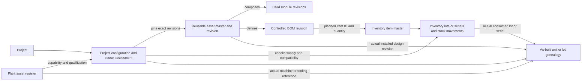

# SSM One Cross-Platform Master Plan

Updated 28 October 2026. This is the cross-platform planning authority. The sample catalogue below is the single reusable fixture definition. This documentation consolidation does not implement code, seed data, or change permissions.

## Read this compact planning set

| File | Purpose |
|---|---|
| [Sample Data and Test Plan](Feature%20Roadmap/Sample%20Data%20and%20Test%20Plan.md) | All fixture packs, development phases, stages, detailed task templates, milestones and load/restore/remove acceptance. |
| [Implementation Plan](Implementation%20Plan.md) | Existing web/Android implementation details and handoffs; inspect actual code before rebuilding anything. |
| [Backend Contracts](Backend%20Contracts.md) / [machine-readable contract](Mobile%20Backend%20Contract.json) | Shared interfaces and dated verified contract snapshots. Earlier snapshots are not current deployment proof. |
| [Document Catalogue](SSM%20One%20Document%20Catalogue%20-%20Auto-Drafting%20Audit%20and%20Native%20Upload%20Rules.md) / [mapping JSON](SSM%20One%20Document%20Catalogue%20-%20Auto-Drafting%20Audit%20and%20Native%20Upload%20Rules.json) | Preserve all document families, editable drafts, original native uploads and controlled approved outputs. |
| [Historical Evidence](References/Historical%20Evidence.md) | Dated reports, superseded plans, old content map and source-to-destination recovery ledger; reference only. Original DOCX evidence is retained in the same References folder. |

## Current lifecycle decisions — take precedence over retained source chapters

- Seven project tracks: Hardware only; Firmware only; Software only; Hardware + Firmware; Firmware + Software on existing hardware; Hardware + Firmware + Software; Ready-made deployment. Combined new Hardware + Software development includes Firmware. Internal/client origin and PoC/pilot/production purpose are separate dimensions.
- Model **track → phases → stages → task templates**. Milestones are outcome/evidence checkpoints linked to this hierarchy, not another mandatory level or a duplicate task board. Existing nine macro stages remain an optional versioned legacy summary/crosswalk; HW_01–HW_37 and FW/SW gate labels are template-version-scoped detail, not global IDs to overwrite existing projects.
- **Progressive task creation is user-confirmed.** At project baseline create the applicable roadmap and full planned-task preview; create actual assigned tasks only for ready stages. Completion prepares the next eligible stages after prerequisite evidence/approvals. Finishing a task never substitutes for formal stage approval. Stable project/template/stage/task keys make retries idempotent; parallel independent work is permitted. Every planned task remains in the sample manifest even before activation.
- Reuse existing project inputs/feasibility as the PMSS baseline and analysis view. Keep compact department selection and own-department edits; other contributions are readable/commentable only where authorized. Do not introduce eight compulsory PMSS tabs, a new project database or a raw shared-data screen. Version amendments and hold affected releases only; do not freeze every unrelated department input or require unanimous Consulted approval.
- Preserve SAL/EHW/FW/SW/MECH/PUR/QA/EMF/MMF/FIN/SIT/HR-OPS ownership. EMF uses accepted outsourced PCB assemblies; MMF owns mechanical manufacturing; TST is not restored as a separate department. RACI is responsibility, not access/signing authority. Shared functions participate only where applicable.
- Preserve original layouts, Sales intake, canonical relationships, numbering/revisions, private files and approval rules. Today / Tomorrow-Planned stay the task columns, with Completed collapsed and a separate approval queue. New lifecycle work changes neither historical IDs nor signed/completed records without explicit reviewed adoption.
- Treat the 28 October SCMS attachment and earlier milestone guide as source references, not executable SQL, compliance certification or authorization. Use their useful interfaces, handshakes and task ideas after adaptation. Do not import fixed company addresses, prices/volumes, SLA days, automotive limits, coverage percentages, infrastructure claims, 11-department labels or four-column boards as portal defaults. Company location comes from settings.
- QA owns applicable certification work with supporting EHW/FW, PUR, FIN and production tasks. Certification is a conditional workstream, not an eighth project type. Genuine outside certificates/reports are uploaded originals; a file upload or simulated sample outcome cannot authorize production. Draft/template values are not measured results.
- Exact versions and evidence links govern change control. HW/FW HSI, FW/SW API/payload contracts, test configuration/build IDs and released fabrication hashes link original records. No signing secret/device private key belongs in the document vault or fixture seed; store only appropriate public fingerprints or protected key references.
- Additive schema/API proposals must extend existing authorized contracts after inspecting actual code. Do not execute the attachment's unscoped DDL/triggers: it duplicates project/task tables, omits organization/RLS controls, confuses different IDs with different tracks, and auto-approves stage progression. Existing authenticated shared backend remains authoritative.

## Custom tasks and stage-plan changes — final implementation rules

Authorized responsible leads may add, edit, reorder or remove custom tasks within a stage/sub-stage during planning or ongoing execution. Admin retains configured oversight; permission comes from authenticated membership and project/department responsibility, not the selected workspace or a role URL. A custom task may reference another department without granting authority to assign or edit that department's work.

- Reuse existing task fields and compact create/edit interactions: title, stage context, responsible owner, priority, optional planned/due date, dependency, description and evidence links. Prefill project, department and stage; inherit company location. Ask only for missing required information. Use searchable canonical selections and authorized inline creation where applicable. Preserve draft values on failure.
- A task definition is a default, not an immutable checklist. Changes to one project do not silently edit global templates or other projects. A new reusable template revision requires the existing configured template-management authority; existing projects adopt it explicitly with a change preview.
- Unused planning tasks may be deleted if no evidence, comments, approvals, time/expense, records or dependent tasks reference them. Once used, remove them from active work by cancellation/retirement with a reason and audit history; preserve original ID, evidence and links. Keep completed or signed history immutable through its existing controls. Do not implement deletion by cascading away business records.
- Before removing a prerequisite, show affected dependents and require an explicit re-link, replacement or governed waiver; never treat removal as completion. Required release/evidence gates cannot be bypassed by deleting their task. Reopening, cancellation and material scope changes recalculate affected readiness and flag stale approval evidence according to existing change controls; unrelated work remains available.
- New tasks in an active eligible stage become actual assigned work; custom tasks in a future stage remain planned until that stage is ready. The full planned preview remains visible. Stable task-instance keys, expected versions and replay identities prevent regeneration, retry or concurrent-edit duplicates. A cancelled template task must not reappear on refresh or stage regeneration.
- Preserve Today / Tomorrow-Planned, priority sorting, overdue dates, Completed and the separate approval queue. Task completion is not automatic stage approval. Dates, mandatory gates and signatories are never invented.

Acceptance must include: adding tasks before and after stage activation; editing/reordering; unused deletion; cancellation with retained evidence; dependent-removal prevention; unchanged unrelated tasks; no global-template mutation; no regenerated cancelled tasks; concurrent edits/retry; authorized department versus read-only cross-department and client denial; shared web/mobile persistence after reload; and preservation of existing task numbering, approvals and history.

## Milestone baseline and dependency corrections

Use approximately 5–10 meaningful milestones where useful, not a fixed quota. Each records name, linked phase/stage, owner, optional planned date, explicit completion criteria, dependency/evidence references, status, actual completion date only on verified completion, approver where required and audit history. Drafts may have unplanned dates; due dates come from the approved plan, never from a copied SLA.

The sample catalogue contains complete versioned HW, FW, SW, certification and common task tables. In particular: assemble/receive prototype before bring-up; bench validation before formal pre-compliance; final interface freeze after verified bring-up where needed; certification sample readiness before lab execution; close relevant design changes before production release. Cross-track prerequisites are conditional on selected scope; pure SW/FW projects cannot wait for a nonexistent new PCB. Failure creates a linked corrective/retest iteration and preserves earlier evidence, rather than erasing completed history. Milestone outcome approval uses existing designated authority.

## Compact file maintenance

Five active Markdown documents and two machine-readable JSON contracts/catalogues replace the previous fragmented planning set. Two folders remain for tracked content: Feature Roadmap (the existing canonical sample file) and References (merged dated evidence plus two original source DOCX files). Original DOCX files and machine-readable JSON are retained because their unique source/consumer content is not safely replaceable by a prose summary. No redirect-only Markdown files are retained. The untracked XLC project folder is outside this cleanup. Recover old versions from normal Git history; do not create duplicate backup directories.

## Retained detailed requirements and source mappings

The chapters below preserve compatible prior detail. Any universal nine-stage/mandatory-standard/in-house-SMT language in them is a retained proposal or historical scope, superseded by the current decisions above. Owner review is still required for specific technical methods and unapproved crosswalks. Standards applicability must come from approved project requirements, not a generic reference.

## SSM_ONE_MASTER_PLAN

**Source:** `SSM_ONE_MASTER_PLAN.md`. **Treatment:** compatible prior master baseline. Latest decisions at the beginning of the master plan override conflicting older universal-stage, department or completion claims.

### SSM One Cross-Platform Master Plan

Last reconciled: 19 October 2026
Status: Active planning baseline. This file is the shared authority for the SSM-new project. Detailed platform documents below implement this plan and must not redefine its cross-platform decisions.

#### Scope and authority

SSM One includes the web portal and its backend, the Android client, and shared operational data/document contracts. The web and Android plans are implementation-specific subplans. Where details conflict, this root plan governs shared scope, terminology, sequencing, and acceptance; each platform plan governs its own technical implementation. The former SSMone Web plan at `C:\Users\Admin\AndroidStudioProjects\SSMone\SSMone-Web\docs\planning\SSM_ONE_WEB_PORTAL_MASTER_PLAN.md` is an older source, not a parallel active plan. It is reviewed as historical input; reconcile any unique still-valid requirements into these SSM-new plans before archiving or deleting anything. New planning updates go only to this root and the relevant platform handoff.

- Reference Web implementation: SSM_ONE_WEB_PORTAL_MASTER_PLAN.md (source reference: `ssm-new-web/SSM_ONE_WEB_PORTAL_MASTER_PLAN.md`; not bundled)
- Document standards: DOCUMENT_STANDARDIZATION_PLAN.md (source reference: `ssm-new-web/docs/DOCUMENT_STANDARDIZATION_PLAN.md`; not bundled)
- Antigravity/Codex handoff and evidence: ANTIGRAVITY_SYNC_STATUS.md (source reference: `ssm-new-web/docs/ANTIGRAVITY_SYNC_STATUS.md`; not bundled)
- Android implementation: SSM_ONE_ANDROID_BUILD_PLAN.md (source reference: `SSM-new-app/docs/planning/SSM_ONE_ANDROID_BUILD_PLAN.md`; not bundled)
- Document-control reference: [SSM One Document Catalogue — Auto-Drafting, Audit, and Native Upload Rules](SSM%20One%20Document%20Catalogue%20-%20Auto-Drafting%20Audit%20and%20Native%20Upload%20Rules.md#source-31) ([source mapping JSON](SSM%20One%20Document%20Catalogue%20-%20Auto-Drafting%20Audit%20and%20Native%20Upload%20Rules.json))
- Electronics-specific product lifecycle and APQP crosswalk: [Electronics Project Lifecycle and APQP Roadmap](SSM_ONE_MASTER_PLAN.md#source-18)
- Generic SSM One software/product delivery sequence: [Product Build Roadmap](SSM_ONE_MASTER_PLAN.md#source-19)

#### Product and architecture decisions

1. **One extensible department model across platforms.** The current baseline departments are SAL, EHW, FW, SW, MECH, PUR, QA, EMF, MMF, FIN, SIT, and HR/OPS. This is the present organization, not a permanent limit. Departments are managed as stable-ID registry records; future departments can be added through governed configuration. A department sees its own records and records explicitly assigned to it; filters and role assignments must never widen authorization.
2. **Final engineering names.** `FW` means Firmware. `SW` means Cloud & Application Software. Do not use EFW, CSW, or ESW as active department labels, new department codes, or new document-ID prefixes. Treat old EFW/CSW values as transitional aliases and ESW as a legacy merged-data alias. Preserve existing entity/document IDs until a reference-safe migration is explicitly specified. Map aliases only from explicit ownership evidence; quarantine ambiguous legacy records for review.
3. **Web/backend is the source of truth.** Authenticated membership and server-side policy determine identity, department, permissions, records, approvals, official numbering, audit history, and private files. A URL role or browser-local demo role is not authentication or authorization.
4. **Android consumes verified contracts.** It must use the same project, department, task, document, approval, and permission semantics as web. Do not implement a second independent source of truth or claim parity before authenticated cross-platform tests pass.
5. **Project and lifecycle evidence must be real and traceable.** Project selection uses stable project identity and explicit links. A screen transition, fixture, generated document, or simulated approval is not proof of an operational lifecycle. Stage gates require recorded authorized decisions and linked evidence.
6. **Document-specific output.** Documents use controlled, type-specific formats populated only from the selected project's verified information. Missing or conflicting values remain explicit; no sample specifications, prices, results, certificates, dates, or signatures are invented. Preview and exported files must agree and preserve revision history.

#### Production department model

Production has exactly two manufacturing departments: **EMF — Electronics Manufacturing** and **MMF — Mechanical Manufacturing**. The existing TST/EOL Testing department is retired as a separate department; test execution becomes an assigned production process in EMF or MMF, while QA owns independent test criteria, quality disposition, nonconformance control, and release authority. Do not automatically reassign historical TST records or its lead; map each record by explicit ownership or quarantine it for review.

EMF owns receiving and traceability of accepted outsourced PCB assemblies (PCBAs), enclosure integration/box-build, harness and accessory installation, controlled firmware loading, in-line functional checks, final assembly, packaging, and production travelers. In-house bare-board fabrication and SMT/PCBA assembly (placement, reflow, SPI/AOI) are out of scope for now. If PCBA is outsourced, PUR owns supplier/PO/commercial coordination, QA owns supplier-quality acceptance criteria and disposition, and EHW owns the released design/specification package. MMF owns mechanical part fabrication/finishing and mechanical subassembly/inspection; exact in-house versus supplier operations are configured per capability and project. EMF and MMF coordinate the final product integration handoff.

**Naming and boundaries:** MECH remains Mechanical Engineering (design); MMF is Mechanical Manufacturing (production). Keep any dedicated test-lab capability as a QA-owned function unless a separately approved organization decision creates a stand-alone test department.

#### Lifecycle stages, department registry, and responsibility assignments

Keep the lifecycle stage model independent from the organization chart. The approved lifecycle template defines stable stage IDs, order, gate intent, evidence, and transition rules. Department and role assignments are configured against a stage template and the applicable project, product, process, and capability; changing the organization chart must not require renaming or rebuilding lifecycle stages. The current 12 departments are the initial registry, and the model must support adding, splitting, renaming, deactivating, or merging departments as the company grows.

Use a versioned responsibility matrix keyed by lifecycle template/version, stage ID, department ID, role/capability, and applicability. It records RACI responsibility and separately identifies required approver/signatory authority. Each project pins the matrix/template version accepted at its baseline. A governed change may take effect for new projects or through an explicit project change with impact review and re-approval; it must not silently rewrite historical decisions, completed work, or signed records. Preserve stable IDs and effective dates; renames use aliases, and splits/merges require explicit record ownership mapping.

HR/OPS, Finance, Service/IT, QA, and other shared functions can contribute horizontally wherever applicable; they are not forced into every stage as sequential gates. Stage events create work only when the matrix says it applies and an authorized owner is assigned. HR/OPS examples include staffing/capacity, competency and training, onboarding, and safety/compliance readiness, with confidential personnel fields restricted to authorized HR users. An assignment or RACI entry does not itself grant data access: authenticated membership, project/record scope, and capability policy remain independent authorization checks. “Informed” means notification eligibility, never automatic read permission.

Governance rules: normally one Accountable owner per decision/work package; Responsible, Consulted, and Informed assignments may be multiple. Every required gate must have an accountable owner and authorized signer or be explicitly marked not applicable with rationale. Configuration changes require an authorized admin, effective date, impact preview, audit record, and tests for old-project stability and new-project routing. New departments receive no inherited project, document, team, or approval access by default. Web and Android consume the same backend-owned registry and matrix contract.

#### Departmental Requirement Sheets & Feasibility Freeze (Stage 2 Gate)

Each department that is applicable to the project prepares its domain-specific requirement sheet during Stage 2 Feasibility analysis before downstream engineering work begins. The responsibility matrix decides applicability and the accountable owner; shared-service contributions are included when relevant:
1. **SAL — Customer & Commercial Feasibility (SOR / mNDA)**: Validates customer SOR, commercial pricing, volume schedules, and contractual warranty/liability terms.
2. **EHW — Hardware Product Requirement Sheet (EHW-PRS)**: Defines electrical architecture, MCU selection, power regulation (9V–36V transient clamping), component obsolescence/AEC-Q ratings, and PCB layout constraints.
3. **FW — Firmware Product Requirement Sheet (FW-FRS)**: Defines RTOS kernel (FreeRTOS/Zephyr), memory map, HAL bring-up, interrupt priorities, protocol drivers (CAN J1939/OBD-II), and dual-bank bootloader fail-safe OTA requirements.
4. **SW — Software Requirement Specification (SW-SRS)**: Defines cloud telemetry ingestion protocols (AIS-140 MQTT/TLS 1.3), Bluetooth GATT schemas (TPMS/temperature), fleet APIs, webhooks, and production line diagnostic flashing GUI tools.
5. **MECH — Mechanical Requirement Sheet (MECH-MRS)**: Defines 3D form factor, enclosure IP67 sealing, vibration/drop dampening, thermal dissipation, connector clearance, and mold tooling feasibility.
6. **PUR — Sourcing & Supply Chain Feasibility (PUR-BOM)**: Verifies Approved Supplier List (ASL), long-lead component availability, MOQ, and dual-sourcing strategy.
7. **QA — Quality & Compliance Requirement Sheet (QA-QRS)**: Defines DVP&R test matrix, automotive compliance standards (AIS-140, ISO 7637-2, ISO 16750), type approvals (iCAT/ARAI), and incoming lot sampling plans.
8. **EMF — Electronics Manufacturing Feasibility (EMF-DFM)**: Verifies accepted outsourced PCBA supplier/lot interfaces, incoming traceability, box-build and line-integration capability, controlled programming, and in-line/final functional testing. In-house SMT, placement, reflow, SPI/AOI, and bare-board fabrication are outside the current scope.
9. **MMF — Mechanical Manufacturing Feasibility (MMF-DFM)**: Verifies plastic injection molding, CNC machining, gasket tooling, and mechanical assembly tolerances.
10. **FIN — Financial & Capital Feasibility**: Verifies payment credit terms, NRE tooling amortization, BOM margin threshold, and cash-flow requirements.
11. **SIT — Service & IT Infrastructure Feasibility**: Defines server hosting capacity, network security/ISMS, telemetry database backup, and field RMA diagnostic procedures.
12. **HR/OPS — Human Resources & Operational Competency Feasibility**: Assesses technician IPC-A-610 workmanship training, ESD certification, and staffing requirements.

All 12 departmental requirement points compile into the unified **Contract Review & Feasibility Report (`HLPL/F/MKT/01`)**. Formal sign-off and requirement freeze are mandatory before engineering kickoff.

#### User-confirmed workflow and UX requirements

- All department roles use a consistent task board: Today / In Progress on the left, Review in its own lane, To Do on the right, and Completed collapsed by default with an expand control. A task appears in one lane only.
- Department workspace is one project-aware view. A project selector scopes project identity, tasks, linked documents/references, approvals, and recorded owners to that project while leaving unlinked department records clearly separate.
- Team, task, approval, reference, and document views default to department-relevant information while retaining explicitly authorized collaboration.
- Lifecycle gates and document generation must be backed by real persistent records and attributable actions before the portal is described as operational end to end.

#### Delivery sequence and current gate

1. **Batch 1 — department identity, migration, routing and preservation.** Antigravity reports 29 automated tests and TypeScript passing; Codex independently reproduced those results on 19 October. This batch is **not signed off**: the implementation still uses EFW/CSW active IDs instead of FW/SW, and must incorporate the production model change from TST to MMF while preserving historic TST records. Codex could not verify localhost from this execution environment, and the local production build stopped at a sandbox EPERM while preparing a shared `node_modules` output directory. Antigravity must reconcile canonical role names and re-run build/browser evidence in its authorized environment.
2. **Batch 2 — document catalogue and type-specific templates.** The current catalogue records 38 logical families, 89 unique source blocks, and 90 family-source links because source block B0545 maps to two families; D02 and D04 are clarification-only. These are catalogue coverage counts, not required output-file quantities. Reconcile required outputs, project/department ownership, feasibility against actual project information, dependencies, acceptance evidence, and target phase.
3. **Batch 3 — authenticated backend and operational lifecycle.** Verify organization and users, authentication, server-side authorization/RLS, persistence, audit history, private file access, notifications, approval gates, and full project lifecycle in a non-production test environment before production deployment.
4. **Batch 4 — Android contract parity.** Implement only against verified web/backend contracts. Run separate Android build, device/navigation, offline/cache isolation, permissions, and cross-platform round-trip acceptance.

Lovable editor preview, localhost, published deployment, backend, and Android are separate environments; report evidence for each separately. A passing local test suite does not certify the live service or production data.

#### Acceptance standard

Close a batch only when the exact source revision and changed files are identified; required automated checks pass; browser/runtime behavior is independently reproduced for relevant roles; negative access tests pass; persisted state and cross-links survive refresh; and evidence is recorded in the sync ledger. Keep unresolved risks and failed checks visible. Do not mark a simulated flow as complete operational functionality.

#### 27 October sample-data consolidation

[Sample Data and Test Plan](Feature%20Roadmap/Sample%20Data%20and%20Test%20Plan.md#source-20) is the single canonical reusable fixture specification. It now includes six lifecycle outcome cases, all six user-confirmed development/deployment tracks, actual register/document placement, and portable pack/version/ID mapping. Preserve the legacy fixture examples as a selectable version; do not force their nine stages onto every track or duplicate existing data. The current hierarchy is track → phases → stages → tasks, with applicable default stages/tasks and authorized project-specific additions. This documentation refinement does not deploy a loader, provision users, import fixtures or modify operational data.

## Electronics Project Lifecycle and APQP Roadmap

**Source:** `Electronics Project Lifecycle and APQP Roadmap.md`. **Treatment:** retained proposed domain/configuration detail; applicability-driven. Latest decisions at the beginning of the master plan override conflicting older universal-stage, department or completion claims.

### SSM One Electronics Project Lifecycle and APQP Roadmap

**Document type:** Electronics-specific product-process and requirements reference
**Version:** 0.5 — Owner review draft
**Prepared:** 19 October 2026
**Status:** Supporting domain-specific reference; the active cross-platform authority is [SSM_ONE_MASTER_PLAN.md](SSM_ONE_MASTER_PLAN.md#source-32). The generic SSM One software/product implementation phases are in the [Product Build Roadmap](SSM_ONE_MASTER_PLAN.md#source-19). This file describes the electronics product process and detailed requirements; it does not override the master or claim that planned capabilities are deployed or certified.

#### 1. Purpose and reading guide

SSM One is intended to connect customer intake, engineering, procurement, manufacturing, quality, finance, service, people operations, controlled documents, and project lifecycle evidence in one system. This reference preserves the electronics product's operational lifecycle and related rebuild requirements so a team can recreate that domain from an agreed baseline even if the current prototype or implementation is lost.

The plan distinguishes **Confirmed** decisions from **Planned** capabilities, **Proposed** mappings, **Open** owner decisions, and **Historical** implementation evidence. An idea found in an older source is not automatically a current requirement. No sample project value, technical limit, customer signature, test result, certificate, approval, or actual deployment status is created by this plan.

This Markdown file is a supporting detail document. Original planning sources remain in their existing workspace locations; no original source folders were moved. Archived copies have been removed from this curated library to reduce duplication. The review DOCX was deleted by the owner and is not required.

#### 2. Authority and configuration control

The hierarchy is:

1. The project-root `SSM_ONE_MASTER_PLAN.md` controls cross-platform product scope, common vocabulary, approved organization model, lifecycle intent, and acceptance criteria.
2. The web/backend and Android implementation plans control platform-specific technical work and must conform to this master.
3. Document standardization, document-control contracts, and the catalogue control type-specific document requirements and known backend boundaries. Their details are incorporated here by reference and summarized below.
4. The [Product Build Roadmap](SSM_ONE_MASTER_PLAN.md#source-19) sequences generic SSM One software/product delivery phases. Those phases are not the electronics product's operational lifecycle stages.
5. Handoffs, review reports, test output, and Antigravity sync ledgers are dated evidence. They do not amend requirements by themselves.
6. Older DOCX and copied plans are source material. Their valid unique requirements are mapped into this reference; conflicts remain listed until resolved.

Every decision or requirement change needs an ID, owner, status, source, rationale, affected lifecycle stage/departments/platforms, effective version, and acceptance evidence. A change to a live project or released document requires impact analysis, authorized review, audit history, and preserved prior revisions. This plan does not replace formal approval or customer-specific requirements.

#### 3. Product scope and guiding rules

SSM One covers web portal and backend, Android client, shared operational records and APIs, controlled document workflows, and selected company-wide operations. The system must support project-based and department-based work without duplicating the source of truth.

The verified backend is authoritative for identity, organization membership, project links, permissions, tasks, approvals, official document numbers, revision history, audit events, and private files. A URL role, mock login, local fixture, visible screen, or successful build is not evidence of authentication or an operational business transaction. Web and Android must use the same server-owned contracts and access decisions.

A project master specification is the reviewed, versioned baseline for project scope and technical/commercial requirements. Drafts retain source references and verification state. Missing or conflicting information is shown for resolution; it is never filled from a demo, guessed from a filename, or copied from a different project. Planned work, actual results, approved evidence, and released records are distinct states.

#### 4. Company structure, roles, and future growth

##### 4.1 Current department registry

The current baseline organization has 12 departments: **SAL** Sales & Business Development; **EHW** Embedded Hardware Engineering; **FW** Firmware Engineering; **SW** Cloud & Application Software; **MECH** Mechanical Engineering; **PUR** Purchasing & Supply Chain; **QA** Quality Assurance; **EMF** Electronics Manufacturing; **MMF** Mechanical Manufacturing; **FIN** Finance; **SIT** Service & IT; and **HR/OPS** Human Resources & Operations.

The 12 departments describe today's structure, not a permanent product limit. Use stable department IDs, display names, aliases, active state, effective dates, lead/owner assignments, capabilities, and scope. New departments can be configured later without rebuilding lifecycle stages or hard-coded platform enums. Renames preserve identity; splits, mergers, and retirement require a governed mapping of records and responsibilities. Historical identifiers remain readable and are not silently reassigned.

Use **FW** and **SW** for active labels and new identifiers. EFW and CSW are transitional legacy aliases; ESW is legacy merged data only. Do not create new active labels or prefixes from these old codes. Ambiguous legacy ownership is quarantined for an authorized decision.

##### 4.2 Production boundaries

Production has two manufacturing departments: **EMF** and **MMF**. **MECH** remains mechanical design; MMF is mechanical production. The former **TST/EOL** department is not a separate active department. Production performs assigned test execution; QA controls test criteria, independent quality disposition, nonconformance, and release authority. Preserve old TST records and roster until ownership is explicitly resolved.

For the current scope, PCB assembly/SMT is outsourced; in-house bare-board fabrication, placement, reflow, SPI, and AOI are not planned. PUR coordinates supplier, sourcing, and purchase records; QA defines supplier-quality acceptance and disposition; EHW owns the released design/specification package. EMF receives and traces accepted PCB assemblies, integrates the board into enclosure/box build, installs harnesses/accessories, loads controlled firmware, performs assigned in-line/final checks, packages, and records travelers. MMF performs mechanical fabrication or controlled supplier receipt, finishing, subassembly, and fit/dimensional inspection. EMF/MMF hand off using explicit product and lot references. Any future in-house PCB assembly is a scope change, not an implied feature.

##### 4.3 Stage-specific roles and shared services

Keep lifecycle stages independent from departments. A versioned responsibility matrix maps stage, project/product/process applicability, department, role/capability, RACI, and required signer authority. Each project pins the approved matrix version. Later updates apply to new projects by default; an active project changes only through authorized, audited impact review. Historical tasks, evidence, decisions, signers, and project baselines remain unchanged.

Normally each decision/work package has one Accountable owner; multiple Responsible and Consulted roles may participate. Every mandatory gate has an accountable owner and authorized signer, or a documented not-applicable rationale. HR/OPS, FIN, SIT, QA, and future shared teams can contribute horizontally where relevant. HR/OPS examples include workforce capacity, onboarding, competency/training, and safety readiness. Sensitive employee information remains restricted to authorized HR users.

RACI, assignment, and notification never grant read or signing access. Access is separately checked against authenticated membership, project/record scope, and capability. “Informed” permits notification only when the underlying record is already accessible. New departments receive no inherited project, document, team, or approval access by default.

#### 5. Project lifecycle and APQP activity crosswalk

##### 5.1 Nine-stage project lifecycle

The portal's nine stages are the user-facing project journey. Stage templates are versioned and may support parallel tasks, applicability rules, documented skips, and rework loops. Stage identity and gate intent are stable within a template version; changing stages requires governed versioning and migration review.

| Stage | Name and intent | Example controlled outputs / gate evidence |
|---|---|---|
| 1 | Sales intake and client portal | Enquiry, customer SOR, mNDA, project identity and initial source records |
| 2 | Cross-department feasibility | Contract review, risk/assumption/action register, relevant department feasibility responses, capacity and sourcing review |
| 3 | Requirement freeze and commercial confirmation | Approved project master specification baseline, requirements traceability, quotation/PO or explicit commercial gate decision |
| 4 | Design and development / PoC | Architecture, schematics, firmware/software prototypes, mechanical design, review results and design risks |
| 5 | Pilot build and manufacturing readiness | Outsourced PCBA receipt baseline, EMF/MMF travelers, process flow, PFMEA, control plan, work instructions, tooling and pilot records |
| 6 | Client validation and pre-compliance | Approved DVP&R, planned vs actual testing, sample/configuration, measured results, defect/rework and customer feedback |
| 7 | Production release and PPAP | Released design/BOM, production controls, run-at-rate/capability, PPAP package, customer disposition and production-readiness decision |
| 8 | Type approval and supply readiness / mass-run authorization | Authentic authority certificate where applicable, supplier capacity/PPAP, long-range supply plan, authorized production ramp decision |
| 9 | SOP, production inspection, delivery and feedback | Work orders, traceable lots/serials, final inspection and QA disposition, dispatch, invoicing, warranty/field issues, lessons and change loop |

These labels consolidate the current 9-stage portal flow and source DOCX flow. Exact gate ownership, deliverable applicability, and terminology must be confirmed by accountable process owners. Project examples and demo figures in the source documents are not production facts.

##### 5.2 Preserve the complete 37-activity APQP framework

The QMS DOCX's 37 activities are retained as detailed sub-stage/work-package definitions, not deleted or forced to become 37 top-level portal screens. The crosswalk below is a proposed mapping to review and version. APQP phase gates 1–5 remain identifiable; their mapping can span adjacent portal stages where the real process requires it.

| APQP ID | Activity | Proposed portal stage |
|---|---|---|
| HW_01 | Market requirement and RFQ intake | 1 |
| HW_02 | Customer technical requirement review/freeze | 2–3 (split review from approved freeze) |
| HW_03 | Business case and sourcing feasibility | 2 |
| HW_04 | High-level system and hardware architecture | 2–4 (feasibility concept to design baseline) |
| HW_05 | Initial safety and cybersecurity hazard analysis | 2–4, applicability-based |
| HW_06 | Preliminary BOM and sourcing strategy | 2–4 |
| HW_07 | APQP Phase Gate 1 and program approval | 2 |
| HW_08 | Detailed hardware schematic capture | 4 |
| HW_09 | Hardware DFMEA | 4 |
| HW_10 | High-speed PCB layout and routing | 4 |
| HW_11 | Mechanical enclosure and thermal CAD design | 4 |
| HW_12 | DFM/DFA review | 4–5 |
| HW_13 | Prototype hardware component procurement | 4–5 |
| HW_14 | A-sample board assembly and bench bring-up | 4; assembly route requires owner decision and may be outsourced |
| HW_15 | Hardware DVP creation | 4–6 (plan created before test execution) |
| HW_16 | APQP Phase Gate 2 and design freeze | 4 |
| HW_17 | Manufacturing process flow and layout | 5 |
| HW_18 | PFMEA | 5 |
| HW_19 | Pre-launch control plan and work instructions | 5 |
| HW_20 | Production tooling, jigs, fixtures and stencils | 5 |
| HW_21 | MSA plan and execution | 5–7 as applicable |
| HW_22 | B-sample pilot build | 5 |
| HW_23 | B-sample DVP&R functional/environmental tests | 6 |
| HW_24 | APQP Phase Gate 3 and process freeze | 5–6 (gate dependency to confirm) |
| HW_25 | Pilot production / run-at-rate, C-sample | 7 |
| HW_26 | SPC capability evaluation | 7 |
| HW_27 | Environmental/EMC product homologation | 6–8 by test vs authority-approval activity |
| HW_28 | PPAP package assembly | 7 |
| HW_29 | Production control plan and final-line handover | 7 |
| HW_30 | Customer PPAP approval and PSW sign-off | 7–8 depending on customer gate sequence |
| HW_31 | APQP Phase Gate 4 and production readiness | 7 |
| HW_32 | Mass-production SOP and ramp-up | 8–9 |
| HW_33 | Early production containment / safe launch | 9 |
| HW_34 | Post-launch lessons learned and knowledge management | 9 |
| HW_35 | Warranty and field-return 8D | 9 |
| HW_36 | Continuous improvement / VAVE | 9 and continuous |
| HW_37 | Engineering change management (ECN/ECO) | all stages through a controlled change loop |

This mapping is not yet a released process crosswalk. Approve stage-level criteria, deliverables, applicable standards/CSR, evidence, owner and route before implementation. Retain all source activity IDs for traceability even if labels or mappings change.

#### 6. Cross-functional business capabilities

The unified system should support these capabilities through shared projects, tasks, documents, and audit identity:

- **Sales and client:** lead/enquiry intake, customer register, RFQ/SOR, NDA/agreement routing, clarification requests, contract review, proposal/quotation, customer PO/LOI, scoped client portal, accepted milestone and validation feedback.
- **Engineering:** EHW/FW/SW/MECH requirement sheets; system architecture and interfaces; BOM and approved alternates; design risk/DFMEA; native design releases; firmware/software builds and test evidence; mechanical CAD/drawings/tooling; controlled engineering changes.
- **Sourcing and inventory:** dual-track prototype and production sourcing where configured; supplier evaluation, ASL/AVL, RFQ comparison, PO revision, supplier acknowledgement/ASN, supplier PPAP, receiving/GRN, IQC hold/release, lot/serial traceability, issue/return and stock reconciliation. A document must never post inventory by itself.
- **Manufacturing:** EMF and MMF process flow, PFMEA, control plans, work instructions, travelers, tools, fixtures, outsourced-PCBA receipt, box-build, mechanical manufacturing, in-line/final checks and cross-team handoff.
- **Quality and compliance:** DVP&R, calibration-aware test plans, measured results, NCR/deviation/concession, 8D/CAPA and effectiveness, PPAP index, release checklists, authentic third-party certificates, audits, management review, corrective action and lessons learned.
- **Finance, delivery and service:** approved budgets/cost models, quotations and invoice calculations, payment/receivables reconciliation, packing/dispatch/delivery evidence, customer installation and commissioning, service tickets, warranty/field returns and feedback into ECN/ECO.
- **HR/OPS and corporate services:** restricted skill matrix, training needs/effectiveness, onboarding and statutory calendar, staffing/capacity, QMS procedures, legal templates, company identity/letterhead, facilities, EHS, risk and improvement registers.
- **Assets and facilities:** asset/tooling register, customer-owned tooling custody and insurance, TPM/maintenance plans, MTBF/MTTR, calibration/IMTE, MSA/Gage R&R, utility contingency drills, calibration due dates, out-of-tolerance impact and safety records.

Operational KPI/SLA definitions must have owner, formula, unit, source, cadence, target rationale and exception behavior. Example KPIs in source documents are candidates only; do not seed fabricated measured values or targets.

##### 6.1 Reusable modular assets and project configuration

Maintain reusable engineering and production assets as controlled, revisioned master records (for example PCB assemblies, harnesses, firmware/software components, mechanical parts/tooling, test fixtures, and approved process modules). A project reuses an exact asset revision through a project-specific configuration record; it does not copy the master into an unrelated document or treat a catalogue match as evidence of compatibility.

For each reuse decision, record the project/product variant, selected asset ID and revision, owner/status, intended configuration and interfaces, linked customer/project requirements, compatibility and fit-gap assessment, deviations or adaptations, affected risk and verification items, qualification/certification scope and validity where applicable, evidence sources, decision owner/approval, and any schedule/cost estimate with its basis. Changed or derived variants get their own revisioned identity and change/effectivity history; preserve the source-to-variant relationship. The project baseline pins the exact selected revisions, while as-built unit/lot records capture the revisions and serial/lot identities actually used.

Certification/qualification evidence is scoped explicitly at two linked levels: the individual reusable component or asset revision (for example a PCB/assembly, enclosure material/design, or harness), and the finished project/product configuration that combines those items. A component certificate can support a project assessment but does not certify the assembled product. Record issuer, applicable standard/edition, certificate/report ID, covered product/asset revision and configuration, tested sample/conditions, limitations, validity, and source file. The project conformity/type-approval record separately identifies the exact combined configuration and its own required test results, approvals, and authentic authority/lab evidence. Do not inherit or imply certification across revisions, configurations, customers, or product variants without an authorized applicability decision.

Reuse can reduce duplicated design effort, but it does not by itself waive a lifecycle gate, customer approval, test, regulatory approval, or recertification. Any skip or tailored verification requires an authorized, evidence-backed applicability and impact assessment, an explicit decision by the configured authority, and retained rationale; unknown or changed configurations keep the relevant checks open. See the [Document Catalogue — Auto-Drafting, Audit, and Native Upload Rules](SSM%20One%20Document%20Catalogue%20-%20Auto-Drafting%20Audit%20and%20Native%20Upload%20Rules.md#source-31) for the controlled asset, configuration, and reuse-assessment records.

##### 6.2 Inventory, reusable design assets, and plant assets

Keep three related but distinct records: **stock items** (raw materials, purchased components, subassemblies, packaging, and consumables); **reusable engineering/product assets** (revisioned designs and approved configurations such as PCBs, enclosures, harnesses, firmware/software components, and process modules); and **physical plant/operational assets** (production machinery, test equipment, fixtures, tooling, calibration instruments, and facility equipment). A reusable design or fixed asset is not itself on-hand stock. An asset may reference stock parts and manufacturing resources without owning or moving their inventory.

###### Inventory and reusable-asset domain map

Treat `Asset` as an umbrella concept in navigation only; the data model keeps three typed domains separate. A **stock item** is an orderable/stockable identity; **lot/serial positions and movements** hold the actual quantities and statuses. A **reusable asset revision** is a controlled design or module, which can contain child module revisions and a BOM. A **project configuration** pins the exact reusable asset revisions selected for that project. A **plant asset** is a serialized machine/tool/resource with custody, maintenance/calibration, and capability data. The project **as-built genealogy** records the exact design revisions, inventory lots/serials, and plant resources used.

| Record layer | Owns | Links to | Does not mean |
|---|---|---|---|
| Inventory item master | Part/material identity, item class, UOM, manufacturer/supplier IDs, approved alternates | Lots/serials, storage locations, suppliers, reusable-asset BOM lines | On-hand quantity by itself |
| Inventory lot/serial and transactions | Receipt/inspection, location, released/held/rejected/allocated state, issue/return/transfer/adjustment and movement history | Inventory item, supplier/PO, authorized project/work order | A reusable design or plant asset |
| Reusable asset/module revision | Controlled design/configuration, interfaces, revision/effectivity, verification and qualification scope | Child modules, BOM lines, native files, requirements and evidence | Stock balance, reservation, or permission to build |
| Project configuration | Project-pinned asset/module revisions, fit-gap/reuse decision, adaptations and required verification | Project baseline, exact asset revisions, selected BOM revisions | A copy of the master asset or a stock transaction |
| Plant asset | Serialized machinery, fixture, tooling, test/calibration equipment, custody and capability | Site/plant, maintenance/calibration records, compatible process/product | Consumable stock or a reusable product design |
| As-built genealogy | Actual product/unit/lot configuration and consumed/installed material | Project configuration, actual inventory lot/serial, installed asset revisions, plant/tool IDs and evidence | The planned BOM or a claim that planned parts were actually used |

The relationships should be visible as a domain flow:

The BOM and project configuration describe planned selection only. Availability checks read current authorized stock; only a separate approved procurement, reservation, issue, return, transfer, or adjustment transaction changes stock. Digital assets such as FW/SW remain revisioned reusable assets without fictitious stock balances; a physical programmed product or module can separately have a stock item and lot/serial identity when it is actually manufactured or received.

The inventory model must support electronics and mechanical manufacturing needs, with configurable item classes, units of measure, supplier/manufacturer part identities, approved alternates, locations/bins, lot/batch/serial/date-code traceability as applicable, on-hand/allocated/released/held/rejected states, receipt and inspection evidence, issue/return/adjustment transactions, and append-only movement history. Consumables and raw materials use quantity/lot controls appropriate to their risk and process; serialized machinery/equipment use a fixed-asset record with owner, site/plant, department custody, location, operational status, maintenance/calibration/qualification history, and compatibility with processes or products. Plant/site and department views may organize these records but must not create duplicate stock balances or bypass authorization.

Each reusable asset's controlled BOM/configuration links to the exact inventory item IDs, approved alternates, quantity/UOM, sourcing and supplier/lot requirements, and applicable plant/process capability. A project-level feasibility and build check compares the pinned asset revision with available released inventory, approved supply, and compatible plant/equipment. Reuse or selecting a BOM does not reserve, issue, procure, or adjust stock; those remain explicit authorized inventory transactions. The as-built record captures actual substituted parts, lots/serials, tooling/machine references, and asset revisions used. See the Web and Android plans for inventory implementation and the Document Catalogue for linked evidence/record types.

#### 7. Controlled documents and project data

##### 7.1 Document identity and lifecycle

Maintain distinct identities for template, document instance, project, and revision. Project output numbering follows the verified server contract and current approved pattern `HLPL-[PROJ_ID]-[DEPT]-[DOC_TYPE]-[REV]`; controlled form IDs such as `HLPL/F/MKT/01` and `HLPL/F/HR/03` remain stable. Preserve legacy IDs and links; alias only through approved reference-safe mappings. Official numbering is server-assigned.

A controlled record includes company identity from approved configuration, title, document ID, template ID/version, project ID, department, revision, issue/effective date, classification, lifecycle state, owner, preparer/reviewer/approver attribution, change reason, linked baseline/source revisions, evidence/attachments, revision history and page numbering. Project-independent forms explicitly show project not applicable. Missing owners, approvals, evidence or source revision are shown as gaps, not interpreted as compliance failure or silently filled.

Supported workflow states and transitions come from the verified backend contract. The current read contract describes DRAFT, IN_REVIEW, APPROVED, and OBSOLETE; review/release mutation is reported web-only, and mobile may read only within backend policy. Private files stay private. Do not claim Android release actions or generalized signed downloads without an approved contract and authenticated tests.

##### 7.2 Source provenance and outputs

Document generation uses the selected authorized project's approved PMSS/SOR, linked commercial records, released BOM/design revision, inspection/test records and approved files. Every populated value records source record/file ID, source revision, field path/page, retrieval time and verification state. States include verified, unverified, demo, missing, conflict and not applicable. Conflict requires owner resolution. An upload does not itself become an approved baseline.

Each document family has its own fields and output format as defined by the [Document Catalogue — Auto-Drafting, Audit, and Native Upload Rules](SSM%20One%20Document%20Catalogue%20-%20Auto-Drafting%20Audit%20and%20Native%20Upload%20Rules.md#source-31). Authorized users edit structured portal entries, preview the populated template, and download DOCX/PDF renditions where configured; a full rich-text or in-app DOCX editor is not required. Preview and downloaded renditions use the same data snapshot. A downloaded copy is not itself a released source of truth; changes that need to become authoritative return through controlled revision and review. Released revisions are immutable through ordinary editing; source changes flag impacted drafts for review rather than silently rewriting releases. Auto-generation is limited to portal-owned structured drafts and renditions. The portal may create a tentative BOM from the controlled parts/inventory catalogue; creating or exporting it does not reserve or move stock. It must not generate native schematics/PCB/Gerber files, firmware/software source or build/release artifacts, CAD/STEP/drawings, actual lab/test/certification reports, or certificates. Those are authored or issued by approved specialist tools/providers and uploaded or linked as controlled evidence. The portal may generate their metadata index, cover, or checklist, but not the source artifacts.

##### 7.3 Inventory and catalogue control

The source plan lists document families for sales, requirements, design, materials, firmware, software, mechanical, sourcing, supplier quality, stores, EMF, validation, QMS, release, production test, finance, dispatch, service, assets, HR/OPS and governance. The active catalogue baseline is 38 logical families, 89 unique source blocks, and 90 family-to-source links because B0545 maps to two families; D02 and D04 are clarification-only. These are coverage counts, not required files. Distinguish a family, a template, an issued instance, a source block, and a family-to-source link; count each separately.

##### 7.4 Department document organization and audit access

Every department workspace uses the same four document contexts: **Common & Standards**, **Internal Projects**, **Client Projects**, and **Department Operations & References**. Departments may receive tasks and document records through explicit assignment; the record is filed under its business context, so project work stays with the internal or client project even when another department owns a task or review. Common & Standards contains approved company/department standards and controlled templates, plus the shared department-organized audit/QMS index and non-project audit evidence. Audit views link to canonical project evidence rather than creating uncontrolled duplicate files. Department Operations & References holds non-project registers, recurring operational records, miscellaneous reference material, and the approved knowledge base. A configured standards owner manages common standards; this does not create a new department by implication. Folder placement and task assignment never grant access: the backend enforces ownership, explicit authorization, classification, and client/internal boundaries.

#### 8. Roles, navigation, boards, and notifications

Every department has a consistent task board: Today/In Progress on the left, Review as its own lane, To Do on the right, and Completed collapsed by default. Each task appears once. One project-aware workspace uses a project selector to scope tasks, project progress, linked documents/references, approvals, and recorded owners; clearly separate unlinked department work.

Lists default to department-relevant and explicitly assigned records. Cross-department collaboration appears when authorized and linked. Filters never expand permissions. My Tasks and approvals must navigate to the real queue and detail. Badges derive from authorized pending records, never hard-coded counts. References must point to verified labels/destinations. Team views use the approved department roster with explicit authorized company-wide directory access where intended.

Handoff notifications are triggered by the pinned responsibility matrix. Responsible and Accountable participants receive actionable work; Informed participants receive notice only when the underlying record can be read by them. A notification does not change stage state or record approval. Approval actions check current state, signer capability, reason, stale/duplicate request protection and audit attribution server-side.

#### 9. Architecture, security, and persistence

The web/backend is the source of truth. Establish authenticated identities and organization membership; server-enforced department/project policies; auditable mutations; private storage; reliable database migrations; document/source version links; notification jobs; idempotent transactions; backup/recovery and observability. RLS policy and service actions require independent review and negative tests. Never treat a browser role switcher as real authentication.

Android consumes verified backend contracts, preserves project/document identity across navigation and cache, and shows clear offline/denied/empty states. No client-only role authority, local duplicate department registry, unsafe document release write, or cross-project cache leakage. Offline drafts must be clearly labeled and reconciled through authorized server actions.

Separate local development, Lovable preview, backend test, published deployment and production. Record exact build, commit, migrations, environment and test identities for each. A successful screen load or simulated lifecycle is not end-to-end proof. No production data migration, publish, signing, or permission change is implied by this plan.

#### 10. Relationship to the generic Product Build Roadmap

This document defines the electronics product's nine operational lifecycle stages and preserves the 37-activity APQP crosswalk as a proposed, owner-review mapping. The [Product Build Roadmap](SSM_ONE_MASTER_PLAN.md#source-19) defines the generic phases for implementing SSM One itself. They are separate planning axes: the product lifecycle describes how a customer product moves from intake through engineering, manufacturing, release, delivery, and feedback; build phases describe how the portal and its backend/mobile capabilities are delivered. Do not force a one-to-one mapping between the two.

Use the Product Build Roadmap to select software scope and implementation order. Each selected phase must implement and verify the applicable electronics lifecycle requirements in this document and the cross-platform acceptance rules in the root master. A phase closes only with its scoped evidence, required automated and browser/device checks, persisted state after reload, negative access tests, and recorded status. Planned, prototype, locally verified, backend-verified, and production-released remain separate statuses.

#### 11. Source decisions and unresolved items

**Confirmed in prior owner discussion and current root plan:** current department names include FW/SW and EMF/MMF; TST is not a separate current department; production PCBA assembly is outsourced/currently out of scope in-house; shared services and future departments must fit an extensible stage-responsibility model; project and department views must be correctly scoped; document content must use project evidence and standard type-specific formats.

**Open for accountable owner/process review:** final mapping of each HW_01–HW_37 activity and APQP gate to nine portal stages; prototype/A-sample PCBA assembly route; applicability of each QMS activity and external standard/edition per product/customer; MMF lead/owner; final company identity, legal text, tax data and authorized signers; owner validation of any ambiguous source-family mappings; which shared functions are in scope for each project/stage; which current back-end contract statements have been independently verified.

**Historical or unverified inputs:** source DOCX project names, volumes, prices, BOM values, test counts, sample approval dates/signatures, fixed specifications and advertised completed features remain examples unless tied to verified project records. Earlier sync entries are preserved with their dates and must be reconciled against the current code revision before implementation claims.

#### Appendix A. Source-to-plan traceability

| Source | Treatment in this domain reference | Record retained |
|---|---|---|
| Historical lifecycle and QMS source material | Preserve HW_01–HW_37, five APQP gates, dependencies/loops, department QMS, KPIs, audits/risk/EHS, quality case; validate applicability against owner-approved processes | Original sources remain at their original workspace locations; see the separate lifecycle framework |
| Owner-confirmed product discussions and current root master | Carry forward nine-stage portal, PMSS, numbering/revision, role dashboards, RACI/alerts, repository, templates, procurement, asset maintenance, HR/OPS, legal and infrastructure capabilities; remove fabricated sample defaults | [SSM_ONE_MASTER_PLAN.md](SSM_ONE_MASTER_PLAN.md#source-32) |
| Web and Android implementation plans | Keep implementation details subordinate to the root master; reconcile platform gaps against it | `Current Plans/` |
| Document standards and controlled-document read contract | Carry forward data provenance, type-specific formats, metadata, private storage, revisions, and known mobile limitations; keep the active Catalogue as the sole document-family reference | Planning-library root catalogue and `Android and Backend Contracts/` |
| Antigravity ledgers, completion handoffs, backend gap/review reports | Keep as dated evidence, never as policy; re-verify each claim against revision/environment | `Portal Progress and Handoffs/` and `Android and Backend Contracts/` |
| Active document catalogue | 38 logical families cover 89 unique source blocks and 90 family-source links (B0545 maps to two families); these are coverage counts, not required standalone files. Reusable-asset records are subrecords within existing families and do not change the family count. | [Document Catalogue — Auto-Drafting, Audit, and Native Upload Rules](SSM%20One%20Document%20Catalogue%20-%20Auto-Drafting%20Audit%20and%20Native%20Upload%20Rules.md#source-31) and its [JSON mapping](SSM%20One%20Document%20Catalogue%20-%20Auto-Drafting%20Audit%20and%20Native%20Upload%20Rules.json) |

#### Appendix B. Change record for this consolidated draft

| Version | Date | Change | Status |
|---|---|---|---|
| 0.1 | 19 Oct 2026 | Consolidated current owner decisions, source-document requirements, cross-platform architecture, lifecycle and control rules; proposed 37-to-9 crosswalk; source copies were later removed from the curated library after original paths were verified | Draft for owner review |
| 0.2 | 19 Oct 2026 | Defined revisioned reusable-asset masters, project-pinned reuse/configuration assessments, change lineage and as-built genealogy; clarified that structured entries, preview and DOCX/PDF downloads do not require an in-app DOCX editor; confirmed catalogue counts remain unchanged | Draft for owner review |
| 0.3 | 19 Oct 2026 | Separated component/asset certificates from finished-project certification; clarified stock inventory, reusable design assets, and physical plant assets as distinct linked records with BOM, plant capability, and as-built lot/serial traceability | Draft for owner review |
| 0.4 | 19 Oct 2026 | Defined department document contexts for common standards/audit, internal projects, client projects, and department operations/references; kept audit links canonical and access permission-based | Draft for owner review |
| 0.5 | 19 Oct 2026 | Made the inventory domain visible: separated item masters and lot/serial transactions from reusable modular asset revisions, project-pinned configurations, plant assets, and actual as-built genealogy; clarified BOM-to-stock and build transaction boundaries | Draft for owner review |

#### Appendix C. Rebuild checklist

Before rebuilding: identify original source files at their existing workspace paths and the current master version; approve open decisions; establish a clean repository/environment and verified backend target; implement department registry and stage/RACI versions; migrate only deterministic records with backup and recovery; implement document type registry and source provenance; configure roles and policy; run tests and browser/device acceptance; capture evidence; issue the next controlled master revision. No build or deployment is certified by this document alone.

## Department Lifecycle and Gate Framework - APQP Audit IATF Mapping

**Source:** `Decisions and Controls/Department Lifecycle and Gate Framework - APQP Audit IATF Mapping.md`. **Treatment:** retained proposed domain/configuration detail; applicability-driven. Latest decisions at the beginning of the master plan override conflicting older universal-stage, department or completion claims.

### Department Lifecycle and Gate Framework with APQP Audit and IATF Mapping

**Status:** Draft framework for department-owner review
**Authority:** [SSM One Master Plan](SSM_ONE_MASTER_PLAN.md#source-32); see the [Electronics Project Lifecycle and APQP Roadmap](SSM_ONE_MASTER_PLAN.md#source-18) for the nine-stage product flow and proposed 37-activity crosswalk.
**Purpose:** Define how department work packages and evidence fit the shared project lifecycle without making departments into separate, disconnected lifecycles.

#### 1. Lifecycle structure

Every project uses the master plan's nine top-level stages. Department profiles below describe the department's contribution, deliverables, and proposed exit checks at each stage. A department may have no standalone gate in a stage; the shared project gate still applies where the work package is relevant.

| Stage | Shared project stage |
|---|---|
| 1 | Sales intake and client portal |
| 2 | Cross-department feasibility |
| 3 | Requirement freeze and commercial confirmation |
| 4 | Design and development / PoC |
| 5 | Pilot build and manufacturing readiness |
| 6 | Client validation and pre-compliance |
| 7 | Production release and PPAP |
| 8 | Type approval and supply readiness / mass-run authorization |
| 9 | SOP, production inspection, delivery and feedback |

##### Hardware/APQP and firmware relationship

The master retains **37 detailed hardware/APQP activities (`HW_01`–`HW_37`)** and identifiable APQP phase gates 1–5. These are detailed activities and phase gates mapped to the nine project stages; they are not 37 portal stages. The master crosswalk is proposed and requires accountable process-owner approval before it becomes a controlled operating workflow.

The master does not yet define a confirmed, numbered FW-specific gate sequence. The FW profile below proposes checkpoints aligned to the same nine stages. Firmware owners must approve the names, criteria, evidence, and mapping before they are treated as official gates. Do not invent a firmware gate count or claim an unapproved gate has passed.

#### 2. Rules for configuring a gate

Each configured gate/work package must record its ID and version, project and product applicability, linked lifecycle stage, predecessor/dependency, accountable role, responsible roles, authorized signer capability if needed, required evidence and source revision, entry criteria, exit criteria, state, decision reason, audit event, and rework route. One accountable owner is assigned per decision/work package. Parallel packages are permitted when dependencies are explicit.

Use `Not applicable` only with a recorded reason and authorized reviewer. Missing or conflicting source data stays visible and blocks any dependent release. RACI, task assignment, and notification do not grant record access or signing authority. A project pins the approved responsibility-matrix version; changes to an active project's matrix require authorized impact review.

The profiles below are proposed planning content, not approved QMS procedures, customer-specific requirements, released signer lists, or production authorization. Department owners and QA must confirm each applicable gate and its criteria before implementation.

IATF 16949, ISO, customer-specific, and other external criteria are applicability-driven. Map an edition or clause only when the approved product/customer scope requires it; this framework does not claim certification or make every clause mandatory for every project.

#### 3. Department gate profiles

##### SAL — Sales & Business Development

| Stage | Proposed checkpoint | Minimum evidence / exit |
|---|---|---|
| 1 | Intake accepted for feasibility | Enquiry, customer source documents, identity, owner, and missing fields recorded. |
| 2 | Feasibility response coordinated | Relevant departments assigned; risks, assumptions, capacity and customer clarifications tracked. |
| 3 | Commercial and requirement package confirmed | Approved requirement baseline and commercial disposition linked; unresolved conflicts block freeze. |
| 4 | Customer changes routed | Customer-facing scope, decision, and approved change links recorded. |
| 5 | Pilot/customer inputs ready | Pilot plan, samples, customer inputs, and acceptance expectations confirmed. |
| 6 | Validation feedback captured | Results and feedback linked to the approved validation package; open issues assigned. |
| 7 | Customer release/PPAP disposition recorded | Customer decision, conditions, and applicable sign-off evidence linked. |
| 8 | Mass-run authorization confirmed | Required customer, type-approval, commercial, and supply decisions recorded. |
| 9 | Delivery and feedback closed | Delivery evidence, customer feedback, open service issues, and closure status recorded. |

##### EHW — Embedded Hardware Engineering

| Stage | Proposed checkpoint | Minimum evidence / exit |
|---|---|---|
| 1 | Hardware intake screened | Hardware-related customer requirements and source revisions identified. |
| 2 | Hardware feasibility reviewed | Architecture options, component/sourcing risks, safety/security concerns, and assumptions recorded. |
| 3 | Hardware requirements frozen | Approved hardware requirements, interfaces, constraints, and baseline revision linked. |
| 4 | Hardware design review and design freeze | Schematics, PCB/design records, DFMEA, design review, and approved release evidence linked. |
| 5 | Manufacturing package ready | Released design/BOM inputs, DFM/DFA actions, supplier interface, and pilot prerequisites verified. |
| 6 | Hardware validation disposition | Approved DVP&R criteria, configuration, measured results, defects, and disposition linked. |
| 7 | Production design package approved | Released design/BOM revision and applicable PPAP/design evidence accepted. |
| 8 | Type-approval support complete | Required hardware compliance evidence and approved changes linked; authority decision remains traceable. |
| 9 | Field/production change loop controlled | Issues and ECN/ECO records linked; impacted baselines routed for review. |

Trace detailed hardware work to the master's `HW_01`–`HW_37` IDs. Do not renumber or collapse those source activities when mapping them into this profile.

##### FW — Firmware Engineering

| Stage | Proposed checkpoint | Minimum evidence / exit |
|---|---|---|
| 1 | Firmware scope identified | Firmware functions, interfaces, and customer requirements extracted with source links. |
| 2 | Firmware feasibility reviewed | MCU/resource fit, boot/update/security constraints, dependencies, risks, and assumptions recorded. |
| 3 | Firmware requirements frozen | Approved FRS, interface assumptions, safety/security requirements, and trace links baselined. |
| 4 | Firmware design/build review | Architecture, code review, unit/static checks, build identity, and design risks linked. |
| 5 | Pilot firmware package ready | Candidate build, configuration, release notes, compatibility, recovery path, and controlled loading instructions verified. |
| 6 | Firmware validation disposition | Integration/regression, update/recovery, fault handling, and DVP&R evidence linked to exact build/configuration. |
| 7 | Production firmware release approved | Authorized release package, immutable checksum/version, signing record, compatibility matrix, and rollback/recovery evidence linked. |
| 8 | Type-approval and mass-run support complete | Approved firmware version and required compliance evidence included in the controlled release package. |
| 9 | Field update and defect loop controlled | Monitoring/field defects, authorized update history, service impact, and corrective changes traceable to builds. |

These are proposed checkpoints, not a confirmed FW gate list. Firmware process owners must define the official gate names/count, required test depth, signing authority, and applicability.

##### SW — Cloud & Application Software

| Stage | Proposed checkpoint | Minimum evidence / exit |
|---|---|---|
| 1 | Software scope identified | Client/application, cloud, integration, and data needs linked to source requirements. |
| 2 | Software feasibility reviewed | Interface, hosting, connectivity, privacy/security, dependency, and capacity risks recorded. |
| 3 | Software requirements frozen | Approved SRS, API/interface contracts, data ownership, and acceptance criteria baselined. |
| 4 | Software design/build reviewed | Architecture, versioned code/build, tests, security review, and interface evidence linked. |
| 5 | Pilot integration ready | Versioned environment/configuration and integration package verified; deployment remains non-production unless authorized. |
| 6 | Client/system validation disposition | End-to-end, interoperability, security, reliability, and user acceptance results linked to exact versions. |
| 7 | Production release approved | Change approval, release artifact, migration/rollback, monitoring, and access-control evidence recorded. |
| 8 | Service capacity ready | Production capacity, availability, support, backup/recovery, and dependent-provider readiness approved. |
| 9 | Operations and feedback loop active | Incidents, customer feedback, service changes, and release impacts linked and reviewed. |

##### MECH — Mechanical Engineering

| Stage | Proposed checkpoint | Minimum evidence / exit |
|---|---|---|
| 1 | Mechanical scope identified | Enclosure, harness, mounting, interface, and environmental requirements linked. |
| 2 | Mechanical feasibility reviewed | Packaging, thermal, ingress, material, tooling, supplier, and fit risks recorded. |
| 3 | Mechanical requirements frozen | Approved MRS, interfaces, material/finish constraints, and drawing baseline linked. |
| 4 | Mechanical design reviewed | CAD/drawing revisions, tolerance/fit analysis, DFMEA, and DFM actions reviewed. |
| 5 | Pilot/tooling package ready | Released drawings, tooling/fixture plan, inspection features, and sample build inputs verified. |
| 6 | Mechanical validation disposition | Fit, dimensional, environmental, and durability evidence linked to controlled criteria. |
| 7 | Production mechanical package approved | Released drawings, control characteristics, and applicable PPAP evidence accepted. |
| 8 | Supply/type-approval support complete | Approved material/process and authority evidence supplied where applicable. |
| 9 | Field/mechanical change loop controlled | Fit/field issues and engineering changes linked to affected revisions and lots. |

##### PUR — Purchasing & Supply Chain

| Stage | Proposed checkpoint | Minimum evidence / exit |
|---|---|---|
| 1 | Sourcing needs identified | Customer/project needs and known long-lead items recorded without committing spend. |
| 2 | Sourcing feasibility reviewed | Supplier options, lead times, capacity, risk, and make/buy assumptions documented. |
| 3 | Commercial sourcing baseline ready | Quote comparisons, approved supplier status, and sourcing assumptions linked to the frozen scope. |
| 4 | Prototype sourcing controlled | Approved prototype requisitions/orders and revision-specific supplier inputs linked. |
| 5 | Pilot supply ready | Supplier readiness, outsourced-PCBA receipt plan, traceability, and receiving criteria verified. |
| 6 | Validation samples traceable | Sample/lot identity, supplier certificates, and test-unit genealogy linked. |
| 7 | Production supply approved | Approved suppliers, production terms, PPAP/quality status, and purchase controls recorded. |
| 8 | Capacity and continuity approved | Capacity, lead-time, continuity, and mass-run supply readiness evidence accepted. |
| 9 | Replenishment and supplier feedback controlled | Receipts, supplier issues, corrective actions, and supply changes traceable; no unapproved stock posting. |

##### QA — Quality Assurance

| Stage | Proposed checkpoint | Minimum evidence / exit |
|---|---|---|
| 1 | Quality/customer clauses identified | Applicable customer quality requirements and source revisions recorded. |
| 2 | Quality feasibility reviewed | APQP/risk plan, compliance applicability, quality resources, and open risks reviewed. |
| 3 | Quality baseline approved | Quality plan, acceptance criteria, document/evidence needs, and responsibility version linked. |
| 4 | Design verification plan reviewed | DVP&R methods/criteria are source-backed; design review and risk actions tracked. |
| 5 | Process controls ready | PFMEA, control plan, work instructions, MSA/calibration needs, and inspection criteria reviewed. |
| 6 | Validation evidence dispositioned | Actual results trace to the exact integrated project configuration, sample/lot and method. Link component/asset certificate evidence as supporting inputs; it does not replace finished-product tests. Deviations and re-tests have controlled disposition. |
| 7 | PPAP and production release dispositioned | Required package, exact released BOM/asset revisions and as-built/traceability evidence reviewed; authorized quality/customer decision and unresolved exceptions recorded. |
| 8 | Type approval/supply evidence verified | Component/asset qualification and the separate finished-product/project certificate or authority report are each checked for exact scope, configuration, issuer, applicable standard/edition, conditions, limitations and validity. Supplier/production readiness is reviewed separately; one certificate scope never substitutes for the other. |
| 9 | Production quality and feedback active | Inspection, NCR/CAPA, audit, field issues, and lessons learned linked to affected product/lot/revision. |

QA's independent disposition remains separate from production test execution and department RACI membership.

##### EMF — Electronics Manufacturing

| Stage | Proposed checkpoint | Minimum evidence / exit |
|---|---|---|
| 1 | Electronics build scope identified | Box-build, firmware loading, test, packaging, and customer-specific needs captured. |
| 2 | Electronics process feasibility reviewed | Capacity, equipment, skills, outsourced-PCBA route, traceability, and process risks recorded. |
| 3 | Manufacturing requirements frozen | Approved EMF process requirements and interface to design/supplier/quality baselined. |
| 4 | Buildability review complete | DFM/DFA, assembly sequence, test access, and design-for-box-build actions reviewed. |
| 5 | Pilot line/package ready | Accepted outsourced-PCBA identity, traveler, work instructions, tooling, checks, and training verified. |
| 6 | Pilot build evidence reviewed | Actual pilot units/lots, in-line/final checks, defects, rework, and handoffs recorded. |
| 7 | Production process release approved | Production traveler, control plan, traceability, capability/PPAP evidence, and quality disposition accepted. |
| 8 | Mass-run readiness confirmed | People, materials, line capacity, suppliers, and authorized ramp conditions verified. |
| 9 | SOP build/delivery records complete | Lot/serial, firmware version, inspection, packaging, and delivery records traceable. |

In-house SMT/PCBA assembly is outside current scope. EMF receives accepted outsourced PCB assemblies and performs electronics box-build and assigned checks.

##### MMF — Mechanical Manufacturing

| Stage | Proposed checkpoint | Minimum evidence / exit |
|---|---|---|
| 1 | Mechanical build scope identified | Fabricated/received parts, finishing, subassembly, and fit interfaces identified. |
| 2 | Mechanical process feasibility reviewed | Make/buy, supplier capability, tooling, material, capacity, and inspection risks recorded. |
| 3 | Manufacturing requirements frozen | Approved MMF process requirements, drawing inputs, finish, and inspection characteristics baselined. |
| 4 | Manufacturability review complete | Tooling/process route, tolerances, finish, and design-for-manufacture actions reviewed. |
| 5 | Pilot process ready | Controlled traveler, work instructions, tools, inspection method, and operator readiness verified. |
| 6 | Pilot mechanical evidence reviewed | Dimensional/finish results, fit checks, deviations, and EMF handoff recorded by lot/revision. |
| 7 | Production process release approved | Production controls, applicable PPAP, inspection, capacity, and quality disposition accepted. |
| 8 | Mass-run readiness confirmed | Mechanical supply/process capacity and continuity evidence verified. |
| 9 | Production and field feedback controlled | Lot traceability, inspection, nonconformance, and mechanical change loop maintained. |

##### FIN — Finance

| Stage | Proposed checkpoint | Minimum evidence / exit |
|---|---|---|
| 1 | Commercial inputs identified | Costing/terms data needs identified; confidential records remain access-controlled. |
| 2 | Financial feasibility reviewed | Cost model assumptions, NRE, cash/credit exposure, and commercial risks documented. |
| 3 | Commercial baseline approved | Authorized quote/budget and commercial conditions linked to the approved project baseline. |
| 4 | Development cost/change impact reviewed | Approved engineering changes and development spend impact linked; no unsupported actuals. |
| 5 | Pilot cost disposition recorded | Pilot procurement/build cost forecast and approved commitments reconciled. |
| 6 | Validation/compliance cost reviewed | Test/certification cost assumptions and approved commitments tracked. |
| 7 | Production commercial readiness reviewed | Approved costing, payment/commercial terms, and required financial control checks complete. |
| 8 | Mass-run commercial readiness approved | Margin/cash/supply exposure and authorization evidence reviewed by authorized finance roles. |
| 9 | Invoice and delivery reconciliation complete | Authorized invoice, delivery, receivable, and variance records linked; no demo posting. |

##### SIT — Service & IT

| Stage | Proposed checkpoint | Minimum evidence / exit |
|---|---|---|
| 1 | Service/IT scope identified | Connectivity, client environment, support, access, and data needs captured. |
| 2 | Service/IT feasibility reviewed | Hosting, infrastructure, security, privacy, integration, and support risks recorded. |
| 3 | Service requirements frozen | Approved service/security requirements, access model, retention, and support assumptions baselined. |
| 4 | Architecture/security review complete | Approved architecture, identity, storage, integration, and threat/control evidence linked. |
| 5 | Pilot environment ready | Non-production configuration, monitoring, access, support route, and recovery plan checked. |
| 6 | Service validation complete | Access/denial, integration, backup/recovery, support, and readiness tests evidenced. |
| 7 | Production deployment readiness approved | Environment, migration, monitoring, security, rollback, and access controls authorized. |
| 8 | Service capacity and continuity ready | Capacity, support coverage, backup, recovery, and third-party dependencies approved. |
| 9 | Operations/support active | Incidents, service tickets, RMA, monitoring, and feedback routed to owners with audit history. |

##### HR/OPS — Human Resources & Operations

| Stage | Proposed checkpoint | Minimum evidence / exit |
|---|---|---|
| 1 | People/operations needs identified | Skill, capacity, safety, and operational constraints captured without exposing restricted HR data. |
| 2 | Resource feasibility reviewed | Role coverage, competency gaps, staffing capacity, and training needs assessed. |
| 3 | Responsibility and competency baseline approved | Versioned responsibility matrix, role capability, training, and staffing assumptions linked. |
| 4 | Development competency ready | Required design, security, safety, and controlled-process competency evidence recorded. |
| 5 | Pilot workforce ready | Training, authorization, equipment competency, and shift coverage verified. |
| 6 | Validation support ready | Competent operators/reviewers and applicable safety controls assigned. |
| 7 | Production role qualification complete | Production competency, training effectiveness, and authorized-role evidence current. |
| 8 | Ramp workforce readiness confirmed | Capacity, shift, training, safety, and support coverage approved. |
| 9 | Operational learning maintained | Training updates, lessons, staffing actions, and controlled procedure updates recorded. |

HR/OPS records remain restricted to authorized users. Matrix membership or project assignment never exposes confidential personnel data.

#### 4. Default department dependencies and handoffs

The routes below are the proposed standard choreography. They turn department outputs into explicit, linked work for the next department; they do not assume that every department participates in every project. Project applicability is checked at Stage 2 and pinned at Stage 3. Run independent work in parallel when its inputs are stable; block dependent work until its required upstream baseline is approved.

| Stage | Default dependency and handoff route | Receiver action and gate control |
|---|---|---|
| 1. Sales intake | SAL creates the project intake packet and routes it to the departments indicated by product scope. Typical recipients: EHW, FW, SW, MECH, PUR, QA, FIN, SIT, EMF, MMF, HR/OPS. | Each applicable department acknowledges its assigned intake and flags missing inputs. SAL coordinates clarifications; no feasibility or design approval is implied. |
| 2. Cross-department feasibility | SAL opens parallel feasibility requests to applicable departments. EHW/FW/SW/MECH identify technical needs; PUR sourcing; QA quality/compliance; EMF/MMF production; FIN commercial; SIT infrastructure/service; HR/OPS capability/capacity. Each response returns to SAL's consolidated feasibility package. | Each department records response, owner, assumptions, risks, constraints, and recommendation. SAL may not close feasibility while a mandatory response is missing; QA and authorized project authority review applicable risks and the feasibility decision. |
| 3. Requirement freeze and commercial confirmation | Every applicable department submits a versioned domain requirement sheet to SAL. QA checks required quality/compliance criteria; FIN confirms commercial baseline; SAL compiles the consolidated project baseline. | Department owners approve their own submitted baseline; authorized project authority approves the project freeze. Downstream development tasks are released only against the frozen revision. A missing/conflicting source or required approval blocks freeze. |
| 4. Design and development / PoC | EHW publishes hardware/interface baselines to FW, SW, MECH, PUR, and QA. FW and SW publish versioned interface/build requirements to each other and to SIT/QA where applicable. MECH publishes enclosure/mounting interfaces to EHW and MMF. Engineering sends design reviews and planned evidence to QA; PUR receives revision-specific sourcing requests. | Receivers acknowledge the exact revision and record compatibility/review outcomes. QA reviews planned verification and risk controls; it does not replace engineering approval. Interface or baseline changes create impact review for every downstream consumer. |
| 5. Pilot build and manufacturing readiness | Released design/BOM/process inputs go from EHW/FW/SW/MECH to PUR, EMF, MMF, and QA as applicable. PUR manages supplier readiness and accepted outsourced-PCBA handoff to EMF. MECH sends released drawings/process inputs to MMF. EMF and MMF exchange explicit assembly/fit/lot handoffs. QA reviews PFMEA/control-plan/inspection readiness; HR/OPS verifies required competence; SIT prepares the approved pilot environment. | EMF/MMF acknowledge input revisions and lot identity before build. QA disposition and required training/process approvals gate pilot start. Outsourced PCBA is received/traceable; no in-house SMT/PCBA route is implied. |
| 6. Client validation and pre-compliance | EHW/FW/SW/MECH and EMF/MMF execute assigned verification and submit configuration-linked evidence to QA. PUR supplies traceable sample/supplier records. SIT supports test/service integrations. QA consolidates disposition; SAL routes approved client-facing validation requests/results. | QA approves, returns, or rejects evidence within its authority. Failed/returned results create linked rework/retest work for the responsible department. Client response is a separate decision and cannot be inferred from internal QA approval. |
| 7. Production release and PPAP | EHW/FW/SW/MECH, EMF/MMF, PUR, and SIT submit their released design, software, process, supply, and service-readiness packages to QA. FIN supplies applicable commercial controls; SAL coordinates customer PPAP/submission. | QA checks the complete, revision-matched release package and records its disposition. Customer approval is recorded by SAL as a separate external gate. Missing or stale evidence blocks production release; no department can self-approve another department's controlled output. |
| 8. Type approval and supply readiness / mass-run authorization | QA verifies applicable authority certificates and final quality status; PUR confirms supplier capacity; EMF/MMF confirm process/line capacity; SIT confirms service/IT capacity; FIN confirms commercial readiness; SAL assembles the authorization package. | The configured authorized project authority records mass-run authorization after all mandatory internal and external decisions are present. A certificate or supplier document is not approved merely because it was uploaded. |
| 9. SOP, inspection, delivery and feedback | EMF/MMF record actual work, lot/serial, inspection, and handoff evidence to QA. QA records disposition. SAL coordinates authorized delivery/feedback; FIN handles authorized invoice/reconciliation; SIT receives service/field issues; HR/OPS updates training/competency where needed. EHW/FW/SW/MECH/PUR receive linked defects or change requests affecting their outputs. | Delivery is blocked by required quality/release holds. Service issues, field failures, supplier issues, and engineering changes reopen linked corrective/change workflows without rewriting released history. |

#### 5. Handoff, approval, and synchronization contract

##### Handoff record

Every cross-department handoff is a persistent project record containing: unique handoff ID; project and lifecycle stage; sending and receiving departments; accountable sender and receiving role; requested action; exact linked record/document IDs and revisions; required evidence; dependencies; due date/SLA if configured; client visibility; current state; timestamps; comments/reason; and audit history. A handoff must not rely on a filename, an unlinked reference, or a chat notification as its only payload.

Default handoff states are **Draft → Ready → Sent → Acknowledged → In progress → Completed**. The receiver may **Return** it with a reason and missing-item list; the sender revises and resubmits while prior revisions remain traceable. Acknowledging receipt means only “received,” not “approved.” A mandatory handoff cannot satisfy a stage dependency until its required response is completed; a sent notification or missing acknowledgement never counts as completion. Closing a handoff means the requested deliverable or response is recorded; any required approval remains a separate controlled decision.

##### Approval request

An approval request is linked to one exact record revision and names the required capability, authorized approver, decision, rationale, and audit event. Default decisions are **Pending**, **Approved**, **Returned for rework**, **Rejected**, or **Withdrawn**. Approval is valid only from a current authorized signer under the project's pinned responsibility/access configuration. RACI or department membership alone never grants signing rights. Returned/rejected decisions keep the gate blocked and route work to the named owner. Approval of one department's output does not approve the receiving department's output or the full project gate.

##### Cross-department synchronization

- The authenticated backend is the shared source of truth. A successful handoff, approval, task, stage transition, or revision is persisted once and emits an auditable event; notifications link users back to the authorized record.
- Updates are idempotent and revision-aware. Duplicate submits do not create duplicate handoffs or approvals; conflicting concurrent edits are surfaced for resolution rather than silently overwritten.
- When a consumed upstream record changes, the system identifies downstream handoffs/evidence that reference its old revision, marks affected reviews stale, creates or reopens configured impact-review tasks, and notifies authorized owners. It never silently updates an approved downstream package.
- Web and Android read the same project/stage/handoff state and permission decisions. Offline work may be saved as a clearly labeled draft; approvals, release decisions, and production transactions require an authorized online server decision unless an explicitly approved contract defines otherwise.
- Notifications are delivery aids, not workflow state. A missed notification must not lose a handoff; queues and badges derive from persisted authorized records.

#### 6. Settings and customization

Provide controlled workflow settings for authorized administrators to configure department profiles and route templates without changing code. Default templates should be usable out of the box; configuration supports project/product applicability and these options:

| Setting | Configurable behavior | Guardrail |
|---|---|---|
| Department and role routing | Sender/receiver departments, responsible role/capability, accountable owner, signer capability | RACI does not grant read/write access or signature authority; access policy is configured and tested separately. |
| Dependencies | Required predecessor records/gates, parallel or sequential work, optional branches, rework/return routes | Cannot bypass mandatory frozen baselines, safety/quality holds, or required approval dependencies. |
| Gate content | Required fields, evidence/document types, source revisions, checklist, acceptance criteria, N/A reason | Criteria need an owner and approved revision; no fabricated standard or threshold is seeded. |
| Handoff controls | Receipt acknowledgement, response expectation, due date/SLA, escalation and reminder policy | Notification/escalation never counts as completion or approval. |
| Approval controls | Required review/sign-off capability, quorum/order where applicable, external customer decision | Only authorized identities may decide; self-approval is denied by default; stale-revision approval is denied. |
| Scope and visibility | Project/product applicability and approved client-visible projection | Configuration cannot widen access beyond server-enforced permissions. |

Configurations are versioned. New projects use the newly approved version by default. Active projects retain their pinned version unless an authorized, audited impact review approves a migration; prior decisions and evidence remain immutable. Provide preview/simulation, dependency validation, change summary, owner approval, effective date, rollback path, and audit history before a workflow version becomes active. No setting may remove the global fail-closed access policy or disguise missing evidence as completion.

#### 7. Validation and release before operational use

Before any profile or route becomes an operational workflow, each department owner and QA must approve its applicability, gate names, required fields/evidence, criteria, predecessor/handoff routes, N/A rules, accountable roles, signer capabilities, synchronization behavior, and rework loop. Confirm customer-specific requirements and applicable standards separately. Preserve the source `HW_01`–`HW_37` identifiers and map FW gates only after the firmware owner defines them.

Implementation acceptance must demonstrate versioned project-pinned profiles, department/project access enforcement, required evidence and source revision checks, blocked incomplete transitions, authorized sign-off, audit history, rework/reopen, explicit N/A rationale, change-impact handling, and cross-platform consistency. Demo or browser-local fixtures cannot satisfy operational release evidence.

## Product Build Roadmap of 0-8 phases

**Source:** `Feature Roadmap/Product Build Roadmap of 0-8 phases.md`. **Treatment:** retained proposed domain/configuration detail; applicability-driven. Latest decisions at the beginning of the master plan override conflicting older universal-stage, department or completion claims.

### Product Build Roadmap

**Purpose:** Select and sequence features to rebuild or extend SSM One.
**Status:** Proposed delivery sequence; implementation and release status are tracked separately.
**Authority:** [SSM One Master Plan](SSM_ONE_MASTER_PLAN.md#source-32); electronics product-process reference: [Electronics Project Lifecycle and APQP Roadmap](SSM_ONE_MASTER_PLAN.md#source-18).

#### Planning model

The master plan defines the final product requirements. This roadmap organizes SSM One's software/product implementation into generic build phases 0–8. These phases are separate from the electronics product's nine operational lifecycle stages and the proposed 37-activity APQP crosswalk documented in the electronics-specific reference. They are related planning views, not a one-to-one stage mapping. The unified master controls common scope; Web and Android plans control platform implementation; the feature plans below define shared test data and acceptance.

The initial company structure has twelve departments: SAL, EHW, FW, SW, MECH, PUR, QA, EMF, MMF, FIN, SIT, and HR/OPS. Production has two manufacturing departments, EMF and MMF; PCB assembly is outsourced. Lifecycle stage IDs remain independent from departments, with a versioned stage responsibility matrix for each project.

#### Feature phases

| Phase | Scope | Main features | Completion evidence |
|---|---|---|---|
| **0 — Product baseline** | Confirm the build baseline | Final scope and terminology; department registry; nine lifecycle stages; extensible department/role model; document types and data provenance; project and access boundaries | Reviewed baseline, named owners for open decisions, versioned configuration plan |
| **1 — Secure foundation and demo data** | Establish safe environments and identity | Environment separation; authenticated users and memberships; department/project/client permissions; schema, API, migration and audit baseline; versioned sample loader, restore-to-demo-defaults and remove-demo actions | Non-production target verified; access-denial tests pass; sample load/reset repeatable and scoped; no production seed path |
| **2 — Company and core workspace** | Enable everyday department work | Company/department/team masters; clients, products and projects; project selector; team views; task board and My Tasks; approvals; document and reference views; notifications | Department/project boundaries pass across lists, details, counts, search and actions; project switching has no data bleed |
| **3 — Client intake and project lifecycle** | Turn an enquiry into a governed project | Client portal; enquiry/RFQ/SOR; OMS records; feasibility; project master; requirement baseline and amendments; project-pinned stages and responsibility matrix; stage remarks and handoffs | Linked records retain source and owner; incomplete/conflicting values remain visible; stage and signer permissions are separately enforced |
| **4 — Product engineering, test and quality** | Develop and verify products | EHW/FW/SW/MECH requirements and design; BOM and revisions; engineering changes; DVP&R; product test cases/results; QA review; NCR/CAPA | Criteria and results are source-backed; simulated and measured results are distinct; no release without required approved evidence |
| **5 — Supply and manufacturing** | Control sourcing and production | PUR supplier/quote/PO/receiving workflows; outsourced-PCBA receipt; EMF box-build; MMF mechanical manufacturing; travelers; work instructions; traceability; inspections; quarantine | No sample creates live stock; separate EMF/MMF work packages and controlled cross-team handoffs are verified |
| **6 — Release, delivery and company operations** | Close the project lifecycle | QA disposition; PPAP/type-approval evidence; production readiness; client release; dispatch/delivery; FIN; SIT/service; HR/OPS; assets and calibration | Client sees only explicitly released/granted fields; finance, employee and security records stay restricted; operational writes are audited |
| **7 — Android parity** | Deliver approved workflows on mobile | Shared identity and contracts; role-safe workspaces; project/task/document/approval flows; defined offline drafts and sync/conflict behavior | Android uses the same backend authorization and record identity; device tests cover denial, persistence, offline and recovery |
| **8 — Future extensions** | Scale only when approved | New department configuration; reusable stage/RACI templates; analytics; integrations; automation; multi-organization needs; advanced offline and bulk operations | Each extension has an owner, access model, migration plan and acceptance evidence; no capability is implied by a source mention |

##### Recommended scope choices

- **Basic rebuild and safe demo:** Phases 0–3. The result is a non-production product walkthrough, not production approval.
- **Operational web product:** Phases 0–6 plus every identity, authorization, persistence, audit, document-security, recovery and acceptance gate in the master plan.
- **Mobile release:** Add Phase 7 only against verified shared contracts.
- **Future version:** Select Phase 8 features individually after owner approval.

Security is foundational and must not be deferred to a later phase. Phase 5 may run in parallel with Phase 4 after data and authorization contracts are stable; both join at QA and release. A successful build, populated demo, or local browser action does not prove operational acceptance.

#### Planning documents

| Document | Use |
|---|---|
| `../../SSM_ONE_MASTER_PLAN.md` | Final cross-platform requirements and decisions |
| `Electronics Project Lifecycle and APQP Roadmap.md` | Electronics product's nine operational stages, proposed HW_01–HW_37 mapping, and supporting domain requirements |
| `Decisions and Controls/Department Lifecycle and Gate Framework - APQP Audit IATF Mapping.md` | Department-specific stage checkpoints and evidence, pending owner approval; external criteria remain applicability-driven |
| `Feature Roadmap/Product Build Roadmap.md` | Choose generic SSM One software/product build phases, scope and dependencies |
| `Feature Roadmap/Sample Data and Test Plan.md` | Sample team with display names, stage RACI, client/OMS/projects, product tests, and sample load/reset |
| `Current Plans/Web Implementation Plan.md` | Web/backend implementation detail |
| `Current Plans/Android Build Plan.md` | Android implementation detail |
| `SSM One Document Catalogue - Auto-Drafting Audit and Native Upload Rules.md` | Document families, formats, structured template auto-drafting, audit placement, and portal-generation versus native-upload boundaries |

#### Phase plan record

For each selected release or implementation batch, record:

- **Selected phase and features:**
- **Deferred features:**
- **Dependencies and accountable owners:**
- **Data, permissions and environments affected:**
- **Acceptance tests and evidence:**
- **Migration, reset and recovery approach:**
- **Status:** planned / approved / implemented / independently verified / released

## Source adaptation provenance — 28 October

Reference attachments remain in their original supplied locations; no extra source copies are added to this library. Their wording is input, not executable instructions or authority to change existing features. Useful milestone/phase/task detail is incorporated above and in the sample catalogue; conflicting raw SQL, organization, limits and approval assumptions are deliberately excluded.

| Source | Source content SHA-256 | Treatment |
|---|---|---|
| Milestone guide | `1ba29f73be711119b50582a954c320ae71d370525b41a273b840b6402ef75dd4` | Adapted reference; not deployed or adopted wholesale. |
| SCMS multi-track reference | `4935fc83c8142e210f9c1428e33f57c0b2c3a0b626c7b36a105873b11d3623ef` | Adapted reference; not deployed or adopted wholesale. |

## Tentative BOM costing clarification — 28 October

**BOM costing rule — 28 October:** Hardware submits its tentative BOM; Purchasing reviews that same BOM/revision in one consolidated costing and sourcing analysis. Component prices (RAM, MCU, modem, connectors and other lines), quantities, currency, quotation source/date, availability, lead time and unresolved assumptions belong in that linked analysis, not separate default price tasks. Reuse canonical parts, suppliers and quotations wherever available; unknown values remain unresolved rather than fabricated. Firmware RAM/Flash sizing remains a technical feasibility requirement, not a purchasing-price task. Only an actual missing quote, alternate-part decision or sourcing blocker may create an assigned follow-up. A changed BOM revision identifies affected lines and requires review of stale cost evidence; it must not duplicate the whole task set. HW_05 is an early technical response, so it does not depend on HW_19. Preserve the existing 89 stage codes and 178 task keys; T02 of HW_19 belongs to PUR, subject to existing permissions and approval rules.

The canonical task definitions are maintained in [Sample Data and Test Plan](Feature%20Roadmap/Sample%20Data%20and%20Test%20Plan.md). This clarification supersedes older separate component-pricing task suggestions; existing records and history must not be deleted or silently reassigned.

## Working-folder plan cleanup — 28 October 2026

Fifteen loose dated plans/reports from `C:/Users/Test/Documents/SSM-new` are retained with original SHA-256 recovery ledgers and full text in the existing [Historical Evidence](References/Historical%20Evidence.md#workspace-planning-consolidation--28-october-2026), [Implementation Plan](Implementation%20Plan.md#workspace-planning-consolidation--28-october-2026) and [Backend Contracts](Backend%20Contracts.md#workspace-planning-consolidation--28-october-2026). Their obsolete loose copies are removed; no new archive folder or redirect file is created. The ongoing Antigravity consolidated handoff and its supporting Web/Android repository documents remain untouched while implementation is active. These retained sources do not supersede current lifecycle, shared-data, layout or approval decisions.
